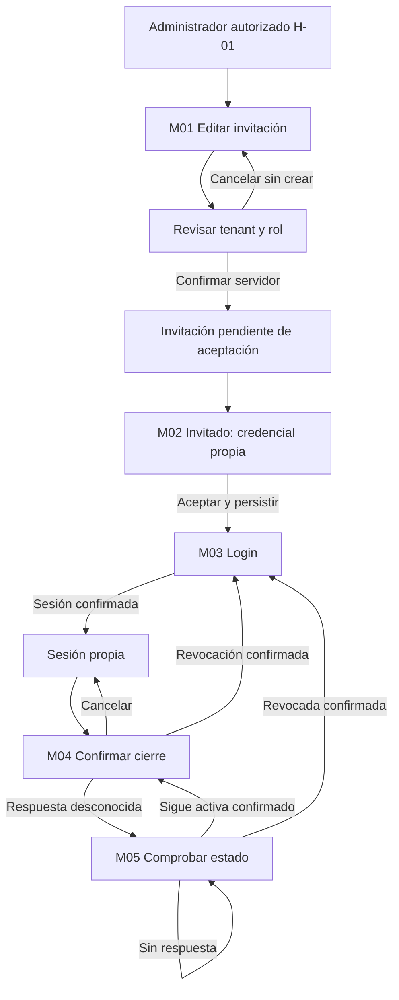
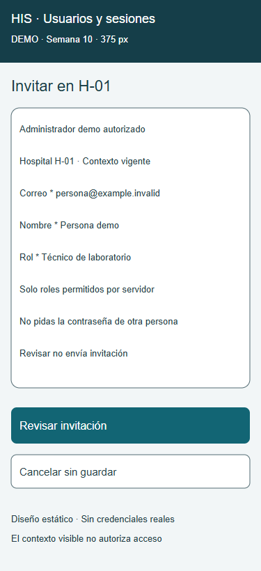
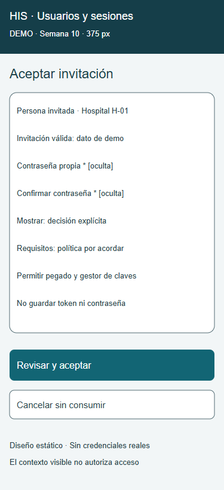
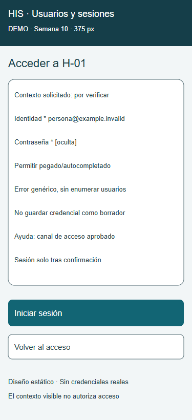
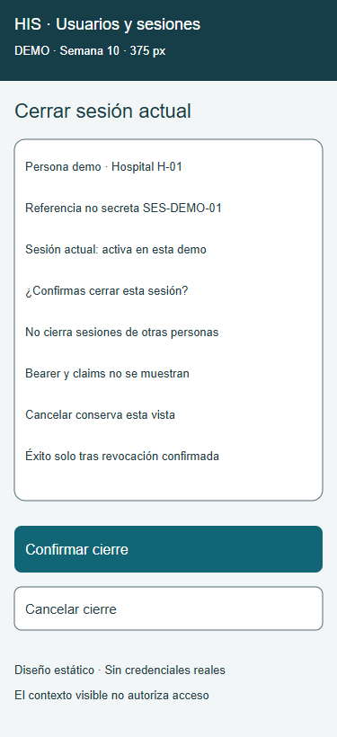
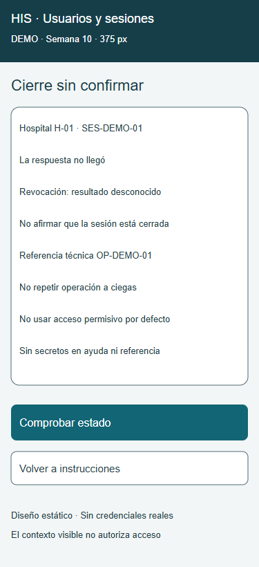

# Semana 10 — Movilidad de usuarios, tenants y autenticación

**Estudiante:** Mercedes Azucena Lopez Perez.

Propuesta responsive de cinco pantallas a 320, 375 y 430 px: 15 SVG estáticos y cinco capturas. Se continúa [UX de semana 8](../semana-08/README.md) y [evaluación de semana 9](../semana-09/README.md), base c5a14e6. Se priorizan contexto tenant, acción única, credencial propia y cierre honesto. No se implementa identidad, JWT, revocación o seguridad multitenant real.

## Pantallas

| Vista | Contenido y rol | Variante 375 |
|---|---|---|
| M01 Invitación | Administrador autorizado H-01, datos y rol legible, revisión antes de crear | [SVG](pantallas/01-invitacion-375.svg) |
| M02 Credencial | Invitado crea su propia contraseña, ayuda y cancelación sin consumir | [SVG](pantallas/02-credencial-375.svg) |
| M03 Login | Identidad, credencial y contexto solicitado, sin enumerar usuarios | [SVG](pantallas/03-login-375.svg) |
| M04 Cierre | Usuario confirma revocación de su sesión actual, cancelar sin efecto | [SVG](pantallas/04-sesion-375.svg) |
| M05 Recuperación | Respuesta de cierre desconocida, comprobación antes de decidir | [SVG](pantallas/05-recuperacion-375.svg) |

Cambiar sufijo -375 por -320 o -430 para las variantes. Los corchetes representan campos dibujados, no inputs operativos. Las anotaciones de flujo no deben aparecer como estados simultáneos en aplicación final. Descripciones técnicas extensas quedan en documentación.

## Reglas de breakpoint

| Ancho CSS | Composición propuesta |
|---|---|
| 320–359 | Columna única, margen 16 px, tarjetas de 288 px a 320. Etiquetas sobre campos, botones apilados. |
| 360–430 | Mantener orden y contenido, tarjeta crece hasta 398 px; no esconder contexto ni errores. |
| 431–767 | Columna centrada max-width 430, texto con ajuste natural; más margen exterior. |
| ≥768 | Posible lista/detalle de usuarios con mismo contrato y permisos; desktop no evaluado en esta entrega. |

Por debajo de 320 se mantiene scroll vertical y fuente legible; fuera de rango comprobado. SVG ilustra geometría, no CSS responsive ejecutado. Metadatos dibujados a 13 px para revisar contenido corto de demo; implementación debe usar contenido de al menos 16 px/rem y ajuste de línea, no reducir fuente para datos largos. Validar luego 200 % zoom, teclado virtual y safe-area del dispositivo.

Primario 52 px, secundario 48 px y separación 16 px. Acciones en flujo vertical, sin pie fijo que tape campos. Orden propuesto contexto → campos → ayuda/error → acción → cancelar. Foco visible, etiquetas programáticas y regiones de estado se implementarán en prototipo navegable; no se prueban con SVG.

## Formularios, tablas y carga cognitiva

Lista de usuarios se presenta como tarjetas con nombre mínimo, rol legible, estado de invitación/membresía y hospital; no tabla horizontal. No exponer correo completo si no se requiere para la tarea. “Técnico de laboratorio” reemplaza TECH como etiqueta, preservando código interno en contrato.

M01 tiene fase edición y revisión: el resumen de tenant, correo y rol precede a confirmación de envío. Al editar no se muestra botón final como si ya estuviera confirmado; cancelar no crea invitación. 202 significa invitación aceptada/encolada, no correo entregado ni usuario activo. Formulario vacío, cargando, pendiente y error son variantes separadas, no se muestran a la vez.

M02 ayuda según política institucional aprobada; “por acordar” declara límite de este diseño, no texto final suficiente de producción. Permitir pegado/gestor, autocomplete new-password; mostrar contraseña solo por acción explícita con estado anunciado. M03 usa autocomplete username/current-password, error genérico y ayuda por canal seguro. No guardar contraseñas, bearer, enlaces secretos o claims en borradores/capturas/logs.

Errores de campo: mensaje específico asociado y resumen con foco al primer error; conservar solo datos no sensibles del mismo contexto. Error de credencial no distingue usuario inexistente, inactivo o membresía ajena; indisponibilidad del servicio tiene texto distinto sin conceder acceso. Al enviar bloquear doble toque y anunciar carga; el bloqueo cliente no sustituye controles de servidor.

## Navegación por rol y estados

No hay cambio de tenant como filtro libre. Servidor debe verificar identidad/membresía/rol y tenant por operación, incluso tras reconexión; UI limpia datos de contexto anterior. Referencias SES-DEMO-01/OP-DEMO-01 son no secretas, nunca JWT. Firma, vigencia, revocación y ámbito del token deben validarse en servidor cuando se implemente JWT; la vista no sustituye esa comprobación.

## Escenario móvil 1 — Alta y acceso con decisión de contenido

Administrador H-01 en 320 px completa M01, revisa “Técnico de laboratorio” y hospital antes de confirmar. Si correo es inválido, error al campo sin perder nombre/rol; si rol no permitido, servidor deniega sin listar roles/hospitales ajenos. Después de invitación pendiente, persona invitada usa M02 para establecer credencial propia; administrador no conoce contraseña.

Si la conexión cae durante aceptación, no afirmar alta exitosa ni consumir invitación desde UI. La acción no se reenvía a ciegas si resultado es desconocido; comprobar vigencia/resultado por servicio autorizado o canal de recuperación. Si se confirma expirada/usada, mostrar solicitud de nueva invitación por canal aprobado. No crear cola offline de credenciales.

Tras aceptación confirmada, M03 requiere respuesta de autenticación antes de entrar. Criterios de implementación: un envío activo, contexto/rol legibles a 320 px, cancelación sin escritura, sin secreto persistido localmente y error genérico sin enumeración. Son decisiones propuestas, no pruebas API ejecutadas aquí.

## Escenario móvil 2 — Revocación con conexión limitada

Usuario en 430 px revisa M04 y confirma cierre de su sesión actual. Si la respuesta no llega, M05 indica resultado desconocido, no “sesión cerrada”. Acción principal concreta: “Comprobar estado”; no combina comprobar/reintentar en una etiqueta ambigua.

Comprobación autorizada confirma revocación → limpiar estado local y volver a login. Confirma activa → permitir reintento explícito de cierre respetando contrato/espera del servicio. Sigue sin responder → conservar explicación y restringir acciones sensibles sin usar autorización cacheada como fallback. Una limpieza local por sí sola no demuestra revocación del servidor.

No almacenar bearer en pantalla de recuperación ni en una cola de sincronización. No cambiar hospital para recuperar acceso. Criterios de implementación: nunca éxito falso, permiso revalidado tras red, solo sesión propia, referencia no secreta y sin reenviar operaciones de resultado desconocido automáticamente.

## Relación con hallazgos de semana 9

H02: variantes móviles/columna única propuestas; H05: carga/error separados; H06: pegado/gestor/política explícita pendiente; H07: acción “Comprobar estado” ante revocación desconocida; H08: rol legible. No se cierran automáticamente hallazgos de teclado/foco/lector H01/H03 por dibujar variantes. El prototipo funcional deberá verificarlos.

## Evidencia y límites

[mediciones.json](evidencia/mediciones.json): 15 variantes sin texto fuera del lienzo. Cinco capturas a 375 px de fuentes SVG. Reproducción en [evidencia/README.md](evidencia/README.md). No demuestra CSS responsive, toque, lector, autorización, JWT, correo entregado o revocación real.

