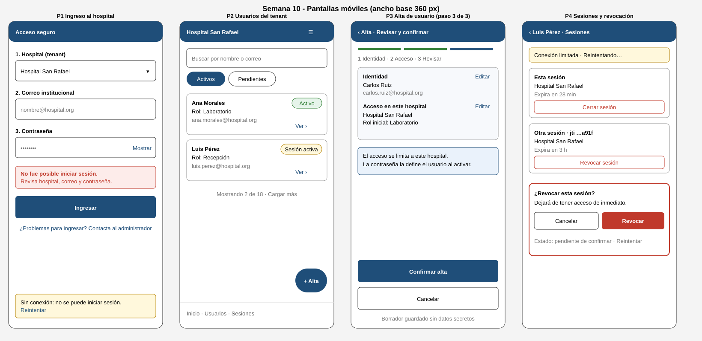

# Semana 10 — Diseño para movilidad: usuarios, tenants y autenticación

| | |
|---|---|
| **Curso** | Análisis de Sistemas II — Proyecto Final 2026 |
| **Módulo** | Gestión de usuarios, tenants y endurecimiento de autenticación |
| **Flujo** | «Alta de usuario por tenant, autenticación segura y revocación de sesión» |
| **Alcance** | Adaptación a móvil de 320 a 430 px |
| **Estudiante** | Mercedes Azucena López Pérez |

## 1. Objetivo y alcance

Se adapta a móvil el flujo de las semanas 1 y 2: alta de una identidad con membresía en un tenant, ingreso contextualizado a ese tenant y revocación de sesión. La propuesta organiza la información, reduce la carga cognitiva, define la navegación, las tablas y formularios, las confirmaciones y la recuperación ante conexión limitada.

Es un diseño de interfaz: **no hay código, ni pruebas con usuarios reales, ni implementación de JWT o de la lista de revocación**. Los datos de los wireframes son ficticios. Rango de diseño: 320 a 430 px; el ancho base de los wireframes es 360 px.

## 2. Jerarquía de datos y acciones

| Concepto | Dato visible primero | Acción principal | Se muestra solo bajo demanda |
|---|---|---|---|
| Tenant (hospital) | Nombre del hospital activo, siempre en la cabecera | Seleccionar al ingresar | Estado del tenant |
| Usuario | Nombre, rol, estado | Ver detalle · Alta | Correo completo, historial |
| Credenciales | Solo el campo contraseña con «Mostrar» | Ingresar | Ayuda de recuperación (la gestiona el administrador) |
| Sesión JWT | Estado (esta sesión u otra) y tiempo restante | Cerrar o revocar | Fragmento corto del `jti` (los últimos 4 caracteres) |
| Revocación | Confirmación y estado (pendiente / confirmada) | Revocar | Detalle técnico |
| Aislamiento multitenant | Hospital activo en toda pantalla | — | Explicación breve en el paso 3 del alta |

Reglas: el contexto de tenant se ve siempre; la acción destructiva se separa visualmente (rojo, nunca como acción por defecto); el token completo y la contraseña nunca se muestran ni se guardan en el dispositivo más allá de lo necesario para operar.

## 3. Pantallas

| # | Pantalla | Propósito | Decisiones clave |
|---|---|---|---|
| P1 | Ingreso al hospital | Elegir tenant e iniciar sesión | Orden hospital → correo → contraseña; error genérico; aviso y reintento sin conexión |
| P2 | Usuarios del tenant | Consultar y filtrar usuarios | Tabla convertida en tarjetas; búsqueda y filtros por estado; paginación «Cargar más»; botón «+ Alta» |
| P3 | Alta de usuario (paso 3 de 3) | Revisar y confirmar | Asistente de 3 pasos; resumen editable; nota de aislamiento al tenant; borrador sin secretos |
| P4 | Sesiones y revocación | Cerrar la propia sesión o revocar otra | Tarjetas por sesión; diálogo de confirmación; estado pendiente y reintento |

### Navegación

Barra inferior de tres destinos (Inicio · Usuarios · Sesiones) con alcance del pulgar. El alta es un flujo lineal con «‹ Atrás» y salida explícita («Cancelar»). Ninguna pantalla pide más de una decisión principal. El cambio de hospital cierra el contexto actual y vuelve a P1.

### Tablas y formularios

- **Tablas:** por debajo de 600 px cada fila pasa a una tarjeta de 3 líneas (nombre, rol, correo) con estado como etiqueta de texto, no solo de color. Una columna adicional, si hiciera falta, pasa al detalle.
- **Formularios:** una columna, etiqueta sobre el campo, campos de al menos 48 px de alto, teclado apropiado (`email`), y el error junto al campo. El alta se divide en 3 pasos para limitar a 2 o 3 campos por pantalla.
- **Contraseña:** el alta **no** pide contraseña (decisión de Semana 2: el flujo de alta no recibe secretos); el usuario la define al activar su cuenta.

## 4. Reglas de breakpoint

| Rango | Nombre | Regla |
|---|---|---|
| 320–359 px | Compacto | Márgenes de 12 px; botones a ancho completo; filtros como lista desplazable en horizontal; etiquetas de la barra inferior en una línea o solo icono con texto accesible |
| 360–429 px | Base | Márgenes de 16 px; diseño de los wireframes; tarjetas a ancho completo |
| 430 px | Máximo móvil | Se mantiene la columna única con ancho máximo de 430 px centrado, sin añadir columnas |
| 600 px o más | Fuera de este alcance | Se vuelve a una tabla completa y navegación lateral; se diseñará en otra entrega |

Reglas comunes: objetivos táctiles de al menos 44×44 px y separación de 8 px; texto base de 16 px (evita el zoom automático en formularios); sin desplazamiento horizontal de la página; el botón principal queda al alcance del pulgar en la parte inferior; el contraste de texto cumple al menos 4.5:1; el significado no depende solo del color.

## 5. Escenarios móviles

### Escenario A — Camino feliz con conexión limitada: alta de un usuario nuevo (P2 → P3)

| Paso | Qué ve y hace la administradora | Decisión de contenido |
|---|---|---|
| 1 | En P2 toca «+ Alta» | El tenant activo sigue en la cabecera |
| 2 | Completa identidad (nombre, correo) y acceso (rol) en dos pasos | Solo 2–3 campos por pantalla; validación inmediata de formato |
| 3 | En P3 revisa el resumen y toca «Confirmar alta» | La nota aclara que el acceso se limita a este hospital |
| 4 | La red tarda: el botón queda en «Enviando…» y no admite un segundo toque | Se envía con una clave de operación para que el reintento no duplique la membresía |
| 5 | Se confirma: aparece «Alta registrada» y el usuario en la lista de pendientes | No se anuncia éxito hasta recibir la confirmación del servidor |

### Escenario B — Error crítico: revocar una sesión sin conexión estable (P4)

| Paso | Qué ve y hace | Decisión de error |
|---|---|---|
| 1 | En P4 elige «Revocar sesión» de otra sesión | Diálogo de confirmación con el efecto: «Dejará de tener acceso de inmediato» |
| 2 | Confirma «Revocar»; la conexión falla | Estado «Pendiente de confirmar»; **no** se muestra como revocada |
| 3 | Aparece la franja «Conexión limitada · Reintentando…» y el botón «Reintentar» | La operación es repetible sin efectos duplicados |
| 4 | Si no se recupera, el mensaje indica que la sesión sigue activa hasta confirmar y sugiere avisar al administrador | Honestidad: nunca se declara un cierre que el servidor no confirmó |
| 5 | Al volver la red, se confirma y la tarjeta pasa a «Revocada» | La acción es idempotente |

### Otros errores de ingreso (P1)

El mensaje es genérico («No fue posible iniciar sesión») para no revelar si el correo existe ni si falló el hospital (RF-06, RNF-03). Sin conexión se informa que no se puede iniciar y se ofrece «Reintentar»; no hay inicio de sesión sin servidor.

## 6. Recuperación ante conexión limitada

| Operación | Sin conexión | Reintento seguro |
|---|---|---|
| Ingreso | Aviso claro; no se inicia sesión | Manual |
| Alta | Borrador local sin secretos; no se confirma | Clave de operación para evitar membresías duplicadas |
| Revocación | Estado pendiente visible | Repetible; el resultado no cambia al repetir |
| Consulta de usuarios | Se conserva lo último cargado, marcado como «no actualizado» | Al reconectar |

## 7. Trazabilidad

| Origen | Decisión móvil |
|---|---|
| RF-03, RF-04 (alta autorizada y atómica) | Asistente de 3 pasos y confirmación explícita |
| RF-05, RF-06, RNF-03 | P1 con hospital explícito y error genérico |
| RF-07, RF-09, RNF-05 (aislamiento por tenant) | Tenant visible en toda pantalla; sesión limitada a un hospital |
| RF-08, RF-10, RNF-06 (revocación confiable) | Estado pendiente y confirmación solo del servidor |

## 8. Criterios de revisión

1. Con 320 px no hay desplazamiento horizontal en P1–P4.
2. Todo control táctil mide al menos 44×44 px.
3. Cada pantalla tiene una acción principal clara.
4. Los mensajes de error de ingreso son iguales para correo inexistente y contraseña incorrecta.
5. Una revocación no confirmada nunca aparece como revocada.
6. Un reintento de alta no crea una segunda membresía.

## 9. Limitaciones

- Son wireframes estáticos dibujados a mano en SVG; no se probaron con usuarios ni se midió contraste o desempeño reales.
- Los criterios de la sección 8 son una lista de verificación para la futura implementación, no resultados.
- No se definen recuperación de contraseña, MFA ni correo de invitación; siguen fuera del alcance heredado de las semanas 1 y 2.
- La clave de operación es una decisión de diseño; requiere un contrato de API que aún no existe.
- Los textos y los nombres de hospital, usuarios y roles son ficticios.

## 10. Conclusión

Mostrar siempre el tenant, limitar cada pantalla a una decisión, confirmar las acciones destructivas y no afirmar nada que el servidor no haya confirmado permite que el flujo sea usable en pantallas de 320 a 430 px y consistente con las reglas de seguridad de las semanas anteriores.
