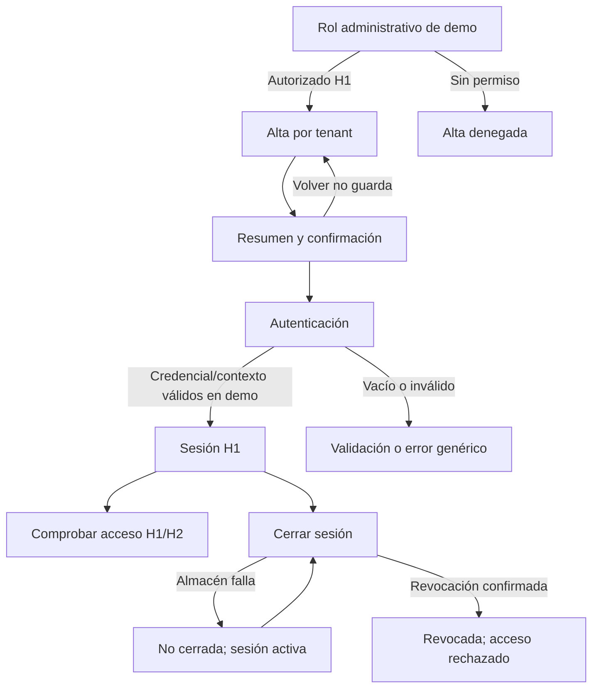

# Semana 11 — Prototipo navegable de usuarios y tenants

**Estudiante:** Lopez Perez, Mercedes Azucena.

[Abre el prototipo local](prototipo/index.html) en Edge o Chrome. No necesita servidor ni instalación. Es una demo autocontenida con datos ficticios y estado en memoria, que se borra al recargar o reiniciar. No introduzcas contraseñas reales.

## Alcance y procedencia

Alta por tenant, autenticación, sesión contextual y revocación. Base b32f57b de semana 7; la entrega debe integrarse después de esa base. Se reutiliza el prototipo web ya desarrollado en semana 12, commit 961fc5a, como archivos independientes adaptados a semana 11. No depende de abrir la carpeta de semana 12 ni incluye su presentación o cambio práctico.

El rol administrativo, el tenant y el almacén son escenarios simulados. No existe API, autorización real, JWT firmado ni persistencia entre procesos. El objeto de sesión muestra sujeto/tenant/jti/expiración como contexto, sin presentarlo como validación criptográfica. La demo no corrige defectos del backend anterior.

## Camino feliz

1. Administrador H1 → alta de DEMO-U, persona ficticia, rol TECH en H1.
2. Revisar alta muestra resumen; volver no guarda. Confirmar crea identidad/membresía de demo e invita a autenticar.
3. Login H1 con clave ficticia indicada, DEMO-ONLY. El campo no debe recibir un secreto real y se limpia tras intento.
4. Sesión activa H1 con expiración limitada. Comprobar H1 permite acceso en la simulación; H2 lo deniega.
5. Cerrar sin falla confirma revocación; comprobar después rechaza acceso.

## Error crítico

Desde sesión activa, activar “Simular falla del almacén de revocación” y cerrar. Mensaje: “No se confirmó la revocación”; el estado permanece activo y no se anuncia logout exitoso. Comprobar acceso H1 aún permite, reflejando que no hubo revocación efectiva. Desactivar falla y repetir: ahora se confirma revocación y se rechaza acceso posterior.

Otros escenarios: rol sin permiso bloquea alta; administrador H1 no administra H2; clave vacía genera validación; clave incorrecta o tenant sin membresía genera el mismo error de autenticación. No se filtran detalles de existencia de usuario en el mensaje de login.

## Mapa de navegación


La navegación lateral permite revisar cada paso. Alta denegada no equivale a denegación de todas las pantallas: el rol administrativo y la sesión de usuario son responsabilidades separadas de la simulación.

## Desktop, móvil y accesibilidad

Desde 768 px: navegación lateral. Hasta 767 px: una columna, acciones accesibles y controles ≥46 px. Etiquetas persistentes, foco visible, enlace de salto al contenido, foco al navegar y mensajes de error/estado textuales. El campo de clave es password y no se registra en evidencia. Carga bloquea envío repetido y limpia mensajes anteriores para no confundir resultados.

Datos de hospital/sesión visibles y diferenciación textual entre activa, no cerrada y revocada. Se comprueban escritorio 1366 y móvil 375/320/430 px. No se afirma auditoría WCAG, prueba con lector de pantalla ni dispositivo físico. Los permisos de backend y sesión segura no se validan por ocultar botones en UI.

## Capturas y verificación

| Escenario | Escritorio | Móvil |
|---|---|---|
| Camino feliz: sesión activa | [Captura](evidencia/desktop-sesion.png) | [Captura](evidencia/movil-sesion.png) |
| Error crítico: fallo de revocación | [Captura](evidencia/desktop-fallo-revocacion.png) | [Captura](evidencia/movil-fallo-revocacion.png) |
| Recuperación: revocación confirmada | [Captura](evidencia/desktop-revocada.png) | [Captura](evidencia/movil-revocada.png) |

Las seis capturas se regeneran ejecutando esta copia de semana 11, no se presentan imágenes de semana 12 como si se hubieran capturado aquí. [Resultados](evidencia/verificacion.txt).

Repetir con Node.js, Playwright y Edge:
```powershell
$qa = Join-Path $env:TEMP 'shi-browser-qa'
npm install --prefix $qa playwright --no-audit --no-fund
$env:PLAYWRIGHT_MODULE = Join-Path $qa 'node_modules/playwright'
node docs/modulos/gestion-usuarios-tenants-autenticacion/semana-11/verificacion/run.cjs
```
BROWSER_PATH permite otro Chromium. La clave en JavaScript es pública y ficticia: solo representa un resultado de verificador, jamás autenticación productiva. JWT firmado, tenant servidor, hash real y revocación duradera quedan pendientes de integración.