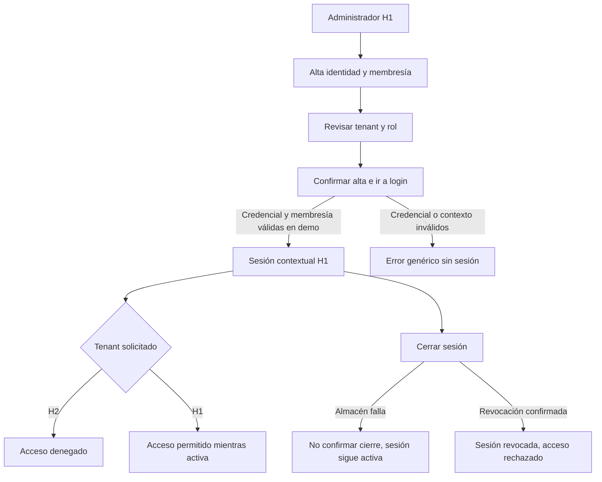

# Semana 12 — Segunda evaluación parcial: usuarios, tenants y autenticación

**Estudiante:** Lopez Perez, Mercedes Azucena

Abrir [prototipo/index.html](prototipo/index.html) en Edge o Chrome. Demo navegable local sin servidor ni persistencia. Base: b32f57b de semana 7; [componentes](../semana-07/semana-07-componentes-refactorizacion.md). Integrar esa rama antes de esta entrega.

## Recorrido de defensa

1. Administrador H1 → alta de identidad ficticia DEMO-U y membresía TECH. Elegir H2 rechaza administración ajena; H1 permite revisar y confirmar. Alta sin contraseña y sin conceder membresía H2.
2. Autenticar DEMO-U en H1 con la clave ficticia indicada en pantalla (no usar contraseñas reales). Vacío devuelve validación; incorrecta o H2 devuelven error genérico. El campo se limpia tras intento.
3. Sesión muestra sujeto, tenant, identificador y expiración +15 minutos. Comprobar H2 rechaza contexto cruzado; H1 permite en demo.
4. Activar falla del almacén y cerrar: no se confirma revocación ni se anuncia sesión cerrada. Desactivar falla y cerrar: sesión revocada; nueva comprobación rechaza acceso.
5. Cambiar rol administrativo a Sin permiso de alta: acción bloqueada. Roles/tenant son escenarios visuales, no autorización real.

## Mapa


## Matriz decisión → RF/RNF → evidencia

Identificadores de [semana 2](../semana-02/semana-02-srp-usuarios-tenants.md).

| Decisión | RF/RNF / criterio | Evidencia |
|---|---|---|
| Separar identidad global y membresía por tenant | RF-01/02/04 | Alta H1 y rechazo de login H2 |
| Permiso administrativo y rol inicial acotados | RF-03 | Rol sin permiso bloqueado; administrador H1 no administra H2 |
| Confirmación antes de alta | RF-04, criterio UX | Resumen identidad/tenant/rol; volver no guarda |
| Login con error genérico y sin secreto visible | RF-05/06, RNF-02/03 | Casos incorrecto/contexto ajeno; campo password se limpia |
| Sesión contextual y limitada | RF-07/09 | Sujeto/H1/jti demo y expiración; no token JWT firmado |
| Aislamiento al comprobar acceso | RNF-05, RF-09 | Tenant H2 rechazado para sesión H1 |
| Logout solo confirmado tras resultado de almacén | RF-08/10, RNF-06 | CH-01 y capturas de fallo/revocada |
| Componentes separados en diseño objetivo | RNF-01/07 | Presentación y base de semana 7; demo representa contratos |
| Móvil columna, foco y etiquetas persistentes | Criterio UX/accesibilidad/movilidad | CSS responsive, salto, foco al navegar y mensajes textuales |
| Alcance honesto de JWT y revocación | RNF-08 | Avisos visibles, presentación y límites; firma/persistencia no demostradas |

## Componentes, UX y movilidad

Diseño objetivo: formularios/vistas presentan estados; casos de uso separan alta/login/revocación/control de sesión; dominio conserva membresía/tiempos/contexto; adaptadores aíslan credenciales, emisor y almacenes. La demo JS compacta representa interacción, no sustituye el backend ni implementa JWT seguro en navegador.

Desktop desde 768 px usa navegación lateral; móvil una columna y controles grandes (≥46 px). Etiquetas persistentes, campo de clave ficticia protegido visualmente, foco visible, enlace de salto y foco al contenido al navegar. Errores textuales y avisos de estado no dependen solo del color. Vacío de sesión es distinto de fallo de autenticación; carga deshabilita reenvíos. No se afirma auditoría WCAG ni prueba de lector de pantalla.

La confirmación de alta identifica tenant/rol antes de aplicar. La clave conocida en JavaScript es solo un escenario ficticio: nunca se debe usar comparación cliente para autenticar realmente ni introducir contraseñas reales aquí. La identidad/hospital deben proceder de un servidor confiable en integración, no del selector de demo.

## Cambio, evidencia y resultados

[CH-01](cambio-solicitado.md) es una solicitud simulada para la defensa, no atribuida al docente/usuario: no anunciar sesión cerrada si el almacén de revocación falla.

| Estado | Desktop | Móvil |
|---|---|---|
| Sesión activa contextual | [Captura](evidencia/desktop-sesion.png) | [Captura](evidencia/movil-sesion.png) |
| Falla sin cierre falso | [Captura](evidencia/desktop-fallo-revocacion.png) | [Captura](evidencia/movil-fallo-revocacion.png) |
| Revocada y acceso rechazado | [Captura](evidencia/desktop-revocada.png) | [Captura](evidencia/movil-revocada.png) |

[Verificación](evidencia/verificacion.txt): Edge headless/Playwright a 1366, 375, 320 y 430 px. Roles, tenant, login, fallo de cierre y acceso tras revocación recorridos; sin errores JS. Las capturas son de esta demo ejecutada, no de un servidor autenticado real.

Repetir con Node, Playwright y Edge:
```powershell
$qa = Join-Path $env:TEMP 'shi-browser-qa'
npm install --prefix $qa playwright --no-audit --no-fund
$env:PLAYWRIGHT_MODULE = Join-Path $qa 'node_modules/playwright'
node docs/modulos/gestion-usuarios-tenants-autenticacion/semana-12/verificacion/run.cjs
```
BROWSER_PATH permite otro Chromium. Abrir HTML no requiere estas herramientas.

## Límites de la defensa

Todo se borra al recargar; no hay credenciales reales, hash servidor, JWT firmado, cookies de sesión, tenant en servidor ni revocación persistente entre procesos. La expiración se muestra y se comprueba en JS; no representa validación criptográfica del claim exp. No se exponen tokens reales. La demo no corrige AU-D01/AU-D02 del PHP ni cierra G-JWT. Defiende UX y decisiones del contrato; integración y seguridad productiva siguen pendientes.