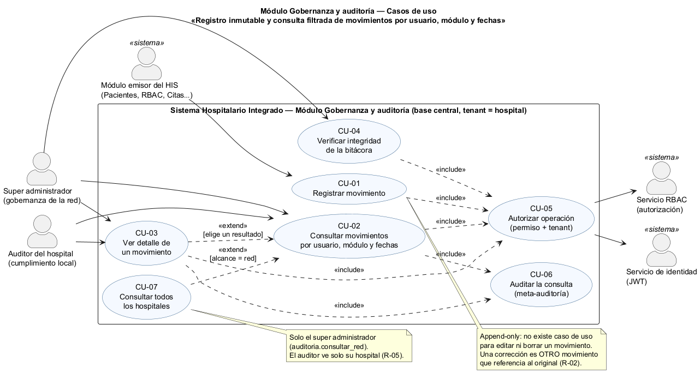
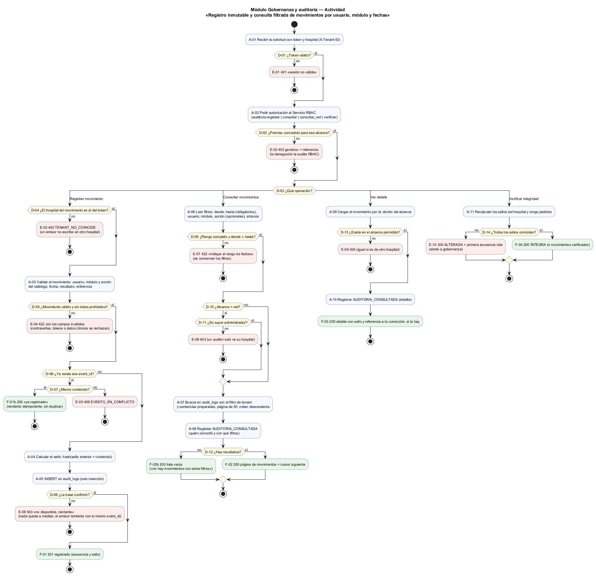
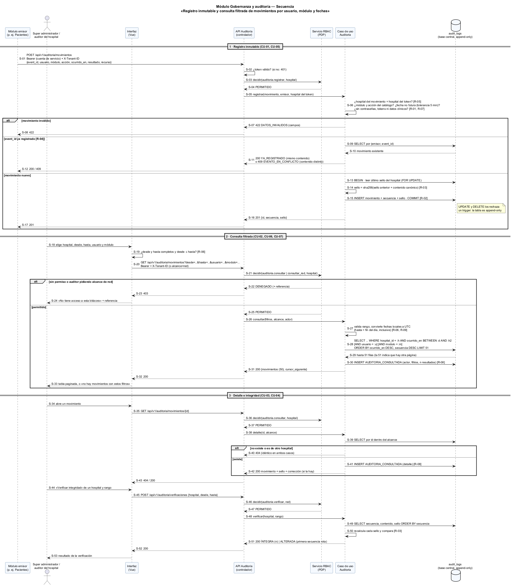

# Semana 1 — Modelado UML del proceso de Gobernanza y auditoría

| | |
|---|---|
| **Curso** | Análisis de Sistemas II — Proyecto Final 2026 |
| **Proyecto** | Sistema Hospitalario Integrado (HIS) |
| **Módulo** | Gobernanza y auditoría de movimientos del sistema |
| **Tema de la semana** | Conceptos generales, orientación a objetos y UML |
| **Proceso modelado** | «Registro inmutable y consulta filtrada de movimientos por usuario, módulo y fechas» |
| **Estudiante** | Boris Alexander Quiroa Orellana |
| **Fecha** | Octubre 2026 |

## Índice

1. [Introducción](#1-introducción)
2. [Narrativa de alcance](#2-narrativa-de-alcance)
3. [Actores](#3-actores)
4. [Reglas de negocio](#4-reglas-de-negocio)
5. [Diagrama de casos de uso](#5-diagrama-de-casos-de-uso)
6. [Especificación de casos de uso](#6-especificación-de-casos-de-uso)
7. [Diagrama de actividad](#7-diagrama-de-actividad)
8. [Diagrama de secuencia](#8-diagrama-de-secuencia)
9. [Matriz de trazabilidad](#9-matriz-de-trazabilidad)
10. [Conclusión](#10-conclusión)
11. [Bibliografía](#11-bibliografía)

## 1. Introducción

En un HIS, la pregunta «¿quién hizo qué, dónde y cuándo?» tiene consecuencias legales y clínicas. Por ejemplo:
- quién abrió la ficha de una paciente protegida;
- quién cambió un rol;
- quién anuló una prescripción.

Si la bitácora se puede editar, borrar o consultar sin control, deja de ser evidencia.

Este módulo da al **super administrador** de la red, y al auditor de cada hospital, una bitácora de movimientos con dos propiedades:

1. **Inmutable.** Un movimiento registrado no se modifica ni se borra; una alteración en la base se **detecta**.
2. **Consultable con filtros obligatorios.** Se filtra por usuario, módulo y un rango libre de fechas (`desde` / `hasta`), sin salirse del hospital que corresponde.

El modelo tiene tres vistas:

| Vista | Qué muestra |
|---|---|
| Casos de uso | Quién interactúa con el módulo y con qué objetivo |
| Actividad | El flujo con sus decisiones, excepciones y resultados |
| Secuencia | Los mensajes entre participantes, las validaciones y las respuestas |

Las tres comparten identificadores para poder **trazarse** entre sí (§9):

| Prefijo | Qué identifica |
|---|---|
| CU | Caso de uso |
| A | Actividad |
| D | Decisión |
| E | Excepción |
| F | Resultado final |
| R | Regla de negocio |
| S | Mensaje de la secuencia |

**Punto de partida en el esquema real del proyecto:**
- No existe una tabla `audit_logs`.
- La base central ya usa el patrón «solo inserción» en `cross_hospital_access_audits`, con un trigger que rechaza `UPDATE` y `DELETE` (`database/migrations/central/2026_08_11_000300_…`). Esa tabla es del módulo de consentimiento y acceso entre hospitales: este módulo **no la toca**, pero adopta el mismo patrón.
- Los usuarios (`central_users.user_id`) y los hospitales (`hospitals.hospital_id`) viven en la base central. Por eso `audit_logs` se ubica allí, con `hospital_id` como tenant.

## 2. Narrativa de alcance

### 2.1 Objetivo del proceso

1. Que cada módulo del HIS **registre** sus movimientos relevantes en una bitácora común, sin poder alterarlos después.
2. Que el super administrador y los auditores **encuentren** rápido los movimientos de un usuario o de un módulo en un rango de fechas, solo dentro de su alcance.
3. Que se pueda **demostrar** que la bitácora no fue alterada.

### 2.2 Dentro del alcance

| Tema | Incluido |
|---|---|
| Registro | Un movimiento lleva: `event_id` del emisor, hospital (tenant), usuario, módulo, acción, fecha y hora en que ocurrió, resultado (`exito`, `denegado`, `error`), recurso afectado (tipo e id) y `correlation_id`. |
| Inmutabilidad | Tabla de solo inserción. No hay operación de edición ni de borrado. Una corrección es **otro** movimiento que referencia al original. |
| Integridad | Cada movimiento lleva un **sello** encadenado (hash del sello anterior + contenido), por hospital. La verificación recalcula la cadena. |
| Idempotencia | El mismo `event_id` reenviado no duplica. Si el contenido difiere, es un conflicto. |
| Consulta | Filtros: `desde` y `hasta` obligatorios; usuario, módulo y acción opcionales. Orden descendente, páginas de 50 con cursor. |
| Tenant | El auditor ve solo su hospital. El super administrador elige un hospital o, con un permiso explícito, la red completa. |
| Meta-auditoría | Toda consulta y todo detalle dejan un movimiento `AUDITORIA_CONSULTADA`. |
| Seguridad | Permisos `auditoria.registrar` (cuentas de servicio de los módulos), `auditoria.consultar`, `auditoria.consultar_red` y `auditoria.verificar`. La decisión la toma RBAC. |

### 2.3 Fuera del alcance

| Excluido | Por qué |
|---|---|
| Qué movimientos registra cada módulo | Lo decide cada módulo emisor; este módulo define **cómo** se registran |
| Exportar a PDF o CSV | Lo cubre «Reportes operativos exportables» (Lis Rosales) |
| Indicadores y gráficos de actividad | Lo cubre «Reportes y analytics básicos» (Erick Ramazzini) |
| `cross_hospital_access_audits` | Es del módulo de consentimiento y acceso entre hospitales |
| Registro de acceso HTTP técnico (logs de servidor) | Es observabilidad, no evidencia de negocio. Va en otro canal. |
| Purga o archivado por retención legal | Requiere una política legal todavía no definida. Se anota como riesgo. |
| Autenticación | Módulo de autenticación (JWT) |

### 2.4 Supuestos y restricciones

- **Tenant.** El hospital del movimiento debe ser el del token del emisor. Los movimientos de nivel red, como un cambio en el registro de hospitales, llevan `hospital_id = NULL` y solo los ve el super administrador.
- **Hora.** Se guarda en UTC. Los filtros se escriben en la hora local del hospital (America/Guatemala), y `hasta` incluye el día completo.
- **Minimización.** Un movimiento lleva referencias (ids) y un resumen. Nunca lleva contraseñas, tokens ni datos clínicos.
- **Volumen.** La bitácora crece siempre. Las consultas exigen rango de fechas y paginación, y usan índices por (hospital, fecha), (usuario, fecha) y (módulo, fecha).

## 3. Actores

| Actor | Tipo | Objetivo |
|---|---|---|
| **Módulo emisor del HIS** (Pacientes, RBAC, Citas…) | Principal (sistema) | Registrar sus movimientos con una cuenta de servicio |
| **Super administrador** | Principal | Gobernar la red: consultar cualquier hospital o la red completa y verificar la integridad |
| **Auditor del hospital** | Principal | Consultar la bitácora de **su** hospital por cumplimiento o por un incidente |
| **Servicio RBAC** | Secundario (sistema) | Decidir si el actor tiene el permiso para ese alcance |
| **Servicio de identidad (JWT)** | Secundario (sistema) | Validar el token e identificar al actor y su hospital |

## 4. Reglas de negocio

| ID | Regla | Origen |
|---|---|---|
| R-01 | Un movimiento debe estar **completo y válido**: hospital, usuario, módulo y acción del catálogo, `ocurrido_en` no futuro (tolerancia de 5 min), resultado del catálogo y `event_id` | Diseño (evidencia útil) |
| R-02 | **Inmutable**: solo inserción. No existe la edición ni el borrado; la base los rechaza con un trigger. Una corrección es otro movimiento con `corrige_a`. | Patrón de `cross_hospital_access_audits` |
| R-03 | **Sello encadenado** por hospital: `sello = sha256(sello_anterior ‖ contenido canónico)`. Cualquier alteración rompe la cadena a partir de ese punto. | Diseño (detección de alteraciones) |
| R-04 | **Idempotencia**: (emisor, `event_id`) es único. Un reenvío con el mismo contenido → 200 sin duplicar; con contenido distinto → 409. | Diseño (reintentos seguros) |
| R-05 | **Tenant**: el emisor solo escribe en el hospital de su token; el auditor solo lee su hospital; la red completa solo con `auditoria.consultar_red` | Diseño (aislamiento) |
| R-06 | **Filtros**: `desde` y `hasta` son obligatorios y `desde ≤ hasta`; usuario, módulo y acción son opcionales | README del proyecto (filtros obligatorios) |
| R-07 | **Minimización**: el movimiento no contiene contraseñas, tokens ni datos clínicos; los campos con esos nombres se rechazan | OWASP Logging Cheat Sheet |
| R-08 | **Meta-auditoría**: consultar la bitácora también deja un movimiento `AUDITORIA_CONSULTADA`, con el actor y los filtros | Diseño (quién vigila al vigilante) |
| R-09 | **Orden y paginación estables**: por `ocurrido_en` y secuencia, de forma descendente; páginas de 50 con cursor; fechas en UTC | Diseño (consulta sobre una tabla que crece) |
| R-10 | **Sin escrituras a medias**: si la base falla, no queda nada registrado y el emisor reintenta con el mismo `event_id` | Diseño (confiabilidad) |

## 5. Diagrama de casos de uso

Fuente: [semana-01-casos-de-uso.puml](diagramas/semana-01-casos-de-uso.puml)

| Relación | Justificación |
|---|---|
| CU-01..CU-04 **incluyen** CU-05 | Toda operación pasa por la autorización con su alcance (R-05) |
| CU-02 y CU-03 **incluyen** CU-06 | Consultar la bitácora deja evidencia (R-08) |
| CU-03 **extiende** CU-02 | Desde los resultados se abre el detalle |
| CU-07 **extiende** CU-02 | Solo cuando el alcance es la red; solo para el super administrador |
| **No hay** «editar» ni «eliminar» movimiento | Es la regla R-02 hecha visible: el diagrama no ofrece esos objetivos a ningún actor |

## 6. Especificación de casos de uso

### CU-01 Registrar movimiento

| | |
|---|---|
| **Actor** | Módulo emisor (cuenta de servicio) |
| **Precondición** | Token válido; permiso `auditoria.registrar` en su hospital |
| **Flujo principal** | 1. Envía el movimiento. 2. El sistema comprueba que el hospital es el del token (R-05). 3. Lo valida (R-01, R-07). 4. Comprueba el `event_id` (R-04). 5. Calcula el sello (R-03). 6. Lo inserta (R-02). 7. Responde con la secuencia y el sello. |
| **Excepciones** | 401 token · 403 sin permiso u otro hospital · 422 inválido o con datos prohibidos · 409 `event_id` con otro contenido · 503 base no disponible, sin nada guardado (R-10) |
| **Resultado alternativo** | 200 `YA_REGISTRADO` si es un reintento idéntico |
| **Postcondición** | Un movimiento más en la cadena del hospital, imposible de modificar |

### CU-02 Consultar movimientos por usuario, módulo y fechas

| | |
|---|---|
| **Actor** | Super administrador o auditor del hospital |
| **Precondición** | Permiso `auditoria.consultar` (o `consultar_red` para la red) |
| **Flujo principal** | 1. Indica el rango (obligatorio) y, si quiere, usuario, módulo y acción. 2. El sistema valida (R-06) y convierte las fechas a UTC. 3. Busca dentro del alcance (R-05). 4. Registra `AUDITORIA_CONSULTADA` (R-08). 5. Muestra 50 resultados por página (R-09). |
| **Excepciones** | 422 rango incompleto o invertido · 403 alcance no permitido |
| **Resultado alternativo** | 200 con lista vacía y el mensaje «no hay movimientos con estos filtros» |

### CU-03 Ver detalle de un movimiento

Carga el movimiento dentro del alcance. Muestra todos sus campos, el sello y, si lo hay, el movimiento que lo corrige. Si no existe o es de otro hospital, responde el mismo 404. También se audita (R-08).

### CU-04 Verificar integridad de la bitácora

Solo el super administrador, con `auditoria.verificar`. Recalcula los sellos del hospital y del rango pedidos. Responde `ÍNTEGRA` con la cantidad verificada, o `ALTERADA` con la **primera** secuencia rota.

### CU-05 Autorizar operación (incluido)

Se delega al módulo RBAC, que actúa como punto de decisión de políticas (PDP): decide con el permiso y el alcance. Si deniega, responde un 403 genérico con referencia, y la denegación la registra RBAC.

### CU-06 Auditar la consulta (incluido)

Registra `AUDITORIA_CONSULTADA` con: actor, alcance, filtros usados (el usuario consultado va como id, no como nombre) y cantidad de resultados.

### CU-07 Consultar todos los hospitales (extiende CU-02)

Alcance «red». Exige `auditoria.consultar_red`, que solo tiene el super administrador. El auditor de un hospital recibe 403.

## 7. Diagrama de actividad

Fuente: [semana-01-actividad.puml](diagramas/semana-01-actividad.puml)

| Elemento pedido | Dónde está |
|---|---|
| **Decisiones** | D-01..D-14: token, permiso, operación, tenant del movimiento, validez, `event_id` repetido, mismo contenido, confirmación de la base, rango, alcance, super administrador, existencia, sellos |
| **Excepciones** | E-01..E-10, en rojo, cada una con su respuesta: 401, 403, 404, 409, 422 o 503, y `ALTERADA` |
| **Resultados** | F-01..F-04, en verde: 201 registrado (F-01b: 200 reintento), 200 página (F-02b: vacía), 200 detalle, 200 íntegra |

Tres decisiones de diseño se ven en el diagrama:

| Decisión | Dónde |
|---|---|
| El tenant del movimiento se verifica **antes** que su contenido | D-04 antes de D-05: un emisor de otro hospital no recibe pistas de validación |
| El reintento se resuelve **antes** de sellar | D-06 y D-07 antes de A-04: un reintento no alarga la cadena |
| La consulta se audita **aunque** no haya resultados | A-08 antes de D-12: buscar a alguien ya es un dato |

## 8. Diagrama de secuencia

Fuente: [semana-01-secuencia.puml](diagramas/semana-01-secuencia.puml)

**Participantes:** módulo emisor, usuario (super administrador o auditor), interfaz (Vue), API Auditoría (controlador), Servicio RBAC (PDP), caso de uso y `audit_logs`.

| Bloque | Mensajes | Validaciones visibles | Respuestas |
|---|---|---|---|
| 1 · Registro inmutable | S-01..S-17 | Token (S-02), permiso (S-03), tenant, catálogo, fecha y datos prohibidos (S-06), `event_id` (S-09), sello (S-14) | 422 · 200/409 reintento · 201 |
| 2 · Consulta filtrada | S-18..S-33 | Rango en la interfaz (S-19), permiso y alcance (S-21), rango y zona horaria en el servidor (S-27) | 403 con referencia · 200 página o vacía |
| 3 · Detalle e integridad | S-34..S-53 | Permiso (S-36, S-46), alcance (S-39), recálculo de sellos (S-50) | 404 idéntico · 200 detalle · 200 ÍNTEGRA/ALTERADA |

El rango se valida **dos veces**: en la interfaz (S-19), por usabilidad, y en el servidor (S-27), por seguridad. La interfaz nunca es la única defensa.

## 9. Matriz de trazabilidad

| Caso de uso | Actividad (nodos) | Secuencia (mensajes) | Resultado / HTTP |
|---|---|---|---|
| CU-01 Registrar movimiento | A-03..A-05; D-04..D-08; E-03..E-06; F-01, F-01b | S-01..S-17 | 201 / 200 / 403 / 409 / 422 / 503 |
| CU-02 Consultar movimientos | A-06..A-08; D-09..D-12; E-07, E-08; F-02, F-02b | S-18..S-33 | 200 / 403 / 422 |
| CU-03 Ver detalle | A-09, A-10; D-13; E-09; F-03 | S-34..S-43 | 200 / 404 |
| CU-04 Verificar integridad | A-11; D-14; E-10; F-04 | S-44..S-53 | 200 ÍNTEGRA / ALTERADA |
| CU-05 Autorizar | A-01, A-02; D-01, D-02; E-01, E-02 | S-02..S-04, S-21..S-25, S-36, S-37, S-46, S-47 | PERMITIDO / 401 / 403 |
| CU-06 Auditar la consulta | A-08, A-10 | S-30, S-41 | Movimiento `AUDITORIA_CONSULTADA` |
| CU-07 Consultar la red | D-10, D-11; E-08 | S-20, S-21 (alcance=red) | 200 / 403 |

| Regla | Actividad | Secuencia |
|---|---|---|
| R-01 Movimiento completo | A-03, D-05; E-04 | S-06, S-07 |
| R-02 Inmutable | A-05 | S-15 (y la nota del trigger) |
| R-03 Sello encadenado | A-04, A-11, D-14; E-10 | S-13, S-14, S-49, S-50 |
| R-04 Idempotencia | D-06, D-07; F-01b, E-05 | S-09..S-12 |
| R-05 Tenant | D-04, D-10, D-11, D-13; E-03, E-08, E-09 | S-06, S-21..S-23, S-28, S-39, S-40 |
| R-06 Filtros obligatorios | A-06, D-09; E-07 | S-19, S-27 |
| R-07 Minimización | D-05; E-04 | S-06 |
| R-08 Meta-auditoría | A-08, A-10 | S-30, S-41 |
| R-09 Orden y paginación | A-07; F-02 | S-28, S-29, S-31 |
| R-10 Sin escrituras a medias | D-08; E-06 | S-13, S-15 (BEGIN … COMMIT) |

Toda regla aparece en las dos vistas dinámicas, y todo caso de uso tiene nodos y mensajes.

## 10. Conclusión

Modelar en tres vistas dejó claro que «inmutable» no es una sola cosa. Son **cuatro** mecanismos, y cada uno cubre una amenaza distinta:

| Mecanismo | Amenaza que cubre |
|---|---|
| Sin casos de uso de edición (R-02) | La aplicación ofrece cambiarlo |
| Trigger de solo inserción (R-02) | Alguien con SQL lo cambia «por la aplicación» |
| Sello encadenado (R-03) | Alguien con acceso a la base lo cambia y desactiva el trigger: no se impide, pero **se detecta** |
| Idempotencia (R-04) | Un reintento de red registra dos veces lo mismo |

La consulta, por su parte, tiene dos riesgos que la pantalla esconde:
- **ver de más**: otro hospital, por eso R-05;
- **mirar sin dejar rastro**: por eso R-08.

La autorización se delega al módulo RBAC (CU-05): este módulo no decide permisos, solo los pide.

## 11. Bibliografía

- Object Management Group. (2017). *Unified Modeling Language (UML), Version 2.5.1*. https://www.omg.org/spec/UML/2.5.1
- Larman, C. (2004). *Applying UML and Patterns* (3.ª ed.). Prentice Hall.
- Cockburn, A. (2001). *Writing Effective Use Cases*. Addison-Wesley.
- OWASP Foundation. (2024). *Logging Cheat Sheet*. https://cheatsheetseries.owasp.org/cheatsheets/Logging_Cheat_Sheet.html
- Crosby, S. y Wallach, D. (2009). *Efficient Data Structures for Tamper-Evident Logging*. USENIX Security Symposium.
- HL7 International. (2023). *FHIR R5 — AuditEvent Resource*. https://hl7.org/fhir/R5/auditevent.html
