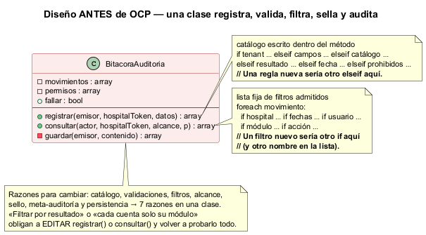
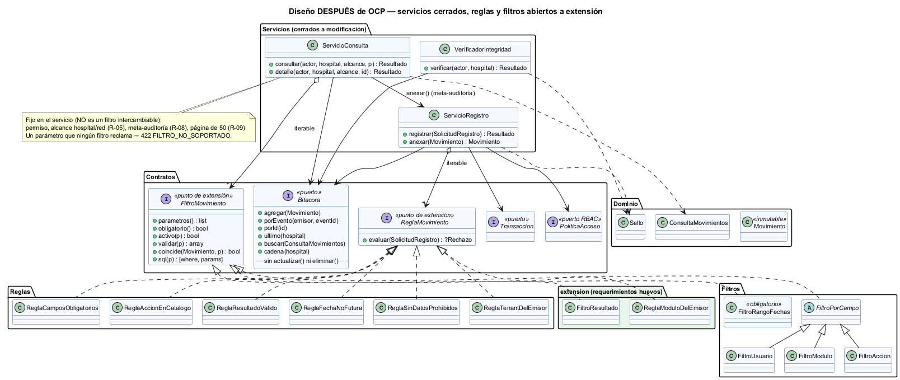

# Semana 2 — Requerimientos, criterios de aceptación y aplicación de OCP

| | |
|---|---|
| **Curso** | Análisis de Sistemas II — Proyecto Final 2026 |
| **Módulo** | Gobernanza y auditoría de movimientos del sistema |
| **Tema de la semana** | Proceso y modelo de diseño; principios SOLID |
| **Principio aplicado** | OCP — abierto a extensión, cerrado a modificación |
| **Flujo** | «Registro inmutable y consulta filtrada de movimientos por usuario, módulo y fechas» |
| **Estudiante** | Boris Alexander Quiroa Orellana |

## Índice

1. [Introducción](#1-introducción)
2. [Requerimientos funcionales](#2-requerimientos-funcionales)
3. [Requerimientos no funcionales](#3-requerimientos-no-funcionales)
4. [Criterios de aceptación](#4-criterios-de-aceptación)
5. [El principio abierto/cerrado (OCP)](#5-el-principio-abiertocerrado-ocp)
6. [Diseño antes de aplicar OCP](#6-diseño-antes-de-aplicar-ocp)
7. [Diseño después de aplicar OCP](#7-diseño-después-de-aplicar-ocp)
8. [Responsabilidades y dependencias](#8-responsabilidades-y-dependencias)
9. [Demostración: extensión sin modificación](#9-demostración-extensión-sin-modificación)
10. [Evidencia verificable](#10-evidencia-verificable)
11. [Trazabilidad con la semana 1](#11-trazabilidad-con-la-semana-1)
12. [Conclusión](#12-conclusión)
13. [Bibliografía](#13-bibliografía)

## 1. Introducción

La semana 1 modeló el proceso con 10 reglas (R-01..R-10). Esta semana:
- las convierte en **requerimientos verificables** (RF, RNF y criterios de aceptación);
- aplica **OCP** al diseño del flujo.

**¿Dónde aplicar OCP?** En el punto que más va a cambiar. En una bitácora de gobernanza, eso es:
- **los filtros de la consulta**: hoy son usuario, módulo, acción y fechas; mañana gobernanza pedirá «solo los denegados», «por correlation_id» o «por IP»;
- **las validaciones al registrar**: cada módulo nuevo que emite trae su propia regla.

**¿Dónde NO aplicarlo?** También es una decisión de diseño. El aislamiento por hospital, el sello encadenado, la idempotencia y la meta-auditoría son **invariantes de seguridad**. Si fueran «extensiones», bastaría con quitar una línea de configuración para que la bitácora dejara de ser evidencia. Por eso viven fijos en los servicios.

## 2. Requerimientos funcionales

| ID | Requerimiento | Regla (S1) |
|---|---|---|
| RF-01 | El sistema debe registrar un movimiento con event_id, hospital, usuario, módulo, acción, `ocurrido_en`, resultado, recurso y detalle, y responder con su secuencia y su sello. | R-01 |
| RF-02 | El sistema debe rechazar el movimiento cuyo hospital no es el del token del emisor (403 `TENANT_NO_COINCIDE`). | R-05 |
| RF-03 | El sistema debe exigir los campos obligatorios, módulo y acción del catálogo, resultado ∈ {exito, denegado, error} y `ocurrido_en` en ISO 8601 con zona, no posterior a ahora + 5 min (422 con los campos). | R-01 |
| RF-04 | El sistema debe rechazar un detalle que contenga contraseñas, tokens, secretos, claves o diagnósticos, en cualquier nivel (422). | R-07 |
| RF-05 | El sistema debe tratar el reenvío del mismo `event_id` del mismo emisor como idempotente (200 `YA_REGISTRADO`), y como conflicto (409) si el contenido difiere. | R-04 |
| RF-06 | El sistema no debe ofrecer ninguna operación para modificar ni eliminar un movimiento. | R-02 |
| RF-07 | El sistema debe sellar cada movimiento encadenado con el anterior de su hospital, y permitir al super administrador verificar la cadena (`INTEGRA` o `ALTERADA` con la primera secuencia rota). | R-03 |
| RF-08 | La consulta debe exigir `desde` y `hasta` (AAAA-MM-DD, fechas reales, `desde ≤ hasta`); `hasta` incluye el día completo en la hora local del hospital. | R-06 |
| RF-09 | La consulta debe aceptar los filtros opcionales usuario, módulo y acción, combinables (Y), y rechazar los parámetros no soportados. | R-06 |
| RF-10 | El auditor de un hospital solo consulta su hospital. La red completa exige `auditoria.consultar_red`. | R-05 |
| RF-11 | La consulta debe devolver como máximo 50 movimientos por página, del más reciente al más antiguo, e indicar si hay más. | R-09 |
| RF-12 | Cada consulta y cada detalle deben registrar `AUDITORIA_CONSULTADA` con el actor y los filtros. Si ese registro falla, no se entregan resultados. | R-08 |
| RF-13 | El detalle de un movimiento fuera del alcance debe responder igual que uno inexistente (404). | R-05 |

## 3. Requerimientos no funcionales

| ID | Atributo | Requerimiento medible |
|---|---|---|
| RNF-01 | **Extensibilidad (OCP)** | Un filtro o una regla nuevos se agregan con **una clase y una línea** en la raíz de composición, sin modificar `ServicioRegistro` ni `ServicioConsulta` |
| RNF-02 | Integridad | Toda alteración de una fila, incluso con su sello recalculado, se detecta en la verificación |
| RNF-03 | Confidencialidad / minimización | Ningún movimiento guarda contraseñas, tokens ni datos clínicos (RF-04) |
| RNF-04 | Aislamiento multi-tenant | Ninguna consulta de hospital devuelve movimientos de otro hospital |
| RNF-05 | Confiabilidad | Ante una falla de la base no queda ningún movimiento a medias (transacción) |
| RNF-06 | Rendimiento | Consulta de un rango de 31 días con filtros sobre 1 millón de filas: p95 < 500 ms con índices (se mide en la semana 5) |
| RNF-07 | Seguridad de consultas | Los valores de los filtros viajan siempre como parámetros, nunca concatenados en el SQL |
| RNF-08 | Testabilidad | Toda la lógica se prueba sin base de datos, con adaptadores en memoria |
| RNF-09 | Trazabilidad | Cada movimiento lleva emisor, `event_id` y, si viene, `correlation_id`, para seguirlo hasta el módulo que lo generó |

## 4. Criterios de aceptación

Formato «Dado / Cuando / Entonces», resumido. Cada criterio es una prueba ejecutable de `verificar.php`.

| CA | Dado | Cuando | Entonces | RF/RNF |
|---|---|---|---|---|
| CA-01 | un emisor con permiso | registra un movimiento válido y luego otro | 201, secuencia 1 y 2, sellos distintos | RF-01 |
| CA-02 | un emisor sin `auditoria.registrar` | registra | 403 y nada guardado | RF-01 |
| CA-03 | el token de oriente | envía un movimiento de norte (y además inválido) | 403 `TENANT_NO_COINCIDE`, no 422 | RF-02 |
| CA-04 | un movimiento sin 5 campos | se registra | 422 con los 5 campos | RF-03 |
| CA-05 | una acción de otro módulo o un resultado desconocido | se registra | 422 | RF-03 |
| CA-06 | `ocurrido_en` +4 min / +6 min / sin zona | se registra | 201 / 422 / 422 | RF-03 |
| CA-07 | `password`, `token` anidado o `Diagnostico` en el detalle | se registra | 422 y nada guardado | RF-04, RNF-03 |
| CA-08 | un movimiento ya registrado | se reenvía igual / con otro contenido | 200 `YA_REGISTRADO` con el mismo id / 409 | RF-05 |
| CA-09 | la base caída | se registra, y luego se reintenta | 503 sin nada guardado; luego 201 | RNF-05 |
| CA-10 | el contrato `Bitacora` y los servicios | se inspeccionan | ningún método para actualizar ni borrar | RF-06 |
| CA-11 | 4 movimientos | se altera la fila 2 / además se recalcula su sello | `ALTERADA` en 2 / `ALTERADA` en 3 | RF-07, RNF-02 |
| CA-12 | consultas sin rango, con un extremo, con el 30 de febrero o invertidas | se consulta | 422 | RF-08 |
| CA-13 | movimientos a las 23:30 del 20 y a las 00:10 del 21 (hora local) | se consulta el día 20 con filtros combinados | entra la de 23:30 y no la de 00:10; los filtros se combinan con Y | RF-08, RF-09 |
| CA-14 | movimientos en dos hospitales | consulta el auditor (su hospital / red / otro) y el super administrador (red) | solo el suyo / 403 / 403 / los dos | RF-10, RNF-04 |
| CA-15 | 51 movimientos | se consulta | 50, el más reciente primero, `hay_mas`; con 50 exactos, no | RF-11 |
| CA-16 | una consulta | se ejecuta / con la bitácora sin poder escribir | `AUDITORIA_CONSULTADA` encadenado / 503 sin resultados | RF-12 |
| CA-17 | un movimiento de norte | el auditor de oriente pide su detalle | la misma respuesta que para un id inexistente | RF-13 |

## 5. El principio abierto/cerrado (OCP)

La fuente obligatoria del curso, *Principios básicos del diseño de software* de MVP Cluster, lo define así:

> «No se debe modificar el código de una clase o entidad, sino que estas deben de ser extendidas.»
> «La forma más común para cumplir con este principio es el uso de la herencia y/o el de las interfaces.»

**Aplicado a este módulo:**

| | Qué significa aquí |
|---|---|
| **Abierto a extensión** | Se pueden agregar reglas de registro (`ReglaMovimiento`) y filtros de consulta (`FiltroMovimiento`). |
| **Cerrado a modificación** | `ServicioRegistro` y `ServicioConsulta`, que **aplican** reglas y filtros, no se editan cuando aparece uno nuevo. |
| **Mecanismo** | Interfaces, más una clase abstracta (`FiltroPorCampo`) donde sí hay comportamiento compartido: los tres filtros «campo = valor» solo difieren en el parámetro, la columna y el valor. |

## 6. Diseño antes de aplicar OCP



Código: [`ejemplo-ocp/antes/BitacoraAuditoria.php`](ejemplo-ocp/antes/BitacoraAuditoria.php)

```php
if (($d['hospital'] ?? null) !== $hospitalToken) { return …TENANT_NO_COINCIDE; }
elseif ($faltan !== []) { … }
elseif (!in_array($d['accion'], $catalogo[$d['modulo']] ?? [], true)) { … }
// … resultado, fecha, datos prohibidos …
// Una regla nueva sería otro elseif aquí.

foreach ($this->movimientos as $m) {
    if (isset($p['usuario']) && $c['usuario'] !== $p['usuario']) { continue; }
    if (isset($p['modulo']) && $c['modulo'] !== $p['modulo']) { continue; }
    // Un filtro nuevo sería otro if aquí (y otro nombre en la lista de arriba).
}
```

**Problemas del diseño:**

| Problema | Consecuencia |
|---|---|
| Las validaciones son un `if/elseif` dentro de `registrar()`. | Cada regla nueva **modifica** la clase: viola OCP y obliga a volver a probar todo el registro. |
| Los filtros son `if` sueltos y una lista fija de nombres admitidos. | Un filtro nuevo exige tocar **dos** lugares; olvidar uno lo vuelve `FILTRO_NO_SOPORTADO` o lo ignora en silencio. |
| El filtro no tiene una forma SQL. | Al pasar a PDO (semana 3), cada filtro se reescribiría a mano dentro del método, con riesgo de concatenar valores. |
| Siete razones para cambiar en una sola clase. | Catálogo, validaciones, filtros, alcance, sello, meta-auditoría y persistencia: también viola SRP. |

## 7. Diseño después de aplicar OCP



Código: [`ejemplo-ocp/despues/`](ejemplo-ocp/despues/)

El servicio ya no **contiene** las reglas ni los filtros: los **recibe**.

```php
interface FiltroMovimiento
{
    public function parametros(): array;      // qué parámetros reclama
    public function obligatorio(): bool;      // el rango lo es (R-06)
    public function activo(array $p): bool;
    public function validar(array $p): array; // campo => mensaje
    public function coincide(Movimiento $m, array $p): bool;   // en memoria
    public function sql(array $p): array;     // ['col = :param', ['param' => valor]]: nunca concatena valores
}

// ServicioConsulta::consultar(), fragmento
foreach ($this->filtros as $filtro) {          // no sabe QUÉ filtro es
    if (!$filtro->activo($parametros) && !$filtro->obligatorio()) { continue; }
    $errores = $filtro->validar($parametros);
    …
}
```

**Dos ganancias que no son OCP «de libro»:**
1. **Los parámetros admitidos salen de los filtros.** Un parámetro que ningún filtro reclama da 422 `FILTRO_NO_SOPORTADO`. La lista ya no se mantiene a mano, así que no se puede desincronizar.
2. **Cada filtro trae su forma SQL con parámetros.** La semana 3 compone el `WHERE` desde los fragmentos, sin escribir un solo valor en el texto de la consulta (RNF-07).

Las clases concretas solo aparecen en la **raíz de composición** ([`composicion.php`](ejemplo-ocp/despues/composicion.php)).

## 8. Responsabilidades y dependencias

### Responsabilidades

| Clase / interfaz | Responsabilidad única | Razón para cambiar |
|---|---|---|
| `ServicioRegistro` | Permiso → reglas → idempotencia → sello → inserción, en una transacción | Solo si cambia el **proceso** de registro |
| `ServicioConsulta` | Permiso y alcance → filtros → búsqueda → meta-auditoría | Solo si cambia el **proceso** de consulta |
| `VerificadorIntegridad` | Recalcular la cadena y señalar la primera fila rota | Cambio en el algoritmo del sello |
| `ReglaTenantDelEmisor` | R-05 al registrar | Política de tenant |
| `ReglaCamposObligatorios`, `ReglaAccionEnCatalogo`, `ReglaResultadoValido`, `ReglaFechaNoFutura` | Una parte de R-01 cada una | Su propia regla |
| `ReglaSinDatosProhibidos` | R-07 | La lista de datos prohibidos |
| `FiltroRangoFechas` | R-06: rango obligatorio en hora local y «hasta» inclusive | Zona horaria o formato |
| `FiltroPorCampo` (+ `FiltroUsuario`, `FiltroModulo`, `FiltroAccion`) | Igualdad sobre un campo | El campo |
| `Movimiento` | Dato inmutable con su contenido canónico | El formato del movimiento |
| `Sello` | `sha256(anterior ‖ secuencia ‖ contenido)` | El algoritmo |
| `Bitacora` (puerto) | Persistencia de solo inserción | Lo que el dominio necesita de la base |
| `composicion.php` | Crear y conectar las clases concretas | Cada regla o filtro nuevo: **es el único lugar que cambia** |

### Dependencias

| Quién | Depende de | Tipo | Justificación |
|---|---|---|---|
| `ServicioRegistro` | `ReglaMovimiento` (iterable) | Abstracción | OCP: reglas nuevas sin tocarlo |
| `ServicioConsulta` | `FiltroMovimiento` (iterable) | Abstracción | OCP: filtros nuevos sin tocarlo |
| Ambos servicios | `Bitacora`, `Transaccion`, `PoliticaAcceso` | Abstracciones | Hoy en memoria; en la semana 3, PDO y RBAC |
| `ServicioConsulta` | `ServicioRegistro::anexar()` | Concreta, mismo módulo | La meta-auditoría entra a la **misma** cadena sellada; no hay una segunda vía de escritura |
| Reglas y filtros | `CatalogoAcciones`, `Reloj` | Abstracción / valor | Cada uno pide solo lo que necesita |
| `composicion.php` | Todas las clases concretas | Concreta | Es el único punto acoplado a implementaciones, a propósito |

## 9. Demostración: extensión sin modificación

Dos requerimientos nuevos, uno por cada punto de extensión:

| | «Gobernanza quiere ver solo los movimientos denegados» | «Cada cuenta de servicio solo registra movimientos de su propio módulo» |
|---|---|---|
| **ANTES** | Agregar `resultado` a la lista de admitidos **y** otro `if` en el bucle de `consultar()` | Otro `elseif` en `registrar()` y un mapa de cuentas dentro de la clase |
| **DESPUÉS** | [`extension/FiltroResultado.php`](ejemplo-ocp/despues/extension/FiltroResultado.php) + 1 línea en `composicion.php` | [`extension/ReglaModuloDelEmisor.php`](ejemplo-ocp/despues/extension/ReglaModuloDelEmisor.php) + 1 línea |
| **¿Se modifica el servicio?** | No | No |
| **¿Cómo se prueba?** | OCP-01: solo denegados; un valor inválido da 422 | OCP-01: Pacientes no puede escribir un `ROL_ASIGNADO` |
| **¿Cómo se revierte?** | Se quita la línea: `resultado` vuelve a ser `FILTRO_NO_SOPORTADO` (OCP-03) | Se quita la línea: la regla desaparece (OCP-03) |

## 10. Evidencia verificable

**Ejecución:** con PHP 8.2 o superior, desde la raíz del repositorio.

```bash
php docs/modulos/gobernanza-auditoria/semana-02/ejemplo-ocp/verificar.php     # 21 pruebas
php docs/modulos/gobernanza-auditoria/semana-02/ejemplo-ocp/mutaciones.php    # 8 defectos inyectados
```

**Resultado obtenido** ([salida completa](evidencia/salida-verificar.txt)): **21 pruebas: 21 pasan, 0 fallan.**

| Grupo | Demuestra |
|---|---|
| CA-01..CA-17 | El diseño cumple los RF y RNF |
| OCP-01 | Las dos extensiones funcionan |
| OCP-02 | Los servicios no mencionan ninguna regla ni filtro concreto (análisis del código fuente) y reciben `iterable` |
| OCP-03 | Quitar las extensiones no exige tocar los servicios |
| PAR-01 | Antes y después dan **exactamente** el mismo resultado en 16 pasos. Se comparan estado, código, ids, secuencias y **sellos**: la refactorización no cambió ni un byte de la cadena. |

**¿Las pruebas detectan defectos?** ([salida](evidencia/salida-mutaciones.txt)): **8 de 8 mutaciones detectadas.**

| Mutación | La detecta |
|---|---|
| M1 «hasta» deja de incluir el día completo | CA-13, CA-14, CA-15, CA-16, OCP-01, PAR-01 |
| M2 sin idempotencia | CA-08, PAR-01 |
| M3 el sello no depende del anterior | CA-11 (el atacante que recalcula el sello), PAR-01 |
| M4 la consulta ignora el hospital | CA-14, PAR-01 |
| M5 la consulta no se audita | CA-16, PAR-01 |
| M6 la regla de tenant va después de los campos | CA-03 |
| M7 los datos prohibidos solo se buscan en el primer nivel | CA-07 |
| M8 el registro no pide permiso | CA-02, PAR-01 |

**Hallazgo del proceso.** Una primera versión del script incluía otra M8: «el verificador no exige secuencias consecutivas». Sobrevivió. Al analizarla resultó **equivalente**: borrar o renumerar una fila del medio rompe igual el sello de la siguiente, porque la secuencia forma parte del hash. Así que esa mutación no medía nada y se reemplazó.

**Límite real del diseño.** El encadenamiento **no detecta** que se borre la **última** fila: no queda ninguna fila posterior que la delate. La defensa estándar es un **ancla externa**: publicar periódicamente el último sello fuera de la base, por ejemplo en otro sistema o firmado. Se anota para la semana 5.

## 11. Trazabilidad con la semana 1

| Semana 1 | Semana 2: requerimiento | Semana 2: clase | Prueba |
|---|---|---|---|
| CU-01, R-01; D-05; E-04 | RF-01, RF-03 | `ServicioRegistro`, `ReglaCamposObligatorios`, `ReglaAccionEnCatalogo`, `ReglaResultadoValido`, `ReglaFechaNoFutura` | CA-01, CA-04..CA-06 |
| D-04, E-03, R-05 | RF-02 | `ReglaTenantDelEmisor` (primera regla) | CA-03 |
| R-07 | RF-04 | `ReglaSinDatosProhibidos` | CA-07 |
| D-06, D-07, F-01b, E-05, R-04 | RF-05 | `ServicioRegistro` + `Bitacora::porEvento()` | CA-08 |
| R-02 (sin casos de uso para editar) | RF-06 | `Bitacora` sin `actualizar()` ni `eliminar()` | CA-10 |
| CU-04, A-11, D-14, R-03 | RF-07 | `Sello`, `VerificadorIntegridad` | CA-11 |
| A-06, D-09, E-07, R-06 | RF-08, RF-09 | `FiltroRangoFechas`, `FiltroPorCampo` | CA-12, CA-13 |
| D-10, D-11, E-08, CU-07, R-05 | RF-10 | `ServicioConsulta` + `ConsultaMovimientos` | CA-14 |
| A-07, R-09 | RF-11 | `ServicioConsulta::PAGINA` | CA-15 |
| A-08, A-10, CU-06, R-08 | RF-12 | `ServicioConsulta::auditar()` → `ServicioRegistro::anexar()` | CA-16 |
| CU-03, D-13, E-09 | RF-13 | `ServicioConsulta::detalle()` | CA-17 |
| D-08, E-06, R-10 | RNF-05 | `Transaccion` | CA-09, CA-16 |

## 12. Conclusión

Aplicar OCP a una bitácora obligó a distinguir **lo que varía de lo que no debe variar**.

| Tipo | Ejemplos | Dónde vive |
|---|---|---|
| Lo que varía con el negocio | Filtros de la consulta, validaciones de cada emisor | Clases pequeñas detrás de dos interfaces: se agregan sin tocar los servicios |
| Lo que da valor de evidencia | Alcance por hospital, sello encadenado, idempotencia, meta-auditoría | Fijo en los servicios, a propósito, para que ninguna composición pueda quitarlo |

La evidencia lo respalda de cuatro formas:
1. Dos requerimientos nuevos se agregaron sin modificar los servicios.
2. Un análisis del código confirma que los servicios no conocen clases concretas.
3. Una prueba de paridad muestra que la cadena de sellos es idéntica byte a byte.
4. Ocho defectos inyectados fueron detectados.

La forma SQL de cada filtro deja preparado el adaptador PDO de la semana 3.

## 13. Bibliografía

- MVP Cluster. *Principios básicos del diseño de software* (OCP). Fuente obligatoria del curso.
- Martin, R. C. (2017). *Clean Architecture*. Prentice Hall. Cap. 8: «OCP: The Open-Closed Principle».
- Meyer, B. (1997). *Object-Oriented Software Construction* (2.ª ed.). Prentice Hall.
- Crosby, S. y Wallach, D. (2009). *Efficient Data Structures for Tamper-Evident Logging*. USENIX Security Symposium.
- OWASP Foundation. (2024). *Logging Cheat Sheet* y *Query Parameterization Cheat Sheet*. https://cheatsheetseries.owasp.org/
