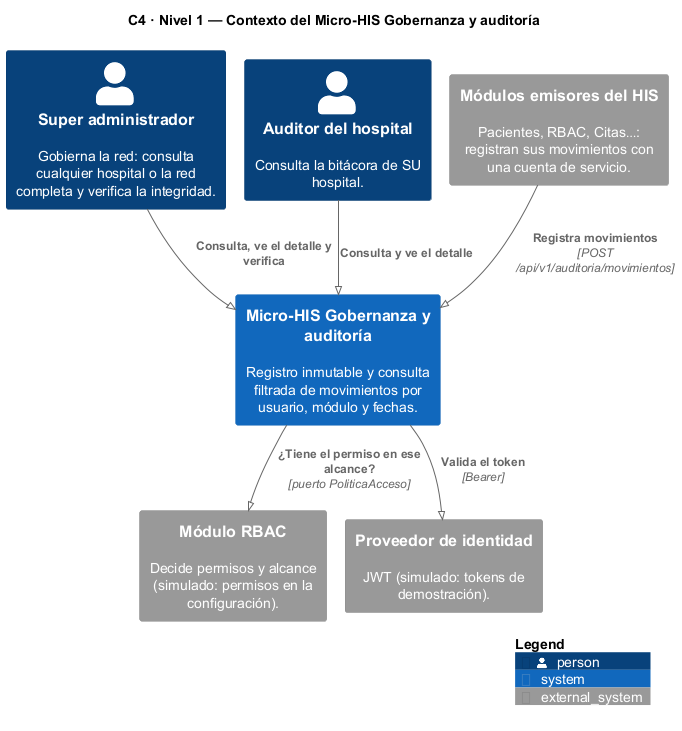
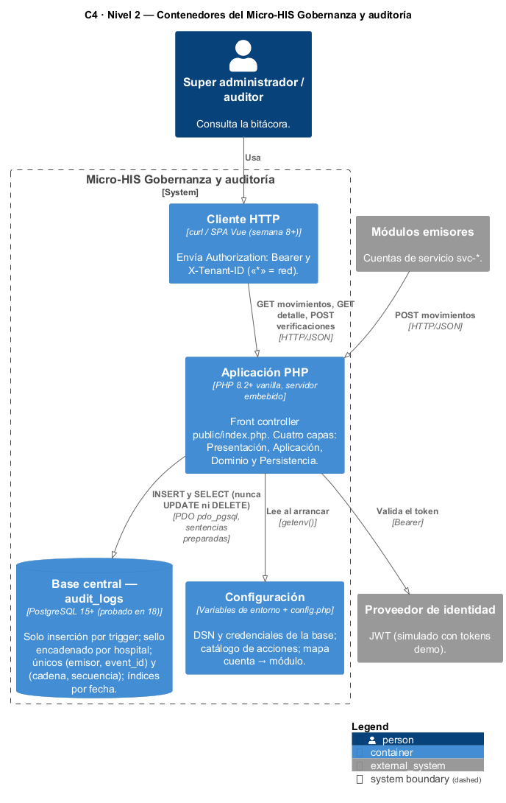
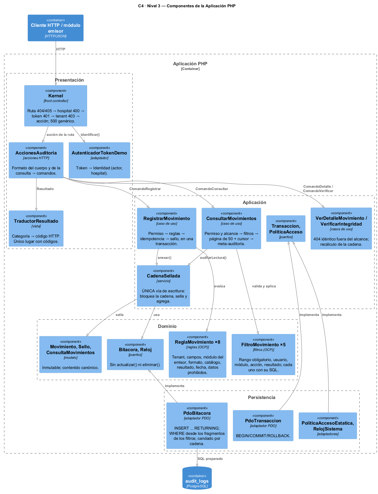
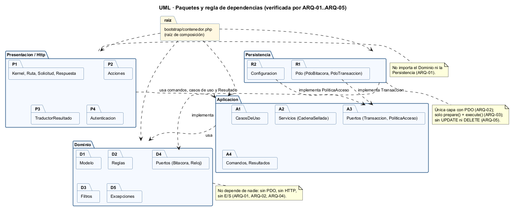
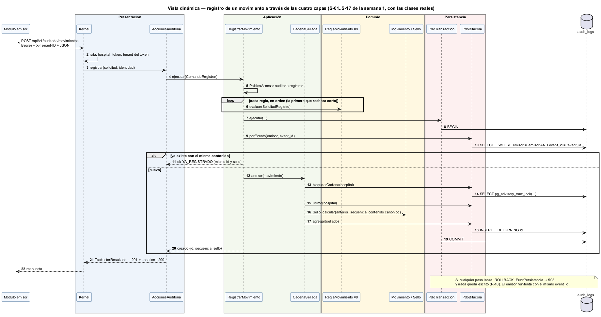

# Semana 3 — Arquitectura del Micro-HIS Gobernanza y auditoría

| | |
|---|---|
| **Curso** | Análisis de Sistemas II — Proyecto Final 2026 |
| **Módulo** | Gobernanza y auditoría de movimientos del sistema |
| **Tema de la semana** | Diseño arquitectónico, vistas y patrones |
| **Flujo ejecutado** | «Registro inmutable y consulta filtrada de movimientos por usuario, módulo y fechas» |
| **Código** | [`micro-his-auditoria/`](../micro-his-auditoria/README.md) |
| **Estudiante** | Boris Alexander Quiroa Orellana |

## Índice

1. [Introducción](#1-introducción)
2. [Decisiones arquitectónicas](#2-decisiones-arquitectónicas)
3. [Vista de contexto (C4 nivel 1)](#3-vista-de-contexto-c4-nivel-1)
4. [Vista de contenedores (C4 nivel 2)](#4-vista-de-contenedores-c4-nivel-2)
5. [Vista de componentes (C4 nivel 3)](#5-vista-de-componentes-c4-nivel-3)
6. [Paquetes y regla de dependencias](#6-paquetes-y-regla-de-dependencias)
7. [Vista dinámica: un registro a través de las capas](#7-vista-dinámica-un-registro-a-través-de-las-capas)
8. [Responsabilidades por capa](#8-responsabilidades-por-capa)
9. [Persistencia: PDO, sentencias preparadas y el esquema](#9-persistencia-pdo-sentencias-preparadas-y-el-esquema)
10. [Patrones aplicados](#10-patrones-aplicados)
11. [Pruebas y evidencia](#11-pruebas-y-evidencia)
12. [Hallazgos: lo que solo apareció con la base real y el servidor real](#12-hallazgos-lo-que-solo-apareció-con-la-base-real-y-el-servidor-real)
13. [Trazabilidad con las semanas 1 y 2](#13-trazabilidad-con-las-semanas-1-y-2)
14. [Limitaciones y trabajo siguiente](#14-limitaciones-y-trabajo-siguiente)
15. [Conclusión](#15-conclusión)

## 1. Introducción

Esta semana se **inicia el Micro-HIS Gobernanza y auditoría**: una aplicación PHP 8.2+ vanilla, sin framework, que ejecuta el flujo de punta a punta.

| Qué hace | Detalle |
|---|---|
| Registra | Un módulo emisor registra un movimiento: se valida, se sella encadenado y se inserta en `audit_logs` |
| Consulta | El super administrador o el auditor consultan por rango de fechas, usuario, módulo, acción y resultado, siempre dentro de su alcance |
| Muestra el detalle | De un movimiento dentro del alcance |
| Verifica | Que la cadena no fue alterada |

**Organización:** cuatro capas (**Presentación, Aplicación, Dominio y Persistencia**), PDO sobre PostgreSQL y solo sentencias preparadas.

**Pruebas:** con dobles, sin base de datos (camino feliz, reglas de dominio y errores de persistencia), y además contra un **PostgreSQL 18 real**.

**El entregable de la semana** es la vista arquitectónica C4/UML del módulo y sus dependencias:
- tres niveles C4: contexto, contenedores y componentes;
- un diagrama UML de paquetes;
- una vista dinámica.

Las dependencias no solo se dibujan: cinco pruebas de arquitectura (ARQ-01..ARQ-05) las verifican leyendo el código.

## 2. Decisiones arquitectónicas

| ID | Decisión | Motivo | Alternativa descartada |
|---|---|---|---|
| DA-01 | **Cuatro capas**: Presentación → Aplicación → Dominio ← Persistencia | Lo exige la tarea. Además, aísla las reglas de la bitácora de HTTP y de SQL. | Controladores con SQL dentro |
| DA-02 | **PHP 8.2+ vanilla**, autoload propio | Lo exige la tarea («sin framework») | Laravel, que usa el proyecto principal |
| DA-03 | **PDO + `pdo_pgsql`**, con `EMULATE_PREPARES = false`, parámetros con nombre y sesión en UTC | Lo exige la tarea. Sin inyección SQL. Misma base que el HIS. | `query()` con concatenación |
| DA-04 | **Puertos en el Dominio** (`Bitacora`, `Reloj`) y en Aplicación (`Transaccion`, `PoliticaAcceso`) | Inversión de dependencias: la persistencia se adapta al dominio | Que el dominio use PDO |
| DA-05 | **Reglas y filtros de la semana 2** (OCP) pasan al Dominio sin cambios; las dos extensiones quedan como parte del módulo | El diseño se probó con paridad; aquí solo cambia de casa | Reescribirlos dentro de los casos de uso |
| DA-06 | **`CadenaSellada`: una sola vía de escritura** | El registro y la meta-auditoría sellan igual: una consulta queda en la cadena como cualquier movimiento | Que la meta-auditoría escriba por fuera |
| DA-07 | **Candado transaccional por cadena** (`pg_advisory_xact_lock`) y único `(cadena, secuencia)` como última defensa | Dos registros simultáneos del mismo hospital no pueden tomar la misma secuencia | `SELECT … FOR UPDATE` del último: no bloquea nada cuando la cadena está vacía |
| DA-08 | **Solo inserción en tres niveles**: el puerto sin `actualizar()`, el SQL sin `UPDATE`/`DELETE`, y un trigger que rechaza `UPDATE`, `DELETE` y `TRUNCATE` | R-02. Lo verifican ARQ-05 e INT-02. | Confiar solo en la aplicación |
| DA-09 | **Detalle canónico antes de sellar** | `jsonb` reordena las claves; sin esto, la verificación daría ALTERADA en datos íntegros (§12) | Guardar el detalle como `text` |
| DA-10 | **Alcance por `X-Tenant-ID`**: un hospital, o «*» para la red, solo con un token de super administrador | Un solo mecanismo para el tenant, verificado en el kernel y otra vez en el caso de uso | Un parámetro `alcance` aparte |

## 3. Vista de contexto (C4 nivel 1)



Personas y sistemas de la semana 1. En el micro-HIS, RBAC y el proveedor de identidad están **simulados detrás de puertos**:
- RBAC → permisos en la configuración;
- proveedor de identidad → tokens de demostración.

Cuando se integren, cambia un adaptador y no los casos de uso.

## 4. Vista de contenedores (C4 nivel 2)



| Contenedor | Tecnología | Responsabilidad |
|---|---|---|
| Cliente HTTP | curl; SPA Vue más adelante | Envía `Authorization: Bearer` y `X-Tenant-ID` |
| Aplicación PHP | PHP 8.2+, `php -S` | Front controller y las cuatro capas |
| `audit_logs` | PostgreSQL 15+ (probado en 18) | Solo inserción, sello, únicos, índices por fecha. En el HIS vive en la base **central**. |
| Configuración | Variables de entorno | DSN y credenciales: nada de esto queda en el repositorio |

## 5. Vista de componentes (C4 nivel 3)



Lo importante es el **sentido de las flechas**: los adaptadores de Persistencia apuntan **hacia** los puertos («implementa»), nunca al revés.

## 6. Paquetes y regla de dependencias



| Capa | Puede usar | No puede usar | Verificación |
|---|---|---|---|
| Dominio | Solo Dominio | Aplicación, Presentación, Persistencia, PDO, HTTP, E/S | ARQ-01, ARQ-02, ARQ-04 |
| Aplicación | Dominio | Presentación, Persistencia, PDO | ARQ-01, ARQ-02 |
| Persistencia | Dominio y puertos de Aplicación | Presentación | ARQ-01; además solo `prepare()` y sin `UPDATE` ni `DELETE`: ARQ-03, ARQ-05 |
| Presentación | Aplicación | Dominio, Persistencia, PDO | ARQ-01, ARQ-02 |
| `bootstrap/contenedor.php` | Todo | — | Es la raíz de composición |

## 7. Vista dinámica: un registro a través de las capas



Es el bloque 1 de la secuencia de la semana 1 (S-01..S-17), ahora con las **clases reales**: Kernel → acción → caso de uso → 8 reglas → transacción → idempotencia → candado → último sello → sello → `INSERT … RETURNING id` → `COMMIT`. Si cualquier paso lanza, hay `ROLLBACK`, la respuesta es 503 y el emisor reintenta con el mismo `event_id`.

## 8. Responsabilidades por capa

| Capa | Clases | Responsabilidad | Lo que NO hace |
|---|---|---|---|
| **Presentación** | `Kernel`, `Ruta`, `AccionesAuditoria`, `TraductorResultado`, `AutenticadorTokenDemo` | Exigir ruta, hospital, token y tenant del token. Validar el **formato** (JSON, parámetros de texto). Traducir el `Resultado` a HTTP. | No valida reglas de negocio; no conoce el Dominio ni el SQL |
| **Aplicación** | 4 casos de uso, `CadenaSellada`, comandos, `Resultado` | Orquestar: permiso, alcance, reglas o filtros, transacción, sello y meta-auditoría | No conoce HTTP ni PDO |
| **Dominio** | `Movimiento`, `Sello`, `ConsultaMovimientos`, 8 reglas, 5 filtros, puertos | Qué es un movimiento válido, cómo se sella, qué coincide con una consulta y su forma SQL | No hace E/S |
| **Persistencia** | `PdoBitacora`, `PdoTransaccion`, `FabricaConexion`, configuración | SQL preparado; traducir `PDOException` a `ErrorPersistencia` sin el SQL ni los valores | No decide reglas |

## 9. Persistencia: PDO, sentencias preparadas y el esquema

```php
// PdoBitacora::buscar(): el WHERE se compone con los fragmentos que trae cada filtro (semana 2)
foreach ($consulta->filtros as $filtro) {
    [$fragmento, $valores] = $filtro->sql($consulta->parametros);   // p. ej. ['usuario_id = :usuario', ['usuario' => 'u-ana']]
    $condiciones[] = '(' . $fragmento . ')';
    $parametros += $valores;                                      // los VALORES nunca entran al texto del SQL
}
```

[`database/schema.sql`](../micro-his-auditoria/database/schema.sql):

| Elemento | Para qué |
|---|---|
| `UNIQUE (emisor, event_id)` | Idempotencia (R-04), también ante dos reintentos simultáneos |
| Único `(COALESCE(hospital_id,'*'), secuencia)` | Una sola fila por posición de cada cadena |
| Trigger `BEFORE UPDATE OR DELETE` y `BEFORE TRUNCATE` | Solo inserción (R-02); mismo patrón que `cross_hospital_access_audits` |
| Índices `(hospital, fecha)`, `(usuario, fecha)`, `(módulo, fecha)` | La consulta siempre lleva rango de fechas (R-06) |
| `CHECK` de resultado y de `detalle` como objeto | La base también rechaza lo inválido |

## 10. Patrones aplicados

| Patrón | Dónde | Para qué |
|---|---|---|
| Arquitectura en capas + puertos y adaptadores | Toda la aplicación | Probar el dominio sin base de datos |
| Front Controller | `public/index.php` + `Kernel` | Un solo punto de entrada con el orden de seguridad fijo |
| Command | `Comando*` | Presentación invoca casos de uso con tipos primitivos |
| Strategy (OCP) | `ReglaMovimiento`, `FiltroMovimiento` | Reglas y filtros intercambiables (semana 2) |
| Repository | `Bitacora` → `PdoBitacora` | La persistencia detrás de un contrato (se amplía en la semana 4) |
| Unit of Work simple | `Transaccion` | Todo o nada |
| Hash chain (*tamper-evident log*) | `Sello`, `VerificarIntegridad` | Detectar alteraciones |
| Composition Root | `bootstrap/contenedor.php` | Único lugar con clases concretas |

## 11. Pruebas y evidencia

| Comando | Resultado | Evidencia |
|---|---|---|
| `php tests/ejecutar.php` (dobles, sin base) | 39 · **33 pasan** · 0 fallan · 6 omitidas | [1-pruebas-dobles.txt](evidencia/1-pruebas-dobles.txt) |
| La misma, con `AUDITORIA_DB_DSN` (PostgreSQL 18) | **39 · 39 pasan** · 0 fallan · 0 omitidas | [2-pruebas-postgres.txt](evidencia/2-pruebas-postgres.txt) |
| `php tests/mutaciones.php` (con la base) | **12/12** defectos detectados | [3-mutaciones.txt](evidencia/3-mutaciones.txt) |
| `bash bin/demo-http.sh` (`php -S` + PostgreSQL) | 201 · 200 · 403 · 422 · 200 · 422 · 403 · 200 `INTEGRA` | [4-demo-http.txt](evidencia/4-demo-http.txt) |

**Lo que pide la tarea, y dónde está:**

| Pedido | Pruebas |
|---|---|
| **Camino feliz** | APP-01 (registrar → consultar → detalle → verificar), HTTP-01, INT-01, INT-03 |
| **Regla de dominio** | DOM-02 (las 8 reglas aisladas), APP-02 (sin transacción ni filas), APP-03 (idempotencia), APP-07 (alcance), HTTP-03 |
| **Error de persistencia** con dobles | APP-04 (falla al agregar: ROLLBACK y reintento), APP-05 (falla la meta-auditoría: no se entregan resultados), APP-06 (falla cada lectura), PER-05 (cada SQLSTATE → `ErrorPersistencia`), PER-06 (COMMIT caído), HTTP-06 |
| **Error de persistencia** con una base de prueba | INT-04 (ROLLBACK real) |

**Grupos:**

| Grupo | Pruebas | Qué cubre |
|---|---|---|
| Dominio | DOM-01..06 | Reglas, filtros, sello, cursor |
| Aplicación | APP-01..10 | Casos de uso con dobles |
| Persistencia | PER-01..06 | SQL exacto con dobles de PDO |
| Presentación | HTTP-01..06 | El kernel completo |
| Arquitectura | ARQ-01..05 | Dependencias leídas del código |
| Integración | INT-01..06 | PostgreSQL real |

**El PostgreSQL de la integración** es un clúster temporal (`initdb` en una carpeta de trabajo, puerto 55432, solo local). No se tocó el servidor instalado en el equipo. Las pruebas crean un esquema propio y lo eliminan al terminar.

## 12. Hallazgos: lo que solo apareció con la base real y el servidor real

| # | Hallazgo | Cómo apareció | Corrección |
|---|---|---|---|
| H-1 | **`jsonb` reordena las claves** del detalle (por longitud y luego por bytes). Un sello calculado sobre el JSON original **no coincide** al recalcularlo. La bitácora se vería ALTERADA estando íntegra. | Al diseñar INT-01. La mutación M1 lo confirma: sin canonizar, fallan DOM-01, PER-04 e **INT-01**. | Canonizar el detalle (claves ordenadas, recursivo) **antes** de sellar: DA-09 |
| H-2 | **Un 200 con `Location` sale como 302.** PHP cambia el estado a 302 si se envía `Location` con un estado que no es 201 ni 3xx. El reintento idempotente respondía 302. | En el recorrido con `php -S` + `curl`; las pruebas en proceso no ejecutan `header()` | `Location` solo con 201 y el estado se fija después de las cabeceras. HTTP-01 ahora lo comprueba. |
| H-3 | **`SELECT … FOR UPDATE` del último sello no protege una cadena vacía**: no hay ninguna fila que bloquear | Al diseñar el registro concurrente | Candado `pg_advisory_xact_lock` por cadena (DA-07), más el único `(cadena, secuencia)` |
| H-4 | El mismo `event_id` de un emisor en **otro hospital** es un conflicto (409), no un movimiento nuevo | APP-07 falló con datos de prueba mal elegidos | Comportamiento correcto: `event_id` es único por emisor (en producción, UUID). Se corrigió la prueba y se dejó documentado. |
| H-5 | Un comentario del Dominio mencionaba códigos HTTP | ARQ-04 lo detectó | Se reescribió el comentario: el Dominio no habla de HTTP |

## 13. Trazabilidad con las semanas 1 y 2

| Semana 1 / 2 | Semana 3: dónde vive | Prueba |
|---|---|---|
| CU-01, R-01, R-07; RF-01..RF-04 | `RegistrarMovimiento` + 8 reglas | DOM-02, APP-02, HTTP-03 |
| R-02, RF-06 | Puerto sin modificación + trigger | ARQ-05, INT-02 |
| R-03, CU-04, RF-07 | `Sello`, `CadenaSellada`, `VerificarIntegridad` | DOM-03, APP-09, INT-05 |
| R-04, RF-05 | `porEvento` + `UNIQUE (emisor, event_id)` | APP-03, HTTP-01, INT-06 |
| R-05, CU-07, RF-10, RF-13 | `Kernel` (tenant del token) + casos de uso (permiso por alcance) | APP-07, HTTP-02, HTTP-05 |
| R-06, R-09, RF-08, RF-09, RF-11 | `FiltroRangoFechas` + cursor | DOM-04, APP-08, INT-03 |
| R-08, CU-06, RF-12 | `CadenaSellada::auditarLectura()` | APP-01, APP-05 |
| R-10, RNF-05 | `PdoTransaccion` | APP-04, PER-06, INT-04 |
| RNF-07 (sentencias preparadas) | `PdoBitacora` | PER-02, ARQ-03, mutación M10 |

## 14. Limitaciones y trabajo siguiente

- **Semana 4:** entrada MVC, adaptador InMemory **de producción** (hoy está solo en las pruebas) y suite de contrato común a InMemory y PDO; análisis del repositorio compartido.
- **Semana 5:** contrato OpenAPI, frontera de microservicio y ancla externa del último sello (el truncamiento de la última fila sigue sin detectarse).
- Autenticación y permisos simulados: tokens de demostración y permisos en la configuración.
- Sin rendimiento medido todavía (RNF-06).

## 15. Conclusión

El micro-HIS ejecuta el flujo completo con la arquitectura pedida, y la regla de dependencias está verificada por pruebas, no solo dibujada.

Lo más valioso de la semana fueron los hallazgos H-1 y H-2. Los dos eran **invisibles con dobles**:
- un sello que se rompe porque la base reordena el JSON;
- un reintento que se vuelve una redirección porque PHP reescribe el código de estado.

Probar contra el PostgreSQL y el servidor reales fue lo que los encontró.
