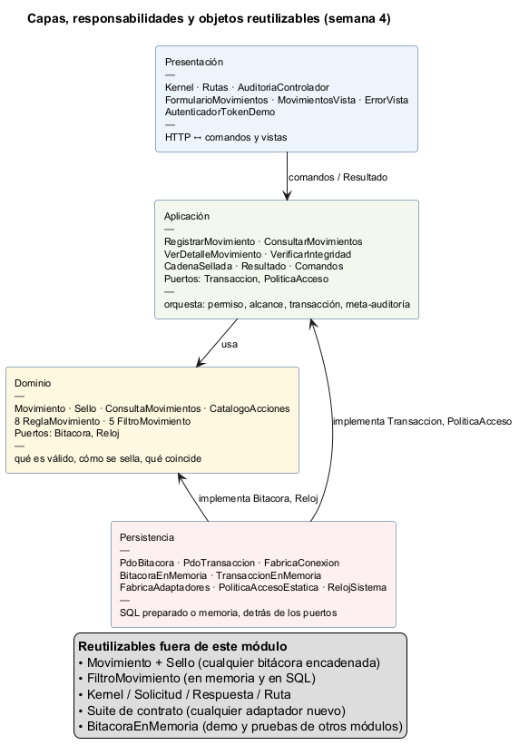
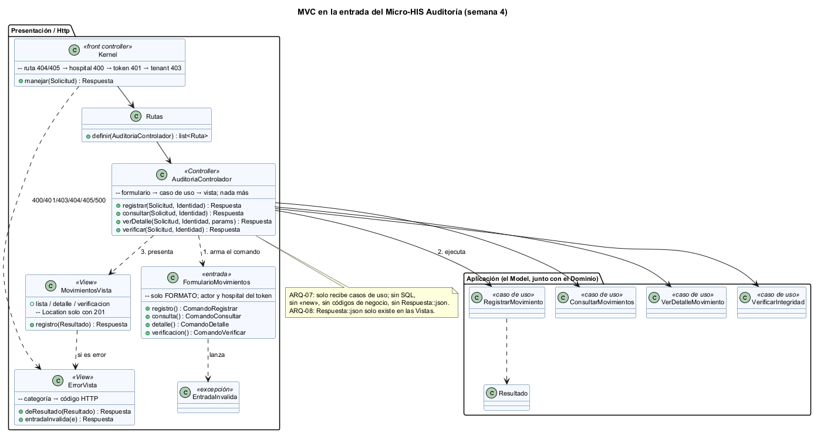
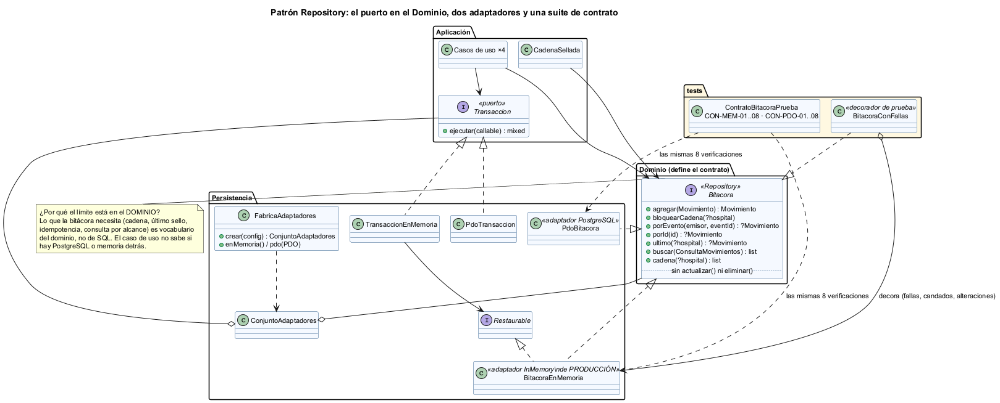
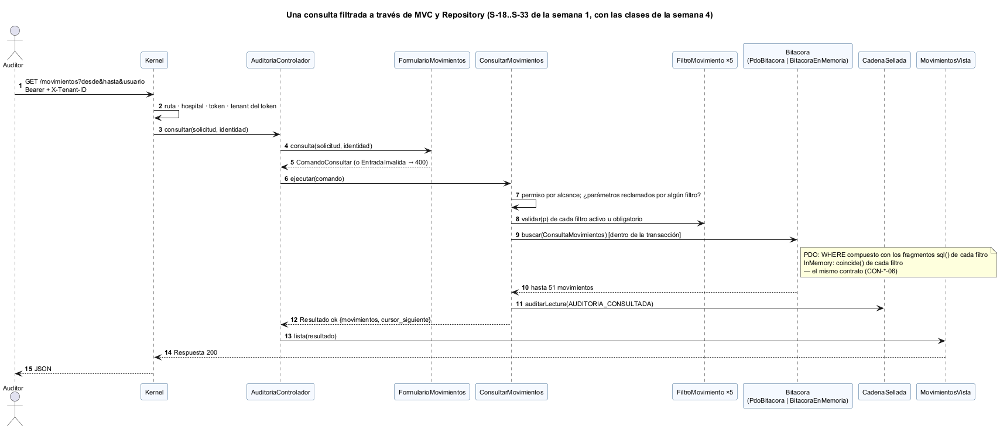
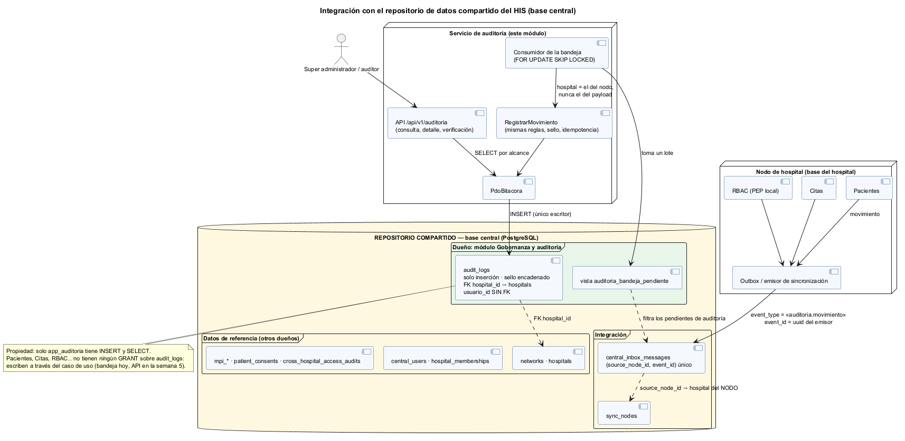

# Semana 4 — Arquitectura en capas, MVC y patrón Repository

| | |
|---|---|
| **Curso** | Análisis de Sistemas II — Proyecto Final 2026 |
| **Módulo** | Gobernanza y auditoría de movimientos del sistema |
| **Tema de la semana** | Arquitectura en capas y patrón Repository |
| **Flujo** | «Registro inmutable y consulta filtrada de movimientos por usuario, módulo y fechas» |
| **Código** | [`micro-his-auditoria/`](../micro-his-auditoria/README.md) (el MISMO de la semana 3) |
| **Estudiante** | Boris Alexander Quiroa Orellana |

## Índice

1. [Qué cambió respecto de la semana 3](#1-qué-cambió-respecto-de-la-semana-3)
2. [Capas, responsabilidades y objetos reutilizables](#2-capas-responsabilidades-y-objetos-reutilizables)
3. [MVC en la entrada](#3-mvc-en-la-entrada)
4. [Patrón Repository](#4-patrón-repository)
5. [Vista dinámica: una consulta por MVC y Repository](#5-vista-dinámica-una-consulta-por-mvc-y-repository)
6. [Integración con un repositorio de datos compartido](#6-integración-con-un-repositorio-de-datos-compartido)
7. [Evidencia](#7-evidencia)
8. [Trazabilidad](#8-trazabilidad)
9. [Limitaciones y trabajo siguiente](#9-limitaciones-y-trabajo-siguiente)
10. [Conclusión](#10-conclusión)

## 1. Qué cambió respecto de la semana 3

| Antes (semana 3) | Ahora (semana 4) | Por qué |
|---|---|---|
| `AccionesAuditoria`: formato, caso de uso y respuesta en una clase | **MVC**: `FormularioMovimientos` (entrada) → `AuditoriaControlador` → `MovimientosVista` y `ErrorVista` | Separar quién lee la petición, quién decide y quién presenta |
| `TraductorResultado` | Las **Vistas** son el único lugar con códigos HTTP | ARQ-08 lo verifica |
| La bitácora en memoria vivía solo en `tests/` | **`BitacoraEnMemoria` y `TransaccionEnMemoria` de producción** en `Persistencia/EnMemoria` | La tarea pide adaptadores PDO **e** InMemory; además permite una demo sin base |
| Un solo modo de persistencia | `AUDITORIA_PERSISTENCIA=pdo` o `memoria`, a través de `FabricaAdaptadores` | El mismo `crearKernel()` para los dos |
| El doble de prueba era otra implementación | El doble es un **decorador** (`BitacoraConFallas`) sobre el adaptador de producción | Las pruebas ejercen el código real de producción, no una copia |
| Sin contrato entre adaptadores | **Suite de contrato**: las mismas 8 verificaciones para InMemory y PDO | Si un adaptador se aparta, falla su fila |

**Lo que NO cambió:** el Dominio y la Aplicación no se tocaron (salvo un comentario). El cambio fue solo en Presentación y Persistencia, que es lo que una arquitectura en capas promete.

## 2. Capas, responsabilidades y objetos reutilizables



| Capa | Responsabilidad | Clases | No hace |
|---|---|---|---|
| **Presentación** | HTTP ↔ comandos y vistas; orden de seguridad del kernel | `Kernel`, `Rutas`, `AuditoriaControlador`, `FormularioMovimientos`, `MovimientosVista`, `ErrorVista`, `AutenticadorTokenDemo` | Reglas de negocio, SQL |
| **Aplicación** | Orquestar: permiso, alcance, transacción, sello, meta-auditoría | 4 casos de uso, `CadenaSellada`, `Resultado`, comandos, puertos `Transaccion` y `PoliticaAcceso` | HTTP, PDO |
| **Dominio** | Qué es válido, cómo se sella, qué coincide | `Movimiento`, `Sello`, `ConsultaMovimientos`, 8 reglas, 5 filtros, puertos `Bitacora` y `Reloj` | E/S |
| **Persistencia** | Implementar los puertos | `PdoBitacora`, `PdoTransaccion`, `BitacoraEnMemoria`, `TransaccionEnMemoria`, `FabricaAdaptadores` | Decidir reglas |

**Objetos reutilizables** (lo que pide el entregable):

| Objeto | Reutilizable para | Por qué es reutilizable |
|---|---|---|
| `Movimiento` + `Sello` | Cualquier bitácora encadenada del HIS: `cross_hospital_access_audits` podría sellarse igual | No dependen de HTTP ni de SQL; el contenido canónico es independiente del almacén |
| `FiltroMovimiento` y sus 5 filtros | Cualquier consulta con filtros que deba funcionar en memoria y en SQL | Cada filtro trae su `coincide()` **y** su `sql()` con parámetros |
| `Kernel`, `Solicitud`, `Respuesta`, `Ruta` | Otro micro-HIS en PHP vanilla | Sin nada del dominio de auditoría |
| `BitacoraEnMemoria` | Las pruebas de **otros** módulos que necesiten verificar que auditan | Implementa el mismo contrato que la base real |
| Suite de contrato | Cualquier adaptador futuro (p. ej. sobre la base central) | Basta con pasarle una fábrica nueva |
| `FabricaAdaptadores` + `ConjuntoAdaptadores` | Elegir el modo de persistencia por configuración | Un solo punto de decisión |

## 3. MVC en la entrada



| Rol MVC | Clase | Hace | Verificado por |
|---|---|---|---|
| **Model** | Casos de uso + Dominio | La lógica | APP-*, DOM-* |
| **View** | `MovimientosVista`, `ErrorVista` | `Resultado` → `Respuesta`; únicas con códigos HTTP; `Location` solo con 201 | MVC-02, ARQ-08 |
| **Controller** | `AuditoriaControlador` | Formulario → caso de uso → vista. Recibe **solo** casos de uso. | MVC-03, ARQ-07 |
| (entrada) | `FormularioMovimientos` | Solo formato. El emisor y el hospital salen del token y de la cabecera, **nunca del cuerpo**. | MVC-01 |

```php
public function registrar(Solicitud $solicitud, Identidad $identidad): Respuesta
{
    try {
        return MovimientosVista::registro($this->registrar->ejecutar(FormularioMovimientos::registro($solicitud, $identidad)));
    } catch (EntradaInvalida $e) {
        return ErrorVista::entradaInvalida($e);
    }
}
```

**El controlador no tiene SQL ni reglas de negocio** (lo exige la tarea). ARQ-07 lo comprueba leyendo el archivo: falla si aparece `SELECT/INSERT/UPDATE/DELETE`, un `new`, un código de negocio escrito a mano (`'DATOS_INVALIDOS'`), `Respuesta::json` o un número de estado HTTP. La mutación M13 lo demuestra: hacer que el controlador arme él mismo la respuesta de error hace fallar ARQ-07 y ARQ-08.

**Formato frente a regla (MVC-04).** Un cuerpo que no es JSON es un problema de formato: 400 del formulario. Un `resultado: "quizas"` tiene formato válido pero rompe una regla: 422 del Dominio.

## 4. Patrón Repository



### 4.1 El límite apropiado de la interfaz

El puerto `Bitacora` está en el **Dominio**, y habla su idioma:
- «la cadena de un hospital»;
- «el último sello»;
- «buscar con esta `ConsultaMovimientos`».

No habla de tablas ni de SQL. Por eso los casos de uso no saben si detrás hay PostgreSQL o memoria.

**Lo que la interfaz NO tiene:** `actualizar()` ni `eliminar()`. La inmutabilidad empieza en el contrato (ARQ-05).

`Transaccion` está en **Aplicación**, porque «todo o nada» es una necesidad de orquestación, no una regla del movimiento.

### 4.2 Dos adaptadores por puerto

| Puerto | PostgreSQL | En memoria (producción) |
|---|---|---|
| `Bitacora` | `PdoBitacora`: SQL preparado, `INSERT … RETURNING`, candado `pg_advisory_xact_lock` | `BitacoraEnMemoria`: reproduce los únicos `(emisor, event_id)` y `(cadena, secuencia)` del esquema |
| `Transaccion` | `PdoTransaccion`: `BEGIN` / `COMMIT` / `ROLLBACK` | `TransaccionEnMemoria`: instantánea y restauración (`Restaurable`) |

Se elige con `AUDITORIA_PERSISTENCIA`. ARQ-06 verifica que cada puerto tenga los dos adaptadores.

### 4.3 Contrato: la misma suite para los dos adaptadores

[`tests/Contratos/ContratoBitacoraPrueba.php`](../micro-his-auditoria/tests/Contratos/ContratoBitacoraPrueba.php) define **8 verificaciones** una sola vez y las corre contra las dos fábricas:

| # | Verifica |
|---|---|
| 01 | Ids crecientes; lo leído es idéntico a lo guardado |
| 02 | `porEvento` por (emisor, `event_id`) |
| 03 | El mismo (emisor, `event_id`) dos veces → error |
| 04 | La misma secuencia en una cadena → error; en otra cadena, no |
| 05 | `ultimo()` y `cadena()` por hospital; la red es aparte |
| 06 | `buscar()`: alcance, filtros, orden (fecha, id), límite, cursor |
| 07 | Un detalle desordenado se lee con el sello válido |
| 08 | `Transaccion` revierte |

Resultado: CON-MEM-01..08 pasan siempre; CON-PDO-01..08 pasan contra PostgreSQL 18.

**¿Detecta un adaptador que se aparta?** Sí. Las mutaciones M14 (InMemory ignora el límite) y M15 (InMemory acepta un `event_id` repetido) hacen fallar CON-MEM-06 y CON-MEM-03. Su fila PDO sigue en verde.

## 5. Vista dinámica: una consulta por MVC y Repository



Es el bloque 2 de la secuencia de la semana 1 (S-18..S-33) con las clases reales.

El mismo paso 9 (`buscar`) lo resuelve cualquiera de los dos adaptadores:
- PDO compone el `WHERE` con los fragmentos `sql()` de cada filtro;
- InMemory usa `coincide()`.

El contrato garantiza que dan lo mismo.

## 6. Integración con un repositorio de datos compartido



### 6.1 Qué es y cuál es el del HIS

Un **repositorio de datos compartido** es un estilo arquitectónico: varios componentes se integran a través de un almacén común en lugar de llamarse entre sí.

En el HIS ese almacén ya existe: la **base central** (migraciones `database/migrations/central/`). Contiene:
- `networks`, `hospitals`, `central_users` y `hospital_memberships`;
- el MPI;
- consentimientos y `cross_hospital_access_audits`;
- y, para integrar, `sync_nodes` y **`central_inbox_messages`**: la bandeja donde cada nodo de hospital deposita eventos con `(source_node_id, event_id)` único.

### 6.2 Correspondencia con el micro-HIS

| Micro-HIS | Repositorio compartido | Diferencia |
|---|---|---|
| `audit_logs` (`schema.sql`) | `audit_logs` en la base central ([`integracion-central.sql`](../micro-his-auditoria/database/integracion-central.sql)) | `text` → `uuid`; `hospital_id` con FK a `hospitals` |
| `hospital_id` texto | `hospitals.hospital_id` uuid | FK |
| `usuario_id` texto | `central_users.user_id` uuid | **Sin FK, a propósito** (6.4) |
| `event_id` texto | uuid, el mismo de `central_inbox_messages.event_id` | Idempotencia extremo a extremo |
| Tokens y permisos de demostración | `central_users` + `hospital_memberships` (RBAC) | Cambia el adaptador `PoliticaAcceso` |

### 6.3 Cómo se integraría

| Opción | Cómo | Ventajas | Riesgos | Decisión |
|---|---|---|---|---|
| A · Cada módulo hace `INSERT` directo en `audit_logs` | Comparte la tabla | Simple | Se saltan las reglas, el sello y la idempotencia; dos escritores rompen la cadena; acopla a todos al esquema | **Descartada** |
| B · **Bandeja compartida** | El módulo deposita «auditoria.movimiento» en `central_inbox_messages`; un consumidor de auditoría lo registra con `RegistrarMovimiento` | Usa la integración que el HIS ya tiene; funciona aunque el nodo esté sin conexión un rato; una sola vía de escritura | Latencia (eventual); hay que operar el consumidor | **Recomendada** para los nodos de hospital |
| C · API REST del módulo | `POST /api/v1/auditoria/movimientos` | Respuesta inmediata | Si auditoría está caída, el emisor debe reintentar | Para servicios centrales; se especifica en la semana 5 |

**Regla de oro de la opción B:** el hospital del movimiento es el del **nodo de origen** (`sync_nodes.hospital_id`), nunca el que diga el `payload`. Es el equivalente de la regla de tenant (R-05) en la integración por datos: un nodo no puede escribir a nombre de otro hospital.

### 6.4 Decisiones sobre el esquema compartido (verificadas)

[`bin/validar-integracion-central.php`](../micro-his-auditoria/bin/validar-integracion-central.php) **extrae el SQL de las migraciones reales** del proyecto, aplica `integracion-central.sql` sobre ellas en PostgreSQL y comprueba ([salida](evidencia/5-integracion-central.txt)):

| Afirmación | Resultado |
|---|---|
| Un usuario que todavía no está en `central_users` **se acepta**: la evidencia no se pierde por sincronización | OK |
| Un `hospital_id` inexistente se rechaza (FK, 23503) | OK |
| `UPDATE` rechazado por el trigger | OK |
| El mismo (emisor, `event_id`) se rechaza (23505) | OK |
| La vista de la bandeja entrega solo «auditoria.movimiento» y con el hospital del **nodo** | OK |
| `PUBLIC` no tiene privilegios sobre `audit_logs` | OK |

**Propiedad de los datos:** el módulo de auditoría es el **único escritor** (`app_auditoria`: `INSERT` y `SELECT`). Ningún otro módulo recibe privilegios sobre la tabla.

### 6.5 Ventajas y riesgos del repositorio compartido para este módulo

| Ventaja | Riesgo | Mitigación |
|---|---|---|
| El super administrador consulta toda la red en un solo lugar | Un almacén para todo: un `DROP` o un permiso mal dado afecta a todos | Roles por módulo; trigger; sello verificable |
| Las referencias (`hospitals`) se validan con FK | Acoplamiento al esquema central | Solo FK a `hospitals`, catálogo estable |
| La bandeja ya resuelve la idempotencia | Consistencia eventual: la bitácora va unos segundos atrás | Aceptable para auditoría; se mide en la semana 5 |
| Un solo volumen que crecer y respaldar | La tabla crece sin fin | Particionar por mes (pendiente con la política de retención) |

## 7. Evidencia

| Comando | Resultado | Evidencia |
|---|---|---|
| `php tests/ejecutar.php` | **62 · 48 pasan** · 0 fallan · 14 omitidas (sin base) | [1-pruebas-dobles.txt](evidencia/1-pruebas-dobles.txt) |
| La misma, con PostgreSQL 18 | **62 · 62 pasan** · 0 · 0 | [2-pruebas-postgres.txt](evidencia/2-pruebas-postgres.txt) |
| `php tests/mutaciones.php` | **15/15** detectadas (3 nuevas: M13 controlador, M14 y M15 adaptador InMemory) | [3-mutaciones.txt](evidencia/3-mutaciones.txt) |
| `php bin/demo.php` | 8 pasos de punta a punta **sin base de datos** | [4-demo-sin-base.txt](evidencia/4-demo-sin-base.txt) |
| `php bin/validar-integracion-central.php` | 6/6 afirmaciones del análisis | [5-integracion-central.txt](evidencia/5-integracion-central.txt) |

**Pruebas nuevas esta semana:**
- CON-MEM-01..08 y CON-PDO-01..08;
- MVC-01..04;
- ARQ-06 (dos adaptadores por puerto), ARQ-07 (reglas del controlador) y ARQ-08 (solo las vistas arman respuestas).

## 8. Trazabilidad

| Requisito / regla | Semana 4 | Prueba |
|---|---|---|
| Tarea: «controlador sin SQL ni reglas» | `AuditoriaControlador` | ARQ-07, MVC-03, M13 |
| Tarea: «Repository en el límite apropiado + PDO e InMemory» | `Bitacora` en el Dominio; dos adaptadores | ARQ-06, CON-*, M14, M15 |
| R-02 inmutable | Contrato sin modificar; trigger también en la versión central | ARQ-05, INT-02, validación central |
| R-04 idempotencia | Único en los dos adaptadores y en la bandeja | CON-*-03, validación central |
| R-05 tenant | Kernel + hospital del nodo en la bandeja | HTTP-02, validación central |
| RNF-08 testabilidad | Modo memoria y decoradores de prueba | Toda la suite sin base: 48 pruebas |

## 9. Limitaciones y trabajo siguiente

- El consumidor de la bandeja está **diseñado y su vista validada**, pero no implementado. Pertenece a la integración con el HIS (semana 5: frontera y comunicación).
- Los roles `app_auditoria` y los `GRANT` están documentados, no creados: el clúster de prueba no tiene usuarios por módulo.
- La partición por mes depende de una política de retención todavía no definida.

## 10. Conclusión

- La entrada quedó en MVC con roles verificables: el formulario lee, el controlador coordina y la vista presenta.
- El Repository quedó en el límite del Dominio, con dos adaptadores que **demuestran** cumplir el mismo contrato.
- El Dominio y la Aplicación no cambiaron, que es la prueba de que las capas aíslan.
- El análisis del repositorio compartido no se quedó en un diagrama: el SQL se ejecutó sobre las migraciones reales del HIS. De ahí salieron dos decisiones con fundamento:
  - integrarse por la bandeja que el HIS ya tiene, tomando el hospital del nodo y no del mensaje;
  - no poner FK de usuario, para que la evidencia nunca se pierda por un problema de sincronización.
