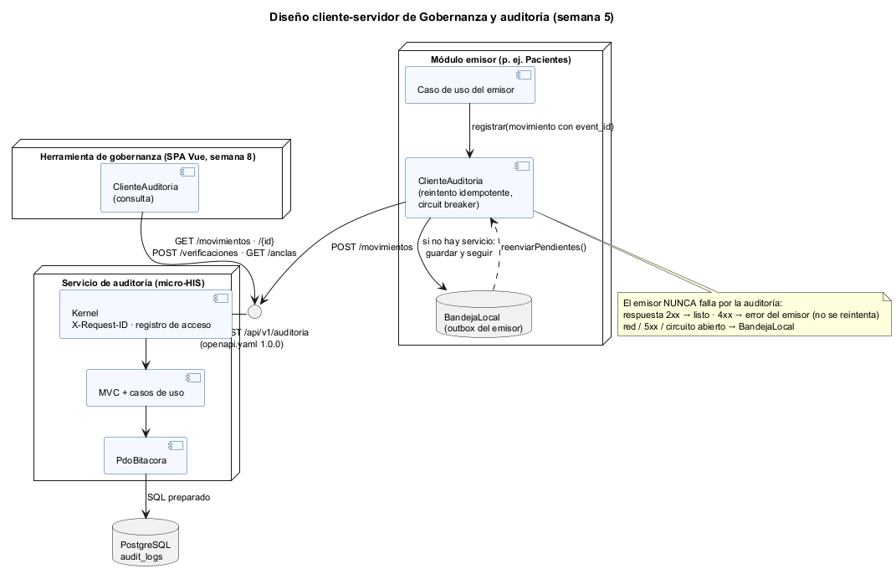
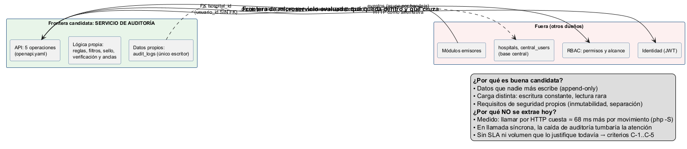
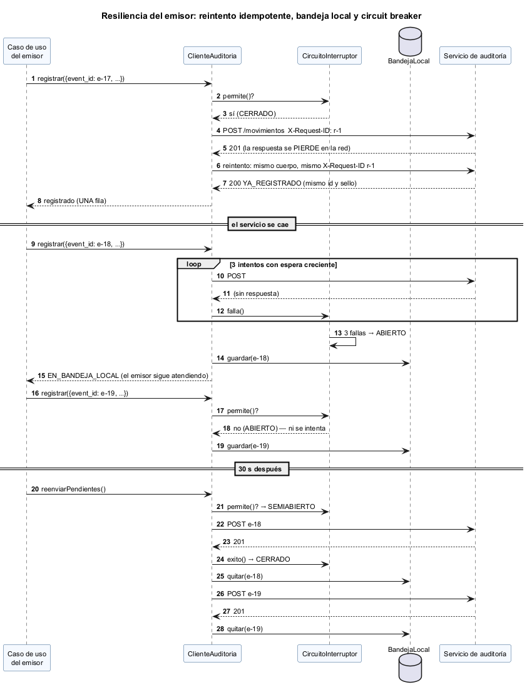
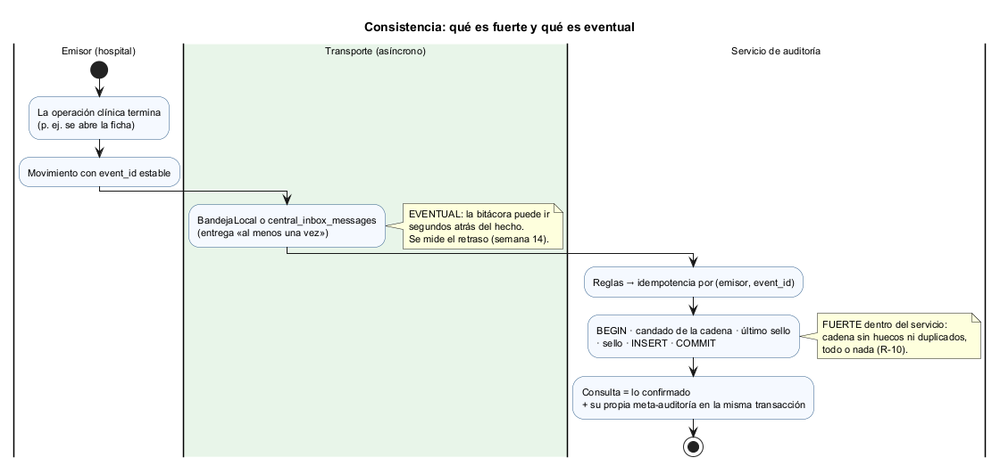
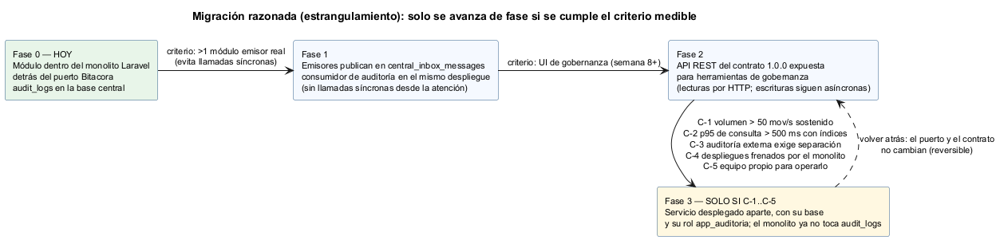
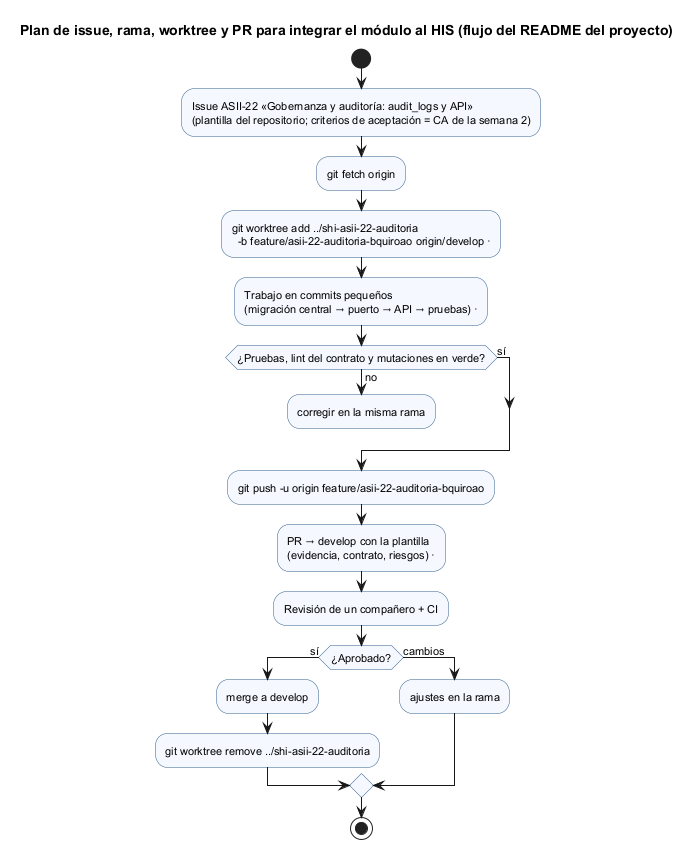

# Semana 5 — Cliente-servidor, API REST, frontera de microservicio e integración

| | |
|---|---|
| **Curso** | Análisis de Sistemas II — Proyecto Final 2026 |
| **Módulo** | Gobernanza y auditoría de movimientos del sistema |
| **Tema de la semana** | Cliente-servidor, API REST, microservicios e integración |
| **Flujo** | «Registro inmutable y consulta filtrada de movimientos por usuario, módulo y fechas» |
| **Código** | [`micro-his-auditoria/`](../micro-his-auditoria/README.md) (el MISMO de las semanas 3 y 4) |
| **Contrato** | [`api/openapi.yaml`](../micro-his-auditoria/api/openapi.yaml) 1.0.0 |
| **Estudiante** | Boris Alexander Quiroa Orellana |

## Índice

1. [Introducción y decisión](#1-introducción-y-decisión)
2. [Qué se construyó esta semana](#2-qué-se-construyó-esta-semana)
3. [Diseño cliente-servidor](#3-diseño-cliente-servidor)
4. [Contrato API](#4-contrato-api)
5. [Evaluación de la frontera de microservicio](#5-evaluación-de-la-frontera-de-microservicio)
6. [Propiedad de los datos](#6-propiedad-de-los-datos)
7. [Comunicación](#7-comunicación)
8. [Seguridad](#8-seguridad)
9. [Resiliencia](#9-resiliencia)
10. [Observabilidad](#10-observabilidad)
11. [Consistencia](#11-consistencia)
12. [Migración razonada](#12-migración-razonada)
13. [Plan de issue, rama, worktree y PR](#13-plan-de-issue-rama-worktree-y-pr)
14. [Evidencia](#14-evidencia)
15. [Limitaciones](#15-limitaciones)
16. [Conclusión](#16-conclusión)

## 1. Introducción y decisión

**La pregunta de la semana:** ¿debe la auditoría ser un microservicio?

**Respuesta medida:** **todavía no**. Se diseña como servicio (contrato, cliente, frontera de datos clara) pero se queda **dentro del monolito**, detrás de su puerto. Las razones:

| Medición o hecho | Valor |
|---|---|
| Registrar en proceso con PostgreSQL | **1,0 ms** p50 |
| El mismo registro por HTTP (`php -S` + PostgreSQL) | **69 ms** p50 (≈ 68 ms más) |
| Consulta filtrada por HTTP | 76 ms p50 · 93 ms p95 (cumple RNF-06 < 500 ms) |
| Movimientos perdidos por HTTP | 0 de 200 |

Casi todo el sobrecosto de HTTP es arranque: `php -S` levanta un proceso y abre una conexión PDO nueva por petición. Un servidor de producción lo bajaría.

**El argumento decisivo no es la latencia, es la disponibilidad.** Si cada operación clínica esperara una respuesta síncrona de auditoría, una caída de auditoría tumbaría la atención. Por eso la escritura de los emisores es **asíncrona** (bandeja) en todas las fases, y el servicio aparte queda condicionado a criterios medibles (C-1..C-5, §5.3).

## 2. Qué se construyó esta semana

| Pieza | Dónde | Para qué |
|---|---|---|
| Contrato OpenAPI 3.1, 5 operaciones | `api/openapi.yaml` | Fuente de verdad de la API; lint de Redocly sin errores |
| Pruebas de conformidad API-01..03 | `tests/Contratos/ContratoApiPrueba.php` | Contrato = código (operaciones, permisos y códigos de 24 escenarios reales) |
| Capa **Cliente** | `src/Cliente/` | `ClienteAuditoria` con reintento idempotente, circuit breaker y **BandejaLocal** (outbox del emisor; en memoria y en archivo) |
| Observabilidad | `Kernel` + `Observabilidad/RegistroAccesoJson` | `X-Request-ID` en toda respuesta; una línea JSON por petición sin datos personales |
| **Ancla externa** | `ObtenerAncla`, `GET /anclas`, `VerificarIntegridad` con `ancla` | Cierra la limitación de la semana 2: ahora se detecta que borren la última fila (`TRUNCADA`) |
| Medición | `bin/medir.php` | La justificación medible de la frontera |
| Plan de integración | `plan/issue-asii-22-auditoria.md`, `plan/pr-integracion-auditoria.md` | Issue, rama, worktree y PR |

## 3. Diseño cliente-servidor



| Rol | Quién | Qué hace |
|---|---|---|
| **Cliente emisor** | Módulos del HIS, con `ClienteAuditoria` | Registra movimientos; nunca falla por la auditoría |
| **Cliente de gobernanza** | SPA Vue (semana 8) o herramientas, con `ClienteAuditoria::consultar()` | Consulta, detalle, verificación y anclas |
| **Servidor** | Micro-HIS: Kernel → MVC → casos de uso → `PdoBitacora` | Único escritor de `audit_logs` |

El cliente se programa **contra el contrato**, no contra las clases del servidor: ARQ-01 impide que `Cliente` importe Dominio o Aplicación.

## 4. Contrato API

[`api/openapi.yaml`](../micro-his-auditoria/api/openapi.yaml), OpenAPI 3.1, versión 1.0.0 ([lint](evidencia/2-lint-openapi.txt)):

| Método y ruta | operationId | `x-permiso` | Respuestas |
|---|---|---|---|
| `POST /api/v1/auditoria/movimientos` | `registrarMovimiento` | `auditoria.registrar` | 201 · 200 `YA_REGISTRADO` · 400 · 401 · 403 · 404 · 409 · 422 · 500 · 503 |
| `GET /api/v1/auditoria/movimientos` | `consultarMovimientos` | `auditoria.consultar` (red: `consultar_red`) | 200 · 400 · 401 · 403 · 404 · 422 · 500 · 503 |
| `GET /api/v1/auditoria/movimientos/{id}` | `verDetalleMovimiento` | `auditoria.consultar` (red: `consultar_red`) | 200 · 400 · 401 · 403 · 404 · 405 · 500 · 503 |
| `POST /api/v1/auditoria/verificaciones` | `verificarIntegridad` | `auditoria.verificar` | 200 `INTEGRA` / `ALTERADA` / `TRUNCADA` · 400 · 401 · 403 · 404 · 500 · 503 |
| `GET /api/v1/auditoria/anclas` | `obtenerAncla` | `auditoria.verificar` | 200 (`Cache-Control: no-store`) · 400 · 401 · 403 · 404 · 500 · 503 |

**Decisiones del contrato:**

| Decisión | Por qué |
|---|---|
| **Idempotencia con `event_id` en el cuerpo**, no con una cabecera `Idempotency-Key` | El `event_id` ya es la identidad del evento en el emisor y en `central_inbox_messages`; una segunda clave sería redundante |
| **No hay `PUT`, `PATCH` ni `DELETE`** sobre un movimiento | Si se intentan, 405 (documentado). R-02 se ve en el contrato. |
| **Alcance por `X-Tenant-ID`** (`*` = red) | Un mecanismo para todo el HIS (el mismo de `TenantMiddleware`) |
| **Un `enum` de códigos de error** | Los clientes pueden programar contra códigos, no contra textos |
| **`x-permiso` por operación** | El permiso es parte del contrato; API-01 verifica que coincida con el caso de uso |

**Conformidad (no solo documentación):**

| Prueba | Verifica |
|---|---|
| API-01 | Las operaciones del contrato y las rutas del código son las mismas 5, y cada `x-permiso` es la constante del caso de uso |
| API-02 | Cada operación documenta los errores transversales |
| API-03 | En **24 escenarios reales** por el kernel, cada estado y cada código de error que sale está documentado (cubre 12 o más códigos distintos) |

## 5. Evaluación de la frontera de microservicio



### 5.1 ¿Es un buen candidato?

| A favor | En contra |
|---|---|
| Datos que nadie más escribe (append-only, único escritor) | Depende de RBAC e identidad **en cada petición** |
| Carga distinta: escritura constante, lectura rara | Agrega una llamada de red a cada emisor si se hace síncrono |
| Requisitos de seguridad propios (inmutabilidad, separación de funciones) | Hoy no hay volumen, SLA ni equipo que lo justifique |

### 5.2 Medición

`AUDITORIA_DB_DSN=… php bin/medir.php 200` ([salida](evidencia/1-medicion-frontera.txt)):

```text
A · en proceso, memoria                                   p50=  0.068 ms   p95=  0.108 ms
B · en proceso, PostgreSQL                                p50=  1.024 ms   p95=  1.958 ms
C · por HTTP (php -S) + PostgreSQL, con ClienteAuditoria  p50= 69.364 ms   p95= 88.784 ms
D · consulta filtrada por HTTP                            p50= 76.403 ms   p95= 87.948 ms
Costo de la base (B − A):  0.955 ms · Costo de la red (C − B): 68.340 ms · No registrados por HTTP: 0 de 200
```

**Cómo leerla:**
- La base cuesta ≈ 1 ms; la frontera HTTP, ≈ 68 ms en este entorno.
- Aunque un servidor real bajara eso a 5–10 ms, la conclusión no cambia: la auditoría **no debe** estar en el camino síncrono de la atención.
- El contrato y el cliente quedan listos para que, si se cumple un criterio, extraer el servicio no cambie a los emisores.

### 5.3 Criterios medibles para extraer el servicio

| ID | Criterio | Cómo se mide |
|---|---|---|
| C-1 | Más de 50 movimientos/s sostenidos | Conteo por minuto en `audit_logs` |
| C-2 | p95 de la consulta > 500 ms con los índices (RNF-06) | `bin/medir.php` sobre el volumen real |
| C-3 | Una auditoría externa exige separar la bitácora del sistema auditado | Requisito de cumplimiento escrito |
| C-4 | Los despliegues del monolito frenan cambios de auditoría (o al revés) | Frecuencia de despliegues bloqueados |
| C-5 | Hay un equipo que pueda operar el servicio (guardias, respaldos) | Decisión organizativa |

Mientras ninguno se cumpla, extraer el servicio solo agrega red, despliegues y fallas parciales.

## 6. Propiedad de los datos

| Dato | Dueño | Acceso de auditoría |
|---|---|---|
| `audit_logs` | **Auditoría** (único escritor; rol `app_auditoria`: `INSERT` y `SELECT`) | Total |
| `hospitals` | Registro de la red | FK, solo lectura |
| `central_users` | Usuarios y tenants | **Sin FK** (semana 4): la evidencia no espera a la sincronización |
| `central_inbox_messages` | Sincronización central | Consume solo `auditoria.movimiento` |
| Permisos | RBAC | Pregunta por el puerto `PoliticaAcceso` |

## 7. Comunicación

| Interacción | Estilo | Por qué |
|---|---|---|
| Emisor → auditoría (nodo de hospital) | **Asíncrona**, por `central_inbox_messages` | La atención no espera a la auditoría |
| Emisor → auditoría (servicio central) | HTTP `POST` + `ClienteAuditoria` (reintento + bandeja local) | Sin bandeja central a mano; igual nunca falla ni duplica |
| Gobernanza → auditoría | HTTP síncrono (`GET`, `POST /verificaciones`) | Es una consulta humana; necesita la respuesta |
| Auditoría → RBAC e identidad | Por puertos, en proceso | Hoy en el monolito; si se extrae, cache de decisiones |

Se usa el **mismo `X-Request-ID` en todos los reintentos** (CLI-01), y el servidor lo devuelve. Así una petición se sigue de punta a punta.

## 8. Seguridad

| Amenaza | Defensa | Prueba |
|---|---|---|
| Emisor que escribe en otro hospital o a nombre de otro módulo | Tenant del token; `ReglaModuloDelEmisor` | HTTP-02, APP-02 |
| Auditor que lee otra red | Permiso por alcance; `*` solo para el super administrador | APP-07, HTTP-02 |
| Inyección SQL en filtros | Fragmentos con parámetros | PER-02, ARQ-03, M10 |
| Datos clínicos o secretos en la bitácora | `ReglaSinDatosProhibidos` | DOM-02 |
| Fuga en logs técnicos | El registro de acceso no lleva token, consulta ni cuerpo | OBS-02 |
| Encabezado inyectado vía `X-Request-ID` | Solo `[A-Za-z0-9-]{8,64}`; si no, se genera | OBS-01 |
| Alteración o truncamiento de la bitácora | Trigger + sello + **ancla externa** | INT-02, INT-05, **INT-07**, **APP-11** |
| Lectura sin rastro | Meta-auditoría transaccional | APP-05, CA-16 |

## 9. Resiliencia



| Falla | Comportamiento | Prueba |
|---|---|---|
| Se pierde la respuesta del 201 | Reintento con el mismo `event_id` → 200 `YA_REGISTRADO`; **una** fila | CLI-02 |
| Red caída o 5xx | 1 + 2 reintentos con espera creciente; después, **BandejaLocal**; el emisor sigue | CLI-01, CLI-03 |
| 3 fallas seguidas | Circuit breaker **ABIERTO**: no llama; guarda directo en la bandeja; a los 30 s, SEMIABIERTO | CLI-05 |
| El servicio vuelve | `reenviarPendientes()` en orden; respeta el circuito | CLI-03, CLI-05 |
| 4xx del servicio | No se reintenta ni se guarda (es un error del emisor); en el reenvío se informa como rechazado | CLI-04, M16 |
| Reinicio del emisor con pendientes | `BandejaArchivo` persiste en disco con `flock` | CLI-06 |
| Puerto cerrado de verdad | `FallaTransporte` en < 5 s; a la bandeja | CLI-08 |
| La meta-auditoría falla | La consulta no entrega resultados (503) | APP-05 |

**Garantía resultante:** entrega «al menos una vez» (reintento + bandeja), más idempotencia por `event_id`, da efecto «exactamente una vez» en la bitácora.

## 10. Observabilidad

| Señal | Dónde | Contenido |
|---|---|---|
| `X-Request-ID` | Toda respuesta | Se respeta el del cliente si es seguro; si no, uno nuevo |
| Registro de acceso | `RegistroAccesoJson` → stderr | `request_id`, método, **ruta sin consulta**, estado, duración, actor y tenant; nunca token, filtros ni cuerpo (OBS-02) |
| Bitácora de negocio | `audit_logs` | Movimientos y lecturas (meta-auditoría) |
| Anclas | `GET /anclas` | Cabeza de cada cadena para publicar y comparar |
| Estado del cliente | `estadoCircuito()` y tamaño de la bandeja | Alertar si la bandeja crece |

El registro de acceso **nunca** cambia la respuesta, aunque falle (OBS-03).

## 11. Consistencia



| Dónde | Modelo | Garantía |
|---|---|---|
| Dentro del servicio | **Fuerte** | Candado por cadena, secuencia sin huecos, todo o nada; la meta-auditoría va en la misma transacción que la lectura |
| Emisor → bitácora | **Eventual** | La bitácora puede ir segundos atrás del hecho; no se pierde ni se duplica |
| Lecturas | Leer lo confirmado | Una consulta nunca ve un movimiento a medias |

## 12. Migración razonada



| Fase | Qué cambia | Entra si | Reversible |
|---|---|---|---|
| 0 (hoy) | Módulo en el monolito, detrás del puerto | — | — |
| 1 | Emisores publican en `central_inbox_messages`; consumidor en el mismo despliegue | Hay más de un emisor real | Sí: el puerto no cambia |
| 2 | API REST 1.0.0 para gobernanza | Existe la interfaz (semana 8+) | Sí |
| 3 | Servicio aparte, con su base y su rol | Se cumple alguno de C-1..C-5 | Sí: el contrato y el cliente no cambian |

## 13. Plan de issue, rama, worktree y PR



| Paso | Detalle |
|---|---|
| Issue | [`plan/issue-asii-22-auditoria.md`](plan/issue-asii-22-auditoria.md): plantilla `module_task.md` llena, 5 tareas de integración (T1 esquema central, T2 núcleo, T3 API, T4 ingesta, T5 seguridad y operación) y dependencias con ASII-01, 02, 03, 27 y 30. Listo para `gh issue create`. |
| Rama | `feature/asii-22-auditoria-bquiroao`, con una rama por tarea (`…-esquema-…`, `…-api-…`, `…-ingesta-…`) |
| Worktree | `git worktree add ../shi-asii-22-auditoria -b feature/asii-22-auditoria-bquiroao origin/develop`, como pide el README del proyecto |
| PR | [`plan/pr-integracion-auditoria.md`](plan/pr-integracion-auditoria.md): la plantilla del repositorio prellenada para T2, con los comandos de apertura y cierre del worktree |

## 14. Evidencia

| Comando | Resultado | Evidencia |
|---|---|---|
| `php bin/medir.php 200` | A 0,07 · B 1,0 · C 69 · D 76 ms (p50); 0 perdidos | [1-medicion-frontera.txt](evidencia/1-medicion-frontera.txt) |
| `npx @redocly/cli lint api/openapi.yaml` | Válido | [2-lint-openapi.txt](evidencia/2-lint-openapi.txt) |
| `php tests/ejecutar.php` | **78 · 63 pasan** · 0 fallan · 15 omitidas (sin base) | [3-pruebas-dobles.txt](evidencia/3-pruebas-dobles.txt) |
| La misma, con PostgreSQL 18 | **78 · 78 pasan** | [4-pruebas-postgres.txt](evidencia/4-pruebas-postgres.txt) |
| `php tests/mutaciones.php` | **18/18** (3 nuevas: M16 cliente guarda un 4xx, M17 ignora el ancla, M18 sin `X-Request-ID`) | [5-mutaciones.txt](evidencia/5-mutaciones.txt) |

**Pruebas nuevas:**
- API-01..03;
- CLI-01..08;
- OBS-01..03;
- APP-11 (ancla);
- INT-07 (truncamiento real en PostgreSQL).

**Hallazgo del proceso.** CLI-03 falló en su primera versión: el reenvío inmediato después de la caída no entregaba nada. No era un defecto. El circuito estaba **abierto**, y respetarlo es justo lo que se busca: no martillar un servicio caído. Se corrigió la prueba para que compruebe las dos cosas.

## 15. Limitaciones

- La medición usa `php -S` (un proceso por petición, sin conexiones persistentes). Sirve para comparar órdenes de magnitud, no para dimensionar producción.
- El consumidor de `central_inbox_messages` sigue diseñado (semana 4) y no implementado: es la tarea T4.
- `BandejaArchivo` es un prototipo; en el HIS, la bandeja del emisor es la tabla de salida de su nodo.
- Las anclas se obtienen por API, pero **publicarlas** fuera de la base (otro sistema, firma) es operación (T5).

## 16. Conclusión

La auditoría quedó diseñada como un servicio:
- un contrato verificado contra el código;
- un cliente que nunca hace fallar al emisor ni duplica;
- datos con un solo dueño.

Pero **no se separó**, porque la medición dice que hoy solo agregaría costo y un punto de falla en la atención. La decisión es reversible y tiene disparadores medibles.

Además, se cerró la limitación pendiente desde la semana 2: con el ancla externa, borrar la última fila deja de ser invisible, y lo demuestra INT-07 contra PostgreSQL real.
