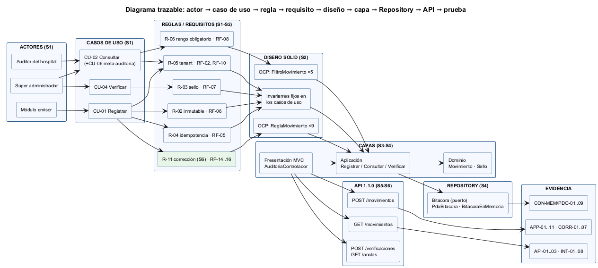
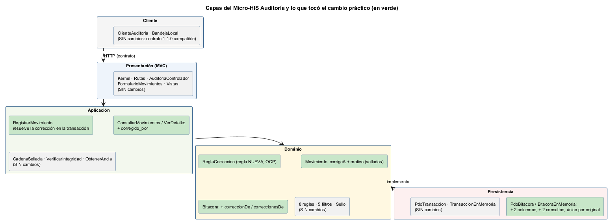

# Semana 6 — Primera evaluación parcial: defensa de la arquitectura

| | |
|---|---|
| **Curso** | Análisis de Sistemas II — Proyecto Final 2026 |
| **Módulo** | Gobernanza y auditoría de movimientos del sistema |
| **Proceso** | «Registro inmutable y consulta filtrada de movimientos por usuario, módulo y fechas» |
| **Estudiante** | Boris Alexander Quiroa Orellana |

## Entregables

| Pedido | Dónde |
|---|---|
| Presentación de 6–8 diapositivas | [`presentacion/semana-06-defensa-auditoria.pptx`](presentacion/semana-06-defensa-auditoria.pptx) (8 diapositivas, con notas del orador) · [PDF](presentacion/semana-06-defensa-auditoria.pdf) |
| Diagrama trazable | [`diagramas/semana-06-trazabilidad.png`](diagramas/semana-06-trazabilidad.png): actor → caso de uso → regla y requisito → diseño SOLID → capa → Repository → API → prueba |
| Matriz decisión → evidencia | [`matriz-decision-evidencia.md`](matriz-decision-evidencia.md): 21 decisiones (D-01..D-21), cada una con requisito, ubicación y evidencia ejecutable |
| Registro del cambio práctico defendido | [`registro-cambio-practico.md`](registro-cambio-practico.md): «corrección trazable de un movimiento», con pruebas primero |

## 1. La arquitectura en una página

| Lo que pide la defensa | Lo que se muestra | Semana | Evidencia |
|---|---|:-:|---|
| **Actores** | Módulo emisor, auditor del hospital, super administrador; RBAC e identidad como secundarios | 1 | [UML](../semana-01/semana-01-uml-proceso-auditoria.md) |
| **UML** | Casos de uso **sin editar ni borrar**; actividad con 14 decisiones; secuencia con 53 mensajes; identificadores compartidos | 1 | Matriz de trazabilidad de la semana 1 |
| **RF/RNF** | 13 RF, 9 RNF, 17 criterios de aceptación (más RF-14..17 y RNF-10 del cambio) | 2, 6 | CA-01..17, CORR-01..07 |
| **Principio SOLID** | OCP: reglas y filtros extensibles; invariantes fijos | 2 | OCP-01..03, PAR-01 (sellos idénticos) |
| **Capas** | Presentación (MVC) → Aplicación → Dominio ← Persistencia, verificada leyendo el código | 3, 4 | ARQ-01..08 |
| **Repository** | `Bitacora` en el Dominio; PDO e InMemory de producción; una suite de contrato | 4 | CON-MEM/PDO-01..09 |
| **Contrato API** | OpenAPI 3.1, 5 operaciones, 1.1.0; verificado contra el código | 5, 6 | API-01..03, lint |



## 2. El cambio práctico defendido

**Solicitud:** un integrador atribuyó consultas de fichas al usuario equivocado. Hay que corregir sin editar la bitácora. El detalle completo está en el [registro del cambio](registro-cambio-practico.md).

| Tema que pide la tarea | Respuesta del diseño |
|---|---|
| Audit logs inmutables | La corrección es **otro** movimiento; el original y su sello no cambian (CORR-01) |
| Usuario | Se corrige el usuario; la consulta muestra los dos, enlazados (CORR-06) |
| Módulo | Solo el mismo emisor corrige (CORR-03) |
| Acción | La corrección pasa por las mismas 9 reglas |
| Tenant | Otro hospital responde igual que «no existe» (CORR-03, M20) |
| Filtros por rango de fechas | Cada uno en su fecha; el original avisa `corregido_por` (CORR-06) |



**Lo que demuestra el cambio sobre la arquitectura:**
- **Presentación y Cliente no cambiaron.**
- **La regla nueva se agregó** sin tocar las 8 existentes (OCP en acción).
- **El contrato subió a 1.1.0** de forma compatible.

## 3. Estado verificable

| Verificación | Resultado | Evidencia |
|---|---|---|
| Pruebas antes del cambio | 84 · **5 fallan** (las nuevas) | [cambio-1-antes-rojo.txt](evidencia/cambio-1-antes-rojo.txt) |
| Pruebas después | 88 · 71 pasan · **0 fallan** · 17 omitidas | [cambio-2-despues-verde.txt](evidencia/cambio-2-despues-verde.txt) |
| Con PostgreSQL 18 | **88/88** | [cambio-3-postgres.txt](evidencia/cambio-3-postgres.txt) |
| Mutaciones | **21/21** | [mutaciones.txt](evidencia/mutaciones.txt) |
| Contrato 1.1.0 | Válido (Redocly) | [lint-openapi.txt](evidencia/lint-openapi.txt) |
| Demo del cambio | 8 pasos por la API, sin base | [demo-correccion.txt](evidencia/demo-correccion.txt) |

## 4. Cómo verificarlo en vivo

```bash
cd docs/modulos/gobernanza-auditoria/micro-his-auditoria
php tests/ejecutar.php
php tests/mutaciones.php
php bin/demo-correccion.php
npx @redocly/cli@1.34.3 lint api/openapi.yaml
```
