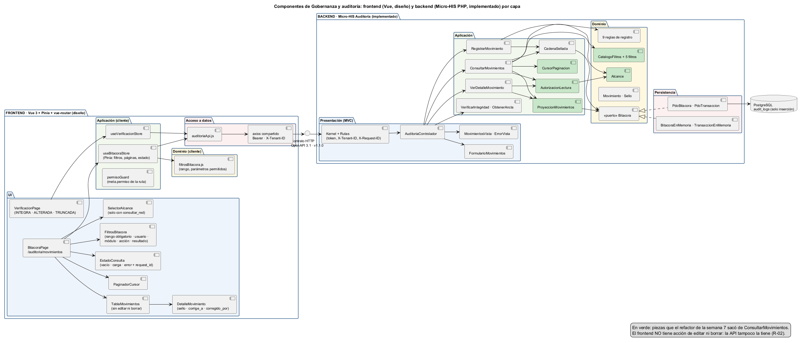
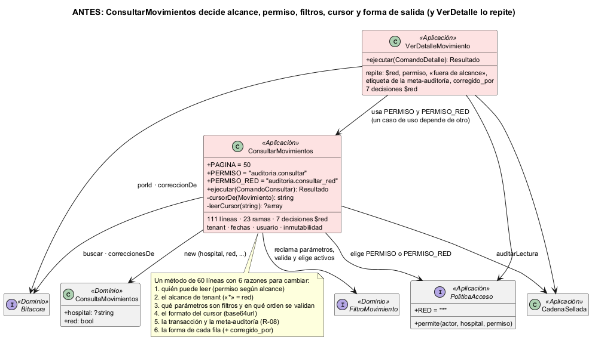
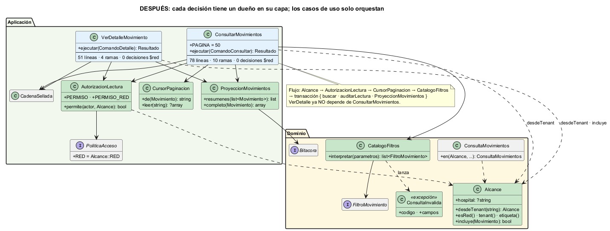

# Semana 7 — Diseño de componentes y refactorización

| | |
|---|---|
| **Curso** | Análisis de Sistemas II — Proyecto Final 2026 |
| **Módulo** | Gobernanza y auditoría de movimientos del sistema |
| **Proceso** | «Registro inmutable y consulta filtrada de movimientos por usuario, módulo y fechas» |
| **Estudiante** | Boris Alexander Quiroa Orellana |

## Entregables

| Pedido | Dónde |
|---|---|
| Diagrama de componentes | [`diagramas/semana-07-componentes.png`](diagramas/semana-07-componentes.png): frontend y backend, por capa |
| Contratos de entrada/salida | [`contratos-entrada-salida.md`](contratos-entrada-salida.md) |
| Comparación antes/después de un refactor concreto con justificación | §4–§9 de este documento · diagramas [antes](diagramas/semana-07-refactor-antes.png) y [después](diagramas/semana-07-refactor-despues.png) · código anterior en [`refactor/antes/`](refactor/antes/) |

## 1. Resumen

- **Componentes:** backend implementado en el Micro-HIS (4 capas más el Cliente) y frontend Vue diseñado con la convención del HIS. Los une el contrato OpenAPI 1.1.0.
- **Punto de mayor acoplamiento:** `ConsultarMovimientos`, elegido **midiendo**. Decidía en un solo método:
  - el alcance de tenant;
  - el permiso;
  - qué parámetros son filtros;
  - el formato del cursor;
  - la forma de la salida.

  `VerDetalleMovimiento` repetía la mitad de eso y además dependía de las constantes de `ConsultarMovimientos`.
- **Refactor:** 5 piezas con un dueño cada una, en su capa:
  - Dominio: `Alcance` y `CatalogoFiltros`;
  - Aplicación: `AutorizacionLectura`, `CursorPaginacion` y `ProyeccionMovimientos`.

  Los casos de uso quedaron como orquestadores.
- **Sin ampliar el módulo:**
  - mismas rutas y mismo contrato;
  - las demos dan la misma salida;
  - las pruebas de caracterización pasaron antes y después.

## 2. Diagrama de componentes



| Lado | Capa | Componentes | Responsabilidad |
|---|---|---|---|
| Frontend | UI | `BitacoraPage`, `FiltrosBitacora`, `SelectorAlcance`, `TablaMovimientos`, `PaginadorCursor`, `DetalleMovimiento`, `EstadoConsulta`, `VerificacionPage` | Mostrar y capturar; sin reglas |
| Frontend | Aplicación | `useBitacoraStore`, `useVerificacionStore`, `permisoGuard` | Estado de la pantalla, paginación, permisos de navegación |
| Frontend | Dominio | `filtrosBitacora.js` | Ayuda de validación (el servidor decide) |
| Frontend | Acceso a datos | `auditoriaApi.js` sobre el `axios` compartido | HTTP y normalización de errores |
| Backend | Presentación | `Kernel`, `Rutas`, `AuditoriaControlador`, `FormularioMovimientos`, Vistas | HTTP ↔ comandos y resultados |
| Backend | Aplicación | 5 casos de uso, `CadenaSellada` y las 3 piezas nuevas | Flujo, transacción, permisos |
| Backend | Dominio | `Movimiento`, `Sello`, 9 reglas, 5 filtros, `Alcance`, `CatalogoFiltros`, puerto `Bitacora` | Reglas del negocio |
| Backend | Persistencia | PDO e InMemory | Guardar sin modificar nunca |

Los contratos de cada componente están en [`contratos-entrada-salida.md`](contratos-entrada-salida.md).

**Lo que el frontend no tiene, a propósito:**
- un formulario de registro (escriben los módulos emisores, servidor a servidor);
- acciones de editar o borrar (R-02).

## 3. Cómo se midió el acoplamiento

`php bin/acoplamiento.php` analiza las clases de `src/` con el tokenizador de PHP. Es el mismo instrumento que se usó en Pacientes, adaptado. Para cada clase calcula:

| Medida | Qué cuenta |
|---|---|
| **Ce / Ca** | Clases del proyecto que usa / que la usan |
| **Ramas** | `if`, `foreach`, `catch`, `??`, `&&`, `\|\|` y ternarios (el `?` de los tipos anulables no se cuenta) |
| **Alc** | Veces que la clase **decide** el alcance de tenant por su cuenta: el comodín `RED` o una variable `$red` |
| **P** | Cuántas de las 6 preocupaciones de la tarea mezcla: inmutabilidad, usuario, módulo, acción, tenant y rango de fechas. Cada una se reconoce por sus marcas en el código |

Salida **antes** ([`evidencia/acoplamiento-1-antes.txt`](evidencia/acoplamiento-1-antes.txt)):

```
Clase                    Capa            Ce   Ca  Ramas  Alc  P  Preocupaciones que mezcla
PdoBitacora              Persistencia     4    1     13    1  6  inmutabilidad · usuario · modulo · accion · tenant · fechas
Movimiento               Dominio          1   15     11    0  6  inmutabilidad · usuario · modulo · accion · tenant · fechas
ConsultarMovimientos     Aplicacion      10    2     23    7  4  inmutabilidad · usuario · tenant · fechas
BitacoraEnMemoria        Persistencia     5    1     17    0  4  inmutabilidad · modulo · tenant · fechas
RegistrarMovimiento      Aplicacion      10    1     14    0  3  inmutabilidad · modulo · tenant
VerDetalleMovimiento     Aplicacion       8    1      8    7  3  inmutabilidad · usuario · tenant
```

**Cómo se leyó la tabla:**

| Clase | ¿Es un problema? | Motivo |
|---|---|---|
| `PdoBitacora`, `BitacoraEnMemoria` | No | Un adaptador **debe** conocer todas las columnas. Está aislado detrás del puerto y cubierto por la suite de contrato. |
| `Movimiento` | No | Es la entidad: contener usuario, módulo, acción, hospital, fecha y sello es su razón de ser. |
| `RegistrarMovimiento` | Poco | 0 decisiones de alcance. Las reglas ya estaban afuera (OCP de la semana 2). |
| **`ConsultarMovimientos`** | **Sí** | Es el caso de uso con **más ramas (23)** y **7 decisiones de alcance**. Mezcla tenant, fechas (cursor), usuario e inmutabilidad (meta-auditoría). |
| **`VerDetalleMovimiento`** | **Sí, por duplicación** | Repite las mismas 7 decisiones de alcance y lee las constantes de permiso de `ConsultarMovimientos`: un caso de uso dependía de otro. |

## 4. Refactor: antes

Código completo en [`refactor/antes/ConsultarMovimientos.php`](refactor/antes/ConsultarMovimientos.php) y [`refactor/antes/VerDetalleMovimiento.php`](refactor/antes/VerDetalleMovimiento.php).



```php
// ConsultarMovimientos::ejecutar() — antes (extracto)
$red = $comando->hospital === PoliticaAcceso::RED;                                    // tenant
if (!$this->acceso->permite($comando->actor, $comando->hospital,
        $red ? ConsultarMovimientos::PERMISO_RED : ConsultarMovimientos::PERMISO)) { … } // permiso
$despuesDe = $cursor === null ? null : self::leerCursor($cursor);                     // formato del cursor
$reclamados = []; foreach ($this->filtros as $filtro) { … }                           // qué es un filtro
foreach (array_keys($parametros) as $nombre) { … 'FILTRO_NO_SOPORTADO' … }
foreach ($this->filtros as $filtro) { … obligatorio … validar … 'DATOS_INVALIDOS' … }
$consulta = new ConsultaMovimientos($red ? null : $comando->hospital, $red, …);       // tenant otra vez
… auditarLectura($consulta->hospital, …, ['alcance' => $red ? 'red' : 'hospital', …]) // tenant otra vez
… $m->resumen() + ['corregido_por' => $corregidos[$m->id] ?? null] …                  // forma de salida
// VerDetalleMovimiento: copia el bloque de tenant y permiso, '(!$red && $m->hospital !== …)' y otra forma de salida
```

**Seis razones para cambiar en un solo método:**
1. quién puede leer;
2. el alcance de tenant;
3. qué parámetros son filtros y en qué orden se validan;
4. el formato del cursor;
5. la transacción y la meta-auditoría;
6. la forma de cada fila.

## 5. Refactor: después



| Pieza | Capa | Se llevó | Por qué en esa capa |
|---|---|---|---|
| `Alcance` | Dominio | `*` = red, hospital o `null`, `incluye(Movimiento)`, etiqueta de la meta-auditoría | R-05 es una regla de negocio: «un hospital solo ve lo suyo» |
| `CatalogoFiltros` + `ConsultaInvalida` | Dominio | Qué parámetros son filtros, el rango obligatorio y el orden «no soportado → inválido» | Es la gramática de la consulta (R-06), que ya vivía en los filtros del Dominio |
| `AutorizacionLectura` | Aplicación | Qué permiso exige leer según el alcance | Los nombres de los permisos son de RBAC (puerto `PoliticaAcceso`), no del Dominio |
| `CursorPaginacion` | Aplicación | El formato base64url del cursor | Es un detalle de la paginación (R-09), no una regla de negocio. No es de la Presentación, porque el caso de uso necesita la posición |
| `ProyeccionMovimientos` | Aplicación | La forma de la fila y del detalle, con `corregido_por` | Es una vista de lectura compartida por dos casos de uso |

```php
// ConsultarMovimientos::ejecutar() — después (completo, sin la transacción)
$alcance = Alcance::desdeTenant($comando->hospital);
if (!$this->autorizacion->permite($comando->actor, $alcance)) {
    return Resultado::accesoDenegado();
}
$parametros = $comando->parametros;
$cursor = $parametros['cursor'] ?? null;
unset($parametros['cursor']);
$despuesDe = $cursor === null ? null : CursorPaginacion::leer($cursor);
if ($cursor !== null && $despuesDe === null) { return /* 422 cursor */; }
try {
    $consulta = ConsultaMovimientos::en($alcance, $this->catalogo->interpretar($parametros), $parametros, self::PAGINA + 1, $despuesDe);
} catch (ConsultaInvalida $e) {
    return Resultado::error(Resultado::INVALIDO, $e->codigo, ['campos' => $e->campos]);
}
// transacción { buscar → auditarLectura($alcance->hospital, …, ['alcance' => $alcance->etiqueta(), …]) → $this->proyeccion->resumenes($pagina) }
```

**Archivos tocados**, todos dentro de `micro-his-auditoria/`:
- 6 clases nuevas en `src/`;
- 2 casos de uso reescritos;
- `ConsultaMovimientos::en()`;
- `PoliticaAcceso::RED = Alcance::RED`;
- el contenedor;
- 2 líneas de `ContratoApiPrueba`, que ahora leen los permisos de su nuevo dueño.

**Nada de la Presentación, de la Persistencia ni del Cliente cambió.**

## 6. Comparación medida

Mismo instrumento antes y después ([antes](evidencia/acoplamiento-1-antes.txt) · [después](evidencia/acoplamiento-2-despues.txt)):

| Métrica | Antes | Después | Cambio |
|---|---:|---:|---|
| Decisiones de alcance en `ConsultarMovimientos` / `VerDetalleMovimiento` | 7 / 7 | **0 / 0** | Solo `Alcance` decide (3) |
| Decisiones de alcance en toda la Aplicación | 17 | **4** | Las 4 que quedan son las verificaciones de red de `VerificarIntegridad` y `ObtenerAncla`, fuera del punto elegido (§9) |
| Decisiones de alcance en todo `src/` | 20 | **10** | — |
| Ramas de `ConsultarMovimientos` / `VerDetalleMovimiento` | 23 / 8 | **10 / 4** | −57 % / −50 % |
| Preocupaciones de `ConsultarMovimientos` | 4 | **3** | Sale rango de fechas (cursor). Quedan tenant (usa `Alcance`), usuario (el actor) e inmutabilidad (meta-auditoría), que son su flujo |
| Líneas de `ConsultarMovimientos` | 111 | **78** | −33 |
| Dependencias entre casos de uso | 1 (`VerDetalle` → `Consultar`) | **0** | — |
| Lugares que definen la forma de salida con `corregido_por` | 2 | **1** | `ProyeccionMovimientos` |
| Clases que mezclan ≥ 4 preocupaciones | 4 | **3** | — |
| Ce de `ConsultarMovimientos` | 10 | 13 | **Sube**: ver §9 |
| Pruebas | 88 → 91 (+3 de caracterización) | **94** (+3 unitarias): 0 fallan; 94/94 con PostgreSQL | Mismo comportamiento |
| Mutaciones detectadas | 21/21 | **24/24** | M22–M24 vigilan las piezas nuevas |

## 7. Justificación

| Principio | Cómo lo cumple el refactor |
|---|---|
| **SRP** | Cada caso de uso tiene una sola razón para cambiar: su flujo. Un cambio en el formato del cursor, en los nombres de los permisos o en la forma de la fila se hace en **una** clase. |
| **OCP** (semana 2) | Agregar un filtro sigue sin tocar el caso de uso. Ahora tampoco toca el código que decide qué parámetros se aceptan: `CatalogoFiltros` los descubre de los filtros. |
| **DIP** | La Aplicación depende de `Alcance` (Dominio) y del puerto `PoliticaAcceso`, no de un comodín `'*'` repetido. El Dominio no conoce nombres de permisos. |
| **Separación de capas** (lo que pide la tarea) | La regla de tenant y la gramática de la consulta bajaron al Dominio. Permiso, cursor y forma de salida quedaron como servicios de Aplicación. UI y Persistencia, sin cambios. |
| **Seguridad (R-05)** | La comparación «¿es de mi hospital?» está en `Alcance::incluye()`, vigilada por la mutación M22. Antes había dos copias, y un cambio en una sola habría abierto una fuga solo en el detalle. |
| **Facilidad de prueba** | Las piezas se prueban solas (REF-04..06), sin transacción ni bitácora. Eso encontró el defecto DEF-07-01 (§8). |

**Alternativas descartadas:**

| Alternativa | Motivo |
|---|---|
| Mover el alcance a un *middleware* de la Presentación | La Presentación ya valida el **token** contra `X-Tenant-ID` (M12). Pero «un hospital solo ve lo suyo» es una regla de negocio: si sale del caso de uso, otro canal (CLI, eventos) la perdería. |
| Convertir el alcance en otro `FiltroMovimiento` | Rompe una decisión de la semana 2: el alcance **no** es intercambiable. Si fuera un filtro, una composición podría quitarlo. |
| Un objeto `ConsultaInterpretada` que reúna cursor, filtros y alcance | Agrega un tipo más sin quitar ninguna decisión. Con 5 piezas pequeñas, cada una se nombra por lo que decide. |
| Pasar `Alcance` al constructor de `ConsultaMovimientos` y cambiar la Persistencia | Cambia adaptadores cubiertos por la suite de contrato sin bajar el acoplamiento del punto elegido. Se agregó `ConsultaMovimientos::en()` y los adaptadores no se tocaron. |

## 8. Prueba de que no se amplió el módulo

1. **Línea base**, antes de tocar `src/`: 88 pruebas, 0 fallan ([`pruebas-1-antes.txt`](evidencia/pruebas-1-antes.txt)).
2. **Caracterización** REF-01..03, escrita y ejecutada **sobre el código anterior** ([`caracterizacion-sobre-codigo-anterior.txt`](evidencia/caracterizacion-sobre-codigo-anterior.txt)):
   - **REF-01:** orden de las comprobaciones (permiso → cursor → filtro no soportado → datos inválidos); una consulta rechazada no deja meta-auditoría.
   - **REF-02:** contenido exacto de la meta-auditoría de consulta y detalle, por hospital y por red; un 404 fuera del alcance es idéntico al de un id inexistente y no se audita.
   - **REF-03:** forma exacta de la fila y del detalle; el formato del cursor (un cliente puede tener guardado uno) y la continuidad de la segunda página.
3. **Después:** 94 pruebas, 0 fallan; con PostgreSQL 18, 94/94 ([sin base](evidencia/pruebas-2-despues.txt) · [PostgreSQL](evidencia/pruebas-3-postgres.txt)). Siguen verdes:
   - las de arquitectura (ARQ-01..08);
   - las de contrato (API-01..03, CON-*-01..09);
   - las del cambio de la semana 6 (CORR-01..07).
4. **Mutaciones:** 24/24 ([`mutaciones.txt`](evidencia/mutaciones.txt)). M6 se actualizó al nuevo texto, y M21 se reubicó en `ProyeccionMovimientos`, porque el código que vigilan se movió.
5. **Demos:** `bin/demo.php` y `bin/demo-correccion.php` producen exactamente la misma salida antes y después ([`demos-sin-cambios.txt`](evidencia/demos-sin-cambios.txt)).
6. **Contrato:** `api/openapi.yaml` sin cambios (1.1.0); no hay rutas nuevas.

**Defecto hallado — DEF-07-01** ([evidencia](evidencia/defecto-def-07-01.txt))
- **Qué pasa:** la prueba unitaria REF-06 mostró que el cursor acepta una fecha imposible. `2026-13-45T99:00:00Z` se desborda a `2027-02-18T03:00Z`, y la consulta responde 200 desde otra posición en lugar de 422.
- **Desde cuándo:** el código ya era así antes del refactor; solo se movió.
- **Por qué no se corrige aquí:** cambiaría el comportamiento, y la tarea pide no ampliar el módulo.
- **Impacto:** no hay fuga, porque el alcance y los filtros se siguen aplicando. Solo devuelve una paginación incorrecta ante un cursor manipulado.
- **Plan:** se corrige en la semana 15 (pruebas), comparando la fecha con su formato de vuelta.

## 9. Costos y límites

- **El Ce de `ConsultarMovimientos` sube de 10 a 13** y el Ce total de `src/` de 176 a 189, por 6 clases nuevas. El acoplamiento no desaparece: pasa de un método con 23 ramas a dependencias explícitas, cada una con una sola responsabilidad y su propia prueba. Se reporta tal cual en lugar de ajustar el instrumento.
- **`VerificarIntegridad` y `ObtenerAncla` todavía usan `PoliticaAcceso::RED`** (4 decisiones). Siempre trabajan en la red, con otro permiso, y no estaban en el punto elegido. Llevarlas a `Alcance` sería el siguiente paso.
- **`ConsultaMovimientos` conserva `hospital` y `red`** para no tocar los adaptadores (M2 y M3 los vigilan).
- **Frontend no implementado:** queda diseñado con sus contratos. El prototipo navegable es la entrega de la semana 11.

## 10. Conclusión

El punto con mayor acoplamiento de Auditoría no estaba en la entidad ni en los adaptadores, que **deben** conocer todas las columnas. Estaba en la **consulta**: ahí se cruzaban tenant, rango de fechas, usuario e inmutabilidad, y la misma decisión de alcance se repetía en el detalle. Medirlo permitió elegirlo con datos y demostrar la mejora con el mismo instrumento:
- de 7 + 7 decisiones de alcance a 0;
- de 23 ramas a 10;
- de 2 copias de la forma de salida a 1;
- con las mismas respuestas byte a byte.
