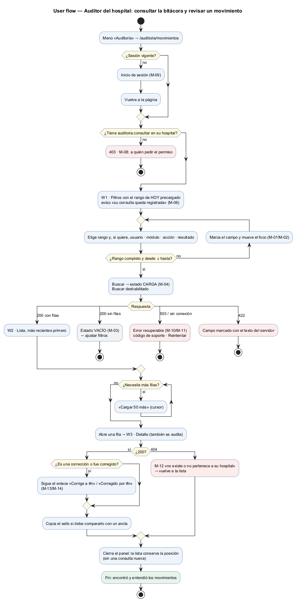
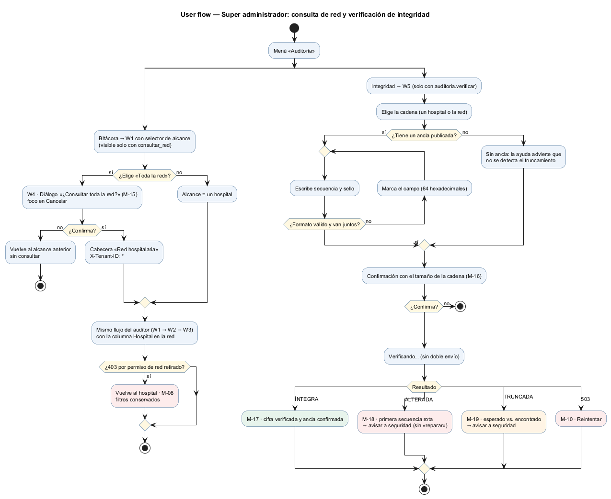
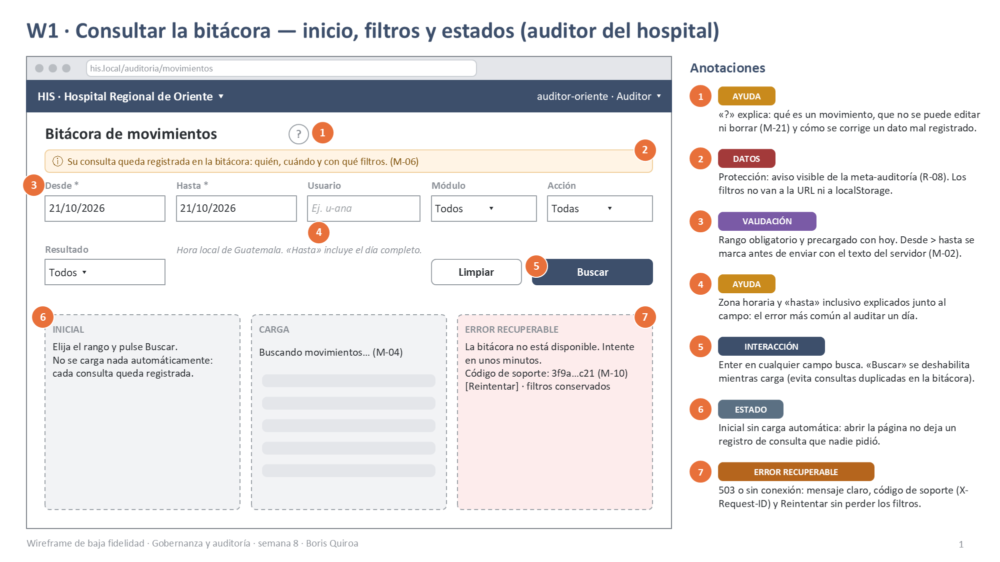
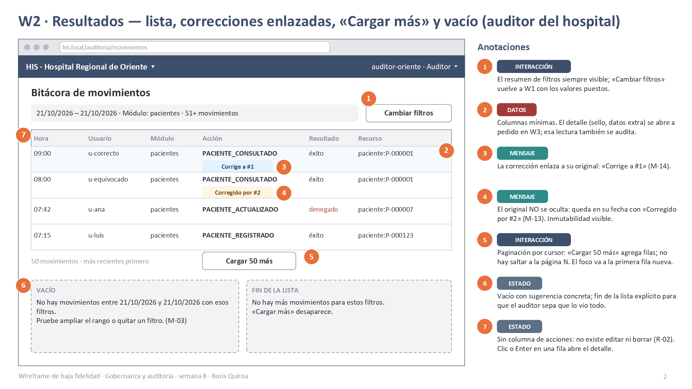
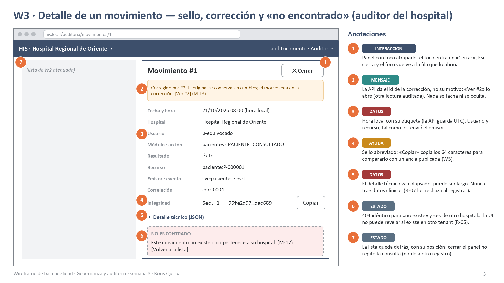
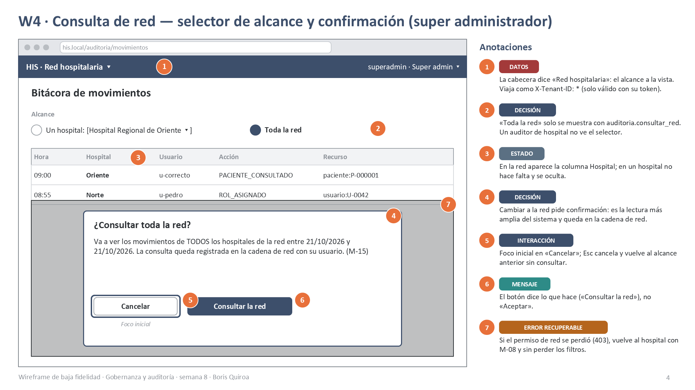
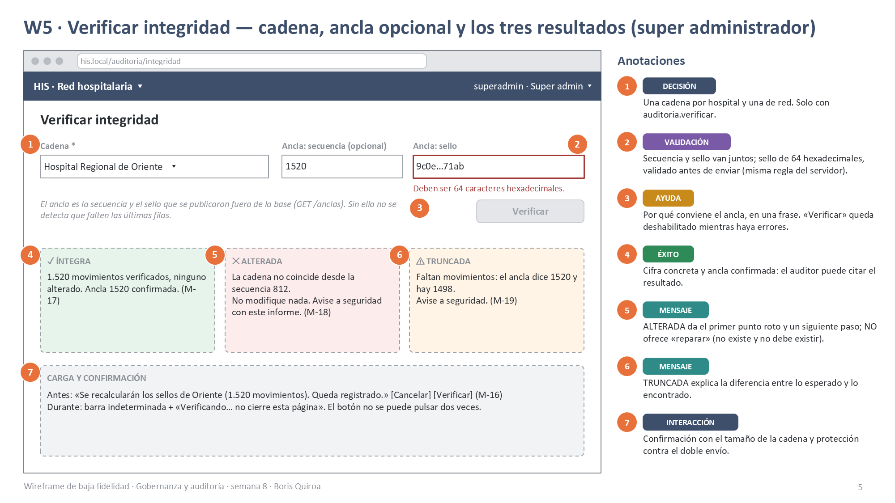
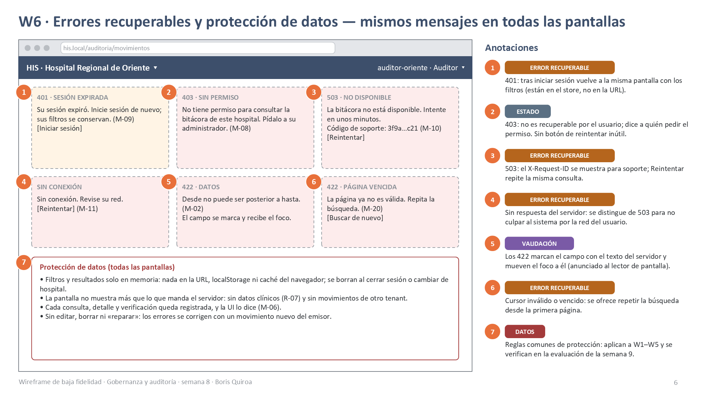

# Semana 8 — Diseño de experiencia de usuario de Gobernanza y auditoría

| | |
|---|---|
| **Curso** | Análisis de Sistemas II — Proyecto Final 2026 |
| **Módulo** | Gobernanza y auditoría de movimientos del sistema |
| **Proceso** | «Registro inmutable y consulta filtrada de movimientos por usuario, módulo y fechas» |
| **Estudiante** | Boris Alexander Quiroa Orellana |

## Entregables

| Pedido | Dónde |
|---|---|
| User flow por rol | [Auditor del hospital](diagramas/semana-08-flujo-auditor.png) · [Super administrador](diagramas/semana-08-flujo-superadmin.png) |
| 4–6 wireframes anotados con estados, mensajes, validaciones y reglas de interacción | 6 wireframes con 42 anotaciones: [PPTX](wireframes/semana-08-wireframes-auditoria.pptx) · [PDF](wireframes/semana-08-wireframes-auditoria.pdf) · PNG en [`wireframes/`](wireframes/) |

## 1. Alcance y punto de partida

- **Flujo diseñado:** la parte **humana** del proceso, es decir, consultar, revisar y verificar.
- **Lo que no tiene pantalla:** el registro. Lo hacen los módulos emisores, servidor a servidor, con el cliente de la semana 5.
- **Base técnica:**
  - la API ya implementada (OpenAPI 1.1.0);
  - los componentes Vue de la [semana 7](../semana-07/contratos-entrada-salida.md).

  Cada estado de pantalla corresponde a una respuesta real de la API: no se diseñó nada que el backend no pueda cumplir.

## 2. Roles autorizados y lo que ve cada uno

| Rol | Permisos (RBAC) | Ve | No ve |
|---|---|---|---|
| **Auditor del hospital** | `auditoria.consultar` en su hospital | W1, W2, W3 de **su** hospital | Selector de red, verificación |
| **Super administrador** | `auditoria.consultar` por hospital, `consultar_red`, `verificar` | W1–W5; alcance de un hospital o de la red | — |
| Módulo emisor (servicio) | `auditoria.registrar` | Sin UI | — |
| Cualquier otro usuario | — | 403 con M-08 (W6) | Todo lo demás; el menú «Auditoría» no aparece |

## 3. Principios de diseño

1. **La inmutabilidad se ve.** No hay botones de editar, borrar ni «reparar». Una corrección aparece enlazada a su original, que no se oculta.
2. **Leer también deja rastro, y la UI lo dice.** Las meta-auditorías (R-08) se muestran:
   - un aviso permanente (M-06);
   - no hay carga automática al abrir la página;
   - cerrar el detalle no repite la consulta.
3. **El rango de fechas es lo primero.** Es obligatorio (R-06), viene precargado con hoy y explica la zona horaria y el «hasta» inclusivo.
4. **El alcance siempre está a la vista.** Hospital o red en la cabecera. Pasar a la red pide confirmación.
5. **La UI no decide la seguridad.** Muestra lo que manda el servidor, y un 404 no distingue «no existe» de «es de otro hospital».

## 4. User flows por rol

### 4.1 Auditor del hospital — consultar y revisar

**Recorrido:**
- **Inicio:** menú → sesión → permiso.
- **Decisión:** el rango válido, con un bucle de corrección en el campo.
- **Respuesta:**
  - 200 con filas → W2;
  - vacío → M-03;
  - 503 o sin conexión → M-10 o M-11;
  - 422 → el campo marcado.
- **Detalle:** W3, con el enlace de la corrección; 404 → M-12.
- **Final:** «encontró y entendió los movimientos».

### 4.2 Super administrador — consulta de red y verificación de integridad

**Dos ramas:**
- **Consulta de red:** selector, confirmación M-15, mismo flujo del auditor con la columna Hospital. Si el permiso de red se retiró, vuelve al hospital.
- **Verificación:** cadena, ancla opcional validada, confirmación M-16 y uno de cuatro resultados: ÍNTEGRA, ALTERADA, TRUNCADA o 503.

## 5. Wireframes anotados

Cada wireframe tiene 7 llamadas numeradas. Cada llamada lleva una etiqueta: ESTADO, MENSAJE, VALIDACIÓN, INTERACCIÓN, DATOS, AYUDA, DECISIÓN, ÉXITO o ERROR RECUPERABLE.

| # | Pantalla | Rol | Estados | Mensajes |
|---|---|---|---|---|
| W1 | [Consultar la bitácora](wireframes/semana-08-w1-buscar-filtros.png) | Auditor | inicial · carga · error recuperable | M-01, M-02, M-04, M-06, M-10, M-21 |
| W2 | [Resultados](wireframes/semana-08-w2-resultados.png) | Auditor | lista · vacío · fin de la lista | M-03, M-13, M-14 |
| W3 | [Detalle](wireframes/semana-08-w3-detalle.png) | Auditor | detalle · corregido · no encontrado | M-12, M-13 |
| W4 | [Consulta de red](wireframes/semana-08-w4-consulta-red.png) | Super admin | confirmación · red | M-08, M-15 |
| W5 | [Verificar integridad](wireframes/semana-08-w5-verificar-integridad.png) | Super admin | validación · confirmación · carga · 3 resultados | M-16..M-19 |
| W6 | [Errores y protección](wireframes/semana-08-w6-errores-proteccion.png) | Todos | 401 · 403 · 503 · sin conexión · 422 · cursor vencido | M-02, M-08..M-11, M-20 |

## 6. Catálogo de mensajes

| ID | Cuándo | Texto | Origen |
|---|---|---|---|
| M-01 | Falta el rango | «Indique desde y hasta (AAAA-MM-DD).» | `FiltroRangoFechas` (texto del servidor) |
| M-02 | Desde > hasta | «Desde no puede ser posterior a hasta.» | `FiltroRangoFechas` |
| M-03 | 200 sin filas | «No hay movimientos entre {desde} y {hasta} con esos filtros. Pruebe ampliar el rango o quitar un filtro.» | UI |
| M-04 | Cargando | «Buscando movimientos…» (anunciado con `aria-live`) | UI |
| M-05 | Resultado | «{n} movimientos · más recientes primero» | UI |
| M-06 | Siempre en W1 | «Su consulta queda registrada en la bitácora: quién, cuándo y con qué filtros.» | R-08 |
| M-07 | `FILTRO_NO_SOPORTADO` | «Uno de los filtros no es válido. Recargue la página.» (no debería ocurrir desde la UI) | API |
| M-08 | 403 | «No tiene permiso para consultar la bitácora de este hospital. Pídalo a su administrador.» | API |
| M-09 | 401 | «Su sesión expiró. Inicie sesión de nuevo; sus filtros se conservan.» | API |
| M-10 | 503 | «La bitácora no está disponible. Intente en unos minutos. Código de soporte: {X-Request-ID}» | API |
| M-11 | Sin respuesta | «Sin conexión. Revise su red.» | Cliente |
| M-12 | 404 en el detalle | «Este movimiento no existe o no pertenece a su hospital.» | API (R-05) |
| M-13 | Original corregido | «Corregido por #{id}. El original se conserva sin cambios; el motivo está en la corrección. [Ver #{id}]» | `corregido_por` (la API da el id; el motivo se lee al abrir la corrección) |
| M-14 | Corrección | Lista: «Corrige a #{id}». Detalle: «Corrige a #{id}. Motivo: {motivo_correccion}» | `corrige_a`, `motivo_correccion` |
| M-15 | Pasar a la red | «Va a ver los movimientos de TODOS los hospitales de la red entre {desde} y {hasta}. La consulta queda registrada en la cadena de red con su usuario.» | UI |
| M-16 | Antes de verificar | «Se recalcularán los sellos de {cadena} ({n} movimientos). Queda registrado.» | UI |
| M-17 | ÍNTEGRA | «{n} movimientos verificados, ninguno alterado. Ancla {s} confirmada.» | API |
| M-18 | ALTERADA | «La cadena no coincide desde la secuencia {s}. No modifique nada. Avise a seguridad con este informe.» | API |
| M-19 | TRUNCADA | «Faltan movimientos: el ancla dice {esperada} y hay {verificados}. Avise a seguridad.» | API |
| M-20 | Cursor inválido | «La página ya no es válida. Repita la búsqueda.» | API |
| M-21 | Ayuda «?» | «Los movimientos no se pueden editar ni borrar. Si un sistema registró un dato mal, envía una corrección que queda enlazada al original.» | R-02 |

## 7. Reglas de interacción

| Regla | Dónde |
|---|---|
| Enter en cualquier filtro busca; «Buscar» queda deshabilitado mientras carga (sin consultas duplicadas en la bitácora) | W1 |
| No hay carga automática al abrir; cerrar el detalle no vuelve a consultar | W1, W3 |
| «Cargar 50 más»: el foco pasa a la primera fila nueva; no se puede saltar a la página N (cursor) | W2 |
| Una fila se abre con clic o con Enter; el panel atrapa el foco, Esc lo cierra y el foco vuelve a la fila | W2, W3 |
| Acción sensible (red, verificar): diálogo con el foco en «Cancelar» y un botón que dice lo que hace | W4, W5 |
| Un error 422 marca el campo, muestra el texto del servidor y mueve el foco | W1, W5, W6 |
| Los reintentos conservan los filtros (están en el store, no en la URL) | W1, W6 |

## 8. Matriz de estados por pantalla

| Pantalla | Inicial | Carga | Éxito | Vacío | Error recuperable | Error no recuperable |
|---|---|---|---|---|---|---|
| W1/W2 Consulta | Rango de hoy, sin resultados | Esqueleto + M-04 | Lista (M-05) | M-03 | M-10, M-11, M-09, M-20 | M-08 |
| W3 Detalle | — | Esqueleto en el panel | Detalle (+ M-13) | — | M-10, M-11 | M-12 (vuelve a la lista) |
| W4 Red | Alcance de hospital | Igual que W2 | Lista con columna Hospital | M-03 | Igual que W2 | M-08 (vuelve al hospital) |
| W5 Verificar | Cadena sin ancla | «Verificando…» | M-17 | — | M-10 | M-18, M-19 (no son de la UI: avisar a seguridad) |

## 9. Ayuda contextual

| Dónde | Ayuda |
|---|---|
| «?» del título (W1) | Qué es un movimiento, por qué no se edita y cómo se corrige (M-21) |
| Junto al rango (W1) | Hora local de Guatemala; «hasta» incluye el día completo |
| Insignias de corrección (W2/W3) | Enlace al otro movimiento y el motivo |
| Sello (W3) | «Copiar» para compararlo con un ancla |
| Ancla (W5) | Por qué conviene: sin ella no se detecta que falten las últimas filas |

## 10. Protección de datos

1. Los filtros y los resultados viven solo en memoria (Pinia): nada en la URL, en `localStorage` ni en la caché. Se borran al cerrar sesión o al cambiar de hospital.
2. Columnas mínimas en la lista; el detalle, solo a pedido, y también queda auditado.
3. La bitácora no contiene datos clínicos (R-07 los rechaza al registrar), así que la UI no los puede mostrar.
4. El 404 no revela otros tenants.
5. El alcance de red se confirma y se identifica en la cabecera.
6. Ninguna acción modifica la bitácora.

## 11. Trazabilidad

| Elemento de UX | Requisito / regla | Evidencia en el backend |
|---|---|---|
| Rango obligatorio y precargado | RF-08, R-06 | `FiltroRangoFechas`, REF-05 |
| Aviso M-06 y sin carga automática | RF-12, R-08 | `CadenaSellada::auditarLectura`, REF-02 |
| Sin editar ni borrar | RF-06, R-02 | HTTP-02 (405), ARQ-05 |
| Insignias de corrección | RF-14..17 | CORR-06 (`corregido_por`) |
| 404 sin revelar el tenant | RF-13, R-05 | REF-02, `Alcance::incluye` (M22) |
| Confirmación de la red | CU-07, R-05 | `AutorizacionLectura` (M23) |
| «Cargar más» | R-09 | REF-03 (cursor) |
| Tres resultados de la verificación | RF-07, RF-11 | `VerificarIntegridad`, INT-07 |

## 12. Validación del diseño

- **Cada código de la API tiene su mensaje y su estado:** se contrastó con el contrato (API-02/API-03 enumeran los códigos reales).
- **La evaluación heurística y WCAG** se hace en la semana 9 sobre estos wireframes.
- **El prototipo navegable** se hace en la semana 11.
