# Semana 9 — Evaluación de usabilidad y accesibilidad del flujo UX de Auditoría

| | |
|---|---|
| **Curso** | Análisis de Sistemas II — Proyecto Final 2026 |
| **Módulo** | Gobernanza y auditoría de movimientos del sistema |
| **Proceso** | «Registro inmutable y consulta filtrada de movimientos por usuario, módulo y fechas» |
| **Estudiante** | Boris Alexander Quiroa Orellana |

## Entregables

| Pedido | Dónde |
|---|---|
| Checklist completado | [`checklist-evaluacion.md`](checklist-evaluacion.md): 40 ítems (10 heurísticas de Nielsen, 20 de WCAG 2.2 AA y 10 propios del módulo) y un recorrido de teclado por pantalla |
| Evidencia de al menos 6 hallazgos | **15 hallazgos**, cada uno con su recorte marcado en [`evidencia/hallazgos/`](evidencia/hallazgos/) y el contraste medido en [`evidencia/contraste-wcag.txt`](evidencia/contraste-wcag.txt) |
| Backlog priorizado con corrección propuesta y criterio verificable | [§6](#6-backlog-priorizado): 15 ítems B-01..B-15 en 3 prioridades |

## 1. Resumen

- **Qué se evaluó:** los 6 wireframes y los 2 flujos de la semana 8, con las heurísticas de Nielsen y WCAG 2.2 AA (teclado, foco, contraste, etiquetas, mensajes y prevención de errores).
- **Resultado del checklist:** 16 ✅, 15 ⚠️, 8 ❌ y 1 N/A.
- **Hallazgos:** 15. Cinco son de severidad 3.
- **Los tres más importantes no eran evidentes a primera vista:**
  1. **H-01:** marcar «Toda la red» abre el diálogo de confirmación, y con el teclado basta con mover las flechas. Viola WCAG 3.2.2.
  2. **H-02:** el mensaje del 401 promete conservar los filtros, pero la regla de protección de datos los guarda solo en memoria, y esa memoria se pierde al ir a `/login`. Dos decisiones de la semana 8 se contradicen.
  3. **H-03:** las insignias de corrección citan «#1» y «#2», pero la lista no muestra ningún id. La relación más importante del cambio de la semana 6 no se puede seguir.
- **Contraste:** el instrumento dio 9 pares que fallan, con los colores **tal cual** salen del generador de los wireframes. Con la paleta propuesta, los 9 cumplen (`contraste.py` termina con 0).

## 2. Método

| Paso | Cómo |
|---|---|
| 1. Heurísticas | Se revisaron las 10 de Nielsen sobre cada wireframe y sus 7 anotaciones |
| 2. WCAG 2.2 AA | Los criterios que pide la tarea: teclado (2.1.1, 2.1.2), foco (2.4.3, 2.4.7, 2.4.11, 3.2.1, 3.2.2), contraste (1.4.3, 1.4.11), etiquetas (3.3.2, 4.1.2), mensajes (3.3.1, 3.3.3, 4.1.3) y prevención de errores (3.3.4, 3.3.7, 3.3.8) |
| 3. Contraste medido | [`contraste.py`](herramientas/contraste.py) calcula la razón WCAG de los 24 pares de color del generador de wireframes |
| 4. Recorrido de teclado | Se simuló Tab, Shift+Tab, Enter, Esc y las flechas en el orden definido por las anotaciones ([checklist §4](checklist-evaluacion.md#4-recorrido-de-teclado)) |
| 5. Evidencia | [`recortes.py`](herramientas/recortes.py) marca en rojo cada hallazgo sobre el PNG de la semana 8 |

### 2.1 Priorización

**Severidad** (escala de Nielsen):

| Valor | Significado |
|:-:|---|
| 0 | No es un problema |
| 1 | Cosmético |
| 2 | Menor |
| 3 | Mayor |
| 4 | Catástrofe |

**Prioridad:**

| Prioridad | Cuándo | Se corrige en |
|---|---|---|
| **P1** | Severidad 3, o un criterio WCAG A/AA que deja a alguien sin poder completar la tarea | Antes del prototipo (semana 10–11) |
| **P2** | Severidad 2 | En el prototipo |
| **P3** | Severidad 1 | Si el tiempo alcanza; si no, queda registrado |

## 3. Medición de contraste

`python herramientas/contraste.py` ([salida completa](evidencia/contraste-wcag.txt)):

| Par | Uso | Actual | Mín. | Propuesto | Nuevo |
|---|---|---:|---:|---|---:|
| C-01 | Etiquetas de campo (10 pt negrita) | 3,26 | 4,5 | `#5F6670` | 5,80 |
| C-02 | Encabezados de tabla | 2,93 | 4,5 | `#5F6670` | 5,22 |
| C-03 | Pistas (zona horaria, ancla) | 3,26 | 4,5 | `#5F6670` | 5,80 |
| C-04 | Títulos INICIAL/CARGA/VACÍO | 2,93 | 4,5 | `#5F6670` | 5,22 |
| C-05 | Títulos de error sobre rosa | 2,85 | 4,5 | `#5F6670` | 5,08 |
| C-06 | Contador de resultados | 3,26 | 4,5 | `#5F6670` | 5,80 |
| C-07 | Ícono «?» | 3,26 | 4,5 | `#5F6670` | 5,80 |
| C-08 | Borde de campo | 2,64 | 3,0 | `#7D838A` | 3,83 |
| C-09 | Borde del radio | 2,64 | 3,0 | `#7D838A` | 3,83 |

**Los otros 15 pares cumplen**, entre ellos:
- el aviso M-06 (6,82);
- las insignias de corrección (7,58 y 6,82);
- «denegado» (6,51);
- el anillo de foco (8,30).

«Verificar» deshabilitado está exento (1.4.3).

## 4. Hallazgos

### H-01 · Marcar «Toda la red» abre un diálogo — W4 · Severidad 3 · P1

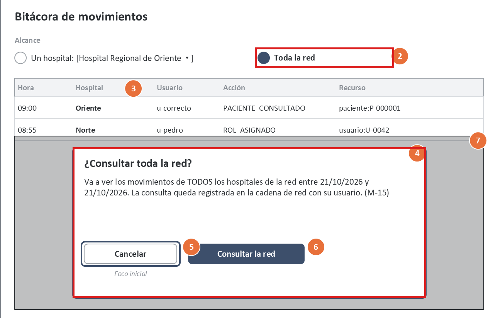

- **Qué pasa:** el diálogo M-15 aparece al **seleccionar** el radio. Con el teclado, las flechas seleccionan al moverse dentro del grupo, así que el diálogo se abre con solo recorrer las opciones.
- **Por qué importa:** viola **WCAG 3.2.2** (cambio de contexto al introducir datos) y la heurística **N3** (el usuario no pidió nada todavía).
- **Corrección:** el radio solo cambia la selección. El botón pasa a decir «Buscar en toda la red», y la confirmación aparece **al buscar**.

### H-02 · El 401 promete conservar los filtros, pero no se puede — W6 · Severidad 3 · P1

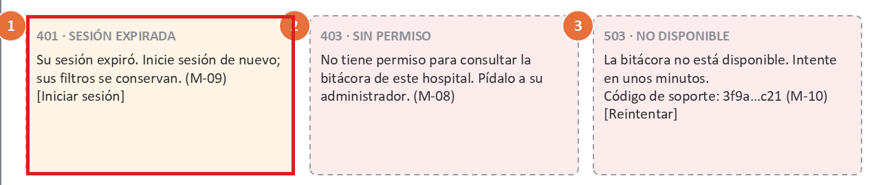

- **Qué pasa:** M-09 dice «sus filtros se conservan». La regla de protección de W6 los guarda solo en memoria (Pinia), y ir a `/login` recarga la aplicación y vacía esa memoria.
- **Por qué importa:**
  - **N4** y **WCAG 3.3.8:** se rompe una promesa del sistema y la reautenticación hace perder el trabajo.
  - **3.3.7:** el usuario tiene que volver a escribir lo que ya había ingresado.
- **Corrección:** renovar la sesión en un **diálogo sobre la misma página**, sin navegar a `/login`. Así el store sobrevive y no hace falta guardar nada en el navegador. Si la renovación falla, M-09 debe decir la verdad: «Deberá repetir la búsqueda».

### H-03 · Las insignias citan ids que no se ven — W2 · Severidad 3 · P1

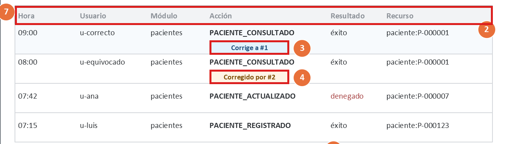

- **Qué pasa:** «Corrige a #1» y «Corregido por #2» remiten a números que no aparecen en ninguna columna.
- **Por qué importa:**
  - **N6:** obliga a recordar en lugar de reconocer.
  - **WCAG 1.3.1:** la relación solo existe como texto.
  - Es justamente lo que tiene que poder seguir un auditor.
- **Corrección:** una columna «#» angosta, y las insignias como **enlaces** que llevan a la fila o al detalle del otro movimiento.

### H-04 · Las filas «se abren con clic» pero no son controles — W2 · Severidad 3 · P1

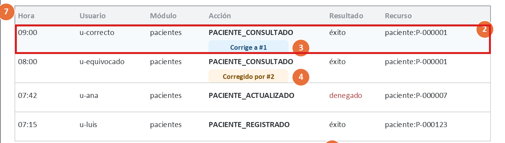

- **Qué pasa:** la anotación dice «clic o Enter en una fila abre el detalle», pero una fila `<tr>` no recibe el foco ni tiene función.
- **Por qué importa:** viola **WCAG 2.1.1** y **4.1.2**. Quien usa solo el teclado o un lector de pantalla no puede abrir ningún detalle, y W3 queda inalcanzable.
- **Corrección:** un enlace «Ver» por fila con `aria-label="Ver detalle del movimiento #n"`. El clic en la fila queda como atajo para el ratón.

### H-05 · Texto secundario con contraste insuficiente — W1–W6 · Severidad 3 · P1

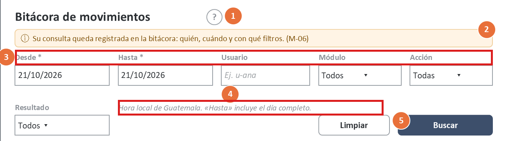

- **Qué pasa:** etiquetas, encabezados, pistas, títulos de estado, el contador y el «?» usan `#8A8F96`, con razones de 2,85:1 a 3,26:1.
- **Por qué importa:** viola **WCAG 1.4.3** (mínimo 4,5:1). Afecta a todas las pantallas, y las etiquetas son lo que dice qué escribir en cada campo.
- **Corrección:** `#5F6670`, con razones de 5,08:1 a 5,80:1 (§3).

### H-06 · Bordes de campos y radio con contraste insuficiente — W1, W4, W5 · Severidad 2 · P2

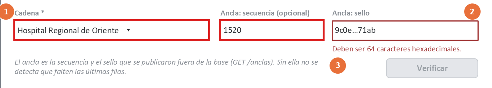

- **Qué pasa:** el borde `#9AA0A6` sobre blanco tiene 2,64:1.
- **Por qué importa:** viola **WCAG 1.4.11** (mínimo 3:1): con baja visión no se distingue dónde está el campo.
- **Corrección:** `#7D838A`, con 3,83:1.

### H-07 · «Verificar» deshabilitado no explica por qué — W5 · Severidad 2 · P2

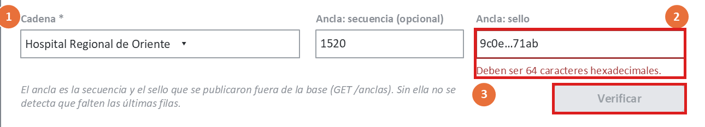

- **Qué pasa:** con errores, el botón queda deshabilitado. Un botón deshabilitado sale del orden de Tab.
- **Por qué importa:** viola **N9** y **WCAG 3.3.1**. Quien llega con el teclado o con el lector de pantalla al final del formulario no encuentra el botón ni sabe qué corregir.
- **Corrección:** el botón queda **habilitado**. Al pulsarlo se valida, aparece un resumen de errores con enlaces a los campos y el foco va al primer error.

### H-08 · ALTERADA y TRUNCADA no dicen a quién avisar ni dan el informe — W5 · Severidad 2 · P2

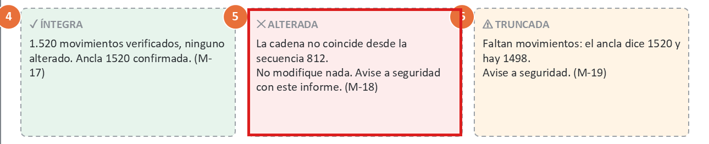

- **Qué pasa:** M-18 dice «avise a seguridad con este informe», pero no hay contacto ni forma de llevarse el informe.
- **Por qué importa:**
  - **N9** y **N10:** el resultado más grave del módulo no tiene un siguiente paso ejecutable.
  - El usuario copiaría el informe a mano, con errores.
- **Corrección:**
  - un botón **«Copiar informe»** que copia un texto fijo: cadena, estado, primera secuencia o esperado/encontrado, verificados, fecha y hora, usuario y `X-Request-ID`;
  - el contacto de seguridad configurado.

  No se agrega «reparar».

### H-09 · El formato de fecha mostrado no coincide con el que pide el error — W1 · Severidad 2 · P2

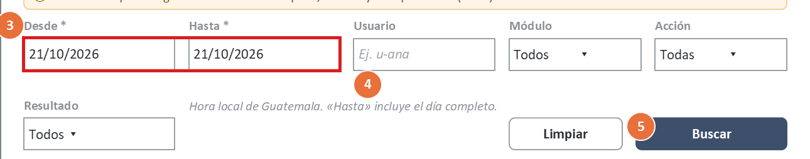

- **Qué pasa:** los campos muestran `21/10/2026`, pero M-01 (el texto del servidor) dice «Indique desde y hasta (AAAA-MM-DD)».
- **Por qué importa:** viola **N4** y **WCAG 3.3.2**. El usuario no sabe qué formato escribir, y el error lo contradice.
- **Corrección:**
  - un campo de fecha nativo (`type="date"`, con el formato del sistema) y la pista «día/mes/año»;
  - el cliente convierte a AAAA-MM-DD;
  - la UI usa su propio texto para M-01: «Indique la fecha desde y hasta.»

### H-10 · La hora se muestra sin la fecha — W2 · Severidad 2 · P2

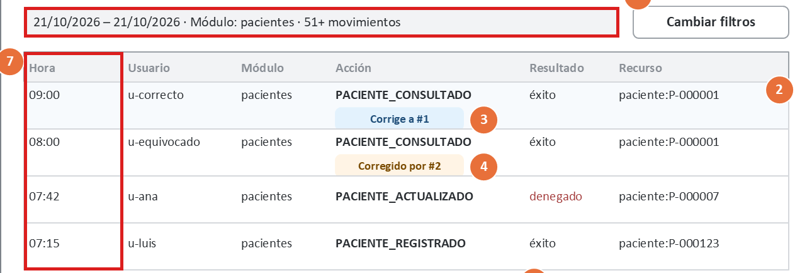

- **Qué pasa:** la columna «Hora» muestra `09:00`. Con un rango de varios días, dos filas con la misma hora son de días distintos y no se distinguen.
- **Por qué importa:** viola **N2**. En auditoría, el «cuándo» es un dato central.
- **Corrección:** la columna se llama «Fecha y hora» y muestra `21/10 09:00`. Si el rango es de un solo día, la fecha se muestra una vez en el encabezado del grupo.

### H-11 · Las acciones se muestran como códigos técnicos — W2 · Severidad 1 · P3

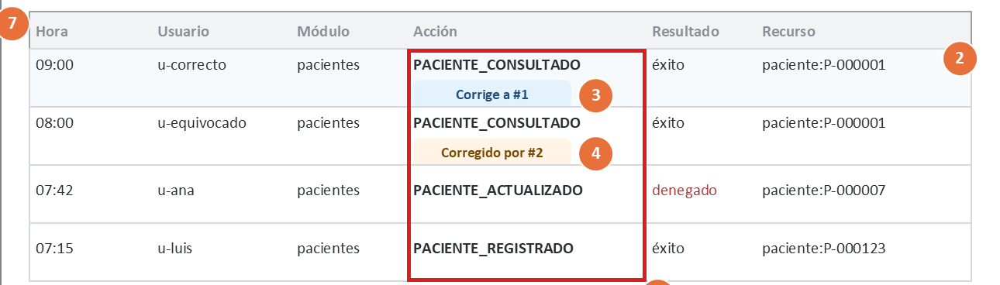

- **Qué pasa:** `PACIENTE_CONSULTADO`, `ROL_ASIGNADO`.
- **Por qué importa:** viola **N2**. El auditor de un hospital no tiene por qué conocer los códigos de los emisores.
- **Corrección:** mostrar una etiqueta legible («Consulta de paciente»), con el código como texto secundario. Las etiquetas se agregan al catálogo de acciones de la configuración; la regla de validación (R-01) no cambia.

### H-12 · El número de resultados y «Cargar más» no se anuncian — W2 · Severidad 2 · P2

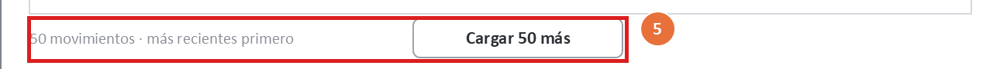

- **Qué pasa:** «Buscando…» se anuncia (M-04), pero el resultado («50 movimientos») y la llegada de 50 filas más no.
- **Por qué importa:** viola **WCAG 4.1.3** y **N1**. Con lector de pantalla no se sabe si la búsqueda terminó ni cuántas filas hay.
- **Corrección:** una región `aria-live="polite"` que dice «50 movimientos encontrados» y «Se cargaron 50 más; 100 en total», o «Fin de la lista».

### H-13 · «Limpiar» borra el rango obligatorio — W1 · Severidad 1 · P3

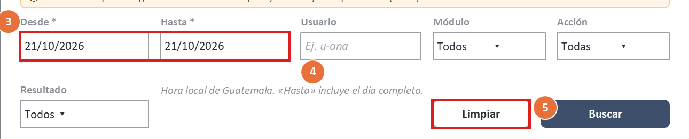

- **Qué pasa:** «Limpiar» vacía todos los campos, incluido el rango, que es obligatorio.
- **Por qué importa:** viola **N3** y **N5**. Después de limpiar, «Buscar» da un error seguro.
- **Corrección:** el botón se llama «Restablecer» y vuelve al rango de hoy, con los filtros opcionales vacíos.

### H-14 · El «*» de obligatorio no tiene leyenda — W1, W5 · Severidad 1 · P3

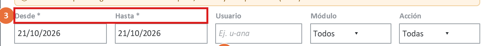

- **Qué pasa:** «Desde *», «Hasta *» y «Cadena *» no tienen una explicación del asterisco.
- **Por qué importa:** viola **WCAG 3.3.2**.
- **Corrección:** la leyenda «* obligatorio» al inicio del formulario y `aria-required="true"` en los campos.

### H-15 · La ayuda «?» no está definida para teclado ni tiene nombre accesible — W1 · Severidad 2 · P2

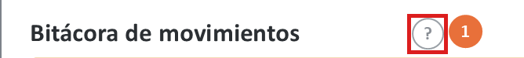

- **Qué pasa:** el «?» es un círculo con un signo. No se define si es un botón ni qué anuncia.
- **Por qué importa:** viola **WCAG 2.1.1** y **4.1.2**. Un lector de pantalla diría «signo de interrogación», y la ayuda más importante del módulo (por qué no se edita, M-21) queda fuera de alcance.
- **Corrección:** un `<button aria-label="Ayuda sobre la bitácora" aria-expanded>` que despliega la ayuda; Esc la cierra.

## 5. Fortalezas (se mantienen)

| Fortaleza | Dónde |
|---|---|
| La inmutabilidad se ve: no hay editar, borrar ni «reparar», y el original corregido sigue visible | W2, W3, W5 |
| Leer deja rastro y la UI lo dice (M-06); no hay lecturas automáticas | W1, W3 |
| El 404 no revela otros tenants (M-12) | W3 |
| Las confirmaciones dicen exactamente qué va a pasar y el botón nombra la acción | W4, W5 |
| Los errores recuperables tienen acción y código de soporte | W1, W6 |
| Los colores de estado cumplen (C-13..C-23) y nunca son el único indicador | W2, W5 |

## 6. Backlog priorizado

| ID | Prioridad | Hallazgo | Corrección propuesta | Criterio verificable | Semana |
|---|:-:|---|---|---|:-:|
| B-01 | P1 | H-01 | El radio solo selecciona; la confirmación se pide al pulsar «Buscar en toda la red» | En el prototipo, recorrer el grupo con ↑/↓ **no** abre ningún diálogo; el diálogo aparece solo después de «Buscar» | 11 |
| B-02 | P1 | H-02 | Renovar la sesión en un diálogo sobre la página; si falla, M-09 dice «Deberá repetir la búsqueda» | Simulando un 401 con resultados en pantalla: tras renovar, los filtros y las filas siguen iguales, y `localStorage` y `sessionStorage` quedan vacíos | 11 |
| B-03 | P1 | H-03 | Columna «#» e insignias como enlaces al otro movimiento | Cada «#n» visible es un enlace cuyo destino muestra el mismo «#n»; 0 insignias sin destino | 11 |
| B-04 | P1 | H-04 | Enlace «Ver» por fila con `aria-label` con el id | Con solo Tab se abre el detalle de cualquier fila; el árbol de accesibilidad lista «Ver detalle del movimiento #n» por fila | 11 |
| B-05 | P1 | H-05 | Texto secundario `#5F6670` | `python herramientas/contraste.py --solo-propuestos` termina con código 0, y el prototipo usa ese color en los 7 usos | 10–11 |
| B-06 | P2 | H-06 | Bordes `#7D838A` | Igual que B-05 para C-08 y C-09 | 10–11 |
| B-07 | P2 | H-07 | «Verificar» siempre habilitado; resumen de errores y foco al primero | Con un sello inválido: Tab llega a «Verificar»; al pulsarlo aparece el resumen y el foco queda en «Ancla: sello» | 11 |
| B-08 | P2 | H-08 | «Copiar informe» con los 7 campos, más el contacto de seguridad | El texto copiado contiene cadena, estado, secuencia, verificados, fecha y hora, usuario y `X-Request-ID` | 11 |
| B-09 | P2 | H-09 | Campo de fecha nativo, pista «día/mes/año» y conversión a ISO en el cliente | Ningún texto visible dice «AAAA-MM-DD»; la petición enviada lleva `desde=2026-10-21` | 11 |
| B-10 | P2 | H-10 | «Fecha y hora» `dd/mm HH:MM`, o agrupado por día | Con un rango de 2 días, cada fila muestra su día | 11 |
| B-11 | P2 | H-12 | Región `aria-live` para el resultado y para «Cargar más» | El lector de pantalla anuncia el número de movimientos tras buscar y tras cargar más | 11 |
| B-12 | P2 | H-15 | «?» como botón con nombre y `aria-expanded` | Tab llega al «?»; se anuncia «Ayuda sobre la bitácora, botón, contraído»; Esc lo cierra | 11 |
| B-13 | P3 | H-11 | Etiqueta legible de la acción, con el código como texto secundario | Toda acción del catálogo de la demo muestra una etiqueta en español | 11 |
| B-14 | P3 | H-13 | «Restablecer» vuelve a hoy | Después de «Restablecer», «Buscar» funciona sin errores | 11 |
| B-15 | P3 | H-14 | Leyenda «* obligatorio» y `aria-required` | La leyenda es visible y los campos con «*» tienen `aria-required="true"` | 11 |

### 6.1 Qué cambia en la especificación de la semana 8

| Elemento de la semana 8 | Cambio |
|---|---|
| Anotación W4-4 («cambiar a la red pide confirmación») | La confirmación se pide **al buscar**, no al seleccionar |
| M-09 | Se reformula según B-02 |
| M-01 en la UI | «Indique la fecha desde y hasta.» El texto del servidor se sigue mostrando si llega un 422 |
| W2: columnas | + «#», y «Hora» pasa a «Fecha y hora» |
| W5: «Verificar» | Siempre habilitado |
| Paleta | `#8A8F96` → `#5F6670` y `#9AA0A6` → `#7D838A` |

## 7. Limitaciones

- **Evaluación de un solo evaluador**, sobre wireframes y no sobre un producto que funcione. Nielsen recomienda de 3 a 5 evaluadores: los hallazgos de severidad 1–2 podrían cambiar con más evaluadores.
- **El recorrido de teclado se simuló siguiendo las anotaciones.** La verificación real con lector de pantalla y con axe se hace sobre el prototipo (semana 11), usando los criterios de B-01..B-15.
- **Los colores medidos son los del generador de los wireframes.** El prototipo debe usar los mismos tokens para que la medición siga valiendo.
