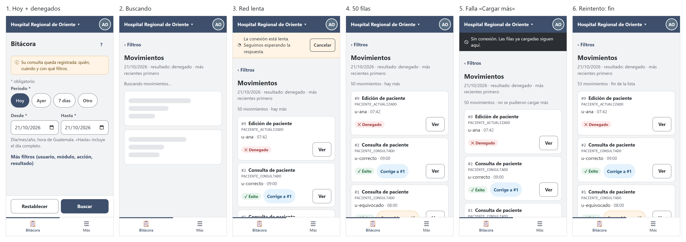
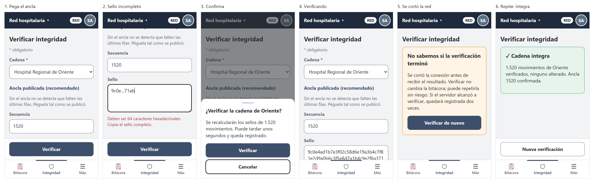

# Semana 10 — Diseño para movilidad del flujo de Auditoría (320–430 px)

| | |
|---|---|
| **Curso** | Análisis de Sistemas II — Proyecto Final 2026 |
| **Módulo** | Gobernanza y auditoría de movimientos del sistema |
| **Proceso** | «Registro inmutable y consulta filtrada de movimientos por usuario, módulo y fechas» |
| **Estudiante** | Boris Alexander Quiroa Orellana |

## Entregables

| Pedido | Dónde |
|---|---|
| Propuesta responsive de 3–5 pantallas | **4 pantallas** navegables con sus estados en [`prototipo/`](prototipo/) (M1–M4), y 39 capturas de 320 a 1024 px en [`capturas/`](capturas/) |
| Reglas de breakpoint | [§4](#4-reglas-de-breakpoint), verificadas con [`herramientas/verificar-responsive.cjs`](herramientas/verificar-responsive.cjs): 39/39 vistas cumplen |
| Dos escenarios móviles con decisiones de contenido y error | [§8](#8-escenario-1--el-auditor-revisa-los-denegados-de-hoy-con-señal-débil-360-px) (360 px) y [§9](#9-escenario-2--el-super-administrador-verifica-la-cadena-con-red-intermitente-320-px) (320 px) |

## 1. Punto de partida

- **Base de diseño:** los wireframes de escritorio de la [semana 8](../semana-08/semana-08-ux-auditoria.md) y el backlog de la [semana 9](../semana-09/semana-09-evaluacion-ux-auditoria.md#6-backlog-priorizado).
- **Quién usa esto en el teléfono:**
  - un auditor que revisa algo puntual fuera del escritorio (una alerta, una denuncia);
  - el super administrador que recibe un aviso de seguridad fuera de horario.

  Nadie hace una auditoría completa en 320 px.
- **Consecuencia:** el diseño móvil prioriza **una pregunta concreta y rápida**, no la exploración.
- **Cómo abrir el prototipo:** HTML y CSS estáticos. Se abre `prototipo/m1-consultar.html` en un navegador; los estados se eligen con `?estado=…` (la lista está en el comentario al inicio de cada archivo).

## 2. Jerarquía de contenido

La tabla de 6 columnas de W2 no cabe en 320 px. Cada movimiento pasa a ser una tarjeta con tres niveles de prioridad:

| Prioridad | Contenido | Por qué |
|:-:|---|---|
| 1 | **Qué** (acción legible, semana 9 B-13) y **#id** | Es lo que se busca; el id permite seguir una corrección (B-03) |
| 2 | **Quién y cuándo** (usuario · hora), **resultado** (con icono y texto) y las insignias de corrección | Responde la pregunta de auditoría |
| 3 | Recurso y módulo | Solo desde 431 px (`.extra`); siempre están en el detalle |
| — | Código técnico de la acción | Debajo y en fuente monoespaciada pequeña: sirve para buscar en el código, no para leer |

En el **detalle** (M3), los datos de origen e integridad (emisor, evento, correlación, secuencia, sello) van plegados en «Origen e integridad». El auditor los abre solo si los necesita.

## 3. Reducción de carga cognitiva

| Decisión | Antes (escritorio) | Teléfono |
|---|---|---|
| Rango obligatorio (R-06) | Dos campos de fecha | Cuatro atajos («Hoy», «Ayer», «7 días», «Otro»); las fechas quedan abajo, precargadas |
| Filtros opcionales | 4 campos a la vista | Plegados en «Más filtros» |
| Alcance de red | Radio en la página | Solo con `consultar_red`; el botón cambia a «Buscar en toda la red» (B-01) |
| Detalle | Panel lateral sobre la lista | Pantalla completa con «‹» que vuelve a la misma posición |
| Paginación | «Cargar 50 más» | Igual, al final de la lista: nada de paginación numerada |

## 4. Reglas de breakpoint

**Mobile-first:** la base es 320 px y cada breakpoint **agrega**.

| Nombre | Ancho | Qué cambia |
|---|---|---|
| **XS** | 320–359 | Base. Nombre corto del hospital («H. R. Oriente»). Las fechas, en **una** columna. Barra de acción fija sobre la navegación inferior |
| **S** | 360–430 | Nombre largo del hospital. Fechas en dos columnas |
| **M** | 431–767 | Aparecen los datos de prioridad 3 (recurso, módulo) y el rol en la barra. Los botones de la hoja inferior se ponen en fila |
| **L** | 768–1023 | Navegación lateral; la hoja inferior pasa a diálogo centrado; la barra de acción deja de ser fija |
| **XL** | ≥ 1024 | La lista vuelve a ser la **tabla** de W2, ya con «#» y «Fecha y hora» (B-03, B-10) |

### 4.1 Reglas transversales (verificadas)

`verificar-responsive.cjs` abre cada pantalla y estado en Chrome sin interfaz, al ancho indicado, y mide:

| Regla | Qué mide | Umbral |
|---|---|---|
| **R-W1** sin desborde | Ancho del documento contra el ancho pedido, y controles que se salen de la ventana | 0 |
| **R-T1** objetivos táctiles | Ancho y alto de botones, enlaces, campos, `summary` y etiquetas de radio | ≥ 44 px (WCAG 2.5.8 pide 24) |
| **R-T2** fuente en campos | Tamaño de letra de `input`, `select` y `textarea` | ≥ 16 px (iOS no hace zoom al enfocar) |
| **R-A1** alcance visible | La barra muestra el hospital o «Red hospitalaria» | Siempre |
| **R-D1** datos fuera de la URL | Ningún enlace lleva `desde`, `hasta`, `usuario`, `modulo`, `accion`, `resultado`, `cursor` ni `sello` | 0 |

**Resultado final:** 39 vistas, 0 fallas ([`evidencia/verificacion-responsive-2-final.txt`](evidencia/verificacion-responsive-2-final.txt)).

**Lo que el instrumento encontró antes de llegar a 0:**

| # | Defecto | Cómo se encontró | Corrección |
|---|---|---|---|
| 1 | `summary` de 22 px de alto (R-T1) en 14 vistas | Primera corrida ([evidencia](evidencia/verificacion-responsive-1-primera.txt)) | Regla de altura para `details.mas summary`, que faltaba en la base |
| 2 | A 320 px, el campo «Hasta» se salía por la derecha (el `input type=date` tiene un ancho mínimo propio) | **Mirando las capturas**: el instrumento decía 0 | Fechas en una columna por debajo de 360 px y `min-width: 0` |
| 3 | El instrumento no veía el defecto 2 | Chrome en modo móvil **ensancha `innerWidth`** cuando el contenido no cabe (320 → 362 px), así que «documento − ventana» daba 0 | Se mide contra `clientWidth` y se cuentan los controles que salen de la ventana. Control: sobre el prototipo **sin** el arreglo, la regla corregida da 6 fallas ([evidencia](evidencia/verificacion-responsive-control-desborde.txt)) |

El defecto 3 es del **instrumento**, no del diseño. El verificador de Pacientes (semana 10) usa la misma comparación con `innerWidth` y tiene el mismo punto ciego; queda anotado para ese módulo.

## 5. Navegación

| Ancho | Patrón | Contenido |
|---|---|---|
| < 768 | Barra inferior | «Bitácora», «Integridad» (solo con `auditoria.verificar`) y «Más» |
| ≥ 768 | Barra lateral | Las mismas secciones |
| Detalle | Pantalla completa sin navegación | «‹» vuelve a la lista **sin repetir la consulta**: si la repitiera, quedaría otro registro (§6.3) |

## 6. Tablas, formularios, confirmaciones y conexión limitada

### 6.1 Tablas → tarjetas

Cada tarjeta tiene un botón «Ver» real de 44 px con `aria-label="Ver detalle del movimiento #n"` (B-04). Las insignias de corrección son **enlaces** de 44 px de alto al otro movimiento (B-03).

### 6.2 Formularios y confirmaciones

| Elemento | Decisión |
|---|---|
| Fechas | `type="date"` nativo: el teléfono muestra su calendario; la pista dice «día/mes/año» (B-09) |
| Sello del ancla | `textarea` sin corrector ni mayúsculas automáticas: es para **pegar**, no para escribir |
| Errores | Un solo campo marcado con `aria-invalid`, el texto debajo y el foco en él; la vista se desplaza hasta el campo (en 320 px quedaba bajo el borde) |
| Confirmaciones (red, verificar) | Hoja inferior con «Cancelar» **abajo**, donde cae el pulgar, y el foco inicial en él; desde 768 px, diálogo centrado |
| «Verificar» | Siempre habilitado (B-07) |

### 6.3 ¿Es seguro reintentar? Medido, no supuesto

Con conexión inestable, el teléfono puede no recibir una respuesta que el servidor sí produjo. [`herramientas/reintento.php`](herramientas/reintento.php) repite la **misma** petición contra el kernel real del Micro-HIS, con 60 movimientos de hoy ([salida](evidencia/reintento.txt)):

| Caso (la misma petición dos veces) | 1.ª | 2.ª | Respuesta | Emisores | Meta |
|---|:-:|:-:|---|:-:|:-:|
| Repetir la consulta (primera página) | 200 | 200 | **1 fila nueva arriba: #61 AUDITORIA_CONSULTADA** | 60 | 2 |
| Repetir «Cargar más» (mismo cursor) | 200 | 200 | Mismas 10 filas, sin duplicar ni saltar | 60 | 3 |
| Repetir el detalle | 200 | 200 | Mismo detalle | 60 | 2 |
| Repetir la verificación | 200 | 200 | INTEGRA / INTEGRA | 60 | 2 |

**Lo que dice la medición:**

1. **Un reintento nunca modifica los movimientos de los emisores** (60 antes y después). Todas las acciones de esta UI son lecturas.
2. **Cada lectura que llega al servidor deja su meta-auditoría** (R-08). Un reintento después de un corte puede dejar **dos** registros de una sola intención del usuario.
3. **Esto no estaba previsto: la bitácora se observa a sí misma.** La primera consulta dejó su AUDITORIA_CONSULTADA en la cadena del hospital, con fecha de hoy, y la segunda la muestra **primero**. Repetir la primera página no da las mismas filas.
4. **«Cargar más» es estable:** el cursor fija la posición, así que reintentarlo no duplica ni salta filas.

**Decisiones que salen de la medición:**

| Decisión | Por qué |
|---|---|
| **Sin reintentos automáticos** de consultas ni verificaciones; solo el botón «Reintentar» | Cada reintento que llega deja un registro: debe ser una decisión del usuario |
| Tras un error de «Cargar más», **las filas ya cargadas se conservan** y se reintenta con el **mismo** cursor | Medido: es estable |
| Tras un corte en la **primera** búsqueda, la lista puede traer arriba la propia consulta anterior. Se acepta: es verdad que ocurrió | Ocultarla escondería una lectura real |
| La verificación interrumpida dice «no sabemos si terminó; repetir es seguro y puede quedar registrada dos veces» | Medido: el estado se repite y los emisores no cambian |

### 6.4 Estados de la red

| Estado | Señal | Comportamiento |
|---|---|---|
| Lenta (sin respuesta tras 5 s) | Barra ámbar «La conexión está lenta…» con «Cancelar» | Se sigue esperando hasta 20 s; «Cancelar» detiene la espera, pero si la petición llegó, la lectura ya quedó registrada |
| Sin conexión | Barra oscura con icono y texto | Los botones que necesitan la red dicen «· requiere conexión»; **lo ya cargado se puede seguir leyendo** |
| Error con respuesta (503) | Aviso con código de soporte | «Reintentar», manual |

### 6.5 Lo que el diseño **no** hace sin conexión, a propósito

- **No guarda resultados para leerlos sin conexión.** La bitácora no se guarda en el navegador (semana 8, protección de datos). Lo que está en pantalla vive en memoria y desaparece al cerrar la pestaña o la sesión.
- **No encola consultas para «cuando vuelva la red».** Una lectura diferida dejaría un registro en un momento que el usuario no eligió.

## 7. Las 4 pantallas

| Pantalla | Rol | Estados | Capturas clave |
|---|---|---|---|
| **M1** Consultar | Auditor; super admin con «Toda la red» | `base`, `red`, `confirmar-red`, `error`, `sin-conexion` | [320](capturas/m1-consultar-base-320.png) · [360](capturas/m1-consultar-base-360.png) · [430](capturas/m1-consultar-base-430.png) · [768](capturas/m1-consultar-base-768.png) · [1024](capturas/m1-consultar-base-1024.png) · [confirmar red](capturas/m1-consultar-confirmar-red-320.png) |
| **M2** Resultados | Los dos | `base`, `red`, `carga`, `vacio`, `lenta`, `sin-conexion`, `error-mas`, `fin` | [320](capturas/m2-resultados-base-320.png) · [360](capturas/m2-resultados-base-360.png) · [1024 tabla](capturas/m2-resultados-base-1024.png) · [red](capturas/m2-resultados-red-360.png) |
| **M3** Detalle | Los dos | `base`, `correccion`, `carga`, `no-encontrado`, `sin-conexion` | [original corregido](capturas/m3-detalle-base-360.png) · [corrección](capturas/m3-detalle-correccion-360.png) · [404](capturas/m3-detalle-no-encontrado-360.png) |
| **M4** Verificar | Super admin | `base`, `error`, `confirmar`, `verificando`, `integra`, `alterada`, `truncada`, `incierto`, `sin-conexion` | [alterada](capturas/m4-verificar-alterada-320.png) · [truncada](capturas/m4-verificar-truncada-360.png) · [768](capturas/m4-verificar-base-768.png) |

## 8. Escenario 1 · El auditor revisa los denegados de hoy con señal débil (360 px)

**Situación:** a las 22:00, el auditor de Oriente recibe la consulta de una jefa de servicio: «¿alguien intentó editar fichas sin permiso hoy?». Está en el pasillo, con una sola barra de señal.



| Paso | Pantalla | Decisión de contenido | Decisión ante el error |
|---|---|---|---|
| 1 | M1 | «Hoy» ya está elegido; elige «Denegado» en «Más filtros». Dos toques, nada de teclado | — |
| 2 | M2 `carga` | Esqueletos con la forma de las tarjetas; «Buscando movimientos…» se anuncia | — |
| 3 | M2 `lenta` | — | A los 5 s, barra ámbar con «Cancelar». No hay reintento automático: cancelar no borra el registro si la petición ya llegó |
| 4 | M2 `base` | Cada tarjeta: **qué** (Edición de paciente), **quién** (u-ana) y **cuándo**; «✕ Denegado» con icono y texto. El recurso queda para el detalle | — |
| 5 | M2 `error-mas` | — | Falla «Cargar 50 más»: **las 50 tarjetas se quedan** y el aviso lo dice; «Reintentar» usa el mismo cursor (medido: estable) |
| 6 | M2 `fin` | «53 movimientos · fin de la lista»: sabe que lo vio todo | — |

## 9. Escenario 2 · El super administrador verifica la cadena con red intermitente (320 px)

**Situación:** un domingo llega una alerta: «la copia de la bitácora de Oriente no cuadra». El super administrador tiene un teléfono pequeño y el ancla publicada en un mensaje.



| Paso | Pantalla | Decisión de contenido | Decisión ante el error |
|---|---|---|---|
| 1 | M4 `base` | La barra dice «Red hospitalaria» y «RED»; la sección del ancla viene abierta y explica por qué conviene | — |
| 2 | M4 `error` | — | Pegó un sello abreviado: el campo se marca, el foco va a él y la vista se desplaza hasta el mensaje («Copie el sello completo»). «Verificar» sigue habilitado (B-07) |
| 3 | M4 `confirmar` | Hoja inferior con el tamaño de la cadena; «Cancelar» abajo, al alcance del pulgar | — |
| 4 | M4 `verificando` | «No cierre esta pantalla» | — |
| 5 | M4 `incierto` | — | Se corta la red sin respuesta. El mensaje **no adivina**: «no sabemos si terminó». Explica que repetir es seguro y que puede quedar registrada dos veces (medido en §6.3) |
| 6 | M4 `integra` | Cifra concreta y ancla confirmada | Si diera ALTERADA: «Copiar informe» y el contacto de seguridad (B-08) |

## 10. Trazabilidad

| Decisión móvil | Requisito / regla | Evidencia |
|---|---|---|
| Atajos de rango | R-06, RF-08 | M1; `FiltroRangoFechas` |
| Aviso de registro y sin reintentos automáticos | R-08, RF-12 | `reintento.txt` (columna Meta) |
| Insignias como enlaces y «#» | RF-14..17 (semana 6) | M2, M3 |
| «No existe o no pertenece a su hospital» | R-05, RF-13 | M3 `no-encontrado` |
| «Toda la red» con confirmación al buscar | CU-07, R-05 | M1 `confirmar-red` |
| Verificación repetible | RF-07, RF-11 | `reintento.txt`, M4 `incierto` |
| Nada en la URL ni en el almacenamiento | Protección de datos (semana 8) | R-D1: 0 en 39 vistas |

## 11. Backlog de la semana 9 aplicado

| Ítem | Aplicado en | Cómo se comprueba |
|---|---|---|
| B-01 confirmación al buscar | M1 | Marcar «Toda la red» no abre nada; la hoja aparece con «Buscar en toda la red» |
| B-03 «#» e insignias enlazadas | M2, M3 | Cada «#n» lleva al movimiento n |
| B-04 «Ver» por fila | M2 | Botón de 44 px con `aria-label` |
| B-05 / B-06 colores | Todas | Tokens `--secundario: #5F6670` y `--borde: #7D838A` |
| B-07 «Verificar» habilitado | M4 | Estado `error` |
| B-08 «Copiar informe» | M4 | Estados `alterada` y `truncada` |
| B-09 fecha nativa | M1 | `type="date"`, pista «día/mes/año» |
| B-10 fecha y hora | M2 | La tabla de 1024 px dice «21/10 09:00» |
| B-11 anuncio de resultados | M2 | `role="status"` con el número de movimientos |
| B-12 «?» accesible | M1 | Botón con `aria-label` y `aria-expanded` |
| B-13 acción legible | M2, M3 | «Consulta de paciente» con el código debajo |
| B-14 «Restablecer» | M1 | Texto del botón |
| B-15 «* obligatorio» | M1, M4 | Leyenda y `aria-required` |
| **B-02** renovar la sesión sin salir | **Pendiente** | Necesita el prototipo con estado (semana 11) |

## 12. Verificación y limitaciones

```bash
# desde docs/modulos/gobernanza-auditoria/semana-10 (requiere Chrome y puppeteer-core)
node herramientas/verificar-responsive.cjs prototipo capturas     # 39 vistas, 0 fallan
php herramientas/reintento.php 2>/dev/null                         # tabla de §6.3
```

- **El prototipo es estático:** muestra los estados, pero no los recorre solo. El flujo navegable, con datos y errores simulados, es la semana 11.
- **Las capturas son de Chrome con emulación móvil.** No se probó en un teléfono físico ni con VoiceOver o TalkBack.
- **Los tiempos de §6.4 (5 s y 20 s) son una propuesta**, no una medición sobre redes reales.
