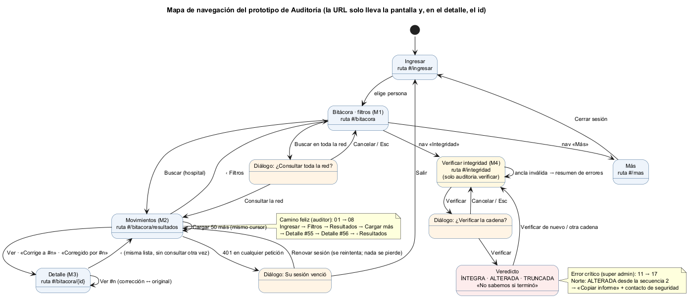

# Semana 11 — Prototipo navegable desktop y móvil del flujo de Auditoría

| | |
|---|---|
| **Curso** | Análisis de Sistemas II — Proyecto Final 2026 |
| **Módulo** | Gobernanza y auditoría de movimientos del sistema |
| **Proceso** | «Registro inmutable y consulta filtrada de movimientos por usuario, módulo y fechas» |
| **Estudiante** | Boris Alexander Quiroa Orellana |

## Entregables

| Pedido | Dónde |
|---|---|
| Enlace o archivo del prototipo | [`prototipo/index.html`](prototipo/index.html): se abre en el navegador, sin servidor ni instalación |
| Mapa de navegación | [`diagramas/semana-11-mapa-navegacion.png`](diagramas/semana-11-mapa-navegacion.png) |
| Capturas desktop y móvil del camino feliz y del error crítico | [`capturas/escritorio/`](capturas/escritorio/) (1280 px) y [`capturas/movil/`](capturas/movil/) (360 px): 17 pasos en cada una, generadas por el recorrido automático |

## 1. Qué es el prototipo

- **Una sola aplicación** (HTML, CSS y JavaScript sin dependencias) para escritorio y móvil, sobre el CSS mobile-first de la semana 10.
- **La API está simulada en el navegador** ([`api-simulada.js`](prototipo/api-simulada.js)). Reproduce el kernel del Micro-HIS:
  - el mismo orden de comprobaciones;
  - los mismos códigos HTTP y de negocio;
  - la misma paginación por cursor;
  - la meta-auditoría de cada lectura (R-08).
- **Paridad probada, no supuesta:** [`herramientas/paridad.cjs`](herramientas/paridad.cjs) ejecuta la misma semilla (63 registros) y 22 peticiones en la API simulada y en el **kernel real**, y compara una huella de cada respuesta. Resultado: **0 diferencias** ([evidencia](evidencia/paridad.txt)).
- **Control de la paridad:** con un defecto inyectado en una copia de la API simulada (la consulta deja de auditarse), la misma herramienta detecta **3 diferencias** ([evidencia](evidencia/paridad-control.txt)).
- **La interfaz no decide reglas:** muestra lo que responde la API y traduce sus códigos a los mensajes del catálogo de la semana 8 (M-xx).

### 1.1 Cómo usarlo

1. Abrir `prototipo/index.html` en Chrome, Edge o Firefox. Para ver el móvil: F12 → modo dispositivo, 360 px.
2. Elegir una persona:
   - **Auditor de Oriente:** camino feliz;
   - **Super administrador:** error crítico.
3. En «Más» se puede simular la red: sin conexión, lenta, respuesta perdida o sesión vencida.

**Datos:** ficticios. La semilla registra hoy 52 consultas rutinarias, una consulta atribuida al usuario equivocado (#55) con su corrección (#56), dos ediciones denegadas, una asignación de rol y la cadena de Norte. De esa cadena «alguien borró directo en la base» la fila de secuencia 2.

## 2. Camino feliz: el auditor sigue una corrección

| # | Paso | Escritorio | Móvil |
|---|---|---|---|
| 01 | Ingresa como auditor de Oriente | [captura](capturas/escritorio/01-ingresar.png) | [captura](capturas/movil/01-ingresar.png) |
| 02 | Filtros: «Hoy» ya elegido; aviso de que la consulta queda registrada | [captura](capturas/escritorio/02-filtros.png) | [captura](capturas/movil/02-filtros.png) |
| 03 | «Más filtros» → módulo pacientes | [captura](capturas/escritorio/03-filtro-modulo.png) | [captura](capturas/movil/03-filtro-modulo.png) |
| 04 | Buscar: 50 movimientos, «hay más»; #55 «Corregido por #56» y #56 «Corrige a #55» | [captura](capturas/escritorio/04-resultados.png) | [captura](capturas/movil/04-resultados.png) |
| 05 | «Cargar 50 más»: 58 en total, fin de la lista | [captura](capturas/escritorio/05-cargar-mas.png) | [captura](capturas/movil/05-cargar-mas.png) |
| 06 | Detalle de #55: el original se conserva; el motivo está en la corrección | [captura](capturas/escritorio/06-detalle-original.png) | [captura](capturas/movil/06-detalle-original.png) |
| 07 | «Ver #56»: la corrección, con su motivo | [captura](capturas/escritorio/07-detalle-correccion.png) | [captura](capturas/movil/07-detalle-correccion.png) |
| 08 | «‹» vuelve a la **misma** lista (58) sin consultar otra vez | [captura](capturas/escritorio/08-vuelve-a-la-lista.png) | [captura](capturas/movil/08-vuelve-a-la-lista.png) |
| 09 | La sesión vence a mitad de una búsqueda: diálogo sobre la página (B-02) | [captura](capturas/escritorio/09-sesion-vencida.png) | [captura](capturas/movil/09-sesion-vencida.png) |
| 10 | «Renovar sesión»: la búsqueda se completa; nada en el almacenamiento del navegador | [captura](capturas/escritorio/10-sesion-renovada.png) | [captura](capturas/movil/10-sesion-renovada.png) |

## 3. Error crítico: la cadena de Norte está ALTERADA

En un módulo de auditoría, el peor error **no** es un fallo de la pantalla. Es descubrir que la bitácora fue manipulada. El prototipo lo demuestra con una manipulación real: falta una fila que alguien borró directo en la base, saltándose el trigger. El kernel real la detecta igual (paso 18 de la paridad).

| # | Paso | Escritorio | Móvil |
|---|---|---|---|
| 11 | Super admin: aparece «Alcance» con «Toda la red» | [captura](capturas/escritorio/11-superadmin-filtros.png) | [captura](capturas/movil/11-superadmin-filtros.png) |
| 12 | Recorrer el alcance con ↓ **no** abre nada; «Buscar en toda la red» pide confirmación con el foco en «Cancelar» (B-01) | [captura](capturas/escritorio/12-confirmar-red.png) | [captura](capturas/movil/12-confirmar-red.png) |
| 13 | Integridad | [captura](capturas/escritorio/13-integridad.png) | [captura](capturas/movil/13-integridad.png) |
| 14 | Ancla pegada incompleta: resumen de errores con el foco, «Verificar» nunca deshabilitado (B-07) | [captura](capturas/escritorio/14-ancla-invalida.png) | [captura](capturas/movil/14-ancla-invalida.png) |
| 15 | Confirmación de la verificación de Norte | [captura](capturas/escritorio/15-confirmar-verificacion.png) | [captura](capturas/movil/15-confirmar-verificacion.png) |
| 16 | **«✕ Cadena alterada desde la secuencia 2»**: no modifique nada, contacto de seguridad, «Copiar informe» con el informe a la vista (B-08); sin «reparar» | [captura](capturas/escritorio/16-cadena-alterada.png) | [captura](capturas/movil/16-cadena-alterada.png) |
| 17 | La misma verificación en Oriente: íntegra (el contraste que da sentido al error) | [captura](capturas/escritorio/17-oriente-integra.png) | [captura](capturas/movil/17-oriente-integra.png) |

## 4. Mapa de navegación



- **La URL solo lleva la pantalla, y en el detalle, el id.** Ningún filtro ni cursor va en la URL (R-D1, verificado en cada paso del recorrido).
- **Los diálogos no son pantallas:** se abren sobre la actual, la vuelven inerte y, al cerrarse, devuelven el foco a quien los abrió.

## 5. Consistencia de roles, estados y mensajes

| Aspecto | Cómo se mantiene |
|---|---|
| **Roles** | El auditor no ve «Toda la red» ni «Integridad». Si escribe `#/integridad` a mano, ve «Acceso denegado» (M-08). Y si pide la red igual, la API responde 403 (pasos 12 y 13 de la paridad) |
| **Alcance** | La barra dice «Red hospitalaria» y «RED» y cambia de tono en la red y en Integridad |
| **Estados** | Carga (esqueletos con `aria-busy`), vacío (M-03), error recuperable (M-10/M-11 con «Reintentar»), éxito y fin de la lista, en las mismas pantallas y con los mismos textos que en las semanas 8 y 10 |
| **Mensajes** | Cada texto tiene su id del catálogo (M-01..M-21). M-01 de la UI dice «Indique la fecha desde y hasta» (B-09); si llega el 422 del servidor, se muestra su texto |
| **Inmutabilidad** | No hay ninguna acción de editar, borrar ni reparar; el recorrido comprueba que esas palabras no aparecen |

## 6. Accesibilidad

`herramientas/recorrido.cjs` recorre el prototipo como una persona (clics y teclado) en las dos vistas. En **cada** paso:
- corre **axe-core** (WCAG 2.2 A/AA);
- toma la captura;
- en móvil, verifica el desborde (contra `clientWidth`) y los objetivos táctiles de 44 px.

**Resultado: 48 comprobaciones, 0 fallas** ([evidencia](evidencia/recorrido.txt)).

**Comprobaciones de teclado y foco, además de axe:**

| Comprobación | Criterio |
|---|---|
| Recorrer el grupo de alcance con ↓ no abre ningún diálogo | WCAG 3.2.2 (H-01, B-01) |
| El foco inicial del diálogo de red está en «Cancelar»; Esc lo cierra y el foco vuelve al botón | 2.4.3, 2.1.2 |
| El foco inicial de «Su sesión venció» está en «Renovar sesión» | 2.4.3 |
| Con un ancla inválida, el foco va al resumen de errores, que enlaza a cada campo | 3.3.1 (B-07) |
| El veredicto recibe el foco y se anuncia como alerta | 4.1.3 |
| «Cargar 50 más» anuncia cuántos llegaron y lleva el foco a la primera fila nueva | 4.1.3 (B-11) |
| Hay un enlace «Saltar al contenido»; cada pantalla mueve el foco a su título | 2.4.1 |

## 7. Defectos que encontró la construcción

| # | Defecto | Cómo se encontró | Corrección |
|---|---|---|---|
| 1 | El selector «Acción» (`id="accion"`) y la barra de acción fija tenían el **mismo id**. Los botones se escribían dentro del `<select>`: el selector aparecía vacío y «Buscar» no existía | El recorrido no encontraba «Buscar»; la captura mostraba el selector vacío | La barra pasó a `id="barra-accion"` |
| 2 | Mientras el diálogo de sesión vencida esperaba a la persona, aparecía «La conexión está lenta» | Revisión de la captura 09 en móvil | Se apaga el aviso de red lenta mientras se decide |
| 3 | El informe de la verificación se cortaba a mitad de palabra en 360 px («IN TEGRIDAD») | Revisión de la captura 16 en móvil | `word-break: normal; overflow-wrap: anywhere` |
| 4 | «1 movimientos coinciden» | Revisión de la captura 16 | Singular y plural |

axe y las reglas medibles dieron 0 en los cuatro casos. Los encontró **mirar las capturas**, o un recorrido que falla porque la interfaz no hace lo que debe.

## 8. Backlog de la semana 9: estado final

| Ítem | Estado | Comprobado en |
|---|---|---|
| B-01 confirmación de red al buscar | ✅ | Recorrido: ↓ no abre diálogo; paso 12 |
| B-02 renovar la sesión sin salir | ✅ (nuevo en la semana 11) | Pasos 09–10; 0 claves en el almacenamiento |
| B-03 «#» e insignias enlazadas | ✅ | Pasos 04, 06 y 07 |
| B-04 «Ver» por fila | ✅ | Enlaces con `aria-label` «Ver detalle del movimiento #n» |
| B-05 / B-06 contraste | ✅ | Tokens de la semana 10; axe sin `color-contrast` |
| B-07 «Verificar» habilitado | ✅ | Paso 14 |
| B-08 informe y contacto | ✅ | Paso 16 |
| B-09 fecha nativa | ✅ | `type="date"`; la URL de la API lleva ISO |
| B-10 fecha y hora | ✅ | Con rango de varios días, la columna pasa a «Fecha y hora» |
| B-11 anuncios | ✅ | Región `role="status"` |
| B-12 «?» accesible | ✅ | Botón con `aria-expanded` y `aria-controls` |
| B-13 acciones legibles | ✅ | «Consulta de paciente» con el código debajo |
| B-14 «Restablecer» | ✅ | Vuelve a hoy |
| B-15 «* obligatorio» | ✅ | Leyenda y `aria-required` |

## 9. Verificación y limitaciones

```bash
# desde docs/modulos/gobernanza-auditoria/semana-11 (requiere PHP 8.2+, Node, puppeteer-core, axe-core y Chrome)
node herramientas/paridad.cjs        # 22 pasos + semilla contra el kernel real: 0 diferencias
node herramientas/recorrido.cjs      # 48 comprobaciones en escritorio y móvil: 0 fallas, y las 34 capturas
```

- **Los sellos de la API simulada no son sha256**: es una imitación determinista. La verificación sí recorre la cadena igual que el kernel, y la paridad lo confirma, pero el prototipo no detecta un **contenido** alterado (solo filas faltantes o un ancla que no coincide). En el sistema real, las dos cosas se detectan (semana 3, INT-05).
- **«Renovar sesión» se simula con un botón.** En el HIS lo haría el módulo de autenticación, renovando el token sin navegar; esa integración no existe todavía.
- **El `X-Request-ID` del informe dice «(prototipo)»**: la API simulada no emite cabeceras de traza.
- **No se probó con lectores de pantalla reales** (NVDA, VoiceOver); axe cubre solo lo automatizable de WCAG.
