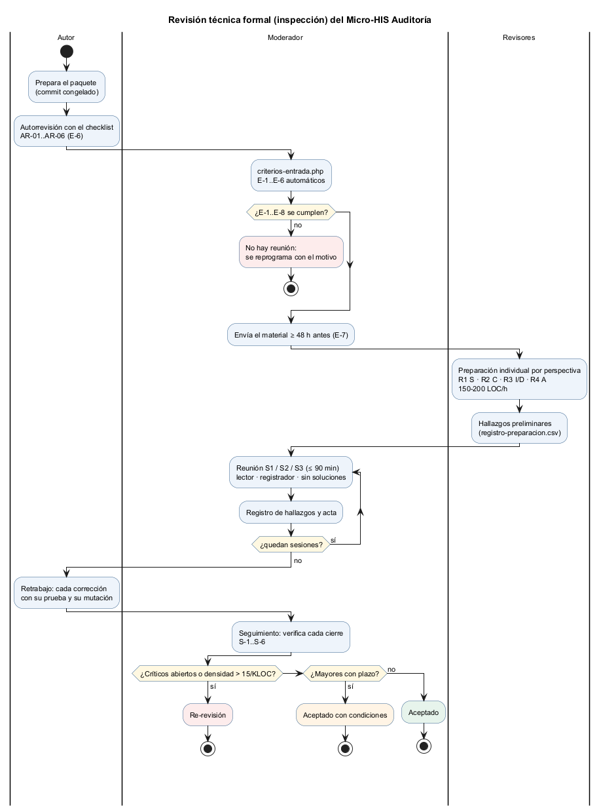

# Semana 13 — Calidad del software y revisión técnica formal de Auditoría

| | |
|---|---|
| **Curso** | Análisis de Sistemas II — Proyecto Final 2026 |
| **Módulo** | Gobernanza y auditoría de movimientos del sistema |
| **Proceso** | «Registro inmutable y consulta filtrada de movimientos por usuario, módulo y fechas» |
| **Estudiante** | Boris Alexander Quiroa Orellana |

## Entregables

| Pedido | Dónde |
|---|---|
| Plan de revisión | [`plan-revision-tecnica.md`](plan-revision-tecnica.md): objetivo, tipo, alcance y paquete, proceso y calendario, reglas, métricas y riesgos |
| Checklist de 12–15 ítems | [`checklist-revision.md`](checklist-revision.md): **15 ítems** (RT-01..15) en 5 perspectivas |
| Roles de autor, moderador y revisores | [Plan §3](plan-revision-tecnica.md#3-roles-y-responsabilidades): autor, moderador, registrador, lector y R1..R4 por perspectiva |
| Criterios de entrada y salida | [Plan §6–§7](plan-revision-tecnica.md#6-criterios-de-entrada): E-1..E-8 (6 automatizados) y S-1..S-6 con la regla de decisión |
| Formato de hallazgos | [`formato-hallazgos.md`](formato-hallazgos.md) y [`plantillas/registro-hallazgos.csv`](plantillas/registro-hallazgos.csv), con las plantillas de [acta](plantillas/acta-revision.md) y de [preparación](plantillas/registro-preparacion.csv) |

## 1. Lo que cubre la revisión

| Pide la tarea | Ítems | Perspectiva | Revisor |
|---|---|:-:|---|
| Reglas de dominio | RT-01 movimiento bien formado · RT-02 rango y filtros · RT-03 corrección trazable | D | R3 |
| Contrato API | RT-04 contrato = código · RT-05 errores sin fuga · RT-06 formato en la frontera | C | R2 |
| Permisos / tenant | RT-07 permiso en el caso de uso · RT-08 tenant · RT-09 identidad del actor | S | R1 |
| Integridad de audit logs | RT-10 inmutabilidad · RT-11 sello encadenado · RT-12 meta-auditoría · RT-13 idempotencia | I | R3 |
| Dependencias estrictamente necesarias | RT-14 capas · RT-15 dependencias y recursos acotados | A | R4 |

**Dos características del checklist:**
- **Cada ítem es una afirmación para refutar**, con la prueba o el comando que hoy la respalda. Así el revisor busca el caso que las pruebas **no** cubren, en lugar de repetirlas.
- **El paquete se divide en 3 sesiones** de menos de 1600 líneas efectivas (919, 936 y 1091), para que cada reunión quepa en 90 minutos.

## 2. Criterios de entrada: automatizados y probados

[`herramientas/criterios-entrada.php`](herramientas/criterios-entrada.php) verifica E-1..E-6 y arma el paquete (archivos y líneas por sesión, y el commit).

| Corrida | E-1 | E-2 | E-3 | E-4 | E-5 | E-6 |
|---|:-:|:-:|:-:|:-:|:-:|:-:|
| [Antes](evidencia/criterios-entrada-1-antes.txt) (sin checklist ni autorrevisión) | PASA | PASA | PASA | PASA | **FALLA** | **FALLA** |
| [Después](evidencia/criterios-entrada-2-despues.txt) | PASA | PASA | PASA | PASA | PASA | PASA |

- **Que la primera corrida falle demuestra que los criterios no son decorativos:** sin checklist ni autorrevisión, el script impide convocar la reunión.
- **E-7 y E-8** (envío ≥ 48 h y roles confirmados) son manuales y los firma el moderador en el acta.

## 3. Resultado de la autorrevisión

El autor pasó los 15 ítems **antes** de convocar ([autorrevisión](autorrevision-autor.md)). Cada hallazgo se reproduce contra el kernel real ([salida](evidencia/autorrevision-verificaciones.txt)).

| ID | Hallazgo | Ítem | Severidad · tipo |
|---|---|---|---|
| AR-01 | `crearKernel()` acepta siempre los tokens de demostración: «Bearer token-superadmin» lee toda la red | RT-09 | **Crítico** · Riesgo |
| AR-02 | La verificación carga la cadena completa: 866 B por movimiento, ≈ 826 MB con 1 M de movimientos | RT-15 | Mayor · Riesgo |
| AR-03 | DEF-07-01: el cursor acepta fechas imposibles | RT-02 | Menor · Defecto |
| AR-04 | El recurso es texto libre: «¿quién vio la ficha?» encuentra 1 de 3 accesos al mismo paciente | RT-01 | Mayor · Riesgo |
| AR-05 | La bitácora se observa a sí misma: las lecturas son la mitad de la cadena en la evidencia | RT-12 | Observación · Riesgo |
| AR-06 | La unicidad de `event_id` es por emisor en toda la red, y el contrato no lo dice | RT-13 | Menor · Contrato |

**Lectura honesta:**
- Hay **un Crítico abierto**. Con la regla de decisión del plan (§7), hoy el resultado sería **«Re-revisión»**.
- **AR-01 y AR-04 nacen de decisiones del propio autor** (los tokens demo para poder probar y el filtro por recurso de la semana 12). La revisión formal existe justamente para eso.
- **Los 9 ítems restantes** se cumplen con evidencia ejecutable: pruebas y mutaciones de las semanas 3 a 12.

## 4. Cómo se ejecuta la revisión

1. **Confirmar los roles** (E-8) y fechas con el plan §4.
2. **Congelar el paquete:** `php herramientas/criterios-entrada.php` debe terminar con el código 0.
3. **Enviar** el material ≥ 48 h antes (E-7).
4. **Preparación** individual por perspectiva, anotada en `registro-preparacion.csv`.
5. **Tres reuniones** de ≤ 90 min con la [plantilla de acta](plantillas/acta-revision.md).
6. **Retrabajo:** cada cierre con su prueba y su mutación.
7. **Seguimiento** y decisión.

## 5. Limitaciones

- **La reunión no se realizó todavía:** los revisores están «por confirmar» (E-8). Esta entrega es el **plan** y la **autorrevisión**, como pide la tarea.
- **La autorrevisión la hizo el autor**, con sus puntos ciegos declarados.
- **Los tiempos (≤ 90 min, 150–200 LOC/h, umbral de 15/KLOC) son los habituales de la literatura de inspecciones**, no calibrados con datos de este equipo. El plan SQA (semana 14) propone medirlos.
