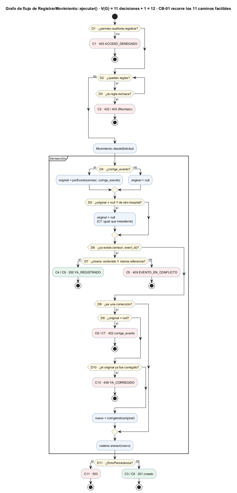

# Semana 15 — Pruebas unitarias, de caja blanca y de caja negra de Auditoría

| | |
|---|---|
| **Curso** | Análisis de Sistemas II — Proyecto Final 2026 |
| **Módulo** | Gobernanza y auditoría de movimientos del sistema |
| **Proceso** | «Registro inmutable y consulta filtrada de movimientos por usuario, módulo y fechas» |
| **Estudiante** | Boris Alexander Quiroa Orellana |

## Entregables

| Pedido | Dónde |
|---|---|
| Matriz RF/RNF → prueba | [`matriz-rf-rnf-pruebas.md`](matriz-rf-rnf-pruebas.md): 21 RF y 15 RNF |
| Mínimo 3 unitarias | **8:** UNI-01..08 en [`tests/Dominio/UnitariasPrueba.php`](../micro-his-auditoria/tests/Dominio/UnitariasPrueba.php) |
| Mínimo 2 de caja blanca | **3:** CB-01..03 en [`tests/Aplicacion/CajaBlancaPrueba.php`](../micro-his-auditoria/tests/Aplicacion/CajaBlancaPrueba.php), con el [grafo de flujo](diagramas/semana-15-grafo-registrar.png) y la cobertura medida (100 %) |
| Mínimo 4 de caja negra | **7:** CN-01..07 en [`tests/Presentacion/CajaNegraPrueba.php`](../micro-his-auditoria/tests/Presentacion/CajaNegraPrueba.php) |
| Comandos y resultados | [§5](#5-comandos-y-resultados) y [`evidencia/`](evidencia/) |
| Capturas | [`capturas/`](capturas/): una por evidencia |
| Defectos registrados | [`registro-defectos.md`](registro-defectos.md): 1 cerrado (DEF-07-01), 4 abiertos con su prueba (1 **nuevo**, hallado por la caja negra) |

## 1. Qué se prueba y qué no

- **Se prueba el Micro-HIS Auditoría:** reglas de dominio, casos de uso, contrato HTTP y persistencia (las INT, con PostgreSQL 18).
- **No se prueban los módulos ajenos** (RBAC, la identidad del HIS, Pacientes): se simulan con `PoliticaAccesoEstatica` y los tokens de demostración, tal como pide la tarea.
- **Las pruebas de las semanas 3 a 12 siguen en la suite;** esta semana agrega 18 pruebas nuevas. La suite queda en **116/116 con PostgreSQL**.

## 2. Pruebas unitarias (UNI-01..08)

Cada una prueba **una** clase, sin kernel, sin transacción y sin base, con un tema de la tarea por prueba ([evidencia](evidencia/1-unitarias.txt) · [captura](capturas/1-unitarias.png)).

| ID | Tema | Clase | Qué afirma | Req. |
|---|---|---|---|---|
| UNI-01 | Inmutable | `Movimiento` | Sellar o asignar id devuelve **otra** instancia; las propiedades son `readonly` | R-02, RF-06 |
| UNI-02 | Inmutable | `Sello` | El sello cambia si cambia **cualquiera** de los 8 campos, la secuencia o el sello anterior | R-03, RF-07 |
| UNI-03 | Usuario | `ReglaCamposObligatorios`, `ReglaFormatoCampos` | Obligatorio; 64 caracteres sí, 65 no | RF-03 |
| UNI-04 | Módulo | `ReglaModuloDelEmisor` | Cada cuenta solo su módulo; una cuenta no listada no registra nada (fail-closed); es un 403 | RF-03 |
| UNI-05 | Acción | `ReglaAccionEnCatalogo` | Del catálogo **de su módulo**; sin normalizar mayúsculas | RF-03 |
| UNI-06 | Tenant | `ReglaTenantDelEmisor`, `Alcance` | El hospital del cuerpo = el del token; un hospital solo se incluye a sí mismo | R-05, RF-02 |
| UNI-07 | Rango de fechas | `FiltroRangoFechas` | 00:00 y 23:59:59 locales dentro, 00:00 del día siguiente fuera; invertido, 30/02 y formato de la UI rechazados | R-06, RF-08 |
| UNI-08 | Rango de fechas | `CursorPaginacion` | **Regresión de DEF-07-01:** el cursor rechaza fechas imposibles | RF-11 |

**UNI-08 se escribió primero y falló** ([antes](evidencia/def-07-01-1-antes.txt)). Después se corrigió el código ([después](evidencia/def-07-01-2-despues.txt)).

## 3. Pruebas de caja blanca (CB-01..03)

Se diseñaron **leyendo el código** ([evidencia y cobertura](evidencia/2-caja-blanca-cobertura.txt) · [captura](capturas/2-caja-blanca-cobertura.png)).



| ID | Técnica | Sobre | Casos |
|---|---|---|---|
| CB-01 | Caminos básicos (McCabe) | `RegistrarMovimiento::ejecutar()`, V(G) = 11 + 1 = 12 | 11 caminos factibles, C1..C11: sin permiso, regla, nuevo, reintento, conflicto, corrección inexistente, de otro hospital, válida, reintento de la corrección, ya corregido, base caída. El 12.º («ninguna regla») no es factible: el contenedor siempre arma las 9 |
| CB-02 | MC/DC | Las dos condiciones compuestas de `ejecutar()` | «original ≠ null **y** de otro hospital» (A, B) y «mismo contenido **y** misma referencia» (C, D): cada condición cambia la salida sola |
| CB-03 | Cobertura de ramas y MC/DC | `VerificarIntegridad` | 10 ramas: vacía, íntegra, hueco (X), sello roto con secuencia correcta (Y; MC/DC del `\|\|`), ancla truncada, ancla distinta, ancla confirmada, secuencia 0, sin permiso, base caída |

**Cobertura de líneas lograda solo por CB-01..03** (phpdbg):

| Clase | Líneas |
|---|---|
| `RegistrarMovimiento` | 11/11 |
| `VerificarIntegridad` | 16/16 |
| `CadenaSellada` | 6/6 |
| **Total** | **33/33 (100 %)** |

La primera medición dio 93,9 %. Mostró dos salidas de `ejecutar()` sin recorrer (sin permiso y base caída), que se agregaron a CB-03.

## 4. Pruebas de caja negra (CN-01..07)

Se diseñaron **solo desde el contrato** (`api/openapi.yaml`) y los requisitos, y entran por HTTP ([evidencia](evidencia/3-caja-negra.txt) · [captura](capturas/3-caja-negra.png)).

| ID | Técnica | Casos |
|---|---|---|
| CN-01 | Particiones de equivalencia | `resultado`: 3 clases válidas (cada una devuelve solo su clase) y 3 inválidas (`EXITO`, `ok`, vacío) |
| CN-02 | Valores límite | Rango: 00:00:00 y 23:59:59 dentro, 00:00 del día siguiente fuera; `desde = hasta + 1`; 29/02 bisiesto; 30/02; falta `desde` |
| CN-03 | Valores límite | Usuario 64/65 (al registrar y al filtrar); recurso 128/129; detalle 4096/4097 bytes |
| CN-04 | Permisos (tabla de decisión) | 4 roles × 5 operaciones: cada rol hace exactamente lo suyo |
| CN-05 | Permisos / tenant | Sin cabecera → 400; tenant ajeno → 403; `*` sin token de red → 403; un 404 de otro hospital = uno inexistente |
| CN-06 | Errores | Sin cuerpo → 400; parámetro repetido → 400; PUT/PATCH/DELETE → 405; id no numérico → 404; cursor manipulado → 422; base caída → 503 sin detalles |
| CN-07 | Valores límite | Paginación: 50 → sin cursor; 51 → 50 + cursor y una 2.ª página de 1 |

**CN-04 encontró un defecto nuevo (DEF-04 / DEF-15-01):** con `X-Tenant-ID` de un hospital, el super administrador verifica **otra** cadena. Hay que leer bien este hallazgo:
- **El contrato** define la cabecera como «el hospital del alcance».
- **El código la ignora** en esas dos operaciones.
- **Detectarlo** era justamente para lo que sirve diseñar desde el contrato y no desde el código.

## 5. Comandos y resultados

```bash
cd docs/modulos/gobernanza-auditoria/micro-his-auditoria
php tests/ejecutar.php --solo=UNI                 # 8/8
php tests/ejecutar.php --solo=CB                  # 3/3
php tests/ejecutar.php --solo=CN                  # 7/7
php tests/ejecutar.php --defectos --solo=DEF      # 4 FALLAN: defectos abiertos (es lo esperado)
AUDITORIA_DB_DSN=… php tests/ejecutar.php         # 116/116 con PostgreSQL 18
AUDITORIA_DB_DSN=… php tests/mutaciones.php       # 27/27
cd ../semana-15 && phpdbg -qrr herramientas/cobertura-caja-blanca.php   # 33/33 líneas
```

| Evidencia | Resultado | Captura |
|---|---|---|
| [1-unitarias.txt](evidencia/1-unitarias.txt) | 8 pasan, 0 fallan | [png](capturas/1-unitarias.png) |
| [2-caja-blanca-cobertura.txt](evidencia/2-caja-blanca-cobertura.txt) | 3 pasan · 100 % de líneas | [png](capturas/2-caja-blanca-cobertura.png) |
| [3-caja-negra.txt](evidencia/3-caja-negra.txt) | 7 pasan, 0 fallan | [png](capturas/3-caja-negra.png) |
| [4-defectos-abiertos.txt](evidencia/4-defectos-abiertos.txt) | 4 fallan (abiertos) | [png](capturas/4-defectos-abiertos.png) |
| [5-suite-completa.txt](evidencia/5-suite-completa.txt) | 116/116 con PostgreSQL | [png](capturas/5-suite-completa.png) |
| [mutaciones.txt](evidencia/mutaciones.txt) | 27/27 (M27 nueva, vigila DEF-07-01) | [png](capturas/mutaciones.png) |
| [6-medir-sqa-despues.txt](evidencia/6-medir-sqa-despues.txt) | M1 116/116; M6 baja un menor; M6 y M7 siguen en rojo | [png](capturas/6-medir-sqa-despues.png) |

## 6. Limitaciones

- **La caja blanca mide líneas, no ramas.** phpdbg no informa la cobertura de ramas. Las ramas y condiciones se aseguraron **por diseño** (caminos básicos y MC/DC), y la cobertura de líneas lo confirma.
- **DEF-01 (crítico) sigue abierto:** su corrección depende del autenticador real del HIS (otro módulo).
- **AR-02 (verificación no acotada) no tiene prueba automática:** probarlo exige volúmenes de cientos de MB. Lo vigila la métrica M7 del plan SQA, que está en rojo.
- **Todas las pruebas usan los adaptadores InMemory, salvo las 17 de PostgreSQL.** La paridad entre los adaptadores la garantiza la suite de contrato (CON-*).
