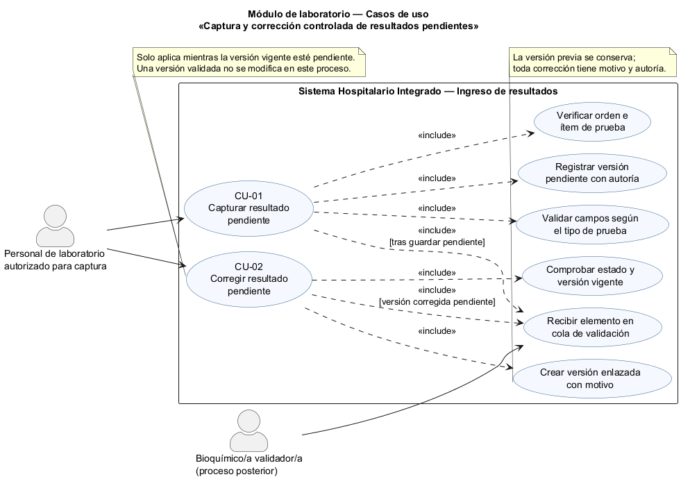
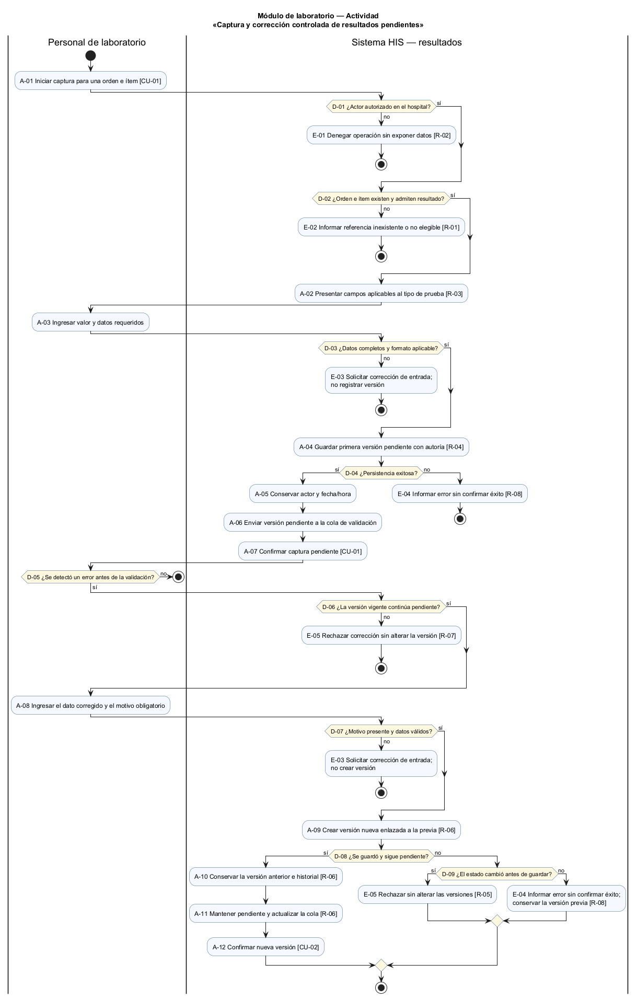
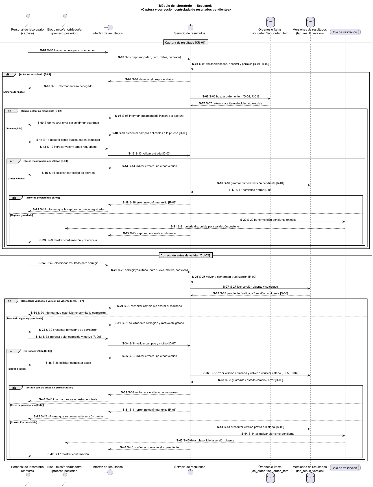

# Semana 1 — Modelado UML del ingreso de resultados de laboratorio

| | |
|---|---|
| **Curso** | Análisis de Sistemas II — Proyecto Final 2026 |
| **Proyecto** | Sistema Hospitalario Integrado (HIS) |
| **Módulo** | Ingreso de resultados de laboratorio |
| **Tema de la semana** | Conceptos generales, orientación a objetos y UML |
| **Proceso modelado** | «Captura y corrección controlada de resultados pendientes» |
| **Estudiante** | Mercedes Azucena Lopez Perez |
| **Fecha** | Octubre 2026 |

## 1. Introducción

El ingreso de resultados requiere conservar la asociación con la orden y el examen correctos, registrar quién capturó cada dato y prevenir cambios silenciosos. Un resultado recién capturado permanece pendiente de validación. Mientras continúe pendiente, el personal autorizado puede corregirlo mediante una nueva versión que incluya el motivo; la versión anterior se conserva para mantener la trazabilidad. La validación bioquímica y la publicación clínica del resultado pertenecen a otro proceso.

Este documento modela el proceso con tres vistas:

- **Casos de uso:** actores y objetivos.
- **Actividad:** validaciones, decisiones, excepciones y resultados.
- **Secuencia:** participantes, mensajes, verificaciones y respuestas.

Los identificadores CU, A, D, E, S y R conectan las tres vistas y se resumen en la matriz de trazabilidad. Es un modelo académico del proceso; no afirma que el flujo, sus pantallas o una API ya estén implementados.

## 2. Narrativa de alcance

**Objetivo.** Capturar el resultado de una prueba realizada para una orden y un ítem identificados. El sistema verifica que el ítem corresponda a la orden y que se pueda recibir el resultado requerido; registra una primera versión como pendiente de validación. Si un dato pendiente necesita corrección, el personal autorizado indica el motivo y crea una versión nueva vinculada con la anterior. Ninguna corrección sobrescribe silenciosamente el historial. El resultado corregido permanece pendiente de validación.

**Escenario de referencia.** Una persona autorizada del laboratorio abre una orden con pruebas aún pendientes de resultado y selecciona el ítem correcto. Registra el valor observado y los datos que el catálogo de la prueba requiera, como unidad cuando aplique, y guarda el resultado. El sistema verifica los datos obligatorios, registra el autor, la fecha y la versión, y presenta el resultado como pendiente de validación. Antes de que un bioquímico lo valide, el capturista detecta un error. Selecciona la versión pendiente, ingresa el dato corregido y un motivo obligatorio. El sistema guarda una nueva versión relacionada con la anterior, conserva la versión original y devuelve el resultado a la cola de validación como pendiente.

**Dentro del alcance:**

- localizar una orden y un ítem de laboratorio existentes;
- registrar un resultado nuevo con los datos requeridos por el tipo de prueba;
- marcar el resultado capturado como pendiente de validación;
- corregir una versión que siga pendiente mediante una nueva versión enlazada y un motivo;
- conservar autoría, marcas de tiempo y versiones anteriores;
- impedir la modificación directa de resultados validados.

**Fuera del alcance:**

- crear órdenes, ítems de orden, muestras o el catálogo de pruebas;
- definir los tipos, unidades, rangos de referencia o criterios clínicos de cada examen;
- validar, aprobar, rechazar bioquímicamente, firmar o publicar resultados;
- generar alertas críticas, notificar al paciente o iniciar tratamiento;
- especificar endpoints, pantallas, roles definitivos, instrumentos o interfaces con analizadores.

**Supuestos y límites:**

1. La orden y el ítem de laboratorio existen y están disponibles en el hospital correspondiente.
2. El valor puede ser numérico, textual o cualitativo según la prueba. Su representación, unidad y demás campos se obtienen del catálogo definido por el módulo de pruebas; este modelo no inventa ese contrato.
3. Solo se puede corregir el resultado vigente mientras permanece pendiente de validación. El estado se vuelve a comprobar al guardar para evitar corregir una versión que haya cambiado concurrentemente. Cada corrección exige motivo y crea una versión enlazada; no elimina ni sobrescribe la anterior.
4. Un resultado validado es inmutable. Su rectificación, si corresponde, necesita un flujo formal posterior, motivo y versionado; no es parte de esta tarea.
5. Si una validación de entrada o el guardado falla, el sistema informa el error y no anuncia que una captura o corrección se guardó.
6. El diseño federado del repositorio contempla `lab_order`, `lab_order_item`, `lab_result_version` y `critical_alert` en HOSPITAL. La especificación requiere que los resultados validados sean inmutables y que las correcciones creen versiones enlazadas con motivo; no define todavía el contrato de captura de esta entrega.

## 3. Actores

| Actor | Tipo | Objetivo |
|---|---|---|
| Personal de laboratorio autorizado para captura | Primario | Registrar resultados de ítems de una orden y corregir resultados que sigan pendientes de validación, de acuerdo con los permisos del hospital. |
| Bioquímico/a validador/a | Secundario, fuera de alcance de ejecución | Recibir el resultado pendiente en la cola del proceso posterior de validación. No valida ni aprueba resultados en este modelo. |

El servicio de resultados, el repositorio y la cola de validación son participantes internos del HIS, no actores externos.

## 4. Diagrama de casos de uso

Fuente editable: [semana-01-casos-de-uso.puml](diagramas/semana-01-casos-de-uso.puml).

## 5. Especificación de casos de uso

### CU-01 — Capturar resultado pendiente

| Campo | Descripción |
|---|---|
| Actor principal | Personal de laboratorio autorizado para captura. |
| Objetivo | Registrar un resultado de prueba vinculado con el ítem correcto de una orden, sin presentarlo como validado. |
| Precondición | El actor está autenticado y autorizado en el hospital; la orden y el ítem existen y admiten la captura de un resultado. |
| Disparador | El actor inicia el ingreso de un resultado para un ítem sin resultado validado. |
| Flujo principal | 1. El actor localiza la orden y selecciona el ítem de prueba. 2. El sistema verifica la asociación y que el ítem admita captura. 3. El sistema presenta los campos aplicables al tipo de prueba. 4. El actor ingresa el valor y los datos requeridos. 5. El sistema valida los datos obligatorios. 6. El sistema registra la primera versión con autor y fecha/hora, en estado pendiente. 7. El sistema muestra la confirmación y la versión registrada. |
| Alternativas y excepciones | Actor sin autorización: operación denegada (E-01). Orden o ítem inexistente/no disponible: no se captura (E-02). Datos requeridos inválidos o incompletos: se solicitan correcciones (E-03). Falla de persistencia: no se muestra confirmación de éxito (E-04). |
| Postcondición | Se conserva una versión de resultado asociada al ítem y marcada pendiente de validación. |

### CU-02 — Corregir resultado pendiente

| Campo | Descripción |
|---|---|
| Actor principal | Personal de laboratorio autorizado para captura. |
| Objetivo | Corregir un dato pendiente con motivo y trazabilidad, sin sobrescribir la versión anterior. |
| Precondición | Existe un resultado vigente para el ítem y permanece pendiente de validación; el actor tiene autorización para corregirlo. |
| Disparador | El actor identifica un dato incorrecto antes de la validación bioquímica. |
| Flujo principal | 1. El actor localiza el resultado pendiente y selecciona «corregir». 2. El sistema comprueba que la versión continúa pendiente y es corregible. 3. El actor ingresa el dato correcto y un motivo. 4. El sistema valida los datos y el motivo. 5. Al guardar, el sistema vuelve a comprobar el estado y crea una nueva versión enlazada a la anterior, conserva el historial y registra actor y fecha/hora. 6. La nueva versión permanece pendiente de validación. 7. El sistema confirma la corrección y su nueva versión. |
| Alternativas y excepciones | Si el resultado ya fue validado o cambió de estado antes o durante el guardado, se rechaza la corrección y no se modifica el dato (E-05). Si falta el motivo o los campos son inválidos, se solicita corregir la entrada (E-03). Si falla el guardado, no se confirma la nueva versión (E-04). |
| Postcondición | La versión anterior se conserva; la nueva versión queda enlazada, con motivo y autoría, y continúa pendiente de validación. |

La validación por bioquímica es otro módulo y no constituye CU-03 de esta entrega: el actor secundario solo recibe el elemento pendiente para su trabajo posterior.

## 6. Diagrama de actividad

Fuente editable: [semana-01-actividad.puml](diagramas/semana-01-actividad.puml).

El flujo diferencia la captura inicial de la corrección. En la corrección, la decisión clave es que la versión continúe pendiente y que el motivo esté presente; la salida es una nueva versión pendiente, nunca una actualización destructiva de la existente.

## 7. Diagrama de secuencia

Fuente editable: [semana-01-secuencia.puml](diagramas/semana-01-secuencia.puml).

## 8. Matriz de trazabilidad

| Regla | Narrativa / caso de uso | Actividad | Secuencia |
|---|---|---|---|
| R-01 — Un resultado se vincula con una orden y un ítem de prueba existentes. | CU-01, pasos 1–2 | A-01 a A-02, D-02 | S-06 a S-07 |
| R-02 — Solo personal autorizado puede capturar o corregir dentro del hospital. | CU-01 y CU-02, precondiciones | D-01, E-01 | S-02 a S-05, S-26 |
| R-03 — La captura debe satisfacer campos y formato aplicables al tipo de prueba. | CU-01, pasos 3–5 | A-02 a A-03, D-03 | S-10 a S-15 |
| R-04 — Una captura inicial se registra como pendiente y con autoría. | CU-01, pasos 6–7 | A-04 a A-07, D-04 | S-16 a S-23 |
| R-05 — Solo se corrige la versión vigente mientras está pendiente, y se vuelve a verificar al guardar. | CU-02, pasos 1–2 | D-06, D-08, D-09, E-05 | S-27 a S-30, S-37 a S-40 |
| R-06 — Toda corrección requiere motivo y crea una versión enlazada que preserva la anterior. | CU-02, pasos 3–6 | A-08 a A-11, D-07 | S-33 a S-37, S-43 a S-45 |
| R-07 — Una versión validada es inmutable en este flujo. | CU-02, alternativas | D-06, E-05 | S-28 a S-30 |
| R-08 — Si el guardado falla, no se informa éxito ni se pierde la versión anterior. | CU-01 y CU-02, alternativas | D-04, D-08, D-09, E-04 | S-17 a S-19, S-38 a S-42 |

## 9. Reglas de negocio

- **R-01:** Cada resultado se refiere a un ítem de prueba de una orden existente; no se determina la asociación únicamente con datos escritos libremente.
- **R-02:** Captura y corrección requieren identidad y permiso válidos dentro del hospital correspondiente.
- **R-03:** Los campos, el formato y la unidad aplicables dependen del tipo de prueba. La fuente de esos datos será el catálogo; no se fijan rangos clínicos aquí.
- **R-04:** La primera captura crea una versión pendiente de validación y conserva quién la registró y cuándo.
- **R-05:** La corrección se permite solo si la versión vigente aún está pendiente; el estado se vuelve a verificar al guardar.
- **R-06:** Una corrección requiere motivo no vacío, conserva la versión previa y crea una nueva versión relacionada; el nuevo resultado continúa pendiente.
- **R-07:** Una versión validada no se modifica mediante este proceso de captura/corrección de pendientes.
- **R-08:** Un fallo de persistencia se comunica sin mostrar una confirmación de éxito; la versión previa permanece conservada.

## 10. Conclusión

El proceso modelado permite capturar resultados con su orden e ítem asociados y mantiene la corrección dentro de un flujo auditable. La regla de versionado evita reemplazar datos históricos y la condición pendiente distingue la captura de la validación bioquímica posterior. Los identificadores compartidos y la matriz permiten seguir cada regla a través de casos de uso, actividad y secuencia.

## 11. Referencias

1. Captura de la consigna de Semana 1 compartida por la estudiante: «Ingreso de resultados de laboratorio», proceso «captura y corrección controlada de resultados pendientes».
2. Repositorio del proyecto, `openspec/changes/postgresql-federated-schema-rebuild/design.md` y `specs/hospital-clinical-schema/spec.md`: entidades planificadas para laboratorio y reglas de versionado e inmutabilidad.
3. Repositorio del proyecto, `docs/README.md` y `docs/modulos/rbac/semana-01/`: convenciones documentales y ejemplo de estructura de entrega UML.
