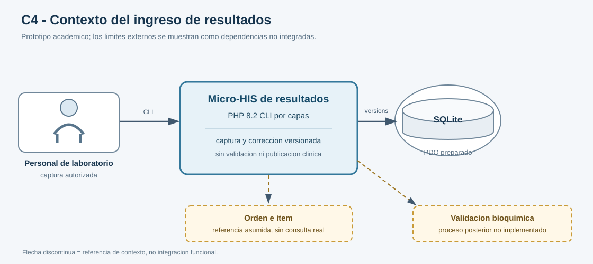
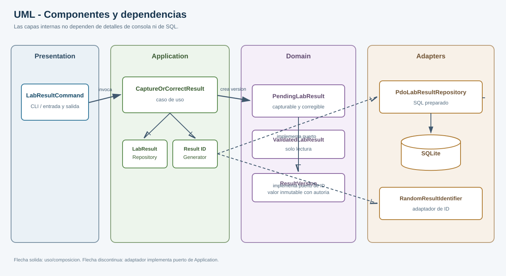

# Semana 3 — Micro-HIS de ingreso de resultados de laboratorio

| | |
|---|---|
| **Curso** | Análisis de Sistemas II — Proyecto Final 2026 |
| **Proyecto** | Sistema Hospitalario Integrado (HIS) |
| **Módulo** | Ingreso de resultados de laboratorio |
| **Tema** | Diseño arquitectónico, vistas y patrones |
| **Proceso** | Captura y corrección controlada de resultados pendientes |
| **Estudiante** | Lopez Perez, Mercedes Azucena |
| **Fecha** | Octubre 2026 |

## 1. Objetivo y alcance

Construir un prototipo ejecutable en PHP 8.2+ vanilla que capture un resultado nuevo asociado a un ítem de orden y permita corregirlo solo mientras siga pendiente de validación. Cada corrección crea una versión inmutable ligada a la anterior, conserva autor y fecha/hora, requiere motivo y sigue pendiente.

El prototipo aplica las capas Presentation, Application, Domain y Persistence. Usa PDO y sentencias preparadas con SQLite; prueba el camino feliz, una regla de dominio y el error de persistencia con dobles. Incluye una vista C4 de contexto y una vista UML de componentes/dependencias.

Quedan fuera el análisis clínico, validación o firma profesional, publicación al expediente, unidades y rangos por examen, consulta real de órdenes, autenticación/autorización productiva, analizadores, UI web y notificaciones. Las referencias y valores demostrativos no son datos clínicos reales.

## 2. Requerimientos y decisiones de dominio

| ID | Requisito verificable |
|---|---|
| RF-01 | Capturar un valor no vacío para un ítem y registrar la versión 1 en estado `pending`. |
| RF-02 | No crear una segunda versión inicial si el ítem ya tiene un resultado vigente. |
| RF-03 | Corregir únicamente la versión pendiente vigente, con versión esperada, valor nuevo y motivo no vacío. |
| RF-04 | Anexar una nueva versión con ID propio, número secuencial, referencia a la anterior, autor y fecha/hora. |
| RF-05 | Mantener las versiones corregidas en `pending`; no validar ni publicar desde este flujo. |
| RF-06 | Rechazar una corrección basada en versión obsoleta o estado validado sin alterar historial. |
| RNF-01 | Ejecutar con PHP 8.2+ sin framework ni dependencias Composer. |
| RNF-02 | Usar consultas PDO preparadas y restricciones persistentes para historial/versionado. |
| RNF-03 | Mantener el dominio inmutable y sin I/O, comprobable mediante dobles. |
| RNF-04 | Propagar fallos técnicos y no presentar un guardado fallido como éxito. |

El flujo representa el valor del resultado como texto porque la forma depende del catálogo de pruebas, que no está definido por esta asignación. No hay validación de rangos, unidades ni plausibilidad clínica.

## 3. Vista C4 de contexto

El diagrama señala la orden/ítem y la validación posterior como límites externos. No implica que el prototipo ya se integre con esos sistemas.



Fuente editable: [semana-03-contexto.puml](diagramas/semana-03-contexto.puml).

## 4. Vista UML de componentes y dependencias

La CLI depende del caso de uso; el caso de uso depende de puertos; los adaptadores implementan esos puertos. El dominio no depende de PDO ni de detalles de consola.



Fuente editable: [semana-03-componentes.puml](diagramas/semana-03-componentes.puml).

| Capa | Componentes | Responsabilidad |
|---|---|---|
| Presentation | `LabResultCommand` | Validar opciones CLI y presentar la respuesta/código de salida. |
| Application | `CaptureOrCorrectResult`, `LabResultRepository`, `ResultIdentifierGenerator` | Coordinar captura y corrección mediante contratos. |
| Domain | `ResultVersion`, `PendingLabResult`, `ValidatedLabResult`, `ResultState` | Proteger invariantes de versión y separar capacidades pendientes/validadas. |
| Infrastructure | `RandomResultIdentifierGenerator` | Generar un ID de versión sin depender de la capa de aplicación. |
| Persistence | `PdoLabResultRepository`, SQLite | Leer vigente, insertar inicial y anexar corrección con condición SQL. |

## 5. Flujo de captura y corrección

### Captura inicial

1. La CLI recibe `orderItemId`, valor y actor de demostración.
2. Application valida campos obligatorios y consulta el repositorio.
3. Si ya existe un resultado vigente, responde conflicto; no sobrescribe.
4. Domain crea `PendingLabResult` versión 1, sin versión anterior ni motivo.
5. El repositorio inserta con PDO preparado. Solo después de escritura confirmada la CLI presenta éxito.

### Corrección controlada

1. La persona indica ítem, ID exacto de versión esperada, valor corregido, motivo y actor.
2. Application comprueba que existe el resultado y que sigue pendiente.
3. La versión esperada debe coincidir con la versión vigente; si no, se informa conflicto.
4. Domain crea una versión nueva pendiente y enlaza `previousVersionId`, motivo y autor.
5. El `INSERT ... SELECT ... WHERE EXISTS` preparado confirma al momento de escribir que la versión esperada es la última y continúa pendiente. Cero filas insertadas significa conflicto; la versión anterior permanece intacta.

El comando usa códigos de salida distintos: 0 éxito, 2 entrada/regla rechazada, 3 conflicto, 4 resultado no encontrado y 1 error técnico. La excepción PDO se informa en stderr y nunca se acompaña de confirmación de éxito.

## 6. Esquema y persistencia

`lab_result_versions` conserva una fila por versión. Restricciones SQL protegen los campos obligatorios, los estados conocidos, secuencia positiva y metadatos de corrección; `UNIQUE(order_item_id, version_number)` evita números repetidos por ítem. El índice compuesto facilita obtener la última versión.

La corrección es append-only. El ID esperado y el estado `pending` se verifican en la misma escritura condicional, reduciendo la ventana de concurrencia entre lectura y escritura. El adaptador preparado usa parámetros; no concatena valores del usuario dentro del SQL.

El prototipo no tiene endpoint de validación. Para probar el bloqueo de resultados validados, la suite usa un registro validado como fixture; no se expone una forma CLI que permita marcarlo como validado.

## 7. Ejecución y validación

Desde `docs/modulos/ingreso-resultados-laboratorio/semana-03/ejemplo`:

```powershell
Get-ChildItem . -Filter '*.php' -Recurse | ForEach-Object { php -l $_.FullName }
php tests/run.php
php bin/result.php --action=capture --item=ITEM-001 --value=5.4 --actor=TECH-01
```

La prueba de PDO SQLite de captura/corrección se realiza con un archivo temporal y se elimina al concluir:

```powershell
$env:LAB_RESULTS_DATABASE = Join-Path $env:TEMP 'week3-results-verification.sqlite'
php bin/result.php --action=capture --item=ITEM-SQL-01 --value=5.4 --actor=TECH-01
php bin/result.php --action=correct --item=ITEM-SQL-01 --expected=RES-ID-DEVUELTO-POR-CAPTURE --value=5.6 --reason="Corrección de transcripción" --actor=TECH-02
```

En el segundo comando se reemplaza `RES-ID-DEVUELTO-POR-CAPTURE` por el ID que imprimió la captura previa. La suite combina pruebas de aplicación con dobles y pruebas de integración PDO SQLite; cubre captura, corrección, versionado, validado, motivo obligatorio, valor vacío, versión obsoleta, conflicto de escritura y fallo de persistencia. Los comandos y resultados observados se registran en [evidencia de validación](evidencia/validacion-semana-03.txt). Las pruebas no certifican reglas clínicas, seguridad productiva, interoperabilidad ni desempeño bajo carga.

## 8. Límites, riesgos y trabajo futuro

- Vincular `orderItemId` con una orden real y validar paciente/episodio requiere un contrato con el módulo de órdenes; hoy se asume la referencia entregada.
- La CLI acepta `actor` como valor sintético. En producción la identidad debe derivarse de una sesión autenticada y autorización por hospital.
- No se definen unidad, precisión, valores cualitativos, intervalos de referencia ni validación clínica. Deben proceder de un catálogo aprobado.
- La condición SQL protege el append ante una versión obsoleta, pero el ejemplo no implementa API, idempotencia de solicitud, auditoría institucional ni firma.
- El resultado permanece pendiente; validación y publicación pertenecen a un flujo distinto.

## 9. Referencias de implementación

- [README y ejecución](ejemplo/README.md)
- [Suite de pruebas](ejemplo/tests/run.php)
- [Esquema SQLite](ejemplo/database/schema.sql)
- [Diagrama C4 de contexto](diagramas/semana-03-contexto.puml)
- [Diagrama UML de componentes](diagramas/semana-03-componentes.puml)
