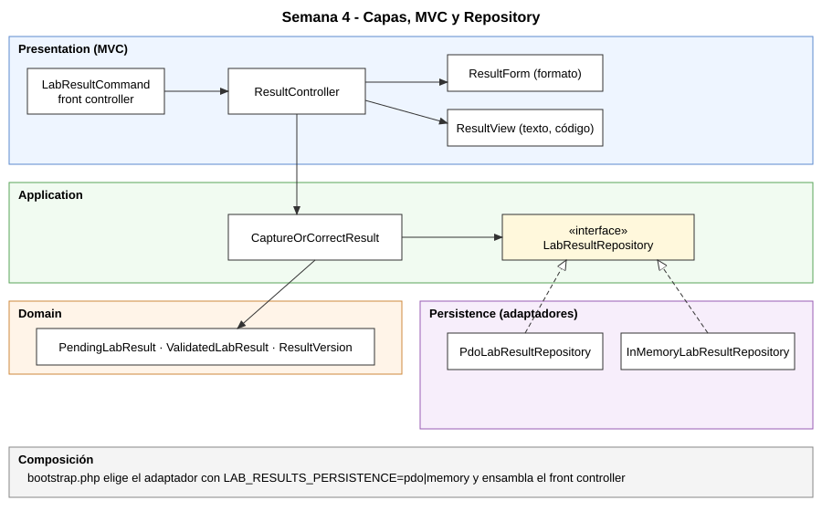
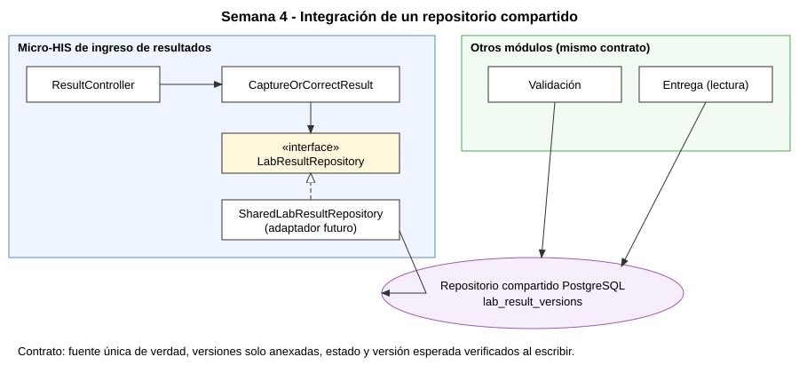

# Semana 4 — Arquitectura en capas y Repository: ingreso de resultados

**Estudiante:** Mercedes Azucena López Pérez · **Módulo:** ingreso de resultados de laboratorio · **Flujo:** captura y corrección controlada de resultados pendientes.

## 1. Qué cambió respecto de la Semana 3

| Aspecto | Semana 3 | Semana 4 |
|---|---|---|
| Entrada | Un comando CLI que validaba y presentaba | Front controller → `ResultController` + `ResultForm` + `ResultView` |
| Persistencia | Solo adaptador PDO | Puerto `LabResultRepository` con adaptadores PDO e InMemory |
| Elección de adaptador | Fija | `bootstrap.php`, variable `LAB_RESULTS_PERSISTENCE` |
| Pruebas | Dobles propios del test | Suite de contrato contra ambos adaptadores + MVC + reglas de arquitectura |

Dominio, caso de uso, esquema SQL y consulta preparada con `CAST` no cambiaron.

## 2. Capas y responsabilidades

| Capa | Objetos | Responsabilidad | No debe |
|---|---|---|---|
| Presentation | `LabResultCommand`, `ResultController`, `ResultForm`, `ResultView`, `Response` | Traducir entrada a llamadas y resultado a texto/código de salida | Contener SQL, reglas de negocio ni crear dependencias |
| Application | `CaptureOrCorrectResult`, `LabResultRepository`, `ResultIdentifierGenerator` | Orquestar el caso de uso y declarar los puertos | Conocer PDO, Persistence o Presentation |
| Domain | `PendingLabResult`, `ValidatedLabResult`, `ResultVersion`, `ResultState` | Invariantes: pendiente corregible, validado solo lectura, versiones enlazadas | Depender de otras capas |
| Persistence | `PdoLabResultRepository`, `InMemoryLabResultRepository` | Implementar el puerto con la misma semántica | Contener reglas de negocio |
| Composición | `bootstrap.php` | Elegir adaptadores y ensamblar | — |

## 3. MVC

- **Modelo:** caso de uso y dominio (no la vista ni la base de datos).
- **Controlador:** `ResultController::capture/correct` recibe el arreglo de entrada, pide al formulario validar el formato, llama al caso de uso y entrega el resultado a la vista. Es un coordinador: sin `new`, SQL, `echo` ni referencias a Domain o Persistence.
- **Vista:** `ResultView` convierte el estado de la operación en mensaje y código de salida (0 correcto, 2 entrada inválida, 3 conflicto, 4 no encontrado).
- **Formulario:** `ResultForm` valida solo el formato (presencia, texto); las reglas de negocio quedan en Application/Domain.
- **Front controller:** `LabResultCommand::handle(array): Response` enruta la acción; `run()` solo lee argv y escribe la salida.

## 4. Repository

La interfaz `LabResultRepository` vive en Application (límite del caso de uso) con tres operaciones: `currentFor`, `saveInitial` y `appendCorrection(expectedVersionId, corrected)`. Los adaptadores la implementan:

- **PDO:** `INSERT … SELECT … WHERE EXISTS` preparado; solo anexa si la versión esperada sigue vigente y pendiente.
- **InMemory:** misma semántica en arreglos; sirve para demos y pruebas rápidas.

La suite de contrato ejecuta los mismos 10 casos contra ambos, de modo que cualquiera puede sustituir al otro sin cambiar el caso de uso (LSP aplicado a persistencia).

## 5. Objetos reutilizables

- `LabResultRepository` y `CaptureOrCorrectResult`: usables desde otra entrada (web, API) sin cambios.
- `ResultForm` / `ResultView`: sustituibles por equivalentes web.
- `ResultVersion` y los tipos de dominio: contrato común con validación y entrega.
- Suite de contrato: reutilizable para cualquier adaptador nuevo.

## 6. Integración de un repositorio de datos compartido

Propuesta: un tercer adaptador, `SharedLabResultRepository`, implementa el mismo puerto sobre la base compartida (PostgreSQL) y no requiere cambios en controlador, caso de uso ni dominio. Condiciones:

1. **Fuente única de verdad:** otros módulos (validación, entrega) leen de la misma tabla `lab_result_versions` y no mantienen copias.
2. **Historial solo anexado:** nadie actualiza ni borra versiones; la corrección es una fila nueva enlazada.
3. **Concurrencia en la escritura:** el append condicional verifica versión esperada y estado pendiente en el mismo SQL; ante cambio externo devuelve conflicto.
4. **Propiedad de escritura:** este módulo escribe capturas/correcciones; validación escribe el cambio de estado; entrega solo lee.
5. **Contrato verificable:** el nuevo adaptador debe pasar la suite de contrato antes de usarse.

Riesgos: acoplamiento por el esquema compartido (mitigado versionando el esquema y usando el puerto), contención y necesidad de permisos por rol. Esta propuesta es análisis; no se implementó el adaptador compartido.

## 7. Evidencia

- `php -l` en los 13 archivos PHP: sin errores.
- `php tests/run.php`: **46 aserciones, todas pasan** ([validacion-semana-04.txt](evidencia/validacion-semana-04.txt)).
- `php bin/demo.php`: captura (0), corrección (0) y reintento obsoleto (3) ([demo-semana-04.txt](evidencia/demo-semana-04.txt)).
- Pruebas de arquitectura: controlador sin SQL/PDO/dominio/persistencia/`new`/salida (con control negativo); Application y Domain sin dependencias hacia capas externas.

## 8. Limitaciones

- Las reglas de arquitectura se verifican con expresiones regulares sobre el código; son una red de seguridad, no un análisis completo.
- Sin validación clínica, autorización real, órdenes reales ni endpoint de validación; los resultados validados existen solo como fixtures.
- El adaptador compartido es una propuesta no implementada; no hay concurrencia real entre procesos probada.
- Los diagramas SVG se dibujaron a mano; los `.puml` son la fuente editable.

## 9. Conclusión

Separar controlador, caso de uso y repositorio permite cambiar la entrada o el almacenamiento sin tocar las reglas. La suite de contrato es lo que garantiza que dos adaptadores sean realmente intercambiables.
