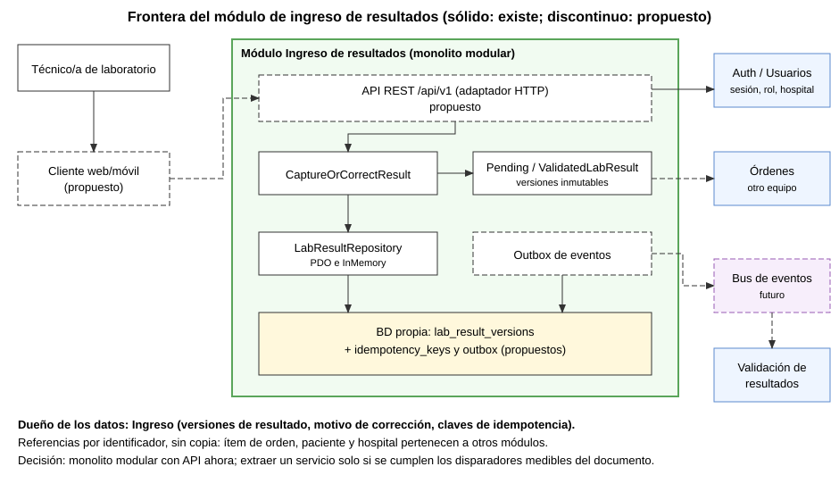
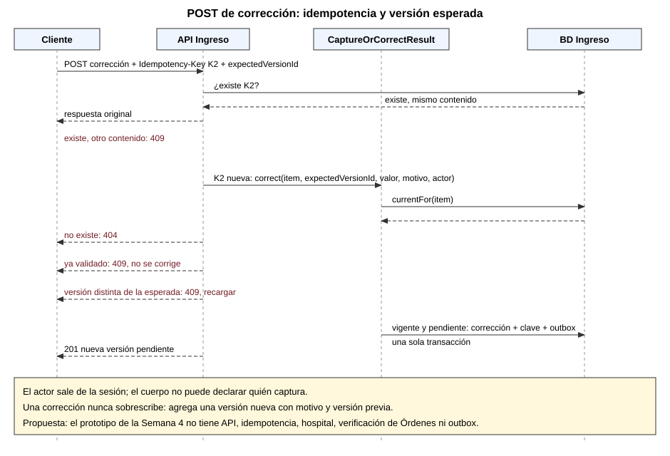

# Semana 5 - Cliente-servidor, API REST y frontera de microservicio: Ingreso de resultados de laboratorio

Estudiante: LOPEZ PEREZ, MERCEDES AZUCENA. Flujo: captura y corrección controlada de resultados pendientes.

## 1. Estado real

| Elemento | Estado |
|---|---|
| Caso de uso `CaptureOrCorrectResult`, dominio, repositorio PDO e InMemory | Existe (Semana 4) |
| API HTTP, `Idempotency-Key`, hospital/actor desde sesión, verificación del ítem contra Órdenes, outbox | **Propuesta**: no está implementado |
| `verificacion/frontera.php` | Mide el prototipo real: 9 de 9 comprobaciones |
| `verificacion/contrato.php` | Adaptador HTTP **simulado** sobre el caso de uso real: 14 de 14 comprobaciones |

Esta rama parte de la rama de las Semanas 3, 4 y 11 (PR #156, aún sin fusionar), porque necesita su código.

## 2. Frontera medida (evidencia/frontera-semana-05.txt)

- Una sola tabla propia: `lab_result_versions`.
- 0 claves foráneas hacia datos de otros módulos; la única referencia es de la tabla a sí misma (versión previa).
- 0 menciones de PDO o SQL en dominio y aplicación; 2 adaptadores intercambiables.
- 0 imports de otros módulos; el ítem de orden es una referencia, sin copiar datos del paciente.
- `UNIQUE (order_item_id, version_number)` garantiza una sola versión por número.

## 3. Contrato API propuesto (`/api/v1`)

Reglas comunes: JSON, errores `application/problem+json`; el hospital y el actor salen de la sesión, **nunca del cuerpo**; toda escritura exige `Idempotency-Key`.

| Método y ruta | Uso | Respuestas |
|---|---|---|
| `POST /lab-results/{orderItemId}` | Captura inicial `{value}` | 201, 400 (sin clave), 404, 409, 422 |
| `POST /lab-results/{orderItemId}/corrections` | Corrección `{expectedVersionId, value, reason}` | 201, 400, 404, 409, 422 |
| `GET /lab-results/{orderItemId}/current` | Versión vigente | 200, 404 |
| `GET /lab-results/{orderItemId}/versions` | Historial | 200, 404 |

Códigos: 201 creado; 400 falta `Idempotency-Key`; 404 ítem inexistente **o de otro hospital** (no se revela); 409 versión obsoleta, ya validado o misma clave con otro contenido; 422 valor inválido; 503 con `Retry-After` si Órdenes no responde.

### Diferencias con el prototipo (brechas)

1. `enteredBy` llega como parámetro; en la API sale de la sesión.
2. No hay hospital/tenant.
3. No hay idempotencia: `contrato.php` (paso 4) demuestra que repetir una captura idéntica por timeout hoy da CONFLICT.
4. `REJECTED` mezcla «entrada inválida» y «ya validado» (paso 8); el adaptador los separa por inspección y debería separarlos el caso de uso.
5. No se verifica el ítem contra Órdenes.

## 4. Comportamiento comprobado en la simulación

Idempotencia (misma clave y contenido repite la respuesta, otro contenido da 409), versión esperada (corrección con versión reemplazada da 409, cadena de 2 versiones), 422 para valor en blanco, 404 sin resultado, 400 sin clave, 409 (no 422) para un resultado validado, actor tomado de la sesión. Evidencia: `evidencia/contrato-semana-05.txt`.

## 5. ¿Microservicio? Decisión

**Monolito modular con API ahora; no se extrae un servicio.** Motivos: un solo equipo, sin carga medida, y la versión + clave de idempotencia deben escribirse en una transacción local. La frontera medida (sección 2) es condición **necesaria, no suficiente**.

Disparadores para reconsiderar (umbrales propuestos por la autora, sin datos reales): ritmo de despliegue distinto al del resto, latencia p95 sostenida sobre el objetivo, propiedad por otro equipo y caídas en cascada.

## 6. Propiedad de datos, comunicación y consistencia

- Ingreso es dueño de versiones, motivo de corrección y claves de idempotencia. Paciente, orden y hospital son de otros módulos y se referencian por identificador.
- Síncrono: Auth (sesión) y Órdenes (verificar ítem). Asíncrono: eventos `ResultCaptured` y `ResultCorrected` por **outbox**, escritos en la misma transacción.
- Consistencia: fuerte dentro del módulo; eventual hacia Validación.

## 7. Seguridad, resiliencia y observabilidad

HTTPS; rol del actor verificado en cada petición; 404 entre hospitales; el cuerpo no puede declarar el autor. Tiempo de espera y `503` ante falla de Órdenes; reintentos seguros gracias a la idempotencia. Id de correlación en cada petición y métricas de latencia, tasa de 409 y de 5xx.

## 8. Migración por fases

1. Separar `REJECTED` en causas distintas. 2. Añadir hospital y actor de sesión. 3. Tabla de idempotencia. 4. Adaptador HTTP. 5. Verificación contra Órdenes. 6. Outbox. 7. Evaluar extracción solo si se cumplen disparadores.

## 9. Plan de issue, rama, worktree y PR

- Issue: pendiente de identificar (no se inventa número).
- Rama: `semana-5-ingreso-resultados-api-microservicio-mercedes-lopez`.
- Worktree: `shi-semana-5-ingreso-resultados-api-microservicio-mercedes-lopez`.
- PR hacia `develop` con la plantilla del repo, **aún no abierto** por instrucción de la autora.

## 10. Diagramas





## 11. Limitaciones

No hay API real ni servidor HTTP; la simulación prueba la lógica, no el transporte. Los umbrales son hipotéticos. El ID del módulo y el número de issue no están confirmados.

## 12. Cómo reproducir

```
php verificacion/frontera.php
php verificacion/contrato.php
```
