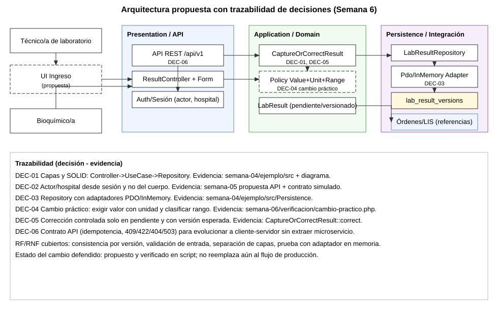

# Semana 6 - Primera evaluación parcial: arquitectura propuesta de ingreso de resultados

Estudiante: LOPEZ PEREZ, MERCEDES AZUCENA  
Módulo: Ingreso de resultados de laboratorio  
Flujo: captura y corrección controlada de resultados pendientes

## Presentación (8 diapositivas)

### Diapositiva 1 - Problema y alcance

- Se defiende la arquitectura para el flujo de captura/corrección sin ampliar el módulo.
- El alcance incluye actores, UML, RF/RNF, SOLID, capas, Repository y contrato API.
- Se responde un cambio práctico sobre valores, unidades, rangos, corrección y estado pendiente.

### Diapositiva 2 - Actores y responsabilidades

- **Técnico/a:** captura resultado inicial y corrige solo cuando sigue pendiente.
- **Bioquímico/a (módulo de validación):** consume resultados pendientes para decidir.
- **Auth/Sesión:** define actor y hospital para evitar suplantación por payload.
- **Órdenes/LIS:** provee referencias (ítem, examen, muestra), no se duplican datos.

### Diapositiva 3 - Arquitectura por capas y SOLID

- Presentation: `ResultController` + `ResultForm` (entrada y respuesta).
- Application: `CaptureOrCorrectResult` (reglas del flujo).
- Domain: `PendingLabResult`, `ResultVersion`, `ValidatedLabResult`.
- Persistence: `LabResultRepository` con adaptadores PDO e InMemory.
- SOLID aplicado: SRP por clase, DIP por puertos, OCP por adaptadores intercambiables.

### Diapositiva 4 - Patrón Repository y consistencia

- `LabResultRepository` abstrae la persistencia.
- Adaptadores existentes: `PdoLabResultRepository` e `InMemoryLabResultRepository`.
- Regla de consistencia: corrección usa versión esperada (`expectedVersionId`) para concurrencia optimista.
- Resultado: conflicto explícito si otro actor cambió la versión.

### Diapositiva 5 - Contrato API propuesto (cliente-servidor)

- `POST /api/v1/lab-results/{orderItemId}` para captura inicial.
- `POST /api/v1/lab-results/{orderItemId}/corrections` para corrección con `expectedVersionId`.
- Códigos esperados: 201, 400, 404, 409, 422, 503.
- Idempotencia con `Idempotency-Key` en escrituras para reintentos seguros.
- Actor y hospital tomados de sesión, no del cuerpo.

### Diapositiva 6 - Cambio práctico defendido

- Problema detectado: el diseño vigente acepta `value` sin unidad (ejemplo `5.2`).
- Cambio propuesto: exigir formato `número unidad` y clasificar rango (`LOW`, `NORMAL`, `HIGH`).
- No rompe el módulo: mantiene agregado y corrección controlada.
- Evidencia ejecutable en `verificacion/cambio-practico.php`.

### Diapositiva 7 - Diagrama trazable y matriz decisión-evidencia

Fuente editable: [semana-06-arquitectura-trazable.puml](diagramas/semana-06-arquitectura-trazable.puml)

### Diapositiva 8 - Riesgos, límites y plan de evolución

- El cambio práctico es propuesta validada por script; aún no reemplaza el caso de uso productivo.
- Riesgo principal: migrar consumidores que hoy envían valores sin unidad.
- Mitigación: fase de compatibilidad con advertencia y corte por fecha.
- Evolución: aplicar la política de valor/rango en el caso de uso real y luego al contrato API.

## Matriz decisión -> evidencia

| Decisión | Qué se decidió | Evidencia concreta |
|---|---|---|
| DEC-01 | Mantener arquitectura en capas y SOLID | `semana-04/ejemplo/src` + diagrama trazable |
| DEC-02 | Tomar actor/hospital de sesión | Contrato API de Semana 5 (propuesta) + diagrama |
| DEC-03 | Repository con adaptadores intercambiables | `PdoLabResultRepository` e `InMemoryLabResultRepository` |
| DEC-04 | Exigir valor con unidad y clasificar rango | `verificacion/cambio-practico.php` + `evidencia/cambio-practico-semana-06.txt` |
| DEC-05 | Conservar corrección controlada sobre estado pendiente | `CaptureOrCorrectResult::correct` + comprobaciones del script |
| DEC-06 | API cliente-servidor sin extraer microservicio aún | Documento de Semana 5 + diagrama trazable |

## Registro del cambio práctico defendido

Ver detalle completo en [registro-cambio-practico.md](registro-cambio-practico.md).

## Resultado de verificación

Ejecución real: [evidencia/cambio-practico-semana-06.txt](evidencia/cambio-practico-semana-06.txt)

- Se demuestra el límite del diseño actual (acepta valor sin unidad).
- Se demuestra que la política propuesta rechaza valor sin unidad.
- Se mantiene versión y estado pendiente en corrección controlada.
- Se mantiene conflicto por versión obsoleta.

