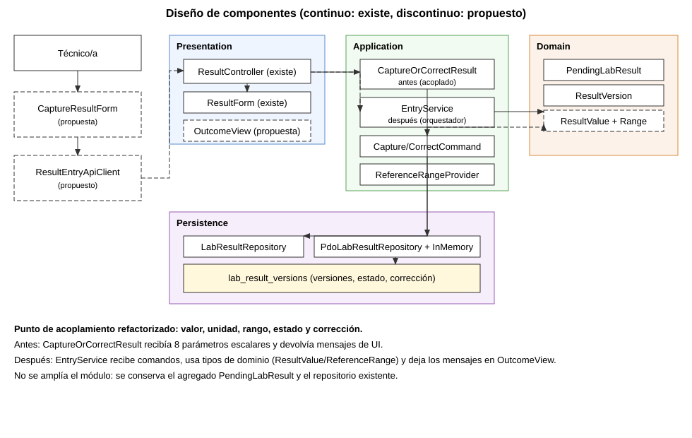

# Semana 7 - Diseño de componentes y refactorización: ingreso de resultados de laboratorio

| | |
|---|---|
| **Curso** | Análisis de Sistemas II - Proyecto Final 2026 |
| **Módulo** | Ingreso de resultados de laboratorio |
| **Proceso** | Captura y corrección controlada de resultados pendientes |
| **Autora** | Lopez Perez, Mercedes Azucena |
| **Fecha** | 27 de octubre de 2026 |

## 1. Alcance

Se diseñan componentes backend y frontend para el flujo de ingreso de resultados y se refactoriza conceptualmente el punto de mayor acoplamiento entre **valor, unidad, rango de referencia, corrección controlada y estado pendiente**, sin ampliar el módulo.

El código base existe desde la Semana 4 (`CaptureOrCorrectResult`, agregado `PendingLabResult`, repositorios PDO e InMemory). Esta entrega agrega una propuesta de refactor en [despues/Refactor.php](despues/Refactor.php) y evidencia ejecutable en [verificacion/acoplamiento.php](verificacion/acoplamiento.php).

## 2. Diagrama de componentes

Fuente editable: [semana-07-componentes.puml](diagramas/semana-07-componentes.puml). Trazo continuo: existe en el repositorio; discontinuo: propuesto.

| Capa | Componente | Responsabilidad | Estado |
|---|---|---|---|
| Frontend | `CaptureResultForm` | Capturar valor, unidad, motivo y confirmación de corrección | Propuesto |
| Frontend | `ResultEntryApiClient` | Traducir respuestas de backend a estados de UI | Propuesto |
| Presentation | `ResultController` y `ResultForm` | Parsear entrada y llamar al caso de uso | Existe |
| Presentation | `OutcomeView` | Mapear `Outcome` a mensajes/códigos de salida | Propuesto |
| Application (antes) | `CaptureOrCorrectResult` | Valida entrada, estado, versión y además arma mensajes | Existe |
| Application (después) | `EntryService` + comandos | Orquestar reglas sin texto de UI y con comandos tipados | Propuesto |
| Domain (existente) | `PendingLabResult`, `ResultVersion` | Estado pendiente y versionado de correcciones | Existe |
| Domain (nuevo) | `ResultValue`, `ReferenceRange`, `RangeFlag` | Parseo canónico del valor y clasificación por rango | Propuesto |
| Persistence | `PdoLabResultRepository`, `InMemoryLabResultRepository` | Persistencia de versiones del resultado | Existe |

## 3. Contratos de entrada y salida

### Entrada propuesta del caso de uso

| Comando | Campos | Regla |
|---|---|---|
| `CaptureCommand` | `orderItemId`, `rawValue`, `actor` | Todos obligatorios; `rawValue` con forma `numero unidad` |
| `CorrectCommand` | `orderItemId`, `expectedVersionId`, `rawValue`, `reason`, `actor` | `reason` obligatorio y versión esperada obligatoria |

### Salida propuesta

| Campo | Propósito |
|---|---|
| `reason` (`Reason`) | Estado semántico de la operación (sin texto libre) |
| `result` | Versión resultante, cuando aplique |
| `flag` (`LOW/NORMAL/HIGH`) | Clasificación del valor frente al rango |
| `field` | Campo específico con error de entrada |

Mapeo de UI (en `OutcomeView`): `0` éxito, `2` entrada inválida/unidad inválida, `3` conflictos de estado o versión, `4` no encontrado.

## 4. Punto de mayor acoplamiento

`CaptureOrCorrectResult` concentra varias responsabilidades en la misma clase:

1. Recibe demasiados escalares (8 parámetros sumando `capture` y `correct`).
2. Mezcla reglas de aplicación con mensajes de presentación.
3. Trata el valor como texto plano, sin tipo para unidad ni rango.
4. Repite validaciones en torno a valor/estado/versión en un único bloque.

El refactor propuesto separa ese eje:

- `EntryService` orquesta reglas.
- `ResultValue` parsea y normaliza.
- `ReferenceRange` clasifica el valor.
- `OutcomeView` traduce a texto/código.

## 5. Comparación antes y después

Evidencia ejecutable: [evidencia/acoplamiento-semana-07.txt](evidencia/acoplamiento-semana-07.txt).

| Medida | Antes | Después |
|---|---:|---:|
| Parámetros escalares en `capture/correct` | 8 | 2 |
| Mensajes de interfaz dentro de aplicación | 6 | 0 |
| Tipos explícitos para valor/unidad/rango | 0 | 3 |

Además, las pruebas de comportamiento del refactor validan:

- captura correcta con bandera de rango;
- rechazo por formato inválido;
- rechazo por unidad incompatible con el rango;
- conflicto por resultado ya existente;
- corrección con versión vigente;
- conflicto por versión obsoleta;
- rechazo de corrección sobre resultado ya validado;
- mapeo de códigos de salida por `OutcomeView`.

## 6. Justificación

- **Menor acoplamiento conceptual:** el valor de laboratorio deja de ser texto opaco.
- **Trazabilidad clínica:** `RangeFlag` permite distinguir normal/alto/bajo sin acoplar UI y reglas.
- **Pruebas más claras:** el caso de uso se valida por razones (`Reason`), no por frases.
- **Sin ampliar módulo:** se conserva el agregado actual y el repositorio existente.

## 7. Trazabilidad al enunciado de la semana

| Pedido de la semana | Evidencia |
|---|---|
| Diseñar componentes backend y frontend | [diagrama de componentes](diagramas/semana-07-componentes.svg) + tabla de componentes |
| Contratos de entrada y salida | Sección 3 |
| Refactor concreto antes/después con justificación | [verificacion/acoplamiento.php](verificacion/acoplamiento.php) + sección 5 y 6 |
| Separar UI, aplicación, dominio y persistencia | `OutcomeView` (UI), `EntryService` (aplicación), `ResultValue/ReferenceRange` (dominio), repositorios (persistencia) |

## 8. Limitaciones

- `Refactor.php` es propuesta de diseño y prueba, aún no reemplaza al flujo vigente de Semana 4.
- No hay frontend implementado ni endpoint HTTP real en esta semana.
- La clasificación por rango usa un proveedor simulado (`ReferenceRangeProvider`) para pruebas.

