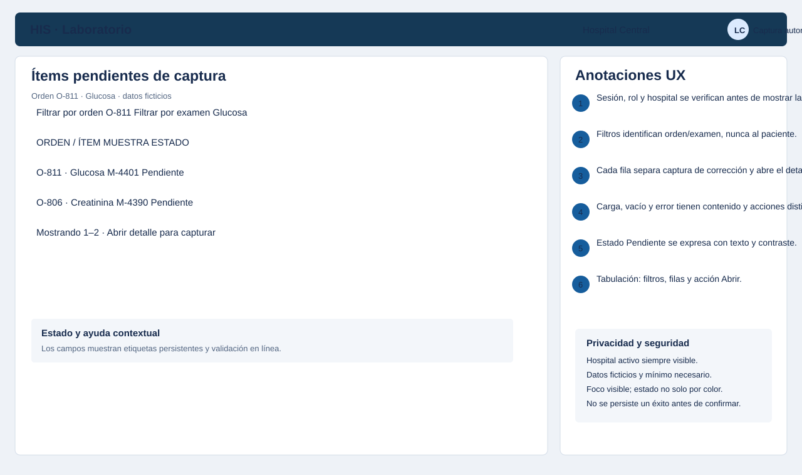
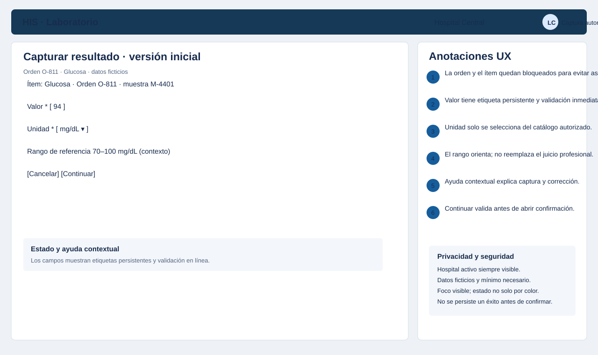
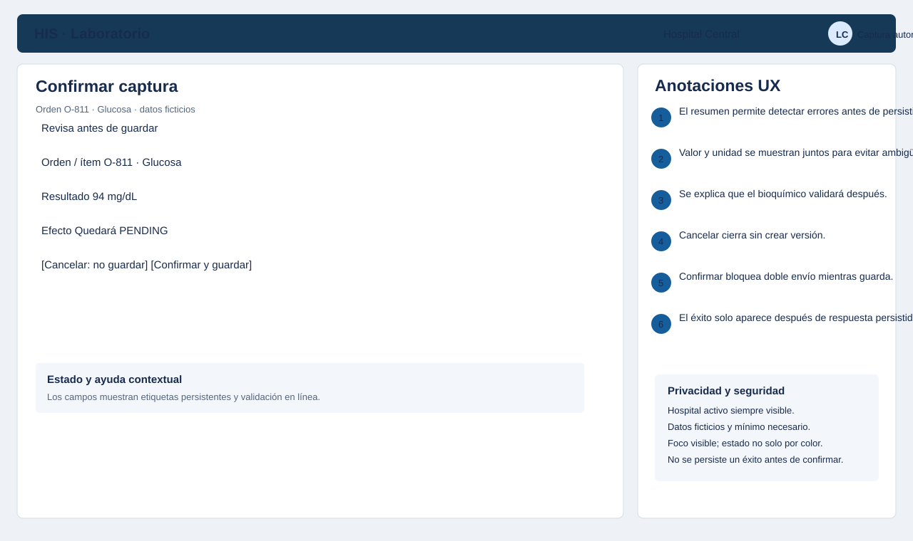
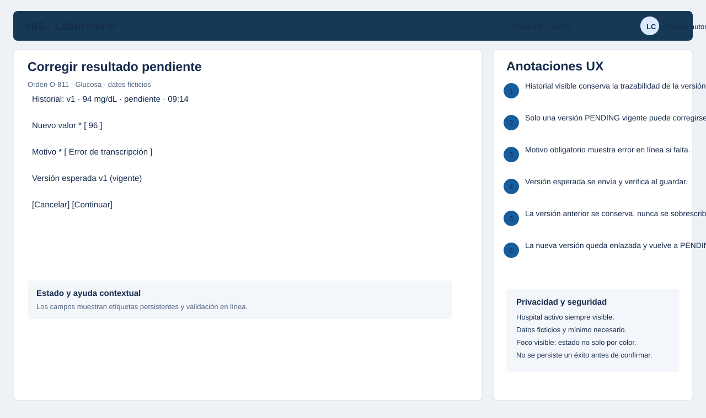
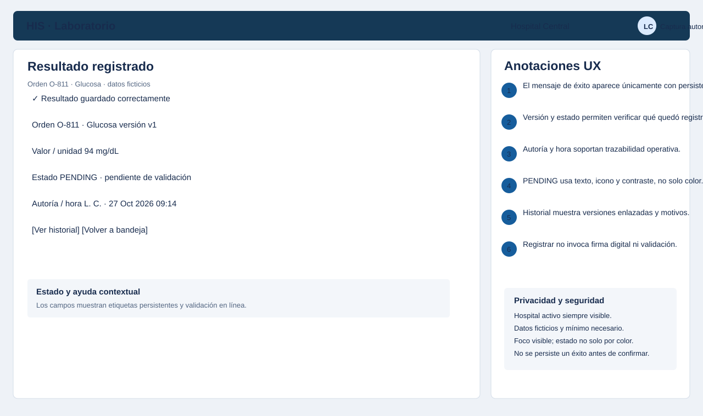
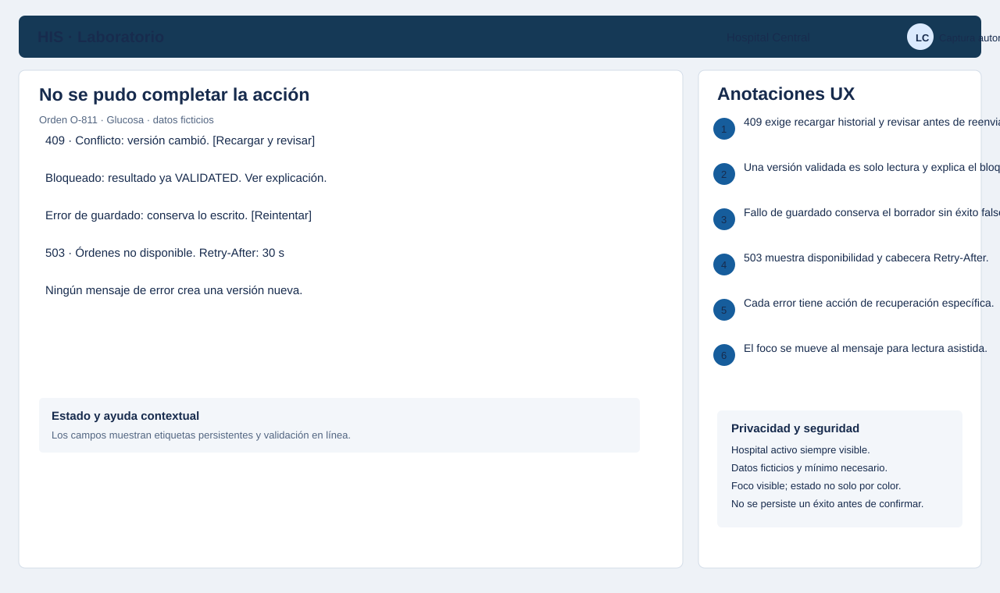

# Semana 8 — Diseño UX de ingreso de resultados de laboratorio

| | |
|---|---|
| **Curso** | Análisis de Sistemas II — Proyecto Final 2026 |
| **Proyecto** | Sistema Hospitalario Integrado (HIS) |
| **Módulo** | Ingreso de resultados de laboratorio |
| **Tema** | Diseño de experiencia de usuario |
| **Flujo** | «Captura y corrección controlada de resultados pendientes» |
| **Estudiante** | Lopez Perez, Mercedes Azucena |
| **Fecha** | Octubre 2026 |

## 1. Objetivo y alcance

Este entregable propone una experiencia para que personal de laboratorio autorizado capture el resultado de un ítem de una orden y corrija, de forma controlada, un resultado que sigue pendiente de validación. El flujo cubre inicio autenticado, selección del ítem, decisión de captura o corrección, confirmación y estados vacío, carga y éxito. Incluye errores recuperables, ayuda contextual y protección de los datos vinculados con resultado, valor, unidad, rango de referencia, corrección controlada y estado pendiente.

Los seis wireframes son propuestas de interfaz para discutir y validar; no son pantallas desplegadas. La validación o publicación por parte del bioquímico queda fuera de este flujo y pertenece al módulo separado de validación. Todos los datos visibles son ficticios.

## 2. Actores, contexto y principios UX

- **Actor primario:** personal de laboratorio autorizado para captura; captura resultados y corrige resultados pendientes.
- **Actor secundario fuera de este flujo:** bioquímico validador; recibe pendientes, pero no valida aquí.

Principios:

1. La identidad del usuario y el hospital activo permanecen siempre visibles.
2. Solo se captura cuando el ítem no tiene resultado vigente.
3. Solo se corrige la versión vigente que está pendiente, con motivo obligatorio.
4. Un resultado validado es de solo lectura.
5. Los errores no son ambiguos: pendiente, guardando, confirmado, conflicto, error e indisponibilidad tienen mensajes distintos.
6. Privacidad por defecto: se minimizan datos de paciente en listados y se restringe el ámbito hospitalario.
7. La ayuda contextual orienta el procedimiento sin sustituir el juicio profesional.
8. Accesibilidad: orden de tabulación lógico, foco visible, etiquetas persistentes, contraste suficiente y estados que no dependen solo del color.

## 3. Flujo principal

```text
[Sesión autenticada + rol de captura + hospital autorizado]
                         |
                         v
[01 Bandeja de ítems de orden pendientes de captura]
                         |
                         v
[02 Formulario: valor + unidad según catálogo + rango visible como contexto]
                         |
                         v
[03 Confirmación de captura]
                         |
                         v
[Éxito: versión 1, estado PENDING, autoría y hora]

Corrección:
[Detalle con historial] --> [04 Formulario de corrección: nuevo valor + motivo obligatorio
                              + versión esperada] --> [Confirmación]
                              --> [Nueva versión enlazada, estado PENDING]

[Conflicto / validado / fallo / 503] ------------------------------> [06 Errores recuperables]
```

## 4. Wireframes anotados

### WF-01 — Bandeja de ítems pendientes de captura



- Filtros por orden y examen; la lista no expone datos de paciente.
- Carga usa filas esqueleto, vacío explica que no hay ítems, y error ofrece **Reintentar**.
- Se muestra hospital, examen, muestra, orden y estado para priorizar sin decidir desde la lista.
- El acceso exige sesión, rol y ámbito hospitalario vigentes.

### WF-02 — Captura de resultado



- Valor es editable y se valida en línea según el tipo de prueba.
- Unidad proviene del catálogo y no es libremente editable.
- Rango de referencia aparece como contexto informativo, no como una decisión automática.
- Ayuda contextual explica el procedimiento y conserva etiquetas/foco accesibles.

### WF-03 — Confirmación de captura



- El resumen confirma orden, ítem, valor y unidad antes de guardar.
- Se informa el efecto: el resultado queda **pendiente de validación**.
- Cancelar no guarda; confirmar bloquea doble envío mientras persiste.
- El éxito solo se comunica tras respuesta de persistencia.

### WF-04 — Corrección controlada



- Historial de versiones visible para conservar trazabilidad.
- Motivo obligatorio con validación en línea; no se permite una razón vacía.
- La versión esperada se muestra y se verifica nuevamente al guardar.
- Se advierte que la versión anterior se conserva y la nueva queda enlazada.

### WF-05 — Resultado registrado



- Éxito aparece solo después de persistencia y muestra versión, estado pendiente, autoría y hora.
- Enlace a historial permite revisar la cadena de versiones.
- Registrar no llama firma digital: la validación/publicación es otro flujo.
- El estado pendiente se expresa con texto y no solo con color.

### WF-06 — Errores recuperables



- Conflicto de versión: recargar y revisar antes de volver a enviar.
- Intento de corregir un resultado validado: bloqueado con explicación, sin editar.
- Fallo de guardado: reintentar sin perder lo escrito y sin mostrar éxito falso.
- Servicio de órdenes no disponible: código 503 y `Retry-After` visible.

## 5. Validaciones y reglas de interacción

| Regla de interacción en la interfaz | Regla / error relacionado |
|---|---|
| El ítem se presenta junto con su orden; no se permite guardar una asociación distinta. | R-01 Asociación orden–ítem |
| El hospital activo y rol se verifican antes de mostrar/guardar. | R-02 Autorización hospital |
| Campos, formato, unidad y rango dependen del tipo de prueba y catálogo. | R-03 Campos según tipo de prueba |
| La captura inicial crea versión 1 con autoría y estado `PENDING`. | R-04 Captura inicial pendiente con autoría |
| Al guardar una corrección se verifica que sea la versión vigente y siga pendiente. | R-05 Corrección solo de versión vigente pendiente |
| Motivo obligatorio y nueva versión enlazada a la anterior. | R-06 Motivo + versión enlazada |
| Una versión validada es inmutable; se bloquea la corrección. | R-07 Validado inmutable |
| Si falla el guardado no se anuncia éxito y se conserva el borrador para reintento. | R-08 Fallo sin éxito falso |
| Idempotencia ausente o inválida: corregir el campo sin duplicar envío. | `400` (contrato API Semana 5) |
| Orden/ítem inexistente o fuera del ámbito: mostrar recurso no encontrado, sin filtrar información. | `404` |
| La versión esperada ya cambió: mostrar conflicto y pedir recarga. | `409` |
| Valor, motivo o campos de prueba inválidos: errores junto al campo. | `422` |
| Servicio de órdenes indisponible: conservar entrada y mostrar `Retry-After`. | `503` |

## 6. Matriz de trazabilidad

| Elemento | Evidencia UX |
|---|---|
| CU-01 Captura de resultado | WF-01 → WF-02 → WF-03 → WF-05 |
| CU-02 Corrección controlada | WF-04 → WF-05 → WF-06 |
| R-01 Asociación orden–ítem | WF-01, WF-02 |
| R-02 Autorización hospital | WF-01, WF-06 |
| R-03 Campos según prueba | WF-02 |
| R-04 Captura pendiente con autoría | WF-03, WF-05 |
| R-05 Versión vigente pendiente | WF-04, WF-06 |
| R-06 Motivo y versión enlazada | WF-04, WF-05 |
| R-07 Validado inmutable | WF-06 |
| R-08 Sin éxito falso | WF-03, WF-05, WF-06 |
| E-01 a E-05 (validaciones y fallos del contrato) | WF-02, WF-03, WF-04, WF-06; códigos 400/404/409/422/503 |

## 7. Límites y siguiente paso

Estos wireframes son propuestas de experiencia y no constituyen pantallas de producción. Las unidades y rangos provienen del catálogo propiedad de otro módulo. El flujo de validación pertenece al módulo `validacion-resultados-bioquimico` y no se implementa aquí. El siguiente paso es realizar pruebas de usabilidad en Semana 9 y preparar el prototipo en Semana 11.

## 8. Referencias

- [Semana 1 — UML de ingreso de resultados](../semana-01/semana-01-uml-ingreso-resultados.md)
- [Semana 2 — LSP, requisitos y contrato](../semana-02/semana-02-lsp-ingreso-resultados.md)
- Las semanas 3–7 se encuentran en los PR abiertos [#156](https://github.com/compilations-teams/sistema-hospitalario-integrado-SistenasII-2026-G1/pull/156), [#170](https://github.com/compilations-teams/sistema-hospitalario-integrado-SistenasII-2026-G1/pull/170), [#173](https://github.com/compilations-teams/sistema-hospitalario-integrado-SistenasII-2026-G1/pull/173) y [#175](https://github.com/compilations-teams/sistema-hospitalario-integrado-SistenasII-2026-G1/pull/175).

## 8. Cobertura explícita de la consigna

Este **user flow por rol** documenta el inicio, la decisión y la confirmación de captura o corrección para personal de laboratorio con rol autorizado. Incluye estados vacío, carga y éxito; errores recuperables; ayuda contextual; y protección de datos. El registro contempla resultados, valores, unidades, rangos, corrección controlada y estado pendiente. Los wireframes anotados muestran cada paso y sus alternativas.
