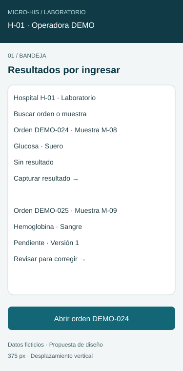
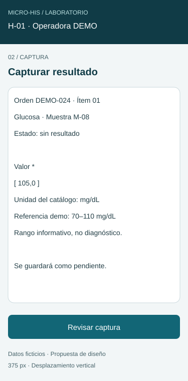
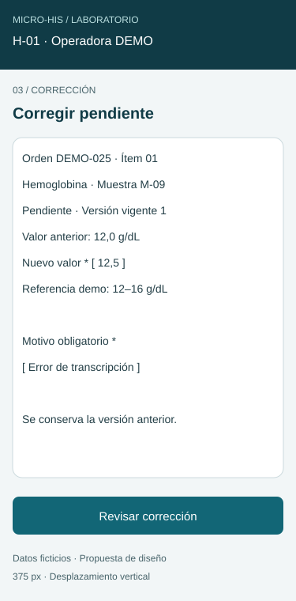
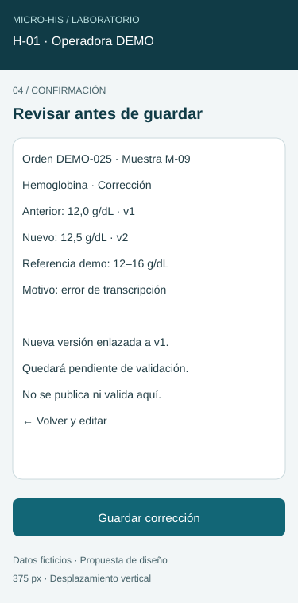
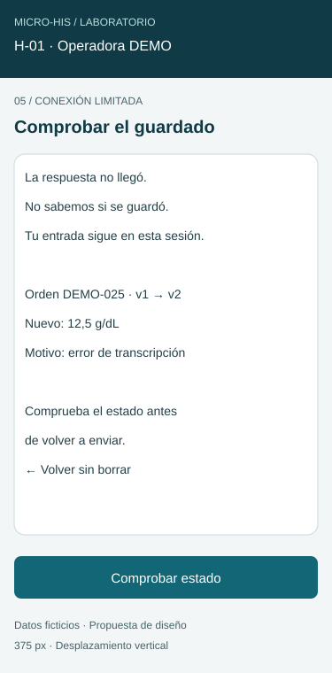

# Semana 10 — Diseño para movilidad

**Estudiante:** Lopez Perez, Mercedes Azucena  
**Módulo:** Ingreso de resultados de laboratorio  
**Flujo:** Captura y corrección controlada de resultados pendientes  
**Base:** [Diseño UX de semana 8](../semana-08/semana-08-ux-ingreso-resultados.md)

## Alcance

Propuesta responsive de cinco pantallas para 320–430 px. Los SVG son wireframes estáticos, no una aplicación conectada. Todos los identificadores, valores y rangos son ficticios; los rangos reales deben proceder del catálogo y contexto del paciente. Capturar no equivale a validar: el bioquímico valida en otro módulo.

## Pantallas

| Pantalla | Jerarquía y acción | Propuesta a 375 px |
|---|---|---|
| M1 Bandeja | Hospital y rol, orden/muestra, examen, estado y acción contextual. Tarjetas sustituyen la tabla. | [Ver](wireframes/01-bandeja-375.svg) |
| M2 Captura | Contexto del ítem, valor, unidad de catálogo, rango informativo y revisión. | [Ver](wireframes/02-captura-375.svg) |
| M3 Corrección | Estado pendiente y versión, valor anterior/nuevo, unidad y motivo obligatorio. | [Ver](wireframes/03-correccion-375.svg) |
| M4 Confirmación | Resumen anterior/nuevo, motivo y efecto; volver conserva la entrada. Captura usa esta misma plantilla sin valor anterior ni motivo. | [Ver](wireframes/04-confirmacion-375.svg) |
| M5 Recuperación | Distingue respuesta desconocida de fallo confirmado; comprobar antes de reintentar. | [Ver](wireframes/05-recuperacion-375.svg) |

Cada pantalla incluye variantes nativas a 320, 375 y 430 px en wireframes/. No se reduce una imagen de escritorio para simular movilidad.

## Reglas responsive y accesibilidad

| Ancho | Regla de distribución |
|---|---|
| 320–359 px | Una columna, márgenes de 16 px, contenido de 288 px a 320. Una acción principal de ancho completo; acciones secundarias en filas independientes. |
| 360–430 px | Una columna y márgenes de 16 px; se amplía el contenido, sin agregar columnas ni ocultar unidad o estado. |
| 431–767 px | Conservar una columna y limitar formulario a 560 px centrados. |
| Desde 768 px | Bandeja puede usar tabla con encabezados; formulario hasta 560 px y contexto lateral solo si cabe. El orden de lectura sigue contexto → valor → unidad/rango → revisión. |

En implementación: viewport width=device-width, initial-scale=1; ancho fluido 100%, box-sizing:border-box, min-width:0 y overflow-wrap:anywhere para identificadores largos. No ocultar desbordamientos para encubrir contenido cortado. Texto base 16 px, etiquetas persistentes, contraste AA y controles de al menos 44 × 44 px. Estos SVG anotan estructura; el texto auxiliar a 14 px y las cabeceras a 20 px son decisiones del boceto, no una validación de accesibilidad del producto.

El botón principal permanece después del formulario; no se fija sobre el teclado. El teclado decimal se solicita con inputmode=decimal, admitiendo coma o punto y normalizando antes de validar. No usar solo color para estados o errores. Foco visible y orden lógico; al fallar, enfocar el resumen y asociar cada error al campo; mensajes de guardado mediante región de estado. Con zoom o teclado abierto se permite scroll vertical sin ocultar acciones.

## Navegación, formularios y estados

M1 → M2 → M4 → éxito en el mismo resumen; M1 → M3 → M4 → éxito. Desde M4 se vuelve al formulario conservando entradas. Salir con cambios pide descartar o continuar editando. Historial se abre bajo demanda para reducir carga cognitiva.

En captura, unidad y rango son de lectura, derivados del catálogo. En corrección se muestran versión esperada y valor previo. Motivo vacío o espacios y formato inválido bloquean la revisión, con mensaje junto al campo. El servidor vuelve a comprobar rol, hospital, asociación orden/ítem, versión y estado. Un validado pasa a solo lectura; la UI nunca ofrece una corrección forzada.

| Estado | Contenido y acción |
|---|---|
| Cargando bandeja | Esqueleto y mensaje; no anunciar lista vacía antes de terminar. |
| Sin ítems | “No hay resultados por ingresar”; cambiar filtro o actualizar. |
| Guardando | “Guardando…” y deshabilitar envío repetido; no anunciar éxito. |
| Éxito confirmado | Mostrar orden, valor/unidad, versión, pendiente, autor y hora recibidos del servidor; volver a bandeja. |
| 422 | Conservar formulario, identificar valor o motivo inválido y devolver foco. |
| 409 | Recargar versión y estado; presentar diferencia para revisión manual. No sobrescribir ni reutilizar la petición antigua como una corrección nueva. |
| 401/403 | Pedir renovar sesión o explicar falta de permiso. No guardar información clínica en almacenamiento persistente del dispositivo. |
| 404 | Recurso no disponible; volver a bandeja sin revelar otro hospital. |
| 503 confirmado | Conservar borrador en memoria, respetar Retry-After y ofrecer reintento manual al vencer. |
| Timeout/sin conexión | M5: guardado desconocido; comprobar estado al reconectar. No mostrar “no guardado” ni hacer envío automático. |

## Escenario móvil 1 — Captura con red intermitente (320 px)

1. Operadora autorizada en H-01 abre DEMO-024 desde M1. Solo ve orden, muestra, examen y estado; se omiten datos personales del paciente en la bandeja.
2. M2 muestra valor, unidad fija y rango juntos. Introduce 105,0; “Revisar captura” normaliza el decimal y M4 confirma 105,0 mg/dL, ítem y estado pendiente.
3. Al confirmar se pierde la respuesta. M5 conserva el borrador solo en memoria y dice “No sabemos si se guardó”. No produce un segundo resultado por pulsaciones repetidas.
4. Al volver la red se consulta estado de la operación. Si fue guardada, mostrar el resultado confirmado. Si el servicio confirma que no se aplicó, reintentar con la misma clave de idempotencia y el mismo contenido. Si el estado sigue desconocido, permanecer en recuperación.

**Decisión:** priorizar contexto y unidad antes que historial. **Error:** timeout no implica rollback. **Criterio de aceptación:** no hay éxito sin confirmación ni captura duplicada al repetir la misma operación. La consulta por operación/idempotencia es requisito del diseño de integración; estos bocetos no implementan ese endpoint.

## Escenario móvil 2 — Corrección concurrente (430 px)

1. Operadora abre DEMO-025 pendiente v1 y usa M3; ve 12,0 g/dL anterior, escribe 12,5 y motivo. Un motivo vacío impide continuar con explicación junto al campo.
2. M4 confirma anterior/nuevo, unidad, motivo y nueva versión enlazada. Otra persona valida v1 antes del envío; el servidor rechaza por estado/versión (409).
3. Se conserva la entrada para comparación mientras se recarga el estado. Si ahora está validado, se muestra solo lectura y se informa “El resultado fue validado; no admite corrección”. Si existe una versión nueva pendiente, se exige revisarla y confirmar una nueva operación con su versión esperada.
4. Volver a la bandeja no presenta la corrección rechazada como guardada ni cambia el resultado vigente.

**Decisión:** mostrar el valor previo y motivo antes de confirmar; historial completo bajo demanda. **Error:** nunca resolver 409 por sobrescritura automática. **Criterio de aceptación:** una versión validada no se modifica y no se crea una versión huérfana ni auditoría de éxito falsa.

## Evidencia y límites

Las 15 variantes SVG representan cinco pantallas en tres anchos. [Verificación estructural](evidencia/verificacion.txt) registra XML válido, tamaño y contenido dentro del lienzo. No se ejecutaron pruebas en navegador, lector de pantalla, dispositivo ni red real; las reglas de teclado, zoom, foco y recuperación son criterios para validar en la futura implementación. No existe caché clínica, cola offline ni persistencia local en esta propuesta.