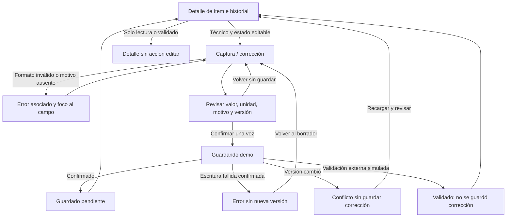

# Semana 11 — Prototipo navegable de ingreso de resultados

**Estudiante:** Mercedes Azucena Lopez Perez.

[**Abrir prototipo local**](prototipo/index.html). Conservar HTML/CSS/JS juntos; funciona al abrir el archivo, sin dependencias ni servidor. Se completa el diseño escrito existente de semana 11 con implementación navegable propia reutilizada de semana 12 (445b0da), identificación adaptada y capturas nuevas. Rama basada en a4e16e5, conserva entregas técnicas previas sin modificarlas.

## Alcance y reglas finales

Captura y corrección controlada de resultados pendientes para un ítem ficticio de H-01. Operador técnico puede capturar/corregir; rol de solo lectura no edita. Estado final de toda captura/corrección es **pendiente de validación**, sin selector de validado/rechazado. Una corrección es nueva versión con motivo y enlace a anterior; no reemplaza historial.

Estas decisiones precisan el diseño escrito inicial: sus propuestas de selector pendiente/corregido/rechazado y reversión administrativa no se implementan. “Corregido” es operación/versionado, no estado clínico final; validación corresponde a otro módulo y aquí solo se simula un cambio externo para probar bloqueo. No se crea flujo administrativo ajeno.

Valor, unidad y rango son datos **de prueba**: mmol/L, rango 4–6, decimal con coma/punto y hasta cuatro decimales. No son recomendaciones clínicas ni catálogo institucional. Unidad fija, fuera del rango ilustrativo avisa y conserva pendiente, no valida automáticamente. No seleccionar paciente libremente ni entrar en otros hospitales.

## Mapa de navegación



La pantalla inicial es detalle de un ítem fijo, no listado/buscador productivo. Reiniciar demo limpia historial local; es herramienta de evaluación, no borrado clínico. Cambiar rol es simulación de UX, no seguridad ni autorización de servidor.

## Camino feliz reproducible

1. Técnico demo: Capturar resultado → valor 7,1 → Revisar. Se normaliza separador, avisa fuera del rango demo y mantiene pendiente.
2. Confirmar → Resultado guardado en demo → Ver historial, versión 1.
3. Corregir pendiente → valor 5.5 y motivo “Corrección demo” → revisar valor/versión previa y confirmar.
4. Historial conserva v1/v2 y enlace/motivo; estado sigue pendiente. No firma, valida ni publica.

Capturas de captura confirmada: [desktop](evidencia/desktop-captura.png), [móvil](evidencia/movil-captura.png). Historial: [desktop](evidencia/desktop-historial.png), [móvil](evidencia/movil-historial.png).

## Error crítico: corrección contra versión obsoleta

Después de captura/corrección, abrir editar con motivo y seleccionar “Otra versión aparece” en escenario demo. Revisar y guardar: se simula una versión concurrente y la corrección propia no se guarda. Mensaje explica conflicto; acción “Recargar y revisar historial” permite examinar nueva versión antes de otro intento. Nunca reintentar sobrescritura automática.

Capturas: [desktop conflicto](evidencia/desktop-conflicto.png), [móvil conflicto](evidencia/movil-conflicto.png). La versión concurrente es dato de simulación, no prueba de concurrencia multiproceso o de transacción servidor.

Variantes adicionales: precisión inválida, motivo ausente, falla de escritura confirmada sin versión nueva, resultado validado por otra persona que bloquea edición y rol de solo lectura. Falla de escritura “confirmada” no equivale a timeout con resultado desconocido; ese caso necesitaría reconciliación antes de repetir operación y no se afirma implementado.

## Desktop, móvil y accesibilidad

Dos columnas en desktop y una columna en móvil; controles nativos, etiquetas persistentes, errores vinculados mediante aria-describedby/aria-invalid, foco al campo inválido y a main al navegar, indicador de carga y región de estado. Botones en flujo, texto de estado explícito, sin dependencia exclusiva de color.

Recorrido automatizado a 1366/320/375/430 px, sin errores JavaScript; comprobación de encaje en captura, historial, conflicto y vista final. No se certifica lector de pantalla, recorrido completo con teclado, zoom o cumplimiento WCAG. No es integración accesible de datos clínicos reales.

## Verificación

Desde raíz, PowerShell:

```powershell
npm install --prefix "$env:TEMP/shi-browser-qa" playwright --no-audit --no-fund
$env:PLAYWRIGHT_MODULE="$env:TEMP/shi-browser-qa/node_modules/playwright"
$env:BROWSER_PATH='C:/Program Files (x86)/Microsoft/Edge/Application/msedge.exe'
node docs/modulos/ingreso-resultados-laboratorio/semana-11/verificacion/run.cjs
```

[Salida ejecutada](evidencia/verificacion.txt). Suite comprueba precisión, coma decimal, fuera de rango pendiente, motivo, borrador al volver, historial enlazado, falla, conflicto, validado bloqueado y rol lector. Capturas nuevas del prototipo adaptado a semana 11, no imágenes atribuidas a otra ejecución.

## Límites

Persistencia solo en memoria del navegador, sin API/PDO, identidad, JWT, tenant real ni validación clínica. Recargar/reiniciar pierde el historial. Se demuestra navegación y decisiones UX; las pruebas de PHP/PDO están en semanas técnicas, no se sustituyen por esta simulación. No publica web ni modifica otras ramas.