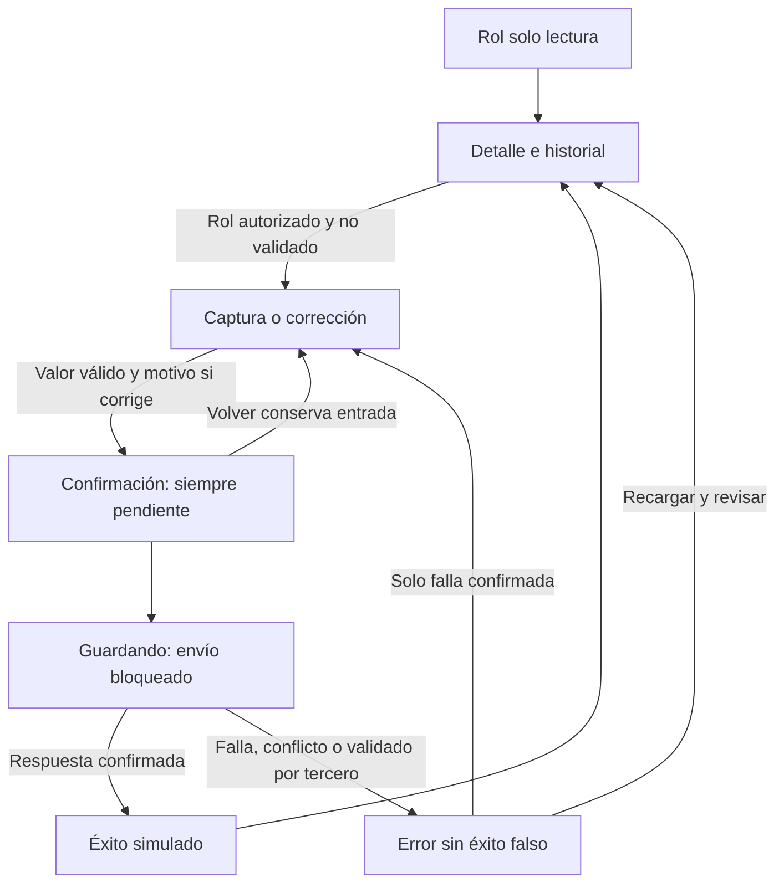

# Semana 12 — Segunda evaluación parcial: ingreso de resultados

**Estudiante:** Lopez Perez, Mercedes Azucena

Abrir [prototipo/index.html](prototipo/index.html) en Edge o Chrome. La demo usa datos ficticios en memoria, sin API ni persistencia clínica. Parte de la propuesta escrita de semana 11 incluida en la base 88a642b de semana 7; la entrega agrega el archivo navegable que no existía en esa base. No altera el backend de otras semanas ni afirma corregir sus defectos.

## Recorrido de defensa (5 minutos)

1. Rol Captura autorizada → Capturar resultado → introducir 7,1 mmol/L. Revisar muestra alerta informativa fuera del rango demo 4–6; estado fijo pendiente, sin selector. Confirmar → éxito simulado → Ver historial v1.
2. Corregir pendiente → 5,5, motivo obligatorio → revisar anterior/nuevo y v2 enlazada → confirmar → historial conserva ambas versiones pendientes, autor y hora de Guatemala.
3. Corregir de nuevo, elegir Falla confirmada: no se agrega versión propia ni se anuncia éxito; Volver al borrador conserva entrada. No se confunde con timeout: la demo solo modela falla confirmada.
4. Elegir Otra versión aparece: la demo agrega una versión concurrente ajena y rechaza el cambio propio. Recargar exige revisar contexto y abrir una nueva corrección.
5. Elegir Otra persona valida sobre un resultado existente: cambia el estado externo simulado y bloquea la corrección. Rol Solo lectura también oculta edición; no prueba permisos reales en servidor.

## Mapa de navegación


## Matriz decisión → RF/RNF → evidencia

RF/RNF conservan los identificadores de [semana 2](../semana-02/semana-02-lsp-ingreso-resultados.md); los criterios de valor/unidad/rango y UX provienen del diseño del módulo y de esta consigna.

| Decisión | RF/RNF / criterio | Evidencia |
|---|---|---|
| Captura siempre pendiente, sin selector de decisión clínica | RF-01/04/05 | Confirmación y captura exitosa; CH-01 |
| Corrección enlazada, sin sobrescribir original | RF-02/03, RNF-02 | Historial v1/v2 con motivo y autor/hora |
| Bloquear validado, versión concurrente y rol de lectura | RF-05/07, criterio UX de rol | Escenarios y verificación; autorización servidor pendiente |
| Unidad fija de catálogo y rango solo informativo | Criterio valor/unidad/rango de semana 7 | Formulario y alerta; fuera de rango no cambia estado |
| Rechazar más de cuatro decimales, sin redondeo silencioso | Criterio de precisión de esta demo | Mensaje de entrada; no resuelve defecto IR-D02 del PHP |
| Confirmar contexto/valor antes de persistir | RNF-03 | Resumen, volver conserva borrador y envío bloqueado |
| Error no produce éxito ni versión propia | RNF-03, RF-07 | Falla confirmada y conflicto; capturas |
| UI, aplicación, dominio y adaptadores separados en diseño objetivo | RNF-01/05 | Presentación y diseño de semana 7; demo JS representa interacción |
| Móvil una columna, etiquetas, foco visible y avisos textuales | Criterio UX/accesibilidad/movilidad | CSS responsive, foco al navegar y errores asociados; pruebas en cuatro anchos |
| Datos ficticios y memoria temporal | Criterio privacidad del experimento | Mensajes de alcance; recarga borra historia; no API ni datos reales |

## Componentes, UX y movilidad

El diseño objetivo de semana 7 separa vista, coordinación de captura/corrección, políticas de valor/estado e infraestructura. Esta demo JS compacta sirve para defender la interacción y no reemplaza ese diseño PHP. El rol es un selector de escenario; el servidor real debe derivar identidad/hospital de sesión y comprobar permiso antes de leer/escribir. No se presenta como resuelto IR-D01.

Desktop desde 768 px: navegación lateral. Móvil: una columna, acciones apiladas y unidad visible junto al valor. Controles de al menos 46 px, foco visible, salto de contenido, etiquetas persistentes, errores asociados y avisos de estado. Al navegar, foco al contenido; al fallar, foco al campo inválido. No se declara auditoría WCAG ni prueba con lector de pantalla/dispositivo físico.

La demo bloquea más de cuatro decimales para evitar redondeo silencioso en su propio flujo. Es una regla del experimento, no precisión clínica aprobada por catálogo. No corrige la discrepancia del backend de semana 7. El valor fuera de rango sigue pendiente y no supone recomendación clínica.

## Cambio documentado

[CH-01](cambio-solicitado.md) es una solicitud **simulada** para la defensa: retirar el selector de estado de la propuesta de semana 11 y dejar todo guardado como pendiente. No se atribuye al docente ni al usuario. Si se recibe un cambio real, registrar su origen y actualizar la ficha.

## Resultados y evidencia

[Verificación](evidencia/verificacion.txt): Edge headless/Playwright a 1366, 375, 320 y 430 px. Casos: precisión, coma decimal, alerta sin validación, motivo obligatorio, conservar borrador, historial, fallo, concurrencia, validado y rol de lectura. Las capturas son de la demo ejecutada, no de una integración clínica.

| Recorrido | Desktop | Móvil |
|---|---|---|
| Captura pendiente | [Captura](evidencia/desktop-captura.png) | [Captura](evidencia/movil-captura.png) |
| Corrección e historial | [Historial](evidencia/desktop-historial.png) | [Historial](evidencia/movil-historial.png) |
| Conflicto sin guardado propio | [Conflicto](evidencia/desktop-conflicto.png) | [Conflicto](evidencia/movil-conflicto.png) |

Para repetir con Node, Playwright y Edge:
```powershell
$qa = Join-Path $env:TEMP 'shi-browser-qa'
npm install --prefix $qa playwright --no-audit --no-fund
$env:PLAYWRIGHT_MODULE = Join-Path $qa 'node_modules/playwright'
node docs/modulos/ingreso-resultados-laboratorio/semana-12/verificacion/run.cjs
```
BROWSER_PATH permite otro Chromium. No se requiere instalar herramientas para abrir el HTML. Falta probar integración servidor, permisos/tenant reales, persistencia, recuperación de timeout e interacción asistida. Esta entrega permite defender la UX del flujo, no certificar uso clínico.