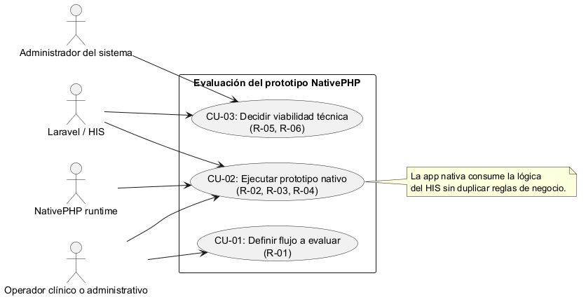
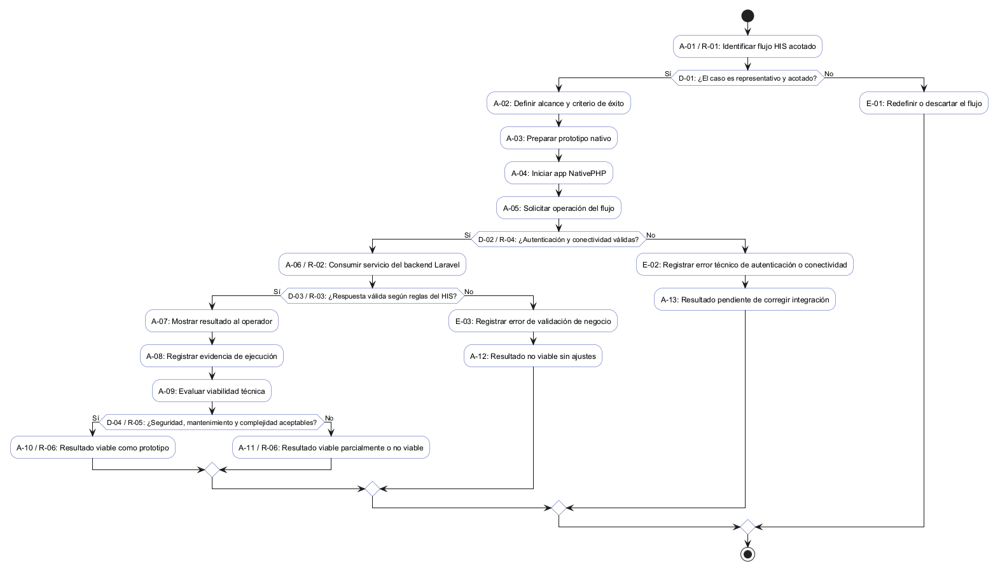
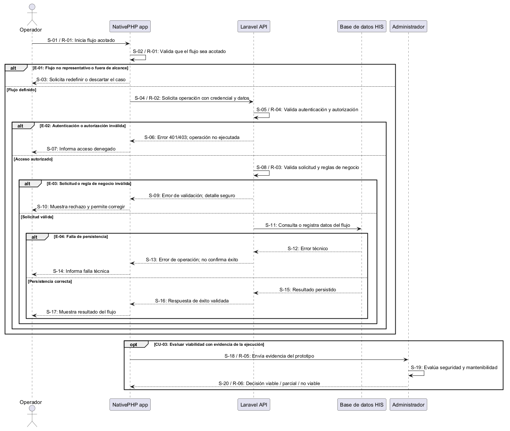

# Semana 1 — Modelado UML de la evaluación y prototipo NativePHP

| | |
|---|---|
| **Curso** | Análisis de Sistemas II — Proyecto Final 2026 |
| **Proyecto** | Sistema Hospitalario Integrado (HIS) |
| **Módulo** | Investigación y prototipo NativePHP para extensión móvil/escritorio |
| **Tema de la semana** | Conceptos generales, orientación a objetos y UML |
| **Proceso modelado** | «evaluación y prototipo acotado de un flujo HIS mediante NativePHP» |
| **Estudiante** | Mercedes Azucena Lopez Perez |
| **Fecha** | Octubre 2026 |

## 1. Introducción

El proyecto HIS ya se diseña como una solución con backend Laravel, capa web y bases federadas; el módulo de NativePHP se aborda como un estudio exploratorio para decidir si una extensión nativa móvil/escritorio puede reutilizar la lógica del sistema sin romper la arquitectura central. La intención no es reemplazar la aplicación web ni construir una app clínica completa, sino validar si un flujo acotado del HIS puede ejecutarse como prototipo local con acceso a datos y a la lógica de negocio del backend.

Este documento presenta tres vistas complementarias del proceso:

- **Casos de uso:** quién participa en la evaluación, qué intenta lograr y qué resultado considera válido.
- **Actividad:** decisiones, excepciones y caminos del prototipo desde la identificación del flujo hasta la decisión de viabilidad.
- **Secuencia:** mensajes y validaciones entre el operador, la app nativa, el backend Laravel y la capa de persistencia.

Los identificadores CU, A, D, E, S y R conectan las tres vistas y permiten rastrear cada regla. El diagrama es una representación académica del proceso de evaluación; no constituye una implementación final ni un despliegue productivo.

## 2. Narrativa de alcance

**Objetivo.** Evaluar si un flujo concreto del HIS puede adaptarse a una extensión nativa basada en NativePHP y decidir, con evidencia mínima, si el enfoque es viable, parcial o no recomendado.

**Escenario de referencia.** Un usuario del HIS (por ejemplo, personal clínico o administrativo) requiere revisar un caso operativo acotado y ejecutar una acción local que el navegador no resuelve con la misma comodidad de un entorno nativo. El prototipo intenta abrir ese flujo desde una app de escritorio o un empaquetado móvil, consumiendo la lógica existente del sistema y capturando la respuesta del backend.

**Dentro del alcance:**

- definir el flujo hospitalario que se va a prototipar y su objetivo operativo;
- seleccionar el tipo de acceso local o remoto que requiere la extensión nativa;
- validar que la app nativa pueda consumir un servicio del HIS sin duplicar la lógica de negocio;
- manejar decisiones de rechazo, validación de datos y error de transferencia;
- registrar la evidencia de viabilidad del prototipo para decidir si continúa o se descarta.

**Fuera del alcance:**

- desarrollar una app clínica completa o una suite de módulos del HIS;
- sustituir la experiencia web principal del sistema;
- definir una infraestructura de producción completa para distribución móvil/escritorio;
- afirmar que NativePHP es la mejor tecnología para todos los escenarios del sistema;
- decidir la política de seguridad, autenticación y despliegue final sin considerar la arquitectura del proyecto.

**Supuestos y límites del modelo:**

1. El flujo a prototipar es un caso acotado, no una solución end-to-end para todo el HIS.
2. El backend de Laravel es la fuente de verdad y la app nativa actúa como cliente local o terminal de ejecución.
3. NativePHP sirve como capa de integración y experiencia de usuario nativa, no como reemplazo del backend.
4. El prototipo debe distinguir entre éxito operativo, validación fallida y error técnico, porque no todas las fallas son equivalentes.
5. La decisión técnica final requiere evidencia de integridad, seguridad y facilidad de mantenimiento; esta entrega solo modela el proceso de evaluación y no la solución definitiva.
6. Se asume una conexión con una API existente o con un servicio HTTP controlado por Laravel para evitar duplicación de reglas de negocio.

## 3. Actores

| Actor | Tipo | Objetivo |
|---|---|---|
| Operador clínico o administrativo | Primario | Ejecutar un flujo específico del HIS en el prototipo nativo y revisar los resultados. |
| Administrador del sistema | Secundario | Revisar la viabilidad técnica, validar restricciones y decidir si continúa el prototipo. |
| Laravel/HIS | Sistema externo | Exponer la lógica y la persistencia del flujo hospitalario para que la app nativa la consuma. |
| NativePHP runtime | Sistema técnico | Ejecutar la app local sobre escritorio o dispositivo y coordinar la interacción de la capa nativa con el backend. |

## 4. Diagrama de casos de uso

Fuente editable: [semana-01-casos-de-uso.puml](diagramas/semana-01-casos-de-uso.puml).

## 5. Especificación de casos de uso

### CU-01 — Definir flujo a evaluar

| Campo | Descripción |
|---|---|
| Actor principal | Operador clínico o administrativo. |
| Objetivo | Seleccionar un flujo acotado del HIS que pueda sirva como prototipo de extensión nativa. |
| Precondición | Existe un caso operativo del sistema con un objetivo claro y datos ficticios o de prueba. |
| Disparador | Se inicia la evaluación del uso de NativePHP sobre un flujo hospitalario. |
| Flujo principal | 1. El operador define el flujo a evaluar. 2. El administrador valida si el caso es representativo y acotado. 3. Se fija el alcance del prototipo. 4. El equipo registra el criterio de éxito y la evidencia esperada. |
| Alternativas y excepciones | Si el flujo es demasiado amplio, se reduce o se descarta; si no hay criterio de éxito, se solicita una definición adicional (E-01). |
| Postcondición | Existe una propuesta de flujo con objetivo, alcance y criterio de aceptación. |

### CU-02 — Ejecutar prototipo nativo

| Campo | Descripción |
|---|---|
| Actor principal | Operador clínico o administrativo. |
| Objetivo | Ejecutar la app nativa para probar el flujo en el entorno local y comprobar que funciona con los datos del HIS. |
| Precondición | El prototipo y la integración con Laravel están disponibles en entorno local. |
| Flujo principal | 1. El usuario abre la aplicación nativa. 2. La app solicita o reutiliza el contexto del caso. 3. Se ejecuta la operación del flujo. 4. La app llama al backend del HIS. 5. Se recibe la respuesta y se presenta al usuario. |
| Alternativas y excepciones | Si falla la autenticación, el flujo se cancela con información útil (E-02); si hay error de conexión, se registra la condición técnica (E-03). |
| Postcondición | El flujo se ejecuta con éxito o queda bloqueado por una condición validada. |

### CU-03 — Decidir viabilidad técnica

| Campo | Descripción |
|---|---|
| Actor principal | Administrador del sistema. |
| Objetivo | Evaluar si el prototipo puede continuar o debe descartarse según la evidencia técnica y de negocio. |
| Precondición | El prototipo fue ejecutado y se registraron los resultados y errores. |
| Flujo principal | 1. Se revisa la ejecución. 2. Se compara con criterios de seguridad, rendimiento y mantenimiento. 3. Se decide entre viable, viable parcial o no viable. 4. Se registra la conclusión. |
| Alternativas y excepciones | Si la validación falla por una regla técnica, se plantea mejora o reestructuración; si la falla es crítica, la decisión es no viable. |
| Postcondición | Hay una decisión documentada con evidencia y un plan de continuidad o rechazo. |

## 6. Diagrama de actividad

Fuente editable: [semana-01-actividad.puml](diagramas/semana-01-actividad.puml).

El flujo distingue entre un caso de uso bien definido, una ejecución exitosa, una validación fallida y una decisión técnica de viabilidad. La intención es evitar confundir una prueba de concepto con una solución final.

## 7. Diagrama de secuencia

Fuente editable: [semana-01-secuencia.puml](diagramas/semana-01-secuencia.puml).

La secuencia modela la interacción entre el operador, la app nativa, el backend Laravel y la base de datos del HIS. El objetivo es verificar la trazabilidad del mensaje y la responsabilidad de cada capa.

## 8. Matriz de trazabilidad

| Identificador | Regla | Casos de uso | Diagrama de actividad | Diagrama de secuencia |
|---|---|---|---|---|
| R-01 | El flujo a prototipar debe ser acotado y representativo | CU-01, CU-02 | A-01, D-01 | S-01, S-02 |
| R-02 | La app nativa no debe duplicar la lógica de negocio del HIS | CU-02 | A-06 | S-04 |
| R-03 | La interacción con Laravel debe validarse con la respuesta recibida | CU-02 | D-03, A-07 | S-08, S-09, S-16 |
| R-04 | Si falla la autenticación o conectividad, el prototipo debe reportar error técnico | CU-02 | D-02, E-02 | S-05, S-06, S-07 |
| R-05 | La decisión final debe registrarse con criterios y evidencia | CU-03 | A-08, A-09, D-04 | S-18, S-19 |
| R-06 | El resultado no se presenta como solución completa si el flujo apenas fue validado como prototipo | CU-03 | A-10, A-11 | S-20 |

| Excepción | Resultado | Caso de uso | Actividad | Secuencia |
|---|---|---|---|---|
| E-01 | El flujo no es representativo o está fuera de alcance; se redefine o descarta | CU-01 | D-01, E-01 | S-02, S-03 |
| E-02 | Falla de autenticación/autorización o conectividad; no se ejecuta la operación | CU-02 | D-02, E-02 | S-05, S-06, S-07 |
| E-03 | Solicitud o regla de negocio inválida; se informa rechazo y no se confirma éxito | CU-02 | D-03, E-03 | S-08, S-09, S-10 |
| E-04 | Falla de persistencia; se informa error técnico y no se confirma éxito | CU-02 | E-04 | S-11, S-12, S-13, S-14 |

## 9. Consideraciones de arquitectura para la evaluación

- NativePHP puede ser útil para un flujo aislado con acceso local y poca latencia, por ejemplo un comprobador, un formulario local o una vista de revisión rápida.
- La capa de negocio del HIS debe mantenerse en Laravel para no duplicar reglas, validaciones ni permisos.
- El punto crítico es la interfaz entre la app nativa y el backend: autenticación, serialización, manejo de errores y control de permisos.
- La decisión de viabilidad debe medir la complejidad de la app nativa, la dependencia con el entorno del dispositivo y la capacidad de mantener una sola lógica de negocio.

## 10. Conclusión

El proceso modelado pone en evidencia que NativePHP no es una solución universal para todas las necesidades del HIS, sino un eje de evaluación para flujos acotados, con acceso local y baja complejidad. La decisión clave no está en la tecnología de interfaz por sí sola, sino en la capacidad de mantener una estructura clara, un backend central y una viabilidad técnica medible. El prototipo, si se valida con evidencia, puede ser una extensión útil; si no logra cumplir el criterio, debe rechazarse como opción por su complejidad o su riesgo de duplicación.
