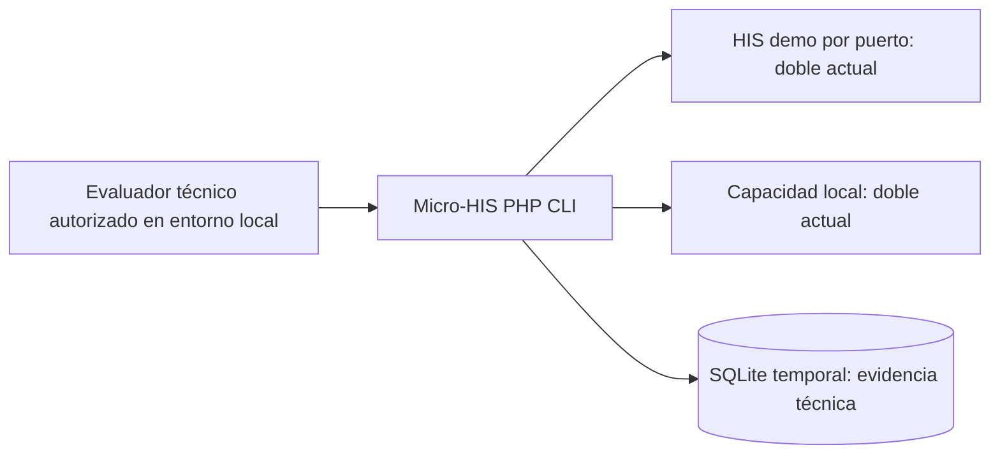
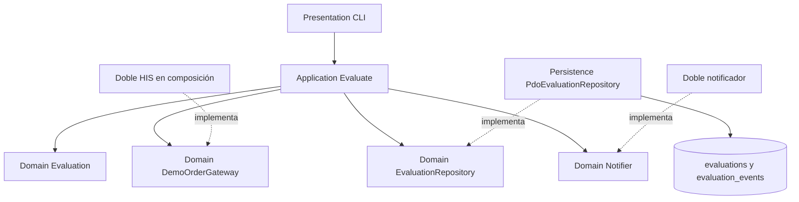
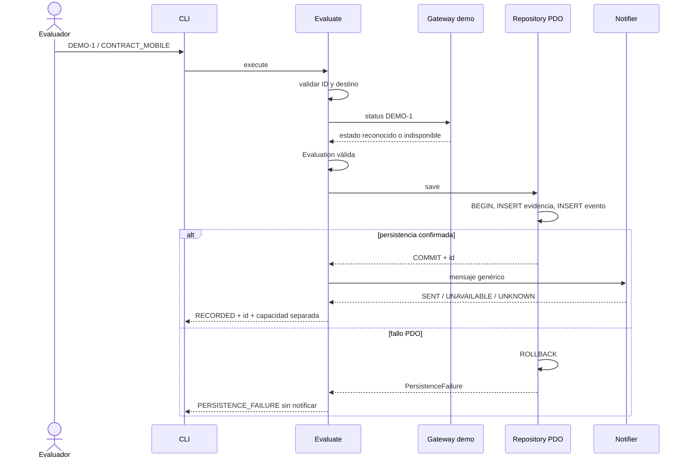

# Semana 3 — Micro-HIS: arquitectura, vistas y patrones

**Estudiante:** Lopez Perez, Mercedes Azucena. **Entorno:** PHP 8.2+ vanilla, PDO SQLite, sin framework.

Se continúa [semana 2 ISP](../semana-02/semana-02-isp-nativephp.md), base 8a3dc40: evaluación acotada de consulta del estado de una orden ficticia y capacidad de notificación. Se añade persistencia de evidencia técnica de contrato y evento asociado en una transacción. El esquema no es almacén clínico ni confirma soporte NativePHP; la notificación del ejemplo CLI informa UNAVAILABLE.

## Ejecución

Desde la raíz del worktree, con PHP y extensión pdo_sqlite:

```powershell
php docs/modulos/investigacion-prototipo-nativephp/semana-03/micro-his/Presentation/cli.php
php docs/modulos/investigacion-prototipo-nativephp/semana-03/micro-his/Presentation/cli.php DEMO-1 CONTRACT_DESKTOP
php docs/modulos/investigacion-prototipo-nativephp/semana-03/micro-his/tests/run.php
```

CLI usa SQLite en memoria: evidencia vive durante el proceso y no se anuncia exportación durable. Resultado esperado RECORDED con evidenceId y notification=UNAVAILABLE. Se implementa una presentación CLI para demostrar el flujo sin instalar framework, no una GUI ni aplicación móvil. Si estado de ejecución no es RECORDED, CLI termina con código 1. Casos sintéticos válidos: DEMO-1, CONTRACT_MOBILE/CONTRACT_DESKTOP; otra orden demo devuelve HIS_UNAVAILABLE por el doble.

## Capas y dependencias

| Capa | Archivo | Responsabilidad |
|---|---|---|
| Presentation | micro-his/Presentation/cli.php | Lee argumentos, compone dependencias y muestra resultado JSON. No contiene SQL de escritura ni decide viabilidad. |
| Application | micro-his/Application/Evaluate.php | Valida entrada, consulta gateway, crea evaluación, persiste, coordina notificación y separa errores. |
| Domain | micro-his/Domain/Model.php | Evaluation inmutable, validación demo/destino/estado, puertos Repository/Gateway/Notifier y error tipado. Sin PDO/HTTP/runtime nativo. |
| Persistence | micro-his/Persistence/PdoEvaluationRepository.php | Dos INSERT preparados en transacción; traduce PDOException, rollback y no éxito parcial. |

bootstrap.php carga clases sin Composer/framework. schema.sql contiene DDL fijo de prueba, nunca construido con entrada de usuario. Valores de ambos INSERT se enlazan mediante prepare/execute. Conexión en modo excepciones y foreign_keys=ON. El adaptador es SQLite específico (lastInsertId y esquema); otros motores necesitan migración y verificación, no se promete portabilidad automática.

ISP mantiene puertos pequeños; DIP orienta adaptadores hacia contratos del dominio; SRP separa coordinación de almacenamiento y presentación. Repository es puerto de escritura de evidencia, no repositorio de órdenes clínicas. DemoOrderGateway es dueño de consulta a HIS; aquí está sustituido por un doble.

## Vista C4 de contexto y contenedores



Fronteras: CLI representa proceso PHP local, SQLite almacenamiento de experimento, HIS/OS dependencias externas sustituidas. No API desplegada, identidad, sincronización clínica ni compatibilidad móvil comprobadas. La sesión del evaluador es precondición de uso local; autenticación/autorización real se exige antes de integrar pacientes/tenants/servicios. No procesar datos clínicos con este ejemplo.

## Vista de componentes



[Fuente UML editable](diagramas/componentes.puml). No depende de un servicio remoto para renderizar el Mermaid incluido.

## Secuencia y reglas



Reglas: solo ID DEMO- con formato restringido; destino es de contrato, no etiqueta de soporte nativo; estado pertenece al enum de demo de semana 2; desconocido no genera notificación. La evaluación/evento deben quedar completos o no quedar. Mensaje local sin ID de orden ni datos de paciente. No se promete transacción distribuida entre DB y SO: primero evidencia técnica de consulta, después efecto local. El evento CONTRACT_RECORDED no significa notificación enviada; resultado local se devuelve separado y no se persiste como éxito nativo.

## Trazabilidad y pruebas

| Requisito de continuidad / decisión | Evidencia |
|---|---|
| RF01/02 consulta por gateway | Camino feliz con doble HIS; estado leído, no fabricado por Repository. |
| RF03/04 notificar solo estado reconocido | Pruebas estado desconocido y gateway sin dato; no éxito falso. |
| RF05 capacidad ausente distinta | CLI y prueba UNAVAILABLE tras lectura persistida. |
| RF06 exportación independiente | No se implementa exportación; persistir evidencia técnica no invoca exportador ni notificación repetida. |
| RF07 privacidad del mensaje | Aserción sin DEMO-1 en texto; no hay paciente/token en esquema. |
| RNF01/05 ISP y testabilidad | Puertos pequeños, dobles explícitos y suite sin infraestructura clínica. |
| Regla nueva evidencia atómica | Fallo real de trigger en segundo INSERT, cero evaluaciones/eventos tras rollback. |

[Pruebas ejecutadas](evidencia/pruebas.txt): 16 aserciones. SQLite real en memoria, gateway/notificador dobles. Incluye camino feliz, ID no demo, destino no permitido, estado desconocido, HIS sin dato, persistencia fallida y separación de capacidad. [Salida CLI](evidencia/cli.txt) y lint en evidencia/.

## Límites y riesgos pendientes

No se instala NativePHP ni se presume una API nativa concreta. Se demuestra diseño PHP y persistencia, no compatibilidad SO, red, permisos, JWT o aislamiento tenant. No hay cola de escritura offline ni modificaciones de estados HIS. Una excepción del gateway se trata como indisponibilidad; una excepción de notificador como resultado desconocido, sin reintento automático.

La DB almacena consulta técnica de contrato, no conclusión de viabilidad completa; un fallo del SO posterior deja evidencia de consulta y devuelve resultado de capacidad separado. Durablez, registro posterior del efecto, correlación e idempotencia requieren ampliación antes de integración real. No reenviar una notificación ante resultado desconocido. Estados son vocabulario demo, sin fijar ciclo clínico institucional.