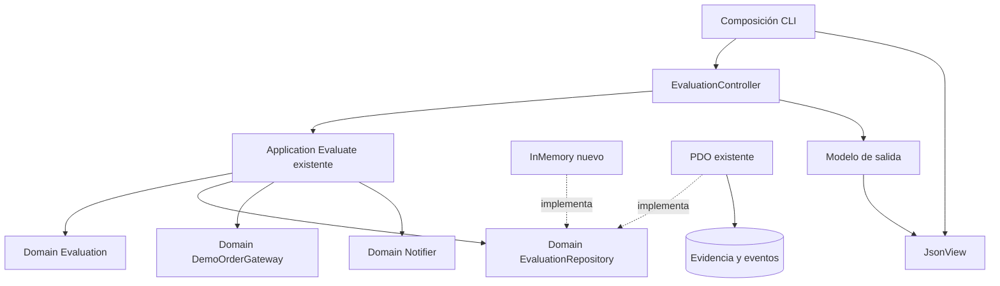
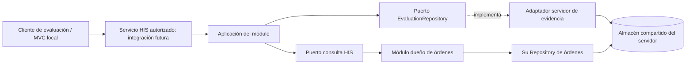

# Semana 4 — MVC, capas y patrón Repository

**Estudiante:** Lopez Perez, Mercedes Azucena.

Se continúa el **mismo Micro-HIS** de [semana 3](../semana-03/README.md), base 463b88c: consultar estado de orden ficticia, registrar evidencia técnica de contrato y evaluar capacidad de notificación. Se reutilizan sin copiar ni modificar Domain/Evaluation, Application/Evaluate, interfaz EvaluationRepository, esquema y adaptador PDO de esa semana.

Esta entrega añade MVC de entrada/salida CLI y adaptador InMemory. Sin framework, aplicación HTTP, integración HIS real ni runtime NativePHP. Todos los datos son ficticios; CONTRACT_ONLY no afirma viabilidad móvil/escritorio.

## Ejecutar

PHP 8.2+; pdo_sqlite para modo PDO/pruebas.

```powershell
php docs/modulos/investigacion-prototipo-nativephp/semana-04/mvc/cli.php memory
php docs/modulos/investigacion-prototipo-nativephp/semana-04/mvc/cli.php pdo
php docs/modulos/investigacion-prototipo-nativephp/semana-04/mvc/tests/run.php
php docs/modulos/investigacion-prototipo-nativephp/semana-03/micro-his/tests/run.php
```

Opcionalmente agregar DEMO-1 CONTRACT_DESKTOP después del modo. Los modos válidos son memory/pdo; modo inválido termina con código 2, resultado no RECORDED con código 1. CLI emite JSON con alcance CONTRACT_ONLY y resultado, evidenciaId y notificación UNAVAILABLE. Los dos modos son volátiles en esta demostración: PDO usa sqlite::memory:, no archivo durable. No se anuncian exportaciones ni envío nativo real.

## MVC y objetos reutilizables

| Rol / capa | Archivo / objeto | Responsabilidad y límite |
|---|---|---|
| Entrada y composición | mvc/cli.php | Lee argumentos, elige adaptador e inyecta dependencias. SQL fijo de inicialización pertenece a composición de prueba, fuera del controlador. |
| Controller / Presentation | EvaluationController | Comprueba forma/tipo de entrada y delega Evaluate. No contiene SQL, lista de estados permitidos, reglas de viabilidad ni manejo de permisos de negocio. |
| View / Presentation | JsonView | Serializa modelo de salida y etiqueta CONTRACT_ONLY; no consulta base ni dispara efectos. |
| Model / Application | Evaluate (semana 3) | Coordina validación, gateway, Repository y notificador; devuelve errores explícitos. |
| Model / Domain | Evaluation y puertos (semana 3) | Invariantes demo, destino y estado reconocido; desconoce MVC/PDO. Model no es sinónimo de una tabla. |
| Persistence / Repository | PdoEvaluationRepository (semana 3) | INSERT preparados, transacción evidencia/evento y rollback. |
| Persistence / Repository | InMemoryEvaluationRepository | Implementa el mismo puerto, IDs propios del adaptador y evidencia volátil por instancia. No promete concurrencia ni durabilidad. |

Objetos reutilizables: Evaluate, Evaluation, Repository, gateway y notificador conservan firmas; controller y view funcionan con ambos adaptadores. El composition root decide infraestructura. JsonView acepta el resultado ya calculado, no recalcula decisiones. No se agregan métodos de lectura genéricos/CRUD al Repository por conveniencia de pantalla: su frontera actual es guardar evidencia de evaluación.

## Flujo y dependencias



Vista editable: [mvc-repository.puml](diagramas/mvc-repository.puml). No se ha renderizado PlantUML a imagen; Mermaid muestra dependencias en este documento.

## Contrato y sustitución del Repository

Puerto existente EvaluationRepository::save(Evaluation): int. Devuelve identificador después de guardar evidencia y evento, o lanza PersistenceFailure sin éxito falso. InMemory y PDO se inyectan en el mismo Evaluate; el controller no selecciona tipo de base ni detecta instancia concreta. Los IDs son opacos y locales al adaptador, no correlaciones clínicas o identificadores globales.

PDO ya implementa persistencia de dos tablas dentro de una transacción; esquema/parametrización permanecen en semana 3. InMemory es adaptador de desarrollo, sin mecanismo durable o aislamiento multihilo. No se usa para demostrar recuperación tras reinicio. El método count del adaptador nuevo es inspección de prueba, no parte del puerto de aplicación.

Regla de ejecución: consulta confirmada → evaluación válida → evidencia registrada → intento de capacidad local. Persistencia fallida no notifica. Si la notificación falla después de COMMIT, la evidencia técnica queda registrada; no existe transacción distribuida DB-SO. CONTRACT_RECORDED no afirma envío y resultado UNKNOWN no debe reintentarse ciegamente.

## Integración con repositorio de datos compartido — análisis

Un repositorio de datos compartido significa aquí un almacenamiento persistente del servidor HIS usado por módulos bajo contratos y propiedad explícitos. No significa un único objeto Repository universal, una copia de la base HIS en cliente ni acceso directo del móvil al SQL remoto.



| Datos / responsabilidad | Propiedad y acceso propuestos |
|---|---|
| Orden, paciente, episodio y estado | Módulos HIS dueños; consulta autorizada a través de servicio/puerto, no escritura desde evaluación. |
| Evaluación y evento técnico | Módulo exploratorio, esquema propio en servidor si se adopta almacenamiento común; sin datos clínicos ni tokens en evidencia. |
| Identidad, tenant, membresía | Servicio de identidad autoriza antes de leer/grabar; ruta/selector del cliente no concede permiso. |
| Permiso SO y notificación | Adaptador local del destino; no vive en DB compartida como capacidad garantizada. |

Plan: acordar contratos/propietarios, agregar contexto autenticado al servicio y ámbito tenant en esquema/consultas, implementar adaptador servidor, probar aislamiento/rollback/concurrencia y migrar evidencia ficticia mediante un proceso aprobado. No usar directamente la tabla actual sin tenant en un sistema multitenant. No almacenar credenciales del servidor dentro del cliente distribuido.

Las migraciones deben pertenecer al módulo dueño de cada tabla. Transacción local solo evidencia/evento; no abarcar servicio remoto y SO. No duplicar estado clínico como autoridad paralela; registrar observación técnica con origen/fecha cuando el contrato lo incorpore. Ante caída del servicio, resultado explícito y sin éxito nativo. Auditoría de acceso, retención, idempotencia y correlación segura requieren diseño y prueba antes de adopción compartida.

Alternativa descartada para esta entrega: integrar por tablas de órdenes compartidas directamente desde UI, porque evade permisos/propiedad y acopla cliente a esquema clínico. Este análisis no crea un servidor, migración productiva ni repositorio compartido operativo.

## Verificación y trazabilidad

[Suite MVC/Repository](evidencia/mvc.txt): 24 aserciones con el mismo controller/application para ambos adaptadores. Comprueba IDs de dos escrituras sin sobrescribir, reglas de destino en dominio, entrada de tipo erróneo, HIS sin dato, efectos solo tras evidencia y vista sin alterar resultado. PDO real en memoria; HIS/SO dobles.

[Regresión de semana 3](evidencia/regresion-semana-03.txt): 16 aserciones, incluidas regla demo y rollback ante segundo INSERT fallido. Nueva suite también rompe tabla de evento para confirmar que controller devuelve PERSISTENCE_FAILURE y cabecera revierte. [CLI memory](evidencia/cli-memory.txt), [CLI PDO](evidencia/cli-pdo.txt), lint en evidencia/.

| Regla heredada | Evidencia |
|---|---|
| RF01/02 consulta por gateway | Mismo Evaluate de semana 3, doble explícito. |
| RF03/04 estado válido y fallo honesto | Reglas de Domain; errores del gateway sin notificación falsa. |
| RF05 capacidad separada | Ambos modos devuelven UNAVAILABLE con RECORDED. |
| RF06/07 independencia y privacidad | No se introduce exportador en controlador ni SQL; no clínica/secreto en vista demo. |
| RNF01 ISP / RNF05 testabilidad | Repository pequeño, dos adaptadores y pruebas comunes. |
| RNF06 límites honestos | CONTRACT_ONLY, sin promesas nativas o de almacenamiento compartido real. |

La persistencia actual no guarda resultado posterior de notificación ni auditoría completa por usuario; no se afirma resolverlo con MVC. Autenticación, JWT, controles de tenant, GUI/teclado y ejecución NativePHP están fuera de la demostración y pendientes de integración.