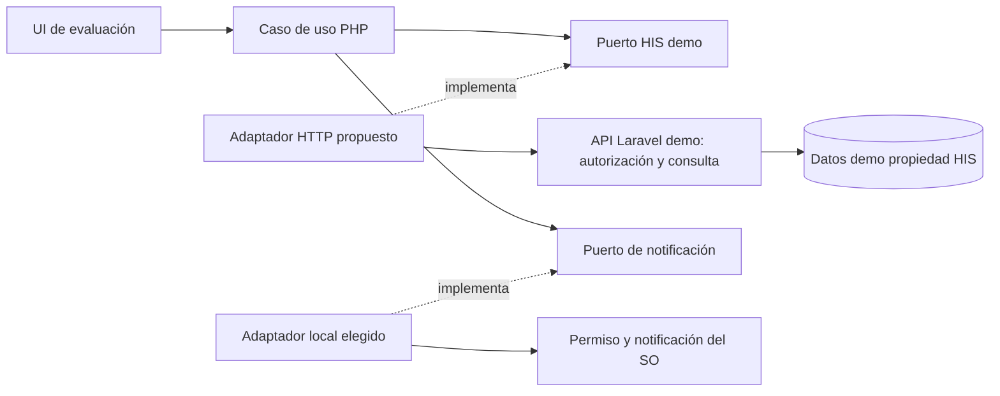
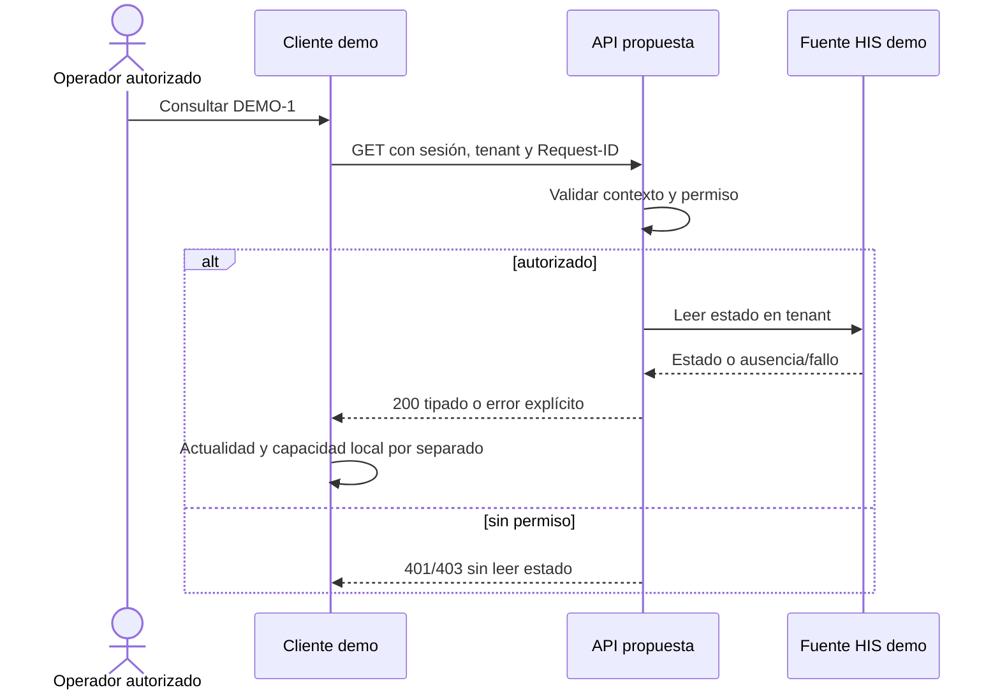

# Semana 5 — Cliente-servidor, API e integración del prototipo NativePHP

**Estudiante:** Lopez Perez, Mercedes Azucena.

## Continuidad y alcance

Se evoluciona el mismo flujo de [semana 2](../semana-02/semana-02-isp-nativephp.md), base 8a3dc40: consultar estado de una orden ficticia y notificarlo. Ese ejemplo separa DemoOrderStatusGateway, NativeNotifier y exportación de evidencia mediante ISP. Esta entrega diseña un adaptador HTTP detrás del gateway y evalúa una frontera de despliegue; no instala runtime NativePHP ni crea infraestructura productiva.

Faltan entregas técnicas intermedias en esta línea base: no se inventa una implementación de semanas 3/4. Se conserva el prototipo de contrato existente y se propone su migración incremental. No se modifican datos clínicos, autenticación general, catálogo, captura ni validación de resultados.

## Cliente-servidor y propiedad de datos

Cliente de evaluación (runtime/destino por seleccionar): UI → caso de uso → DemoOrderStatusGateway → adaptador HTTP. Solo NativeNotifier depende de capacidad local. HIS/Laravel es servidor y fuente de verdad del estado; el cliente no copia su base, no habla directamente con PDO remoto y no actualiza órdenes.

| Datos | Propietario / uso |
|---|---|
| Identidad, membresía, sesión | Módulo de identidad; el cliente solo consume contexto autorizado, sin crear un mecanismo alterno. |
| Orden demo y estado | HIS de demostración en el servidor, aislado por tenant. |
| Notificación / permiso | Capacidad local del destino elegido. Fallo de permiso no invalida la consulta. |
| Snapshot | Copia temporal solo en memoria, con orden/tenant/hora; nunca fuente de verdad ni notificación de dato obsoleto. |
| Evidencia de evaluación | Módulo exploratorio; metadatos ficticios de destino/versión/resultado, sin secretos ni clínica. |

## Contrato API propuesto

[OpenAPI 3.1.0](api/openapi.json), host ilustrativo no operativo:

GET /api/v1/tenants/{tenantId}/demo-orders/{demoOrderId}/status

Authorization: Bearer de sesión del módulo de identidad; X-Request-ID obligatorio sin información personal. Sin cuerpo. Identificador DEMO-... y tenant con formato restringido son decisiones del contrato del experimento, no IDs clínicos globales.

200 devuelve demoOrderId, tenantId, estado reconocido, observedAt con zona, source=HIS_DEMO y requestId; Cache-Control:no-store. Los estados son etiquetas del enum de semana 2 para demostración, no un ciclo institucional acordado. No hay endpoints de escritura ni envío remoto de notificaciones.

| HTTP | Resultado cliente / efecto |
|---|---|
| 200 válido | Mostrar lectura actual; notificar mensaje genérico si capacidad permitida. |
| 400 | Corregir entrada, sin consulta repetida ni notificación. |
| 401 | Renovar sesión por módulo de identidad, sin fallback permisivo. |
| 403 | Denegar operación/tenant; no consultar orden ni notificar. |
| 404 | Recurso no disponible en ámbito autorizado; no revelar si existe fuera. |
| 429 | Respetar Retry-After; no bucle automático ni notificación. |
| 503 | Indisponibilidad/timeout/respuesta inválida; mostrar sin dato actual o snapshot obsoleto, sin notificarlo. |

Los errores usan code/message/requestId sin stack ni datos clínicos. Si falta Request-ID o tiene formato inválido, el servidor genera correlación segura para responder 400, no refleja entrada arbitraria. Cabeceras no-store deben aplicarse también a errores al implementar el middleware.

Brecha de transición: el puerto actual retorna estado o null; no distingue 404/503. Primer adaptador puede conservar null para ambos sin éxito falso, pero pierde detalle. Issue NP5-02 propone resultado tipado y coordinación actualizada sin romper el ejemplo silenciosamente.

## Seguridad

HTTPS en integración. Validar sesión, tenant activo, membresía y permiso demo-orders:read antes de leer. El tenant de ruta es solicitado, nunca autorización confiable. Para tenant al que no pertenece: 403; para orden fuera del ámbito ya autorizado: 404. La autenticación y eventual verificación JWT pertenecen al módulo de identidad, no a este prototipo. No hay secreto embebido en cliente distribuido ni token en URL/logs.

Notificación local solo texto genérico “Consulta demo finalizada: estado”; no ID, nombre, valor clínico ni token. Borrador/snapshot de demo en memoria. Al integrar almacén de credenciales del destino, verificar su mecanismo seguro antes de persistir; no se presupone soporte NativePHP. Revalidar autorización en cada consulta y borrar snapshot al cambiar sesión/tenant.

## Resiliencia, consistencia y observabilidad

Valores propuestos para validar en experimento: deadline total de consulta 5 s y timeout de conexión 2 s. No son mediciones ni SLA. Reintento manual del GET tras 503/red, respetando Retry-After; máximo un intento adicional con nueva correlación y mismo contexto autorizado. No reintentar 400/401/403/404 sin acción del usuario/contexto válido. Si respuesta no cumple esquema/estado/tenant, tratar como indisponible, no mostrar éxito.

El GET no cambia estado ni debe disparar notificación en servidor. El cliente notifica solo después de una lectura nueva confirmada y evita doble toque durante operación. Un fallo de exportación repite solo exportación; notificación con resultado desconocido no se repite ciegamente. No se promete entrega exactamente una vez del SO ni sincronización de escritura offline.

observedAt identifica lectura de fuente; no promete que la orden no cambie después. Ante caída, snapshot obsoleto con fecha/origen; sin snapshot, sin dato. La política clínica del ciclo permanece en HIS; no transacción distribuida ni réplica cliente. Consistencia de lectura depende de la fuente del servidor, sin aceptar evento externo o cambiar órdenes desde este módulo.

Registrar requestId, operación, resultado técnico, latencia y destino/versiones ficticios. No registrar bearer, secretos, payload clínico o identificadores de paciente. Métricas propuestas: tasa 200/errores por tipo, latencia p95, fallos de notificación y experimentos sin evidencia de destino. Correlacionar cliente/API con Request-ID y sanitizar mensajes. Son instrumentación futura, no dashboard operativo.

## Diagramas

Fuentes UML editables en diagramas/.

## Frontera de microservicio y migración razonada

Decisión: mantener endpoint como módulo del servidor HIS y adaptador cliente; no extraer microservicio ahora. La lógica exploratoria no posee datos clínicos ni tiene volumen/equipo/operación independiente medidos. Extraer introduciría otra autenticación de servicio, dependencia de red y lectura potencialmente obsoleta sin beneficio demostrado.

Frontera candidata futura: adaptador de lectura demo/proyección con contrato estable, nunca notificaciones locales del SO ni propiedad de orden. Para evaluarla, obtener baseline y comparar p95/disponibilidad y costo de despliegue; considerar separación solo si hay demanda independiente documentada, presupuesto operativo y mejora medible (criterio de experimento propuesto: al menos 20 % de mejora de p95 bajo misma carga sin degradar autorización/disponibilidad). Hoy no hay medición que satisfaga ese criterio. No dividir base ni despliegue para cumplir una etiqueta.

Migración:

1. Congelar contrato/ejemplos y revisar permisos con dueño HIS; mantener suite de semana 2.
2. Implementar resultado tipado para distinguir fallos; pruebas de compatibilidad conservan camino reconocido y privacidad.
3. Añadir adaptador HTTP contra stub validado; luego endpoint de lectura demo autorizado, sin tocar módulos clínicos.
4. Integrar identidad/tenant, tiempos y errores; pruebas negativas sin lectura fuera de ámbito y snapshot obsoleto sin notificación.
5. Seleccionar distribución/versión/destino NativePHP; comprobar instalación, capacidad/permiso, sesión segura y comportamiento de red en ese destino.
6. Activar por configuración de experimento, comparar resultados y conservar doble de memoria para regresión. Rollback: volver al doble y etiquetar evidencia como contrato, no éxito nativo; no hay migración clínica que deshacer.

## Entregables y validación

[Plan de issues y aceptación](plan-issues.md) con rama/worktree/PR de esta entrega, sin crear issues externos ficticios. Suite existente se ejecuta y contrato se valida con herramienta OpenAPI; salidas en evidencia/. Validación sintáctica de contrato no ejecuta endpoint, autenticación ni runtime.

Fuente primaria de formato: [OpenAPI 3.1.0](https://spec.openapis.org/oas/v3.1.0.html), consultada el 28 de octubre de 2026. No se usan APIs NativePHP supuestas: distribución/destino siguen pendientes. La tarea permite diseño/prototipo; no se crea infraestructura productiva.