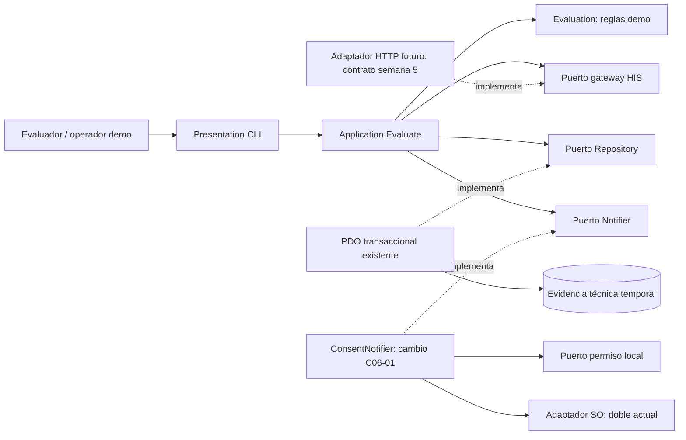

# Semana 6 — Primera evaluación parcial NativePHP

**Autora:** Mercedes Azucena Lopez Perez.

Defensa del flujo acotado de evaluación: consultar una orden ficticia, registrar evidencia técnica de contrato y evaluar capacidad de notificación local. [Presentación: 8 diapositivas](presentacion.md), [matriz decisión → evidencia](matriz-decisiones.md), [registro del cambio práctico](registro-cambio.md) y [UML trazable](diagramas/defensa.puml).

## Bases integradas y alcance

Se parte del Micro-HIS de [semana 3](../semana-03/README.md), commit 463b88c, que continúa los puertos ISP de semana 2. Se incorpora sin modificar el contenido de [semana 5](../semana-05/README.md), contrato y plan API de commit 76e1dbb, para revisar la continuidad arquitectónica. Esa API es propuesta: la CLI de semana 3 usa gateway doble, no adaptador HTTP. Semana 4 no existe en esta línea base y no se atribuye trabajo inexistente.

No se instala runtime NativePHP ni se atribuye soporte de un destino, aprobación clínica o revisión docente. Todo identificador y estado es ficticio. CLI demuestra ejecución local PHP/PDO; el cambio demuestra coordinación de permiso y efecto con dobles. La defensa no equivale a evaluación ya realizada ante un jurado.

## Actores, reglas y arquitectura

Evaluador técnico revisa configuración y evidencia de destino; operador autorizado ejecuta demo; revisor consulta evidencia sin repetir efectos. Estos son roles de diseño, no RBAC implementado. HIS conserva propiedad del estado de orden; SO conserva propiedad del permiso/capacidad; módulo exploratorio registra evidencia de contrato.

Presentation compone CLI y adaptadores; Application valida, consulta, persiste y coordina efecto; Domain contiene Evaluation y puertos pequeños; Persistence implementa Repository con PDO preparado y transacción. ISP evita obligar gateway/notificador a exportar o escanear; DIP permite sustituir adaptadores sin dependencia del dominio a SQL/HTTP/NativePHP. Repository guarda evaluación técnica y evento, no datos clínicos.



## Contrato API y sincronización

[OpenAPI](../semana-05/api/openapi.json): GET /tenants/{tenantId}/demo-orders/{demoOrderId}/status. Sesión y permiso verificados por servidor antes de leer; tenant de ruta no autoriza. 200 devuelve estado reconocido/observedAt/contexto; 400 entrada, 401 sesión, 403 permiso, 404 recurso no disponible, 429 espera, 503 indisponibilidad. Request-ID correlaciona sin secretos. Host ilustrativo, sin servicio.

El cliente no cambia órdenes. Sincronizar significa refrescar lectura autorizada; no hay cola clínica offline ni copia de base HIS. Snapshot obsoleto no notifica ni afirma estado actual. La CLI no implementa snapshots, timeout/red ni validación tenant; esas decisiones pertenecen a integración API propuesta. Token no se imprime, incluye en URL ni guarda en evidencia.

## Cambio práctico y resultados

C06-01: si el destino no concede permiso, no invocar adaptador nativo; preservar evidencia de consulta y devolver UNAVAILABLE. Permiso se consulta cada ejecución, no se conserva como autorización permanente. ConsentNotifier decora Notifier; Evaluate, modelo y Repository permanecen intactos. No se solicita permiso en bucle ni se abre configuración automáticamente.

[Suite del cambio](cambio/verificar.php): 12 aserciones. [Micro-HIS semana 3](evidencia/regresion-semana-03.txt): 16; [ISP semana 2](evidencia/regresion-semana-02.txt): 14. SQLite temporal real; gateway/SO/permiso son dobles. No son pruebas de notificación o permisos reales del dispositivo.

```powershell
php docs/modulos/investigacion-prototipo-nativephp/semana-06/cambio/verificar.php
php docs/modulos/investigacion-prototipo-nativephp/semana-03/micro-his/tests/run.php
php docs/modulos/investigacion-prototipo-nativephp/semana-02/ejemplo-isp/verificar.php
```

Evidencia en evidencia/. OpenAPI se incorpora ya validado en semana 5; no se confunde esa validación histórica con API ejecutada en esta defensa.

## Viabilidad y riesgos de plataforma

| Riesgo | Decisión / evidencia necesaria |
|---|---|
| Runtime/distribución/destino no elegidos | Registrar versión, SO y procedimiento de instalación; no concluir soporte desde PHP CLI. |
| Permiso cambia o SO no disponible | Consultar permiso local; C06-01 prueba coordinación con doble. Probar después en destino real. |
| Permiso cambia entre consulta y envío | Adaptador nativo debe manejar denegación/fallo; chequeo previo no garantiza entrega. |
| Excepción/resultado desconocido | Evaluate devuelve UNKNOWN, no reintenta efecto a ciegas. |
| DB y notificación no atómicas | Evidencia de consulta primero; CONTRACT_RECORDED no afirma envío. Falta persistir resultado posterior si se requiere auditoría completa. |
| Red caída/snapshot obsoleto | Contrato futuro distingue indisponibilidad; no sincronización de escritura clínica. |
| Soporte multiplataforma supuesto | Matriz por destino con evidencia nativa pendiente; conclusión actual limitada a contrato/diseño. |

Siguiente implementación: elegir un destino y adaptador oficial compatible, verificar permisos en dispositivo, conectar gateway HTTP con contexto autenticado y probar ausencia/retiro de permiso y respuesta desconocida. Mantener módulo en HIS, sin extraer microservicio antes de mediciones que lo justifiquen.