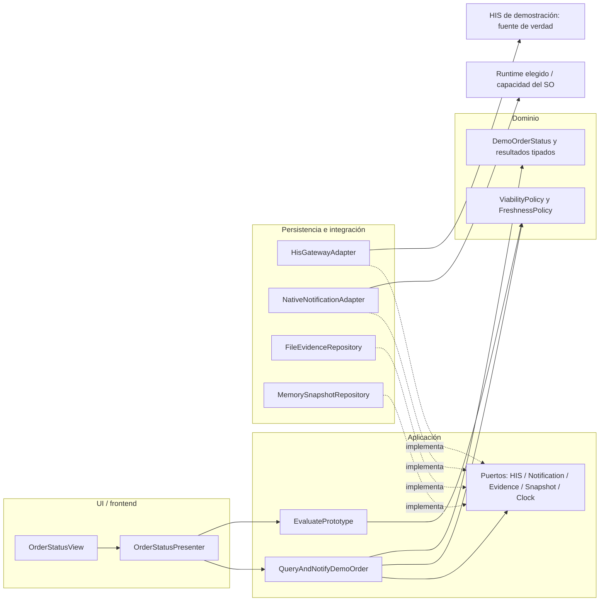

# Semana 7 — Componentes y refactorización conceptual

**Estudiante:** Lopez Perez, Mercedes Azucena

**Módulo:** Investigación y prototipo NativePHP para extensión móvil/escritorio

**Flujo acotado:** Evaluar la viabilidad de consultar el estado de una orden ficticia del HIS y notificarlo mediante una capacidad nativa.

## 1. Punto de partida y alcance

Se parte de [semana 2](../semana-02/semana-02-isp-nativephp.md), específicamente RunOrderStatusPrototype en ejemplo-isp/despues/NativeCapabilities.php. El caso de uso ya recibe DemoOrderStatusGateway y NativeNotifier por constructor, valida entrada, consulta y notifica. Exportación y escaneo están segregados. No existe runtime NativePHP instalado ni un frontend nativo implementado en esa entrega.

El acoplamiento que se aborda es **de comportamiento y resultado**: el mismo execute mezcla consulta HIS y notificación; devuelve solo un estado global. No expresa por separado frescura del dato, motivo de indisponibilidad de la capacidad ni evidencia de plataforma. Eso incentiva a la futura UI a reconstruir causas a partir de un único status y a incorporar reglas de sincronización o plataforma.

Se propone un refactor conceptual concreto de ese caso de uso y sus contratos. Los nombres nuevos y JSON siguientes son diseño, no clases instaladas ni endpoints existentes. No se implementa otro módulo ni se cambia el código de semana 2. No se agregan captura clínica, validación bioquímica, escaneo, escritura offline, exportación automática ni infraestructura de microservicios.

## 2. Diagrama de componentes propuesto



Las flechas continuas son dependencias de código o llamadas al exterior; las discontinuas son implementación de puertos. Application conoce Domain y sus propios puertos; Domain no conoce UI, PDO, HTTP ni NativePHP. El composition root, omitido para legibilidad, crea adaptadores y los inyecta. El backend HIS es externo al módulo y no se refactoriza aquí.

Fuentes editables UML: [componentes](diagramas/componentes.puml), [antes/después](diagramas/refactor-antes-despues.puml).

## 3. Responsabilidades backend/frontend

| Capa / componente | Entrada y salida | Responsabilidad / dependencia permitida |
|---|---|---|
| UI: OrderStatusView | Eventos de consulta y DTO de presentación | Mostrar código demo, estado, frescura y capacidad; foco, carga y mensajes accesibles. No inferir viabilidad ni llamar SDK/red/archivos. |
| UI: OrderStatusPresenter | Evento → QueryRequest; QueryResult → ViewModel | Normalizar espacios del ID, bloquear doble envío durante consulta y mapear estados a mensajes. No decide si el snapshot es actual. |
| Aplicación: QueryAndNotifyDemoOrder | QueryRequest → QueryResult | Validar ID, consultar HIS, aplicar frescura, notificar solo respuesta reconocida y fresca, registrar evidencia mínima. Usa puertos. |
| Aplicación: EvaluatePrototype | EvaluationRequest → EvaluationResult | Evaluar evidencias declaradas del destino y devolver limitaciones; no descubre compatibilidad por nombre del SO. |
| Dominio: FreshnessPolicy | Lectura tipada y snapshot opcional → estado/frescura | Distinguir actual, obsoleto y sin dato; nunca promover copia vieja a actual. |
| Dominio: ViabilityPolicy | Evidencias de runtime/destino/capacidad/HIS → conclusión | No demostrar viabilidad nativa por pruebas con dobles. Clasificar no demostrado, condicional o viable para demo. |
| Integración: HisGatewayAdapter | ID → HisReadResult | Traducir respuesta/timeout/indisponibilidad; autenticar según contrato del HIS cuando exista. No crear fuente clínica local. |
| Integración: NativeNotificationAdapter | Mensaje genérico → NotificationResult | Traducir permiso denegado/revocado, capacidad ausente o fallo conocido; único componente que conoce APIs del destino elegido. |
| Persistencia: MemorySnapshotRepository | ID / snapshot ficticio → lectura o escritura en memoria | Solo lectura cacheada del experimento; sin datos clínicos persistentes ni cola offline. |
| Persistencia: FileEvidenceRepository | Registro técnico mínimo → EvidenceResult | Guardar evidencia del experimento sin pacientes/tokens; un error de evidencia no revierte la consulta ni permite reenviar notificación. |

El backend propio de esta extensión son los casos de uso y adaptadores; no se replica el backend clínico Laravel. La UI puede ser web embebida según el destino que se seleccione; este documento no afirma compatibilidad real con ningún paquete/versión NativePHP.

## 4. Contratos de entrada/salida

Son DTO internos de diseño, no una API HTTP implementada. Las fechas usan ISO 8601 con zona. Los IDs y estados pertenecen a demostración.

| Contrato / operación | Entrada | Salida y garantías |
|---|---|---|
| QueryRequest / execute | demoOrderId: string no vacío tras trim; requestId: string generado por aplicación | QueryResult con estados separados. Vacío devuelve INVALID_INPUT sin red ni notificación. |
| HisGateway / read | demoOrderId normalizado | kind: FOUND, NOT_FOUND, UNAVAILABLE o TIMEOUT; orderStatus solo si FOUND y reconocido; observedAt del dato fresco. Un estado desconocido se traduce a UNAVAILABLE con causa INVALID_RESPONSE. |
| SnapshotRepository / read, remember | ID; para remember, estado reconocido + observedAt | Snapshot opcional. Escritura solo tras FOUND; error se devuelve sin convertir una lectura fresca en fallida. La UI no recibe una copia como actual. |
| NotificationPort / notify | requestId y texto genérico sin ID/paciente/valor clínico | SENT, DENIED, UNAVAILABLE o FAILED. Excepción conocida se traduce al resultado correspondiente; no se inventa envío exitoso. |
| EvidenceRepository / append | requestId, destino demo, resultados técnicos, timestamp | RECORDED o FAILED. El registro no contiene credenciales ni nombres; si falla, mostrar advertencia y no repetir efectos laterales. |
| EvaluatePrototype / execute | Evidencia de runtime, destino, capacidad y acceso HIS; cada campo verificado o pendiente | NOT_DEMONSTRATED si runtime/destino pendientes; CONDITIONAL si permiso o HIS no disponibles; VIABLE_FOR_DEMO solo con evidencia de los cuatro. |
| Presenter / present | QueryResult | title, statusLabel, freshnessLabel, notificationLabel, warning, canRetry. No expone excepciones ni detalles sensibles. |

QueryResult:
```json
{
  "requestId": "REQ-DEMO-01",
  "query": "FOUND",
  "orderStatus": "PENDIENTE",
  "freshness": "CURRENT",
  "observedAt": "2026-10-27T12:00:00-06:00",
  "notification": "SENT",
  "evidence": "RECORDED"
}
```

En un error de red con snapshot previo: query=TIMEOUT, orderStatus=PENDIENTE, freshness=STALE, observedAt conserva la fecha original, notification=NOT_ATTEMPTED. Sin snapshot: orderStatus y observedAt son null y freshness=NONE. No se notifica un dato obsoleto. NOT_FOUND descarta cualquier snapshot para esa consulta y muestra NONE, evitando sugerir que el recurso sigue vigente. Entrada inválida usa query=INVALID_INPUT, NONE, null y NOT_ATTEMPTED; la evidencia de esa validación puede registrarse sin incluir el texto introducido.

Si la notificación falla después de FOUND, la consulta sigue siendo exitosa con notification=FAILED o DENIED y advertencia; no se presenta “HIS fallido”. Reintentar significa una nueva consulta explícita, no una repetición silenciosa de una notificación. El caso de uso no promete entrega exactamente una vez ante cierres del runtime.

## 5. Refactor antes/después

### Antes: comportamiento existente

```text
RunOrderStatusPrototype.execute(id)
  id vacío → INVALID_INPUT
  gateway(id) devuelve null → HIS_UNAVAILABLE
  gateway devuelve estado → notifier.notify(...)
  SENT → NOTIFIED; otro retorno → NOTIFICATION_UNAVAILABLE
```

Aspectos correctos conservados: inyección por constructor, capacidades segregadas, estados de demostración y notificación genérica. Limitaciones concretas: null no separa no encontrado de caída; un único status no conserva el resultado de consulta separado de la notificación; excepciones de adaptadores no tienen traducción; no hay frescura ni evidencia de viabilidad.

### Después: coordinación con resultados independientes

```text
Presenter normaliza evento → QueryRequest
QueryAndNotifyDemoOrder valida solicitud
  gateway.read → FOUND / NOT_FOUND / UNAVAILABLE / TIMEOUT
  FreshnessPolicy combina respuesta y snapshot
  solo FOUND reconocido y CURRENT → NotificationPort
  EvidenceRepository registra resultado mínimo
  QueryResult conserva consulta, frescura, notificación y evidencia por separado
Presenter presenta ViewModel sin conocer SO/red/archivos
EvaluatePrototype evalúa evidencias del destino en operación separada
```

| Aspecto | Antes | Después / justificación |
|---|---|---|
| Consulta vs capacidad | Un solo status final | Resultados separados: una notificación fallida no oculta consulta válida. |
| Disponibilidad HIS | null ambiguo | Resultado tipado distingue inexistencia, timeout y caída. |
| Sincronización | Sin modelo explícito | Política determina frescura y prohíbe notificar snapshot obsoleto. |
| Riesgos del destino | Sin evidencia estructurada | Evaluación separada con pendientes explícitos; cambiar UI no cambia viabilidad. |
| Persistencia de evidencia | No forma parte del flujo | Puerto propio y fallo independiente; no fuerza a reconsultar/notificar. |
| Error de plataforma | Puede escapar excepción del adaptador | Adaptador traduce fallos esperables sin acoplar aplicación al SDK. |

No se añade una clase por cada campo: basta un coordinador, dos políticas pequeñas y adaptadores para efectos externos. El beneficio es comprobable con dobles; el costo es ampliar contratos y ajustar composición/presentación. No se cambia el flujo clínico ni el propietario de datos.

## 6. Plan de refactor y verificación

1. Mantener el ejemplo de semana 2 como línea base y ejecutar su verificar.php.
2. Introducir DTO de lectura y resultado compuesto con casos de equivalencia para el camino conocido.
3. Extraer frescura y viabilidad; usar reloj inyectado para pruebas deterministas.
4. Implementar adaptadores de prueba y luego uno real por destino seleccionado; traducir errores conocidos en el límite.
5. Adaptar Presenter/View; comprobar que no importe SDK, cliente HTTP ni acceso a archivos.
6. Comprobar casos: ID vacío sin efectos; FOUND + SENT; FOUND + permiso denegado conservando dato; timeout con STALE y sin notificación; NOT_FOUND sin snapshot; fallo de evidencia sin repetir notificación; runtime pendiente sin viabilidad afirmada.

El entregable es conceptual: los nuevos contratos no se presentan como código ejecutado. La regresión disponible solo comprueba que el ejemplo previo sigue funcionando. La implementación real requiere confirmar distribución NativePHP, runtime y plataforma; no se necesita investigarlos para justificar esta separación de responsabilidades.

## 7. Trazabilidad

| Requisito existente | Componentes / decisión |
|---|---|
| RF-01 Solicitar orden demo | View, Presenter y QueryRequest |
| RF-02 HIS fuente de verdad | HisGatewayAdapter y política sin escritura offline |
| RF-03 Notificar estado reconocido | QueryAndNotifyDemoOrder y NotificationPort |
| RF-04 HIS no disponible sin éxito falso | HisReadResult y FreshnessPolicy |
| RF-05 Capacidad indisponible explícita | NotificationResult y ViewModel |
| RF-06 Evidencia segregada | EvidenceRepository; conserva exportación separada de semana 2 |
| RF-07 / RNF-03 Privacidad | Mensaje genérico y evidencia técnica mínima |
| RNF-01/02 ISP y portabilidad | Puertos pequeños; SDK solo en adaptador |
| RNF-04/05 Respuesta explícita y pruebas | DTO compuestos, dobles y reloj inyectado |
| RNF-06 Alcance honesto | Viabilidad basada en evidencia; diseño conceptual sin afirmar ejecución nativa |