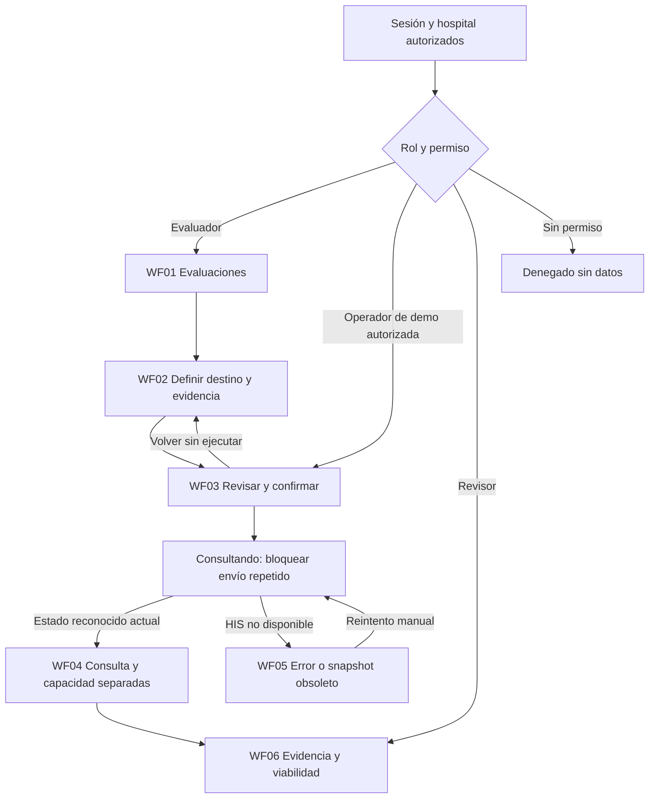
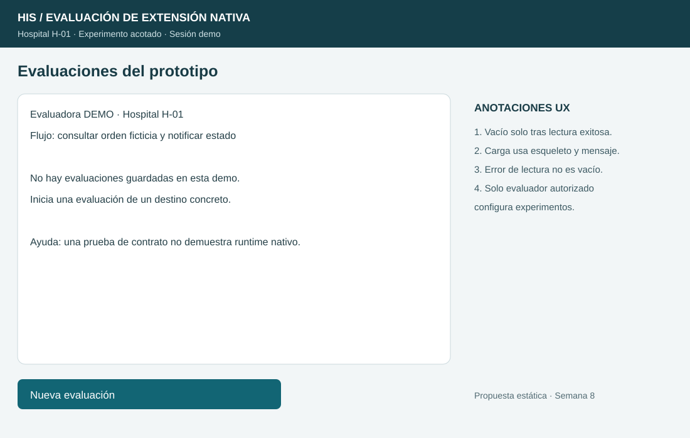
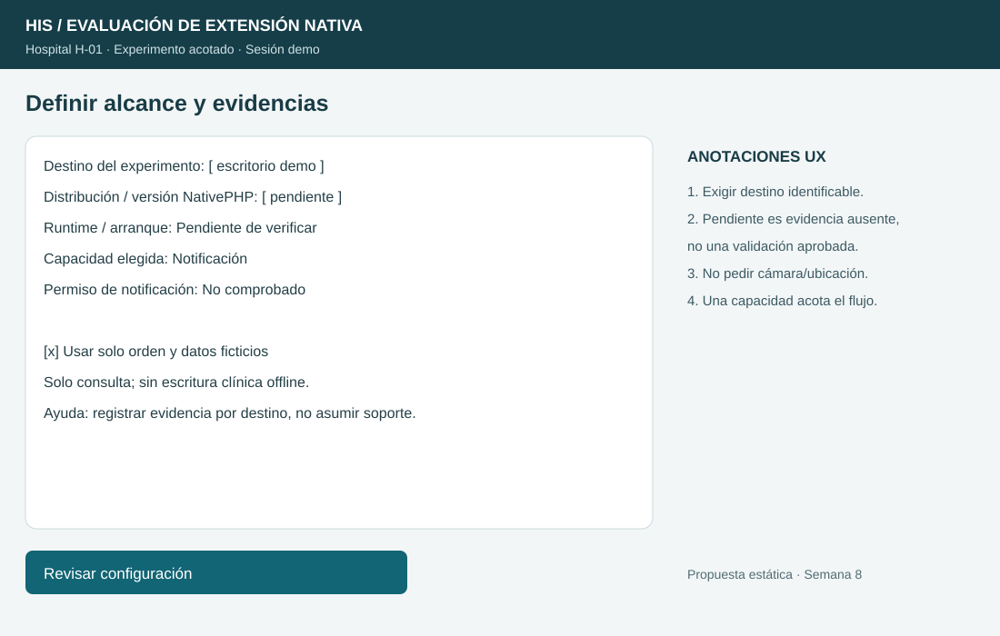
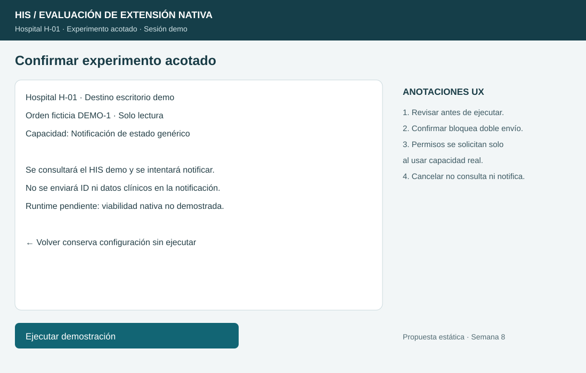
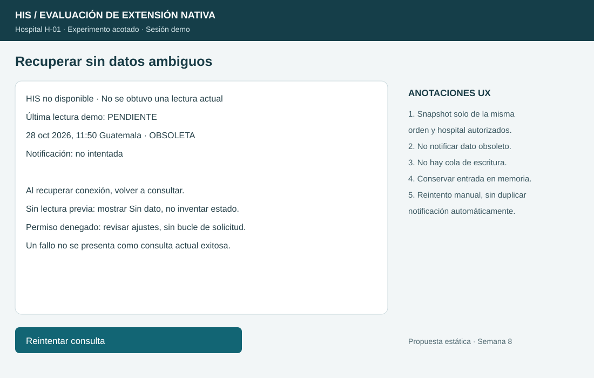
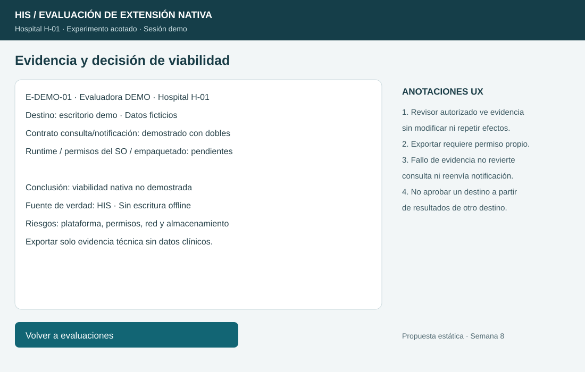

# Semana 8 — UX de evaluación y prototipo NativePHP

**Estudiante:** Lopez Perez, Mercedes Azucena

**Flujo:** Evaluación y prototipo acotado de un flujo HIS mediante NativePHP: consultar una orden ficticia y notificar su estado.

## Alcance y roles

Seis wireframes anotados y user flow por rol. Propuesta estática, sin runtime NativePHP ni integración HIS real. Datos, horas y destinos son ficticios; no se afirma compatibilidad móvil/escritorio. Base: [RF/RNF de semana 2](../semana-02/semana-02-isp-nativephp.md) y [componentes de semana 7](../semana-07/semana-07-componentes-refactor-nativephp.md), commit 01f2c5d. Integrar esa base antes de esta entrega.

| Rol de diseño | Acciones autorizadas propuestas | Límite |
|---|---|---|
| Evaluador técnico autorizado | Configurar destino/experimento y consultar orden demo; registrar evidencia | No administra datos clínicos ni se atribuye permiso por elegir un rol en UI. |
| Operador autorizado de demo | Ejecutar consulta del flujo aprobado y revisar resultado | No cambia conclusión de viabilidad ni contexto hospitalario. |
| Revisor autorizado | Consultar evidencia y limitaciones | No modifica experimento ni repite consulta/notificación. Exportación requiere permiso explícito. |
| Sin autorización | Pantalla de acceso denegado | No se muestran órdenes ni evidencia del hospital. |

Son responsabilidades UX, no permisos reales ya implementados. Un servidor debe comprobar identidad y ámbito antes de leer/ejecutar/exportar. Cambiar hospital exige autorización y nueva carga; no es un filtro libre. Solo datos ficticios y lectura; no hay sincronización clínica de escritura ni módulos ajenos.

## User flow por rol

Operador no puede volver a editar configuración del evaluador: su acción secundaria cancela al inicio del experimento autorizado. El revisor solo consulta evidencia previamente autorizada. El diagrama simplifica navegación compartida; cada retorno debe respetar permisos del rol.

## Wireframes anotados

### WF01 — Inicio

Vacío solo tras lectura exitosa. Durante carga, esqueleto y aviso; ante error, mensaje específico y Reintentar. Un listado fallido no se convierte en “sin evaluaciones”. Revisor usa lista en lectura; Nueva evaluación solo para evaluador.

### WF02 — Decisión de alcance/destino

Exigir destino identificable y flujo acotado antes de revisar. Distribución, versión y runtime pueden estar pendientes, pero deben permanecer así en la conclusión. No inferir soporte por escribir “Android” o “Windows”. Una capacidad necesaria: notificación; no solicitar cámara, ubicación ni escáner. Ayuda contextual explica qué evidencia falta por destino.

### WF03 — Confirmación

Resumen de orden demo, hospital, destino, capacidad y límites antes de ejecutar. Confirmar deshabilita repetición durante consulta. Cancelar no ejecuta efectos. Si existe runtime real, pedir permiso de capacidad en el momento de uso y mostrar explicación; en la demo solo se modela ese resultado, no se afirma solicitud al SO.

### WF04 — Éxito de consulta y capacidad

Mostrar consulta, fuente/hora y notificación por separado. Permiso denegado no oculta consulta válida: “No enviada: permiso denegado”. No presentar notificación enviada hasta confirmación de la capacidad. Aunque consulta/notificación de demo pasen, runtime pendiente implica viabilidad nativa no demostrada.

### WF05 — Errores recuperables y sincronización

Con caída/timeout conservar lectura previa solo como obsoleta, de la misma orden y hospital, sin notificarla como dato actual. Sin snapshot mostrar “Sin dato”. Reintento manual consulta de nuevo y no reenvía notificaciones por fallo de exportación. Un envío nativo con respuesta desconocida debe mostrarse como tal, no como enviado/no enviado confirmado; no reintentar ciegamente.

### WF06 — Evidencia y limitaciones

Distinguir evidencia de contrato y evidencia nativa por destino. Revisor no cambia datos ni ejecuta efectos laterales. Si exportar falla, la consulta sigue siendo válida y se informa que la evidencia no se guardó/exportó; no se repite notificación. Conclusión parcial no equivale a soporte multiplataforma.

## Estados y reglas de interacción

| Condición | Mensaje / acción | Validación y protección |
|---|---|---|
| Carga | “Cargando evaluaciones” / “Consultando…” | No habilitar datos/acciones que aún no existen; bloquear doble envío. |
| Vacío | “No hay evaluaciones guardadas” | Solo tras respuesta de lectura satisfactoria. |
| Entrada incompleta | “Indica destino y código de orden demo” | Error junto al campo, foco y etiqueta persistente; no ejecutar. |
| Fuente HIS fallida | “No hay lectura actual”; Reintentar | Estado anterior obsoleto con hora, sin éxito inventado. |
| Permiso denegado/capacidad ausente | “Consulta confirmada; notificación no enviada” | Conservar resultado; sin bucle de solicitud de permisos. |
| Respuesta nativa desconocida | “No se pudo confirmar la notificación” | No repetir automáticamente ni afirmar envío exitoso. |
| Éxito confirmado | Consulta actual y capacidad confirmada por separado | Ningún resultado crea/modifica una orden clínica. |
| Exportación fallida | “Consulta válida; evidencia no exportada” | Reintentar solo exportación autorizada, sin repetir consulta/notificación. |
| Runtime no comprobado | “Viabilidad nativa no demostrada” | No convertir evidencia ausente en aprobado. |
| Sesión vencida/sin permiso | “Renueva acceso” / “Acceso denegado” | Ocultar contexto protegido; revalidar sesión/tenant antes de continuar. |

## Accesibilidad, privacidad y ayuda

Orden de foco contexto → campos → revisión → confirmar. Etiquetas persistentes, foco visible, controles ≥44 px, contraste legible y mensajes por texto, no solo color. Errores vinculados al campo y resumen enfocable; carga/éxito mediante región de estado. Ayuda del experimento no cambia la pantalla ni pierde entrada. Los SVG anotan diseño, no prueban teclado ni lector de pantalla.

En móvil se propone una columna y acciones apiladas, sin tabla horizontal; en escritorio se separan contexto, resultado y evidencia. La adaptación concreta requerirá implementación y pruebas, no reducir el SVG como si fuera responsive ejecutado.

Notificaciones genéricas sin ID, paciente ni valor clínico. Evidencia técnica mínima: destino, versiones, hora, fuente y resultado del experimento; sin tokens/contraseñas. Borrador/snapshot solo en memoria en este alcance. No persistir datos clínicos en dispositivo ni sincronizar escrituras offline. Exportación exige autorización propia y revisión de contenido; no se asume segura por ser local.

## Trazabilidad

| RF/RNF de semana 2 / criterio | Evidencia UX |
|---|---|
| RF-01/02 consulta por puerto, HIS fuente de verdad | WF02/03/04 y recuperación sin escritura |
| RF-03/04 estado reconocido y fallo explícito | WF04/05 y tabla de estados |
| RF-05 capacidad no disponible | WF04/05; no borrar consulta válida |
| RF-06 exportación segregada | WF06; no repetir notificación |
| RF-07 / RNF-03 privacidad | Mensaje genérico y evidencia mínima |
| RNF-01/02 segregación/portabilidad | Capacidad acotada y resultado independiente del destino |
| RNF-04 respuestas explícitas | Vacío/carga/error/éxito/desconocido distintos |
| RNF-05/06 testabilidad y alcance honesto | Evidencia contrato/nativa separadas y viabilidad pendiente |
| Criterios de rol/accesibilidad/movilidad | User flow, permisos por acción, foco/etiquetas y propuesta de columna móvil |

## Verificación y límites

Se entregan seis SVG con anotaciones, fuentes editables y reglas; se verifica XML y encaje del texto. No hay pruebas de usuario, navegador, accesibilidad completa ni runtime NativePHP. La selección de distribución/versión y pruebas por plataforma quedan pendientes; esta tarea diseña UX sin inventar APIs ni compatibilidad real.