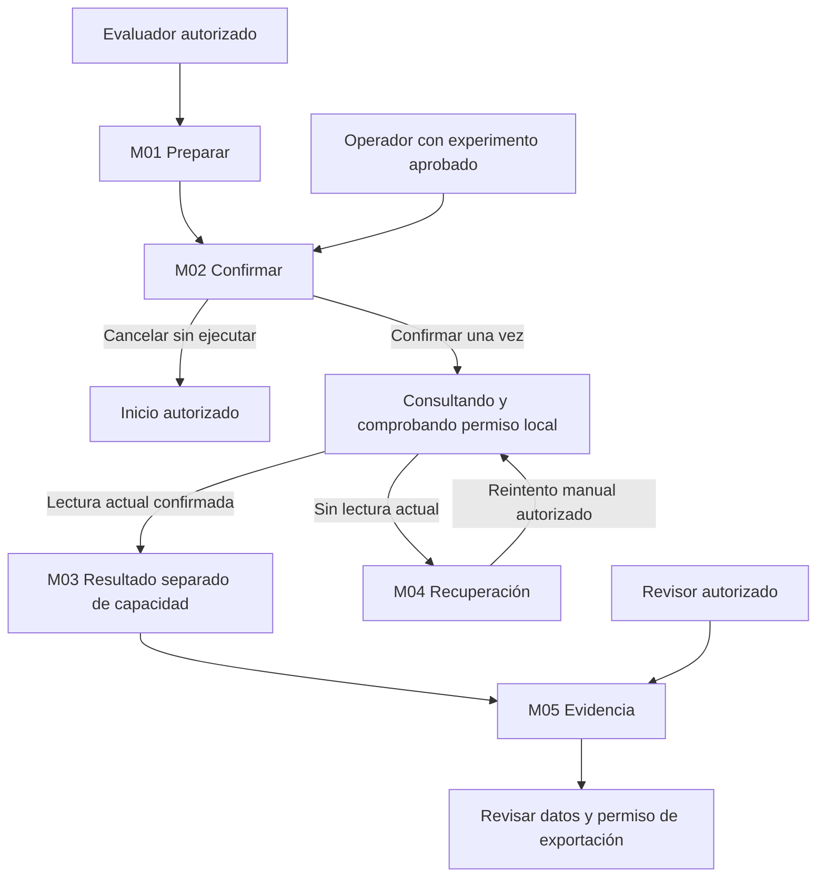
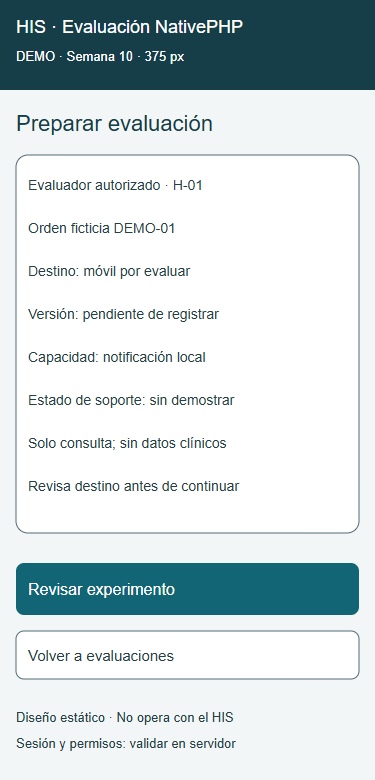
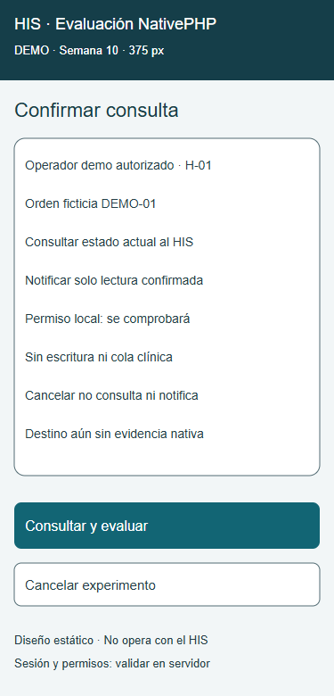
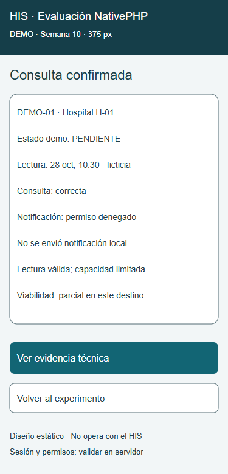
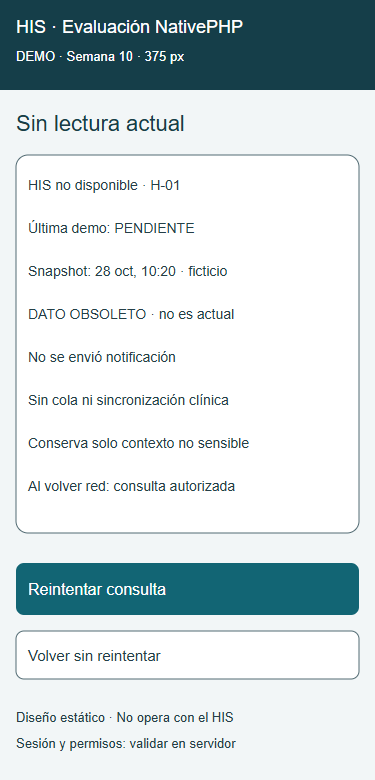
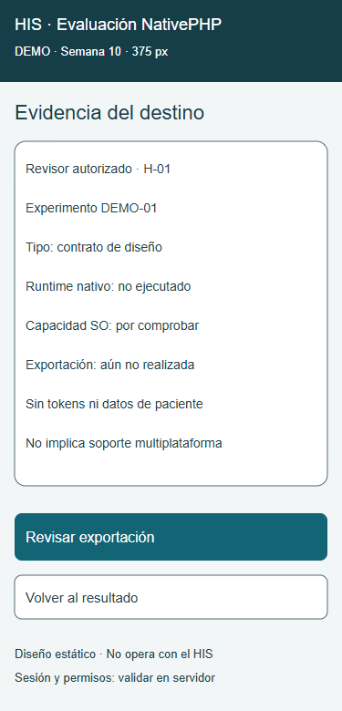

# Semana 10 — Diseño para movilidad del prototipo NativePHP

**Estudiante:** Lopez Perez, Mercedes Azucena.

Se adapta la [evaluación UX de semana 8](../semana-08/semana-08-ux-nativephp.md), base 2dc45d4, al flujo acotado: consultar estado de una orden ficticia y evaluar notificación local. Cinco pantallas, cada una a 320, 375 y 430 px, con fuentes SVG y cinco capturas de navegador. Son propuestas estáticas, no controles interactivos ni runtime NativePHP; las pantallas de resultado ilustran escenarios, no una ejecución nativa.

## Pantallas y jerarquía

| Pantalla | Prioridad de contenido y decisión | Variante 375 |
|---|---|---|
| M01 Preparar | Evaluador autorizado, hospital, orden demo, destino/versión y capacidad. Soporte no demostrado visible antes de continuar. | [SVG](pantallas/01-destino-375.svg) |
| M02 Confirmar | Operador autorizado revisa lectura y efecto local; cancelar sin consulta/notificación. No edita configuración del evaluador. | [SVG](pantallas/02-confirmar-375.svg) |
| M03 Resultado | Estado de consulta separado de notificación/permiso y conclusión parcial. Lectura correcta no significa capacidad nativa disponible. | [SVG](pantallas/03-resultado-375.svg) |
| M04 Conexión limitada | Aviso sin lectura actual primero, snapshot/hora y etiqueta obsoleto; ninguna notificación por ese snapshot. | [SVG](pantallas/04-conexion-375.svg) |
| M05 Evidencia | Revisor consulta alcance y tipo de evidencia; revisar exportación exige permiso, nunca repite consulta/notificación. | [SVG](pantallas/05-evidencia-375.svg) |

El ancho alternativo se obtiene cambiando sufijo -375 por -320 o -430. Todas las pantallas usan datos ficticios. Se combinan consulta, resultado y limitaciones en cinco vistas; notas de ingeniería extensas permanecen en documentación, fuera del flujo móvil.

## Navegación por rol

Volver del operador regresa a su experimento aprobado, sin habilitar configuración. Revisor no ejecuta ni modifica. Cambiar hospital requiere autorización y limpiar snapshot/contexto previo; selector cliente no concede acceso. Sin sesión o permiso: vista denegada sin datos, fuera de las cinco pantallas principales.

## Breakpoints y composición

| Ancho CSS propuesto | Regla de diseño |
|---|---|
| Menor que 320 | Mantener tipografía y columna; permitir scroll vertical, no prometer soporte validado fuera del rango. |
| 320–359 | Margen 16 px, contenido 288 px a 320; una columna, etiquetas sobre campos, acciones apiladas. |
| 360–430 | Mismos datos/orden; tarjetas crecen hasta 398 px, sin agregar columnas ni esconder errores. |
| 431–767 | Continuar columna centrada con ancho máximo 430; aprovechar margen exterior. |
| ≥768 | Propuesta desktop: lista/detalle, mismos permisos y estados; no se entrega ni verifica desktop en esta semana. |

SVG usa texto mínimo 13 px para metadatos, 14 para datos, títulos 22; no reducir fuente para encajar un texto futuro. En implementación, fuente de contenido al menos 16 px con unidades relativas y ajuste de línea. Datos demo cortos aquí no verifican nombres largos, zoom o traducciones. Aplicación futura debe admitir reflujo a 320/zoom, respetar teclado virtual y safe-area del destino. Sin footer fijo: contenido y acciones en flujo vertical.

Botón primario 52 px alto y secundario 48 px; separación 16 px. No son controles operables del SVG. Implementar botones nativos, etiqueta accesible, foco visible, orden contexto → datos → ayuda → acción principal → volver; no foco automático al campo que abra teclado sin necesidad.

## Formularios, tablas y confirmación

M01 representa resumen de formulario: evaluador selecciona destino aprobado y registra versión/entorno/capacidad; validación requerida antes de M02. Campos con etiqueta persistente, opciones disponibles sin afirmar compatibilidad y errores al lado del campo + resumen enfocable. Conservar solo borrador no sensible; nunca contraseña, bearer o payload clínico.

Reemplazar tabla técnica por tarjetas etiqueta/valor. Evidencia completa bajo detalle o exportación autorizada, sin ocultar tipo/origen ni limitaciones. M02 resume orden demo, destino y efecto antes de ejecutar. Al confirmar: bloquear repetición, mostrar “Consultando…”, anunciar estado; volver/cancelar antes de envío no produce efectos. No cancelar en pantalla significa que servidor o SO deshicieron una operación ya iniciada.

## Escenario móvil 1 — Consulta correcta, capacidad denegada

Operador autorizado en experimento del evaluador → M02 en 320 px → confirmar. Servidor autoriza y devuelve estado demo actual; permiso del SO denegado. M03 muestra consulta correcta y notificación no enviada por permiso, sin llamar a esto compatibilidad total ni intentar pedir permiso en bucle. El estado de consulta permanece visible antes de detalles técnicos. Continuar a M05 registra evaluación parcial del destino, si registro/exportación se confirma.

Decisiones: un primario por vista; no mezclar lectura con efecto local; operador no cambia configuración; si notificación queda en estado desconocido, mostrar “Resultado de notificación desconocido”, sin repetir a ciegas. Estas son variantes propuestas, no observaciones de un dispositivo real.

Criterio de implementación: lectura válida no se pierde por denegar permiso; texto genérico de notificación nunca incluye paciente/identificador sensible; evidencia distingue contrato y ejecución nativa con versión/destino medidos.

## Escenario móvil 2 — Conexión limitada y snapshot obsoleto

Durante consulta en 430 px, HIS deja de responder. M04 muestra “Sin lectura actual”, snapshot previo del mismo tenant/orden con hora explícita y aviso obsoleto. Sin snapshot se reemplaza tarjeta por “No hay dato disponible”; no inventar estado ni reutilizar otra orden. Botón reintenta lectura solo por decisión del usuario y tras verificar sesión/ámbito vigentes.

Al recuperar red no se reenvían efectos locales automáticamente ni se vacía una cola clínica. Nueva lectura confirmada reemplaza snapshot; 401 lleva a autenticación y elimina datos locales, 403 deniega sin mostrar datos. Respetar espera del servicio si limita intentos. M05 con exportación fallida muestra “Evidencia no exportada”, permite repetir solo exportación autorizada y nunca la notificación.

Criterio de implementación: no presentar snapshot como actual, ni notificarlo; no éxito falso; contexto técnico sin secretos recuperable. El experimento es de lectura; sincronización equivale a refrescar estado autorizado, no reconciliar escrituras clínicas.

## Riesgos y viabilidad

- Distribución/runtime/destino NativePHP no están instalados o demostrados por esta propuesta. Registrar versión, SO, permisos y limitaciones antes de concluir viabilidad.
- Suspensión/background y permisos son específicos del destino: resultado desconocido se etiqueta; no se promete entrega exactamente una vez.
- Notificar solo mensaje genérico. Snapshots demo en memoria y con ámbito; purgar al cambiar sesión/hospital. No almacenar datos clínicos offline.
- Exportación requiere revisión de contenido y permiso. Fallo de exportación no invalida lectura ni justifica repetir efectos.

## Evidencia y límites

[Mediciones](evidencia/mediciones.json) y [reproducción](evidencia/README.md): encaje de texto en 15 SVG; capturas reales del dibujo en navegador a 375 px. No prueba de interacción, conectividad, autorización, lector de pantalla ni notificación nativa. Las reglas de breakpoint son especificación para futura implementación; las tres variantes estáticas permiten revisar composición sin afirmar CSS responsive ejecutado.

