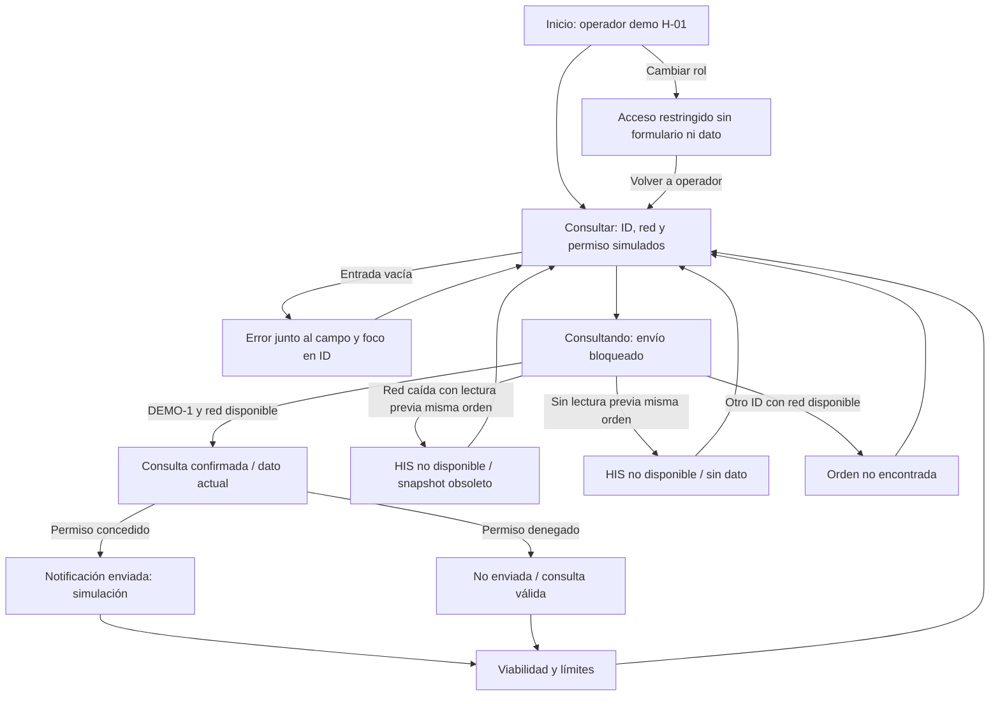

# Semana 11 — Prototipo navegable desktop y móvil

**Estudiante:** Mercedes Azucena Lopez Perez.

[**Abrir prototipo local**](prototipo/index.html). Descargar esta carpeta completa y abrir index.html en navegador; no necesita npm, servidor ni conexión externa para navegar. HTML/CSS/JS sin dependencias de ejecución. Las verificaciones de navegador sí requieren Playwright/Edge.

Se continúa el flujo demo y composición móvil de [semana 10](../semana-10/README.md), base 285df98. Se reutiliza el prototipo propio previamente preparado en rama de semana 12 (dfe7d14), adaptando identificación y generando evidencia nueva de semana 11. No se presenta ese código como implementación nativa ni como una API. No se publica sitio.

## Alcance y roles

Operador de demostración autorizado simulado consulta orden ficticia DEMO-1 y evalúa notificación. Selector “Sin autorización” bloquea formulario y acceso a resultados, y limpia snapshot. Es control de simulación para revisar UX, no seguridad de servidor. Hospital fijo H-01 evita simular acceso libre entre tenants. Evaluación de viabilidad es explicativa, no editable por un rol que no puede ejecutar.

No se capturan resultados, datos de paciente, credenciales ni tokens. No hay runtime NativePHP, HIS real, sesión, JWT o notificación SO. La opción de permiso simula capacidad, no concede permisos reales al dispositivo.

## Mapa de navegación



Acciones “Volver a consultar” y “Volver al recorrido” permiten recuperación sin navegación rota. Menú de viabilidad no consulta ni notifica. Cambiar rol limpia resultados; el selector es una herramienta de demo, no un mecanismo de autorización real.

## Camino feliz

1. Abrir como operador; ID DEMO-1, HIS disponible y permiso concedido.
2. Confirmar “Consultar y simular notificación”; aparece estado temporal y se bloquea envío repetido.
3. Resultado distingue estado PENDIENTE, frescura actual de fuente simulada y “Enviada (simulación)”. Texto demo no incluye ID ni paciente.
4. Abrir viabilidad: informa ejecución nativa pendiente y riesgos de runtime/plataforma, permisos, red y almacenamiento seguro. Volver no reenvía automáticamente la notificación.

Capturas reales del prototipo: [desktop](evidencia/desktop-actual.png), [móvil](evidencia/movil-actual.png).

## Error crítico: conexión perdida con snapshot obsoleto

1. Ejecutar antes una consulta correcta DEMO-1.
2. Volver, seleccionar HIS sin conexión y ejecutar la misma orden.
3. Resultado “HIS no disponible”: conserva dato anterior solo en memoria, marcado **Obsoleto · No es estado actual**, fecha previa y notificación **No intentada**.
4. Volver, recuperar HIS disponible y consultar para obtener lectura nueva; no sincroniza escrituras clínicas ni reenvía automáticamente efectos.

Si se usa otro ID mientras no hay red, no reutiliza snapshot de DEMO-1: muestra Sin dato. Esto comprueba ámbito por ID dentro de hospital fijo, no aislamiento multitenant real.

Capturas: [desktop error](evidencia/desktop-obsoleto.png), [móvil error](evidencia/movil-obsoleto.png). Variante adicional permiso denegado: [desktop](evidencia/desktop-permiso-denegado.png), [móvil](evidencia/movil-permiso-denegado.png); mantiene consulta válida sin afirmar envío.

## Accesibilidad y responsive

- HTML lang es, etiquetas for/id, botones/select/input nativos, ayuda vinculada al campo, error con aria-invalid y foco al campo vacío.
- Enlaces de salto al contenido, main enfocable tras navegación, estilos focus-visible y región de estado para carga/finalización.
- Desktop con barra lateral; hasta 767 px una columna, campos/acciones apilados. Verificación en 1366, 320, 375 y 430 px sin desbordamiento horizontal en vistas comprobadas.
- Datos de estado y advertencias expresados en texto; no depender solo de color. No overlays que impidan acceso a controles.

Comprobación de teclado automatizada limitada al primer Tab sobre el enlace de salto. No se afirma recorrido completo con lector de pantalla, zoom o certificación WCAG. Las capturas no prueban autorización ni capacidades reales.

## Verificación reproducible

```powershell
npm install --prefix "$env:TEMP/shi-browser-qa" playwright --no-audit --no-fund
$env:PLAYWRIGHT_MODULE="$env:TEMP/shi-browser-qa/node_modules/playwright"
$env:BROWSER_PATH='C:/Program Files (x86)/Microsoft/Edge/Application/msedge.exe'
node docs/modulos/investigacion-prototipo-nativephp/semana-11/verificacion/run.cjs
```

La suite recorre cuatro anchos y comprueba entrada vacía, consulta, permiso denegado, error crítico, snapshot por ID, orden inexistente, viabilidad pendiente y rol restringido, sin errores JS. Revisa encaje inicial y resultados capturados. [Resultados ejecutados](evidencia/verificacion.txt). Capturas nuevas de semana 11, sin reutilizar imágenes previas como si fueran de otra ejecución.

## Límites y riesgos

Todo envío/notificación es simulado; no se pide acceso al SO. Snapshot está solo en memoria, se borra al recargar/cambiar rol y no representa sincronización durable. Selector de red prueba una rama UX, no fallo real de un endpoint. Fecha es hora local de la simulación con zona Guatemala, no timestamp firmado por HIS.

No se ofrece exportación como realizada, soporte multiplataforma o validación de un runtime NativePHP. Destino/versiones e instalación deberán seleccionarse y medirse aparte. No se añade flujo clínico ajeno para completar el prototipo.