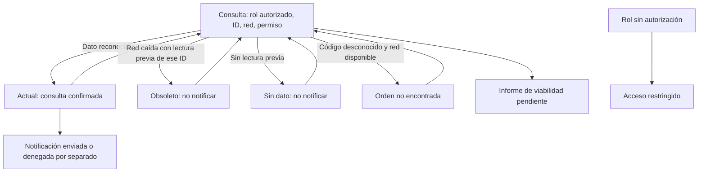

# Semana 12 — Segunda evaluación parcial

**Estudiante:** Lopez Perez, Mercedes Azucena

**Módulo:** Investigación y prototipo NativePHP para extensión móvil/escritorio

Abrir [prototipo/index.html](prototipo/index.html) en Edge o Chrome. Es un recorrido web local autocontenido, sin instalación ni backend. Datos, roles, permisos y notificaciones son ficticios. El estado se conserva solo en memoria y se borra al recargar o cambiar de rol. No demuestra ejecución de NativePHP.

## Recorrido de defensa (5 minutos)

1. Presentar [las diapositivas breves](presentacion.md): objetivo, componentes y límites.
2. Rol Operador autorizado, DEMO-1, HIS disponible y permiso concedido → Consultar. Mostrar estado actual y notificación simulada genérica sin datos clínicos.
3. Volver y elegir permiso denegado → Consultar. La consulta sigue válida; la notificación no se envía. Este es el cambio de ejemplo documentado.
4. Volver y elegir HIS sin conexión → Consultar. Se conserva lectura previa como obsoleta, con su hora; no hay notificación. Un ID diferente no reutiliza el snapshot de otra orden.
5. Consultar otro código con HIS disponible → Orden no encontrada. Entrada en blanco se rechaza antes de consultar.
6. Abrir Viabilidad: runtime/plataforma no demostrados. Seleccionar Sin autorización y comprobar bloqueo del flujo. No equivale a autenticación real.

## Mapa


## Matriz decisión → RF/RNF → evidencia

Los identificadores conservan la definición de [semana 2](../semana-02/semana-02-isp-nativephp.md). Los criterios UX y de frescura se agregan como decisiones de esta demostración.

| Decisión defendida | RF/RNF o criterio | Evidencia |
|---|---|---|
| Limitar a consulta y notificación de orden demo | RF-01/02, RNF-06 | Inicio y presentación; no hay escritura clínica |
| Separar dato obtenido de capacidad nativa | RF-03/05, RNF-04 | Resultado con permiso concedido/denegado; capturas |
| Validar vacío y manejar orden desconocida | RF-01/04 | Mensajes y verificación automatizada |
| No notificar un snapshot obsoleto | RF-02/04, criterio de frescura | Captura obsoleto; hora original; prueba por ID |
| No exponer paciente, ID o valor en notificación | RF-07, RNF-03 | Mensaje genérico en resultado y revisión del texto |
| Separación propuesta UI/aplicación/dominio/adaptadores | RNF-01/02/05 | Diapositiva 2 e informe desplegable de componentes |
| Rol sin autorización bloquea consulta | Criterio UX de rol; integración pendiente | Selector y pantalla Acceso restringido; no prueba tenant real |
| Una columna móvil, controles ≥46 px y texto persistente | Criterio UX/movilidad | CSS hasta 767 px y capturas 375 px; pruebas 320/430 |
| Foco visible, salto, etiquetas y avisos accesibles | Criterio de accesibilidad | HTML/CSS, foco al navegar y errores asociados. Sin auditoría WCAG ni prueba de lector de pantalla |
| No declarar viabilidad a partir de demo web | RNF-06 | Pantalla Viabilidad y límites explícitos |

## Componentes y decisiones

Se defiende la separación objetivo: View/Presenter para interacción; caso de uso para coordinar consulta y notificación; políticas de dominio para frescura y viabilidad; adaptadores para HIS, notificación y evidencia. Esta demo JS compacta simula los contratos para navegar; no implementa una integración NativePHP ni sustituye el diseño de capas. El contrato PHP de semana 2 sigue siendo la base ejecutable con puertos segregados.

En escritorio desde 768 px se usa menú lateral; en móvil una columna y botones apilados. Se evita tabla horizontal. La fecha del snapshot se conserva y el texto “obsoleto” no depende del color. El foco se mueve al contenido al navegar, los campos tienen etiqueta y el guardado/consulta bloquea pulsaciones mientras está en curso. Cambiar de rol elimina datos en memoria. El hospital H-01 está fijado para la demo; no se interpreta como aislamiento real multitenant.

## Cambio de ejemplo y resultados

[CH-01](cambio-solicitado.md) documenta una solicitud simulada para separar consulta válida y permiso denegado. No se atribuye la solicitud a docente/usuario. Es una demostración de análisis de impacto y respuesta a cambio, pendiente de sustituir si se recibe una solicitud real.

[Verificación](evidencia/verificacion.txt): Edge headless/Playwright a 1366, 375, 320 y 430 px; escenarios de entrada, roles, permisos, snapshot y error; seis capturas reales de la demo web. No se probaron dispositivos NativePHP, servicios HIS reales, lector de pantalla ni aislamiento hospitalario en servidor.

| Escenario | Escritorio | Móvil |
|---|---|---|
| Camino feliz | [Actual](evidencia/desktop-actual.png) | [Actual](evidencia/movil-actual.png) |
| Cambio CH-01 | [Permiso denegado](evidencia/desktop-permiso-denegado.png) | [Permiso denegado](evidencia/movil-permiso-denegado.png) |
| Red limitada | [Obsoleto](evidencia/desktop-obsoleto.png) | [Obsoleto](evidencia/movil-obsoleto.png) |

## Repetir comprobación

Requiere Node.js, Playwright y Edge, solo para verificación; abrir el prototipo no requiere esas dependencias.
```powershell
$qa = Join-Path $env:TEMP 'shi-browser-qa'
npm install --prefix $qa playwright --no-audit --no-fund
$env:PLAYWRIGHT_MODULE = Join-Path $qa 'node_modules/playwright'
node docs/modulos/investigacion-prototipo-nativephp/semana-12/verificacion/run.cjs
```
BROWSER_PATH permite usar otro Chromium. El script regenera evidencia con la hora de ejecución. Conclusión de defensa: flujo y degradación demostrables en web; viabilidad NativePHP y seguridad de servidor pendientes.