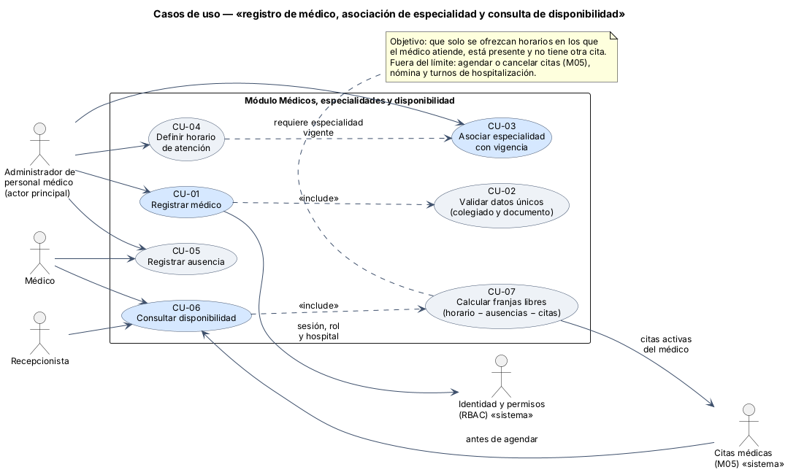
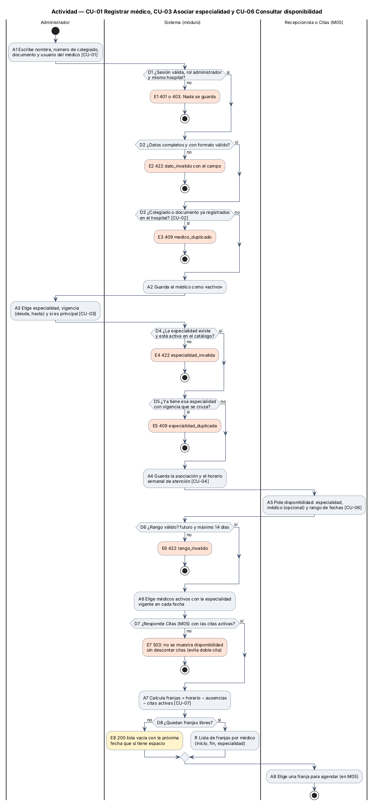
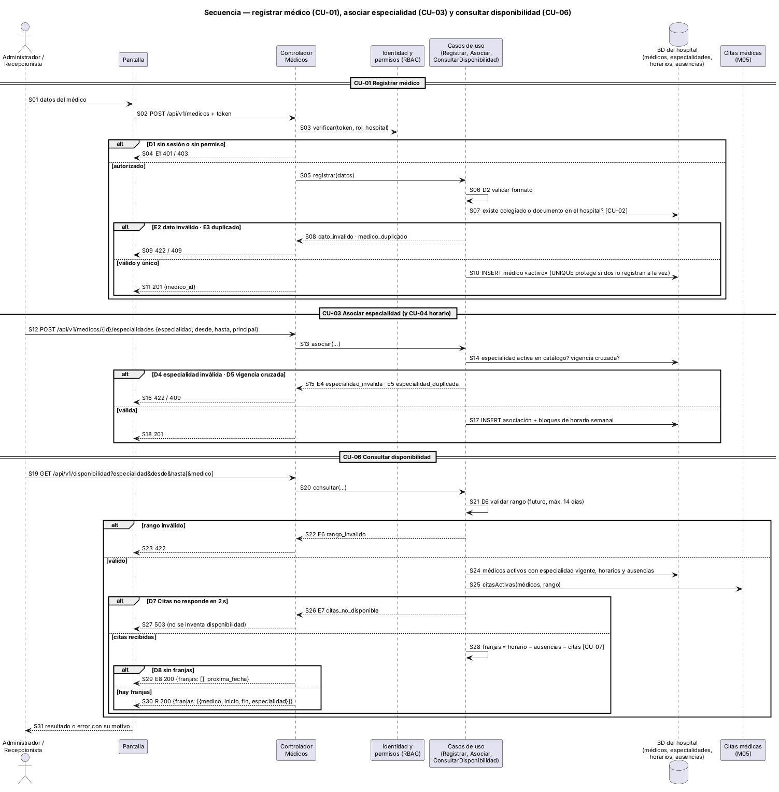

# Semana 1 — UML del registro de médicos, especialidades y disponibilidad

**Estudiante:** Joshua Eduardo García Reyes (`jgarciar73@miumg.edu.gt`, `jgarciar73-svg`) · **Módulo:** Médicos, especialidades y disponibilidad (módulo 4, reasignado dentro del grupo G1) · **Proceso:** «registro de médico, asociación de especialidad y consulta de disponibilidad»

| Pedido | Dónde |
|---|---|
| Casos de uso: actores y objetivo | §2 y [diagrama](diagramas/semana-01-casos-de-uso.png) |
| Actividad con decisiones, excepciones y resultado | §3 y [diagrama](diagramas/semana-01-actividad.png) |
| Secuencia con participantes, mensajes, validaciones y respuesta | §4 y [diagrama](diagramas/semana-01-secuencia.png) |
| Trazabilidad entre los tres diagramas | §5 |
| Narrativa de alcance | §1 |

## 1. Narrativa de alcance

**Objetivo.** Registrar a cada médico una sola vez, asociarle sus especialidades con fechas de vigencia y su horario de atención, y responder con exactitud **cuándo puede atender**. El módulo Citas (M05) reconoce en su semana 1 que hoy no existe el horario del médico y que se podría agendar a las 3:00 a. m.; este módulo cubre ese hueco.

**Actores**

| Actor | Tipo | Qué busca |
|---|---|---|
| Administrador de personal médico | Principal (humano) | Registrar médicos, sus especialidades, horarios y ausencias sin duplicados |
| Recepcionista | Secundario (humano) | Ver qué médicos de una especialidad tienen espacio y cuándo |
| Médico | Secundario (humano) | Registrar sus ausencias y consultar su disponibilidad |
| Identidad y permisos (RBAC) | Secundario (sistema) | Confirmar sesión, rol y hospital |
| Citas médicas (M05) | Secundario (sistema) | Pedir disponibilidad antes de agendar y entregar las citas activas del médico |

**Dentro del alcance:** registrar médico; validar colegiado y documento únicos; asociar especialidades con vigencia; definir el horario semanal de atención; registrar ausencias; consultar disponibilidad en franjas.

**Fuera del alcance:** agendar, confirmar o cancelar citas (M05); el catálogo general de especialidades (catálogo global); nómina; turnos de hospitalización y guardias; verificar el colegiado en línea con el Colegio de Médicos y Cirujanos (se verifica a mano al registrar).

**Supuestos.** El catálogo de especialidades ya existe en la base del grupo. Las franjas son de 30 minutos por defecto. Las citas activas las da M05; este módulo no las guarda.

**Reglas de negocio**

| ID | Regla |
|---|---|
| RN-01 | Solo el administrador de personal médico del hospital registra médicos y asocia especialidades; el autor sale del token |
| RN-02 | El número de colegiado y el documento de identidad son únicos dentro del hospital |
| RN-03 | La especialidad debe existir y estar activa en el catálogo; la misma especialidad no puede tener vigencias que se crucen |
| RN-04 | Un médico puede tener varias especialidades, pero solo una principal vigente a la vez |
| RN-05 | El horario semanal se define por especialidad vigente y sus bloques no se cruzan entre sí |
| RN-06 | Disponible = médico activo, especialidad vigente en la fecha, dentro del horario, sin ausencia y sin cita activa |
| RN-07 | La consulta pide un rango futuro de máximo 14 días |
| RN-08 | Si Citas no responde, no se muestra disponibilidad: es preferible un 503 a ofrecer un horario ya ocupado |
| RN-09 | Los médicos no se borran: se desactivan y su historial se conserva |

## 2. Casos de uso



| CU | Nombre | Actor | Relación |
|---|---|---|---|
| CU-01 | Registrar médico | Administrador | Base; «include» CU-02 |
| CU-02 | Validar datos únicos | — | «include» de CU-01 |
| CU-03 | Asociar especialidad con vigencia | Administrador | Base |
| CU-04 | Definir horario de atención | Administrador | Requiere una especialidad vigente (CU-03) |
| CU-05 | Registrar ausencia | Administrador, Médico | Alimenta el cálculo de CU-07 |
| CU-06 | Consultar disponibilidad | Recepcionista, Médico, Citas (M05) | Base; «include» CU-07 |
| CU-07 | Calcular franjas libres | — | Horario − ausencias − citas activas |

**CU-06 en breve.** Precondición: sesión iniciada; médicos con especialidad y horario. Flujo principal: se pide especialidad y rango; el sistema valida el rango, toma los médicos activos con la especialidad vigente, trae sus horarios y ausencias, pide a M05 las citas activas, calcula las franjas libres (CU-07) y las devuelve. Alternativos: E6 a E8 de §3. Poscondición: lista de franjas o lista vacía con la próxima fecha con espacio; nada se modifica.

## 3. Actividad



| Decisión | Si falla | Resultado |
|---|---|---|
| D1 sesión, rol y hospital | E1 | 401 o 403, nada se guarda |
| D2 datos completos y con formato | E2 | 422 `dato_invalido` con el campo |
| D3 colegiado o documento repetido | E3 | 409 `medico_duplicado` |
| D4 especialidad activa en el catálogo | E4 | 422 `especialidad_invalida` |
| D5 vigencia que se cruza | E5 | 409 `especialidad_duplicada` |
| D6 rango futuro de máximo 14 días | E6 | 422 `rango_invalido` |
| D7 Citas (M05) responde | E7 | 503: no se ofrece disponibilidad sin descontar citas |
| D8 quedan franjas | E8 | 200 con lista vacía y la próxima fecha con espacio |

**Resultado (R):** lista de franjas por médico (inicio, fin, especialidad), que M05 usa para agendar (A8).

## 4. Secuencia



Participantes: administrador o recepcionista, pantalla, controlador, RBAC, casos de uso, base del hospital y Citas (M05). Está dividida en tres partes, una por cada paso del proceso. Las validaciones están en S03 (permiso), S06–S07 (formato y duplicados), S14 (catálogo y vigencia), S21 (rango) y S25–S26 (citas de M05). Las respuestas son S11 y S18 (201) y S29–S30 (200), o la de cada error (S04, S09, S16, S23, S27).

## 5. Trazabilidad entre los tres diagramas

| Caso de uso | Actividad | Secuencia | Regla |
|---|---|---|---|
| CU-01 Registrar médico | A1, D1, D2, A2 · E1, E2 | S01–S06, S08–S11 | RN-01, RN-09 |
| CU-02 Validar datos únicos | D3 · E3 | S07–S10 | RN-02 |
| CU-03 Asociar especialidad | A3, D4, D5 · E4, E5 | S12–S16 | RN-03, RN-04 |
| CU-04 Definir horario | A4 | S17–S18 | RN-05 |
| CU-05 Registrar ausencia | Se usa en A7 | S24 (ausencias) | RN-06 |
| CU-06 Consultar disponibilidad | A5, D6, A6, D8, R, A8 · E6, E8 | S19–S23, S29–S31 | RN-06, RN-07 |
| CU-07 Calcular franjas | A7, D7 · E7 | S24–S28 | RN-06, RN-08 |

Cada nodo de la actividad y cada mensaje de la secuencia lleva el mismo ID (D3, E3, CU-02…), así que un camino se puede seguir de un diagrama a otro.

## 6. Fuentes de los diagramas

Las fuentes editables están en [diagramas/](diagramas/) (`.puml`). Para regenerar las imágenes:

```bash
java -jar plantuml.jar -charset UTF-8 -tpng docs/modulos/medicos-especialidades/semana-01/diagramas/*.puml
```

**Defensa en 1 minuto:** «El administrador registra al médico sin duplicar colegiado ni documento, le asocia especialidades con vigencia y define su horario. La disponibilidad se calcula como horario menos ausencias menos citas activas, y solo para médicos activos con la especialidad vigente. Si Citas no responde, el sistema prefiere decir 503 antes que ofrecer un horario ocupado.»
