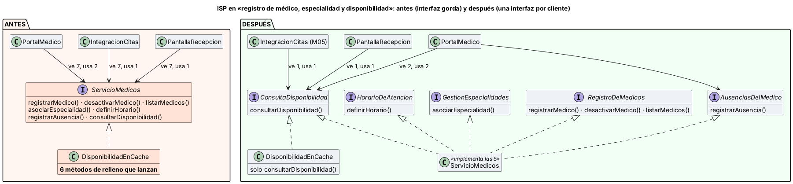

# Semana 2 — RF/RNF, criterios de aceptación e ISP en médicos y disponibilidad

**Estudiante:** Joshua Eduardo García Reyes (`jgarciar73@miumg.edu.gt`, `jgarciar73-svg`) · **Módulo:** Médicos, especialidades y disponibilidad (módulo 4, reasignado dentro del grupo G1) · **Flujo:** «registro de médico, asociación de especialidad y consulta de disponibilidad» (CU-01 a CU-07 de la [semana 1](../semana-01/semana-01-uml-medicos-disponibilidad.md))

**Contenido:** RF/RNF (§1), criterios de aceptación (§2), ISP antes/después con responsabilidades y dependencias (§3, [diagrama](diagramas/semana-02-isp-antes-despues.png), [`ejemplo-isp/`](ejemplo-isp/)) y evidencia verificable (§4, [captura](evidencia/verificar-isp.png)).

## 1. Requerimientos

| ID | Requerimiento funcional | CU |
|---|---|---|
| RF-01 | Registrar médico con colegiado, documento y nombre; colegiado y documento únicos | CU-01, CU-02 |
| RF-02 | Desactivar médico sin borrarlo; uno inactivo no aparece en disponibilidad | CU-01 |
| RF-03 | Asociar especialidad activa del catálogo con vigencia; la misma especialidad no se cruza y hay una sola principal a la vez | CU-03 |
| RF-04 | Definir el horario semanal de atención | CU-04 |
| RF-05 | Registrar ausencias (administrador o el propio médico) | CU-05 |
| RF-06 | Consultar franjas libres de 30 min = horario − ausencias − citas activas de M05, también para que M05 pregunte antes de agendar | CU-06, CU-07 |
| RF-07 | Rechazar con código estable: `medico_duplicado`, `especialidad_invalida`, `especialidad_duplicada`, `rango_invalido` | Todos |

| ID | Requerimiento no funcional |
|---|---|
| RNF-01 | Seguridad: cada cliente solo puede invocar las operaciones de su rol (recepción y Citas no escriben) |
| RNF-02 | Disponibilidad: si M05 no responde, no se ofrecen franjas (503), para no duplicar citas |
| RNF-03 | Rendimiento: consulta de 14 días en menos de 2 s (p95) |
| RNF-04 | Mantenibilidad (ISP): un cliente nuevo depende solo de la interfaz que usa; cambiar una operación de escritura no obliga a recompilar ni a probar los clientes de lectura |
| RNF-05 | Verificabilidad: dobles de prueba mínimos y evidencia ejecutable que sale con 0 o 1 |

## 2. Criterios de aceptación

| ID | Dado | Cuando | Entonces | Evidencia |
|---|---|---|---|---|
| CA-01 | Usuario sin rol de administrador | registra un médico | 403 | Micro-HIS (S3) |
| CA-02 | Colegiado 12345 ya registrado | se registra otro con 12345 | `medico_duplicado` | `verificar.php` |
| CA-03 | M05 no responde | se consulta disponibilidad | 503, sin franjas | Micro-HIS (S3) |
| CA-04 | Cardiología inactiva en el catálogo | se asocia | `especialidad_invalida` | `verificar.php` |
| CA-05 | Medicina interna vigente y principal | se asocia otra vez o se pone otra principal | `especialidad_duplicada` | `verificar.php` |
| CA-07 | Horario 08:00–10:00 y cita a las 08:00 | recepción consulta | 08:30, 09:00 y 09:30 | `verificar.php` |
| CA-08 | Lo mismo | Citas pregunta por 08:30 y 08:00 | sí y no | `verificar.php` |
| CA-09 | El médico avisa ausencia el miércoles | consulta ese día | sin franjas | `verificar.php` |
| CA-10 | Rango de 25 días o en el pasado | se consulta | `rango_invalido` | `verificar.php` |
| CA-11 | Citas usa una réplica de solo lectura | pregunta por 09:00 | responde igual | `verificar.php` |

## 3. ISP: antes y después



**ISP** dice que ningún cliente debe depender de métodos que no usa. Si una interfaz sirve a todos, cada cambio afecta a todos, los dobles de prueba crecen y un cliente puede invocar lo que no le corresponde.

**Antes** ([`antes.php`](ejemplo-isp/antes.php)): `ServicioMedicos` junta las 7 operaciones del módulo. Recepción y Citas solo consultan, pero reciben también registrar, desactivar, horarios y ausencias. La réplica de solo lectura para Citas está obligada a «implementar» 6 métodos que rellena con excepciones. Y como la interfaz lo permite, el código de recepción puede desactivar a un médico (SEG-01).

**Después** ([`despues.php`](ejemplo-isp/despues.php)): cinco interfaces, una por necesidad. La lógica de dominio es la misma; cambia la forma de las dependencias.

| Interfaz | Operaciones | La usa |
|---|---|---|
| `RegistroDeMedicos` | registrar, desactivar, listar | Administración |
| `GestionEspecialidades` | asociar especialidad | Administración |
| `HorarioDeAtencion` | definir horario | Administración |
| `AusenciasDelMedico` | registrar ausencia | Administración y `PortalMedico` |
| `ConsultaDisponibilidad` | consultar franjas | `PantallaRecepcion`, `IntegracionCitas` (M05), `PortalMedico` |

`ServicioMedicos` implementa las cinco; `DisponibilidadEnCache` implementa solo la de consulta. `PortalMedico` pide exactamente lo que usa con un tipo intersección (`AusenciasDelMedico&ConsultaDisponibilidad`, PHP 8.1+). **Por qué así:** las interfaces se cortaron por rol de quien las usa, no por tabla; así el permiso (RNF-01) queda en el tipo y no depende de que alguien recuerde no llamar a un método.

## 4. Evidencia

```bash
cd docs/modulos/medicos-especialidades/semana-02/ejemplo-isp
php verificar.php     # sale con 0 si todo da lo esperado y con 1 si algo falla
```

| ID | Qué comprueba | Antes | Después |
|---|---|---|---|
| ISP-01 | Métodos que cada cliente ve y no usa (por reflexión: interfaces del constructor contra llamadas en su código) | Recepción 7/1, Citas 7/1, Portal 7/2 → **17** sobran | 1/1, 1/1, 2/2 → **0** |
| ISP-02 | Métodos de relleno en la réplica de solo lectura | 6 que lanzan | 0 (implementa 1) |
| ISP-03 | Tamaño del doble de prueba para recepción | 7 métodos | 1 método |
| SEG-01 | ¿El código de recepción puede desactivar un médico? | Sí, y su agenda desaparece | No: el método no existe en su interfaz |
| CA-02 a CA-11 | Criterios de aceptación de §2 | — | PASAN |

Si `PantallaRecepcion` vuelve a pedir `RegistroDeMedicos&ConsultaDisponibilidad`, ISP-01 falla (sobran 3) y el doble de 1 método ya no sirve: la prueba detecta el retroceso ([captura](evidencia/verificar-isp.png)).

**Defensa en 1 minuto:** «Antes, una sola interfaz con 7 métodos servía a todos: recepción y Citas veían operaciones de escritura, la réplica de Citas tenía 6 métodos de relleno y recepción podía desactivar a un médico. La partí en cinco interfaces por rol. Medido por reflexión, los métodos que sobran bajan de 17 a 0 y el doble de prueba de recepción baja de 7 métodos a 1.»
