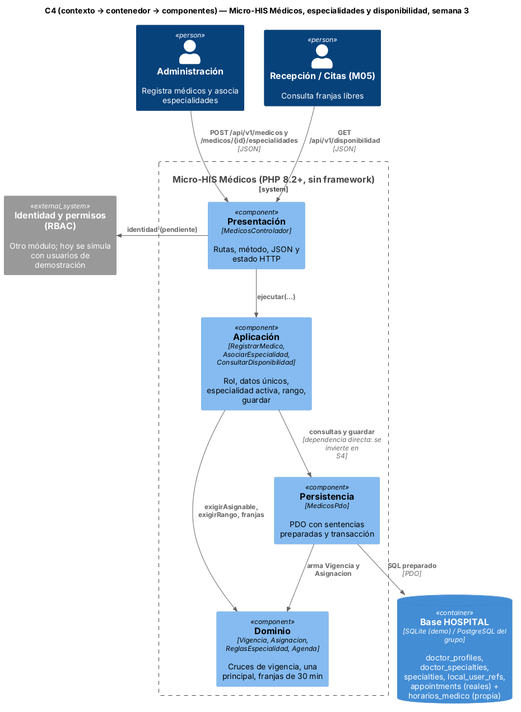

# Semana 3 — Micro-HIS Médicos, especialidades y disponibilidad en capas y vista arquitectónica

**Estudiante:** Joshua Eduardo García Reyes (`jgarciar73-svg`) · **Módulo:** Médicos, especialidades y disponibilidad (módulo 4, reasignado dentro del grupo G1) · **Flujo:** «registro de médico, asociación de especialidad y consulta de disponibilidad»

El Micro-HIS está en [`../micro-his-medicos/`](../micro-his-medicos/): PHP 8.2+ sin framework ni Composer, PDO con sentencias preparadas y pruebas propias. Ejecuta CU-01, CU-03 y CU-06/CU-07 de la [semana 1](../semana-01/semana-01-uml-medicos-disponibilidad.md) con las reglas de la [semana 2](../semana-02/semana-02-isp-requerimientos-diseno.md): colegiado único, especialidad activa, sin cruces de vigencia, una principal a la vez y franjas de 30 minutos en un rango de hasta 14 días.
## 1. Vista arquitectónica (C4) y dependencias

| Capa | Archivos | Responsabilidad | Puede depender de |
|---|---|---|---|
| Presentación | `src/Presentacion/MedicosControlador.php` | Rutas, método, JSON, usuario de demostración y estado HTTP (200, 201, 400, 401, 403, 404, 405, 409, 422, 500) | Aplicación, `ErrorDominio` |
| Aplicación | `src/Aplicacion/CasosMedicos.php` | `RegistrarMedico`, `AsociarEspecialidad`, `ConsultarDisponibilidad`: rol, datos únicos, especialidad activa, rango y guardar | Dominio, Persistencia (*) |
| Dominio | `src/Dominio/Medicos.php` | `Vigencia` (`[desde, hasta)`, igual que en PostgreSQL), `ReglasEspecialidad` y `Agenda` (franjas libres) | Nada |
| Persistencia | `src/Persistencia/MedicosPdo.php`, `sql/esquema.sql` | SQL preparado; perfil y especialidad principal en una transacción con rollback | Dominio, `ErrorPersistencia` |

(*) Hoy los casos de uso reciben `MedicosPdo` directamente: es la única flecha hacia afuera y se invierte en la semana 4 con una interfaz Repository. ARQ-01 falla si el Dominio menciona otra capa o PDO, o si hay SQL fuera de Persistencia.

**Decisiones:**
- Las tablas usan **los nombres y columnas reales** de `database/migrations/hospital`: el médico es `doctor_profiles` y su nombre viene de `local_user_refs.display_name` (hallazgo H-02 de Verificación BD). Registrar un médico es darle perfil a un usuario que ya existe.
- **`horarios_medico` es propia del módulo:** el esquema del grupo no tiene horario del médico (H-03). Las ausencias de la semana 2 quedan para una semana posterior.
- Una cita ocupa su franja si está `scheduled` o `confirmed` (las que bloquea la exclusión GiST de `appointments`) y se cruza con ella, aunque no empiece a la misma hora. `Vigencia` usa el mismo `[desde, hasta)` que las exclusiones de `doctor_specialties`: la regla y la base coinciden.

## 2. Pruebas

`cd docs/modulos/medicos-especialidades/micro-his-medicos && php tests/ejecutar.php` → **Total: 8, Pasan: 8, Fallan: 0** (SQLite en memoria).

| ID | Pide la tarea | Qué comprueba |
|---|---|---|
| APP-01 | Camino feliz | Registrar a Luis con Pediatría principal: 1 perfil y 1 especialidad |
| APP-02 | Camino feliz | CA-07: horario 08:00–10:00 y cita a las 08:00 → 08:30, 09:00, 09:30; la cancelada no ocupa; una cita 08:15–08:45 tapa dos franjas; la médica inactiva no aparece |
| DOM-01 | Regla de dominio | CA-04/CA-05: misma especialidad o segunda principal → `especialidad_duplicada`; inactiva → `especialidad_invalida` |
| DOM-02 | Regla de dominio | CA-02/CA-10: colegiado o usuario repetido → `medico_duplicado`; 25 días o rango pasado → `rango_invalido` |
| APP-03 | Permisos y guardas | CA-01: recepción no registra; usuario revocado; médico inexistente |
| PER-01 | Error de persistencia | Falla el INSERT de la especialidad: `ErrorPersistencia` y el perfil tampoco queda (rollback) |
| HTTP-01 | Presentación | 201, 200, 401, 400, 403, 404, 405, 409 y 422 con su código |
| ARQ-01 | Dependencias | Dominio sin otras capas ni PDO; sin SQL en Aplicación ni Presentación |

**Mutaciones:** quitar el `rollBack()`, permitir dos principales, contar la cita cancelada, chocar solo si la cita empieza a la misma hora e incluir médicos inactivos: cada una hace fallar su prueba. HTTP-01 además encontró un error real: una fecha mal escrita rompía `Vigencia::esFecha`. Ya está corregido.

**Defensa en 1 minuto:** «Cuatro capas con dependencias hacia adentro. El Dominio usa el mismo intervalo de vigencia que PostgreSQL, así que la regla y la base no se contradicen; Persistencia guarda perfil y especialidad juntos o nada. La deuda de depender directo de PDO se paga en la semana 4.»
