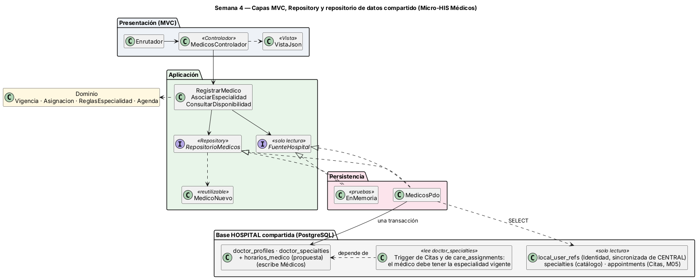

# Semana 4 — MVC, Repository y repositorio de datos compartido

**Estudiante:** Joshua Eduardo García Reyes (`jgarciar73-svg`) · **Módulo:** Médicos, especialidades y disponibilidad (módulo 4, reasignado dentro del grupo G1) · Continúa el [Micro-HIS de la semana 3](../semana-03/semana-03-arquitectura-micro-his.md) y el mismo flujo «registro de médico, asociación de especialidad y consulta de disponibilidad».

## 1. Capas, responsabilidades y objetos reutilizables

| Capa | Objeto | Responsabilidad | Reutilizable en |
|---|---|---|---|
| Presentación | `public/index.php`, `Enrutador`, `Peticion` | Front controller (elige PDO o memoria y genera ids uuid); ruta + método → acción; 404 y 405 | Otras rutas del módulo |
| Presentación | `MedicosControlador` | Identifica al usuario, llama al caso de uso y elige la vista. **Sin SQL ni reglas de negocio** (lo vigila ARQ-01) | — |
| Presentación | `VistaJson` | Estado HTTP + JSON; único mapa código → estado (antes estaba en el controlador) | Toda respuesta del módulo |
| Aplicación | `RegistrarMedico`, `AsociarEspecialidad`, `ConsultarDisponibilidad` | Orquestan y dependen solo de interfaces; el Dominio de la semana 3 no cambió, salvo una corrección (§2) | — |
| Aplicación | `RepositorioMedicos` y `FuenteHospital` (interfaces) | Lo que el módulo escribe (perfiles, especialidades del médico, horarios) y lo que solo lee de otros (usuario, catálogo, citas) | Los tres casos de uso |
| Aplicación | `MedicoNuevo` | Médico ya validado, con su especialidad principal, listo para guardarse todo o nada | Los dos adaptadores |
| Persistencia | `MedicosPdo` / `EnMemoria` | Implementan las dos interfaces: SQL preparado en una transacción / arreglos en memoria con `fallarAlGuardar` | PostgreSQL del grupo / pruebas |

**Dónde va el límite:** las interfaces están en Aplicación porque son lo que el caso de uso necesita; Persistencia las implementa y la flecha de la semana 3 (`casos de uso → MedicosPdo`) queda invertida. Son dos interfaces porque los datos tienen dueños distintos.

## 2. Repositorio de datos compartido

Todos los módulos de un hospital comparten su base HOSPITAL (sin columna de hospital ni RLS: cada hospital tiene su base).

| Regla de integración | Cómo se cumple |
|---|---|
| Cada dato tiene un dueño que escribe | Médicos escribe `doctor_profiles`, `doctor_specialties` y `horarios_medico` (propuesta: el esquema no tiene horario, H-03) |
| Lo ajeno se lee por un puerto | `FuenteHospital` lee `local_user_refs` (Identidad, sincronizada de CENTRAL), `specialties` (catálogo) y `appointments` (Citas, M05); si mañana viene de una API, solo cambia el adaptador |
| Otros módulos dependen de lo que escribe Médicos | El trigger de `appointments` y el de `care_assignments` exigen que el médico tenga la especialidad vigente: leen `doctor_specialties`. Cambiar su forma rompe Citas y Episodios, así que es un contrato del módulo |
| La base respalda las reglas | Las exclusiones GiST de `doctor_specialties` frenan cruces aunque alguien salte el Dominio; la de `appointments` evita dos citas activas del médico a la misma hora |
| Respetar el esquema real | Ids uuid, `is_primary` booleano y horas `time`. Al probar contra PostgreSQL apareció una franja de más a las 10:00: la base devuelve `10:00:00` y la comparación de texto fallaba. Se corrigió en `Agenda` y una prueba lo cubre |

**Prueba contra la base real:** cargué el SQL de esas tablas, copiado tal cual de las migraciones, en un PostgreSQL 16 temporal y corrí `MedicosPdo`. Registro, colegiado repetido, segunda principal, asociación válida y disponibilidad dan lo esperado, y la exclusión GiST frena un cruce insertado a mano ([captura](evidencia/pruebas-y-postgresql.png)).

## 3. Pruebas

`php tests/ejecutar.php` → **Total: 10, Pasan: 10, Fallan: 0**. Siguen las 7 de la semana 3 (APP-02 ahora prueba horas con segundos) y se agregan REP-01 (contrato: PDO y memoria responden igual), MVC-01 (enrutador → controlador → vista: 201, 200, 401, 400, 403, 404, 405, 409 y 422) y PER-02 (doble en memoria que falla → 500 y no queda el médico). ARQ-01 ahora también falla si la Aplicación importa Persistencia o PDO, o si el controlador tiene reglas. Mutaciones probadas: importar el adaptador en Aplicación, poner una regla en el controlador, contar como activo un médico inactivo, contar la cita cancelada e ignorar la falla simulada; cada una hace fallar su prueba. Para usarlo: `php -S localhost:8080 -t public` con la cabecera `X-Usuario-Demo: adm` o `rec` (con `MED_ALMACEN=memoria` cada petición arranca de los datos de demostración).
