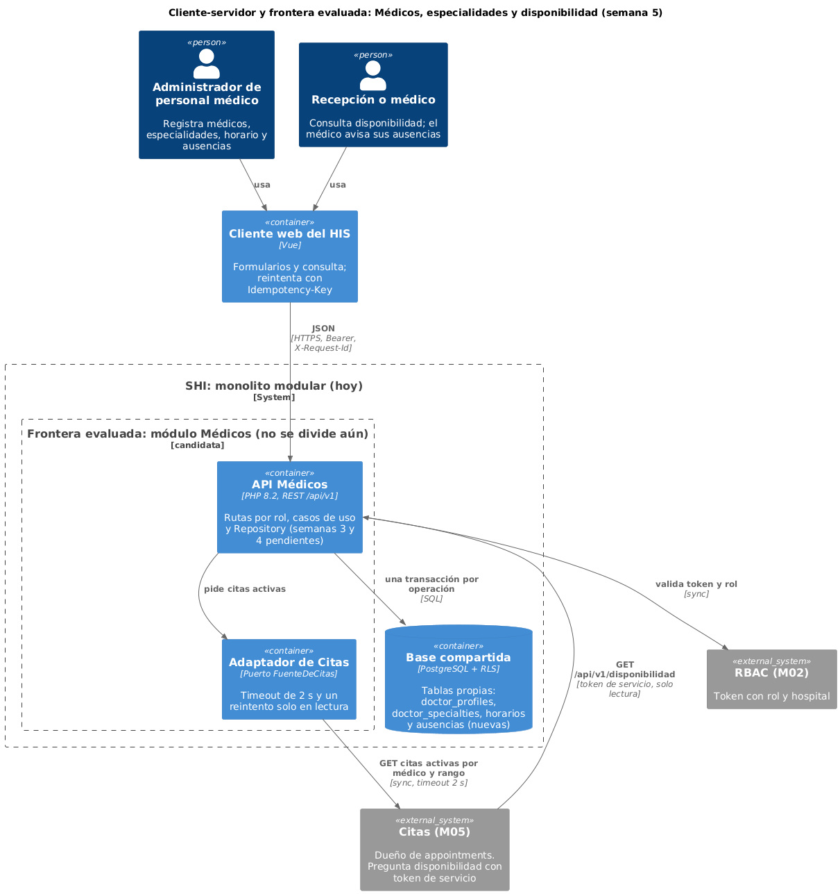
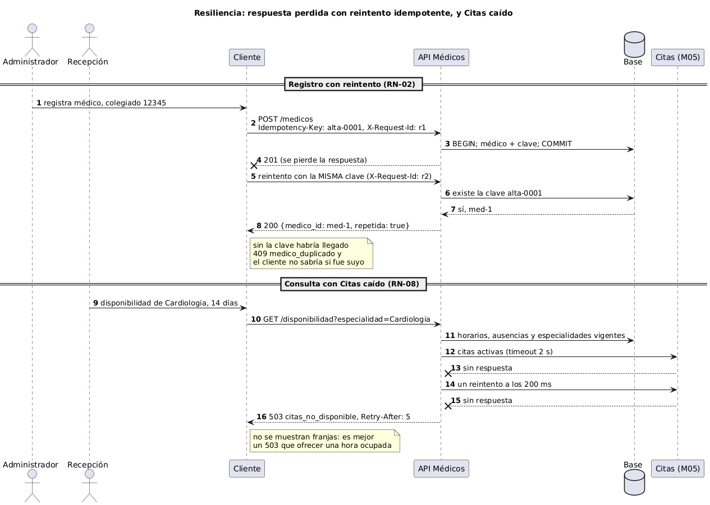

# Semana 5: cliente-servidor, contrato API y frontera de microservicio

Estudiante: Joshua Eduardo García Reyes (`jgarciar73-svg`) · Módulo: Médicos, especialidades y disponibilidad (módulo 4, reasignado dentro del grupo G1) · Flujo: "registro de médico, asociación de especialidad y consulta de disponibilidad" ([semana 1](../semana-01/semana-01-uml-medicos-disponibilidad.md)) sobre el servicio de la [semana 2](../semana-02/semana-02-isp-requerimientos-diseno.md).

Entregables: contrato [`api/openapi.yaml`](api/openapi.yaml) (OpenAPI 3.0.3, validado con `openapi-spec-validator`), dos diagramas, evaluación de la frontera con medición, migración razonada y plan de issue, rama, worktree y PR (§9). Evidencia: `verificar-contrato.php` (§10).

Aclaración sobre el punto de partida: del Micro-HIS de Médicos solo hay semanas 1 y 2. La 3 (capas) y la 4 (MVC + Repository) todavía no se entregan, así que no existe un servidor HTTP que evolucionar. Lo que evoluciono es el servicio de la semana 2 (`ServicioMedicos` y sus 5 interfaces) y lo llevo a un contrato REST. Esta entrega es diseño con contrato verificado y una medición real, sin código de servidor. Las semanas 3 y 4 se implementan sobre este contrato.

## 1. Diseño cliente-servidor



Corté las rutas igual que las interfaces de la semana 2, para que el rol quede en la ruta (RNF-01) y no dependa de que alguien se acuerde.

| Interfaz de la semana 2 | Rutas (`/api/v1`) | Rol |
|---|---|---|
| `RegistroDeMedicos` | `POST` y `GET /medicos`, `PATCH /medicos/{id}` (desactivar) | admin_personal_medico |
| `GestionEspecialidades` | `POST /medicos/{id}/especialidades` | admin_personal_medico |
| `HorarioDeAtencion` | `POST /medicos/{id}/horario` | admin_personal_medico |
| `AusenciasDelMedico` | `POST /medicos/{id}/ausencias` | admin_personal_medico, o medico con su propio id |
| `ConsultaDisponibilidad` | `GET /disponibilidad?especialidad=&desde=&hasta=` | recepcion, medico, servicio_citas |

El flujo completo son tres llamadas: `POST /medicos` (201 con `medico_id`), `POST /medicos/{id}/especialidades` y `GET /disponibilidad`, que devuelve franjas de 30 min con médico, especialidad, inicio y fin, o una lista vacía con `proxima_fecha_con_espacio`. Los `POST` aceptan `Idempotency-Key`. Todo error devuelve `{codigo, mensaje, campos}` con uno de 13 códigos estables, y el cliente decide por `codigo` y no por el texto. Ocho son nuevos respecto a las semanas 1 y 2: los de transporte y seguridad, más `medico_no_encontrado`, `horario_invalido` y `citas_no_disponible`. El hospital y el autor salen del token (RN-01).

## 2. ¿Separarlo como microservicio? Evaluación medible

Medí el servicio real de la semana 2 con 14 días de rango, médicos con 2 bloques por día de lunes a viernes y 15 citas activas por médico (100 repeticiones):

| Médicos | Franjas devueltas | p95 |
|---|---|---|
| 10 | 1 700 | 1.9 ms |
| 40 | 6 920 | 8.1 ms |
| 100 | 17 300 | 20.4 ms |

| Criterio | Medición o hecho | ¿Justifica dividir? |
|---|---|---|
| Rendimiento | El costo crece parejo: unos 0.2 ms por médico. La meta de RNF-03 son 2 s, que por extrapolación serían unos 10 000 médicos. Una llamada de red solo sumaría tiempo | No |
| Escala independiente | A 20 ms por consulta un proceso atiende unas 50 por segundo. No tengo tráfico real, así que que haya más lecturas que escrituras es hipótesis mía | No, por ahora |
| Datos | De las 5 tablas que toca el flujo, 3 son de otros módulos (`specialties`, `appointments`, `local_user_refs`). Separar obligaría a copias o llamadas extra | No, sube el acoplamiento |
| Dependencia externa | Una sola llamada síncrona a M05 por consulta, y si falla se responde 503 (RN-08). Eso ya está aislado en el adaptador | No |
| Despliegue | Un solo equipo publica todo el SHI junto | No |

Aclaro que los 20 ms son dentro del proceso, sin base ni red. Cuando exista PostgreSQL y la llamada real a M05 hay que volver a medir.

Decisión: seguir dentro del monolito modular, con la frontera ya marcada (contrato propio, tablas propias, puerto para citas). Se dividiría si se cumple alguna de estas condiciones, que propongo yo: p95 de la consulta mayor a 2 s con base real e índices puestos, más de 20 consultas por segundo sostenidas (40% de un proceso), otro equipo a cargo, o que M05 exija una disponibilidad distinta. Si algún día se separa, lo primero sería `ConsultaDisponibilidad`: es solo lectura y la semana 2 ya la dejó en su propia interfaz.

## 3. Propiedad de datos

| Dato | Dueño | Acceso de este módulo |
|---|---|---|
| `doctor_profiles`, `doctor_specialties` | Médicos | Escribe y lee |
| Horarios y ausencias | Médicos | Escribe y lee. No tienen tabla en la lista de la base del grupo, hay que crearlas (nombres a decidir) |
| `specialties` | Catálogo global | Solo lectura |
| `local_user_refs` | Identidad (RBAC) | Solo lectura del nombre (`display_name`) |
| `appointments` | Citas (M05) | Nunca por SQL: las pide por el puerto `FuenteDeCitas` |

Queda una duda que no puedo resolver sin las migraciones: `doctor_profiles` no guarda el nombre, está en `local_user_refs`. El contrato recibe `nombre` porque así lo pide la semana 2, pero falta decidir si Médicos lo escribe en esa tabla o si el usuario se crea antes en RBAC.

## 4. Comunicación

- Síncrona REST/JSON entre cliente y API: quien registra necesita ver el resultado al momento.
- Síncrona de Médicos hacia M05 para las citas activas, con timeout de 2 s y un reintento a los 200 ms, solo en lectura. El contrato de M05 está por acordar con ese módulo.
- Síncrona de M05 hacia Médicos para preguntar disponibilidad, con token de servicio de solo lectura. Para saber si una hora está libre usa `medico_id` en la consulta, sin ruta extra.
- Asíncrona, propuesta y sin implementar: `medico.desactivado` y `ausencia.registrada` hacia M05 por bandeja de salida, para que reprograme citas.

## 5. Seguridad

| Riesgo | Control |
|---|---|
| Suplantación | Token Bearer del módulo RBAC; rol y hospital salen del token, nunca del cuerpo |
| Escribir sin permiso | Matriz por rol: recepcion y servicio_citas solo leen disponibilidad; `GET /medicos` es solo del administrador |
| Un médico toca la agenda de otro | En ausencias, el id de la ruta debe ser el del token; si no, 403 `acceso_denegado` |
| Ver médicos de otro hospital | Se filtra por el hospital del token y en PostgreSQL con RLS (`app.tenant_id`) |
| Datos personales | Colegiado y documento solo salen en `GET /medicos` (administrador). La disponibilidad y el log no los llevan |
| Datos basura | 422 `dato_invalido`, 400 `json_invalido` y clave de idempotencia validada (8 a 64 caracteres) |

## 6. Resiliencia



| Falla | Respuesta del diseño | Estado |
|---|---|---|
| Se pierde la respuesta de un alta y el cliente reintenta | Con la misma `Idempotency-Key` devuelve 200 y el mismo `medico_id`. Sin ella llegaría un 409 `medico_duplicado` que no dice si el alta fue suya | Contrato (CON-04) |
| Dos reintentos a la vez | Índices únicos por hospital en colegiado y documento: gana uno y el otro recibe 409 | Diseñado |
| M05 no responde | 503 `citas_no_disponible` con `Retry-After: 5`. No se ofrecen franjas (RN-08) | Contrato (CON-06) |
| Base caída | 500 `error_persistencia` con rollback, sin datos a medias | Diseñado |
| Médicos caído visto desde M05 | M05 no debería agendar sin confirmar. Es decisión de M05, lo dejo como recomendación | Recomendación |

## 7. Observabilidad

- `X-Request-Id`: se acepta o se genera, se devuelve y se manda también a M05, para seguir una consulta de punta a punta.
- Una línea JSON por petición (id, método, ruta, estado, código, ms), sin colegiado, documento ni nombre.
- Métricas propuestas: p95 de la consulta, porcentaje de 503 (alarma si pasa de 1% en 5 minutos), latencia de M05, médicos activos sin horario y consultas rechazadas por `rango_invalido`.

## 8. Consistencia

- Fuerte dentro del módulo: médico y especialidad principal en una sola transacción.
- La disponibilidad es una sugerencia y no una reserva. Entre la consulta y el agendado otra persona puede tomar la franja, así que M05 tendría que agendar con una restricción única (médico, inicio) y avisar el conflicto.
- Eventual con M05 para desactivaciones y ausencias: eventos "al menos una vez" con id único, y M05 ignora los repetidos.

## 9. Migración razonada y plan de trabajo

| Paso | Qué se hace | Listo cuando |
|---|---|---|
| 1 | Contrato y códigos estables (esta semana) | CON-01 a CON-06 pasan |
| 2 | Micro-HIS de las semanas 3 y 4 implementando este contrato | La API responde lo que dice el contrato |
| 3 | Tablas de horarios y ausencias, con índices únicos | El alta repetida da 409 aun con dos peticiones a la vez |
| 4 | `Idempotency-Key` y `X-Request-Id` | El reintento da 200 y el log muestra el id |
| 5 | Adaptador de Citas con timeout y 503 | Con M05 caído la consulta da 503 |
| 6 | Separar `ConsultaDisponibilidad` solo si se cumple una condición de §2 | Una medición lo justifica |

Plan de issue, rama, worktree y PR:

```bash
# Issue: "Semana 5 Médicos: contrato API, frontera de microservicio y plan de migración"
#   Tareas: contrato OpenAPI, diagramas, evaluación con medición, plan; evidencia: verificar-contrato.php
git fetch origin
git worktree add ../shi-medicos-s5 -b semana-5-medicos-especialidades-joshua-garcia origin/develop
cd ../shi-medicos-s5     # trabajo aislado sin tocar la carpeta principal
php docs/modulos/medicos-especialidades/semana-05/verificar-contrato.php
git commit -am "Semana 5 Médicos: contrato API y frontera de microservicio"
git push -u origin semana-5-medicos-especialidades-joshua-garcia
# PR hacia develop (menos de 400 líneas, "Semana 5" en el título, lo revisa otro integrante)
# La rama sale de develop y no de una semana 4 porque esa semana no existe todavía
# Después: git worktree remove ../shi-medicos-s5
```

## 10. Evidencia

```bash
php docs/modulos/medicos-especialidades/semana-05/verificar-contrato.php
```

CON-01 a CON-06 revisan el contrato: las 7 operaciones, los códigos de error, que cada `$ref` apunte a algo que existe, la `Idempotency-Key` en todo `POST`, rol y 401/403/500 en cada operación, y el 503 con `Retry-After` en la consulta. RNF-03 mide el servicio de la semana 2 con 100 médicos y se omite si esa semana todavía no está en la rama. Probé el verificador rompiendo el contrato a propósito de 5 formas y cada una hizo fallar la prueba que le tocaba ([captura](evidencia/verificar-contrato.png), tomada con la semana 2 al lado).

Defensa en 1 minuto: "Pasé las 5 interfaces de la semana 2 a un contrato REST de 7 operaciones, con roles por ruta, 13 códigos de error estables e idempotencia en los POST. Medí el servicio: con 100 médicos la consulta tarda unos 20 ms contra una meta de 2 s, así que separarlo solo agregaría red y acoplamiento. Dejé la frontera marcada y puse condiciones medibles para dividirlo más adelante."
