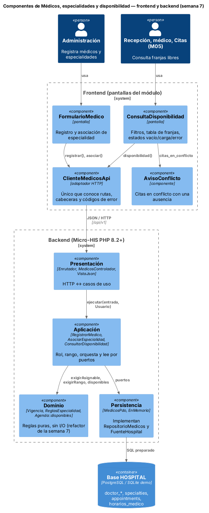
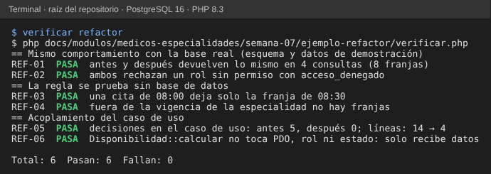

# Semana 7 — Componentes backend y frontend, y un refactor concreto

**Estudiante:** Joshua Eduardo García Reyes (`jgarciar73-svg`) · **Módulo:** Médicos, especialidades y disponibilidad (módulo 4, reasignado dentro del grupo G1) · **Flujo:** «registro de médico, asociación de especialidad y consulta de disponibilidad»

**Entregables:** [diagrama de componentes](diagramas/semana-07-componentes.png) (fuente [`.puml`](diagramas/semana-07-componentes.puml)), contratos de entrada y salida (§2), comparación antes/después con [código ejecutable](ejemplo-refactor/verificar.php) (§3). No se agrega ninguna función nueva al módulo: solo se ordena lo que ya existe.

## 1. Componentes y qué es de cada uno

| Lado | Componente | Responsabilidad (una sola) | No debe |
|---|---|---|---|
| Frontend | `FormularioMedico` | Captura colegiado, usuario y especialidad; valida lo evidente antes de enviar | Conocer rutas ni códigos HTTP |
| Frontend | `ConsultaDisponibilidad` | Filtros (especialidad, rango), tabla de franjas y los estados vacío, carga y error | Calcular franjas |
| Frontend | `AvisoConflicto` | Mostrar las citas en conflicto de una ausencia | Cancelar citas |
| Frontend | `ClienteMedicosApi` | Único que conoce rutas, cabeceras y traduce cada código de error a un mensaje | Mostrar pantallas |
| Backend | Presentación | HTTP ↔ casos de uso; un solo mapa código → estado | Tener SQL o reglas |
| Backend | Aplicación | Rol, rango, orquestar y leer por puertos | Decidir qué médico atiende un día |
| Backend | Dominio | Vigencias, especialidades y **cálculo de franjas libres** | Leer la base o saber del rol |
| Backend | Persistencia | Implementar los puertos con PDO y en memoria | Aplicar reglas |

Citas (M05) consume solo `GET /api/v1/disponibilidad`; nunca llega a Persistencia.

## 2. Contratos de entrada y salida

| Componente | Entrada | Salida | Errores que debe manejar |
|---|---|---|---|
| `RegistrarMedico` | `{usuario_id, colegiado, especialidad_id?, desde?}` + `Usuario` | `{medico_id, especialidad_principal}` | `acceso_denegado`, `usuario_no_disponible`, `medico_duplicado`, `especialidad_invalida` |
| `AsociarEspecialidad` | `medico_id`, `{especialidad_id, desde, hasta?, principal?}` | `{asignacion_id}` | `medico_no_encontrado`, `especialidad_invalida`, `especialidad_duplicada` |
| `ConsultarDisponibilidad` | `codigo`, `desde`, `hasta` + `Usuario` | `[{medico_id, medico, inicio}]` (lista vacía = estado vacío) | `acceso_denegado`, `rango_invalido` |
| `Disponibilidad::calcular` (puro) | médicos con vigencias, horarios, citas, `desde`, `hasta` | La misma lista de franjas | Ninguno: no hace entrada ni salida |
| `ClienteMedicosApi.disponibilidad(codigo, desde, hasta)` | Tres textos | `{franjas}` o `{error: {codigo, mensaje}}` | Traduce el código; reintenta solo ante cortes de red |
| `ConsultaDisponibilidad` (pantalla) | Evento «buscar» con los filtros | Estado: `cargando`, `vacio`, `exito(franjas)` o `error(mensaje)` | Muestra siempre uno de los cuatro |

## 3. Refactor: dónde estaba el mayor acoplamiento

**Punto elegido:** `ConsultarDisponibilidad::ejecutar` (semana 3). En un solo método hacía de todo: revisa el rol, lee tres fuentes (médicos con su vigencia, horarios y citas, de dueños distintos) y además **decide qué médico atiende cada día** con un doble bucle. Cada cambio de regla (la ausencia del médico de la semana 6, una duración de franja distinta por especialidad) obliga a tocar el caso de uso y a probarlo con una base de datos.

| | Antes | Después |
|---|---|---|
| Dónde vive la regla de franjas libres | Bucles dentro del caso de uso | `Disponibilidad::calcular`, función pura (en el repositorio iría como `Agenda::disponibles` en Dominio) |
| Líneas del caso de uso | 14 | 4 |
| Decisiones (`if`, `for`, `foreach`, `array_filter`) en el caso de uso | 5 | 0 |
| Qué se necesita para probar la regla | SQLite con el esquema y datos | Tres arreglos |
| Qué cambia si llega una ausencia | Caso de uso y bucle | Un dato más en el cálculo; el caso de uso solo lo lee |

**Justificación:** el caso de uso conserva una razón para cambiar (el flujo: quién puede, qué rango, qué se lee) y la regla de negocio tiene otra (qué es una franja libre). Es SRP aplicado al punto exacto donde se mezclaban. La UI no cambia: el contrato de `GET /api/v1/disponibilidad` sigue igual.

**Cómo se comprobó** (`php semana-07/ejemplo-refactor/verificar.php`, 6 de 6):

- **REF-01 y REF-02:** antes y después devuelven lo mismo en 4 consultas sobre el esquema real, y ambos rechazan un rol sin permiso.
- **REF-03 y REF-04:** la regla se prueba sin base de datos (una cita ocupa una franja; fuera de la vigencia no hay franjas).
- **REF-05 y REF-06:** mide el acoplamiento y comprueba que `calcular` no usa PDO, rol ni estado.
- Se introdujeron 5 errores a propósito (quitar el filtro de vigencia, ignorar las citas, no leerlas, abrir el rol a «paciente», cambiar el borde del rango) y la verificación falló en los 5.

## 4. Qué queda fuera

El frontend de este módulo es un diseño: el repositorio entrega la API y las pantallas se definen aquí y se prueban con el prototipo de la semana 11. El refactor se aplica al código en el PR que traiga las ausencias (semana 6), donde evita que el bucle crezca.
