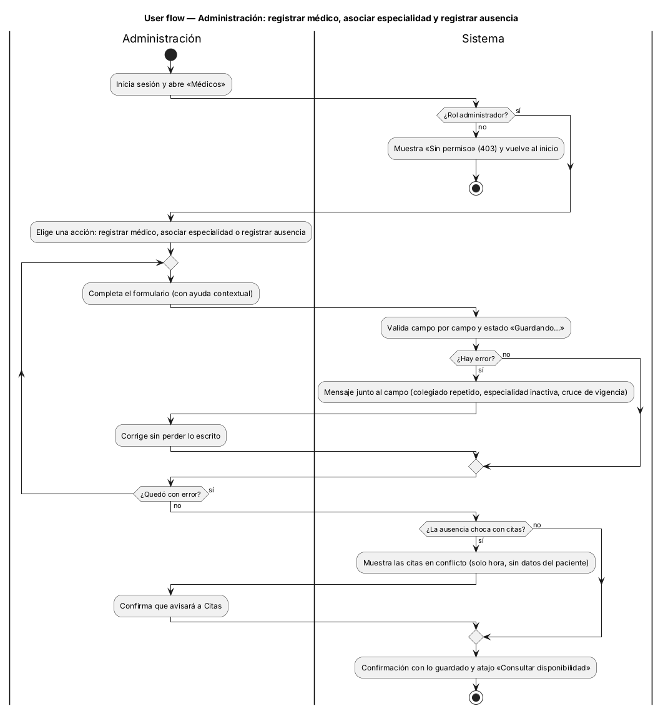
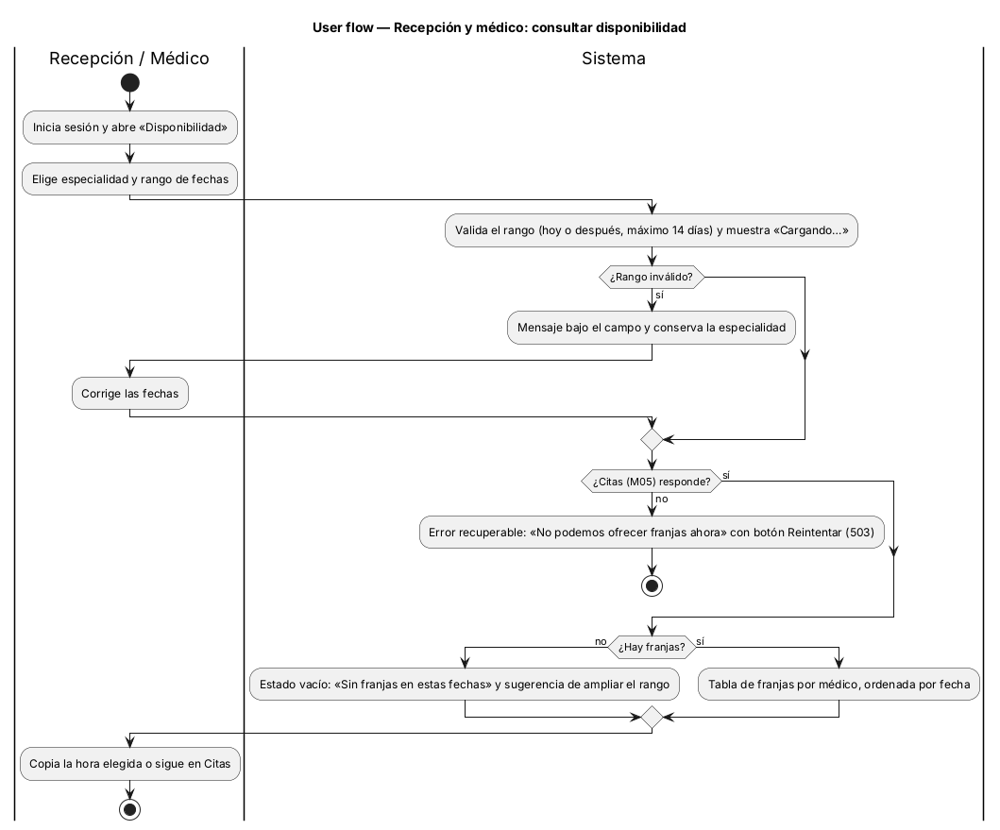
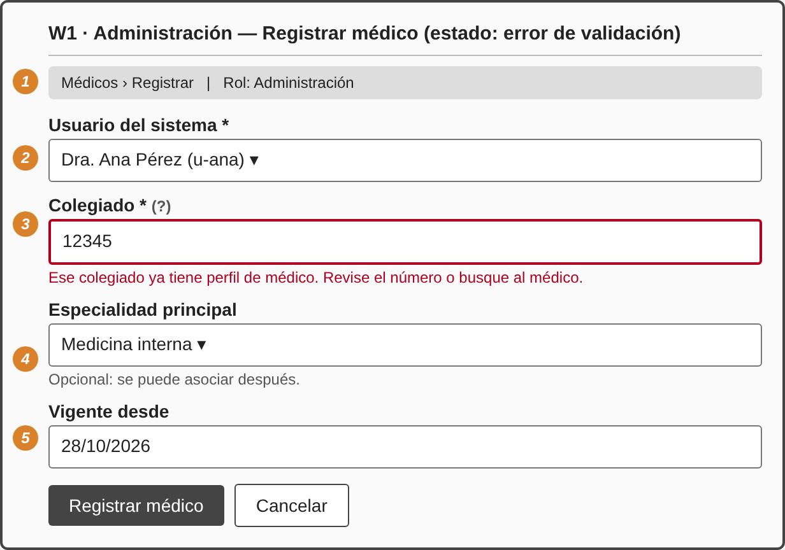
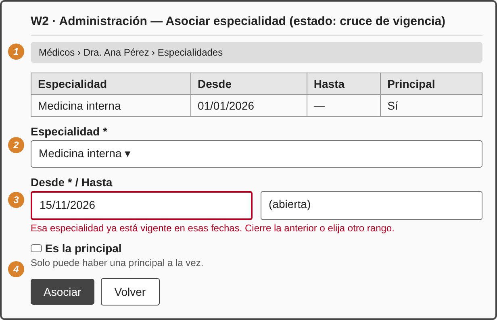
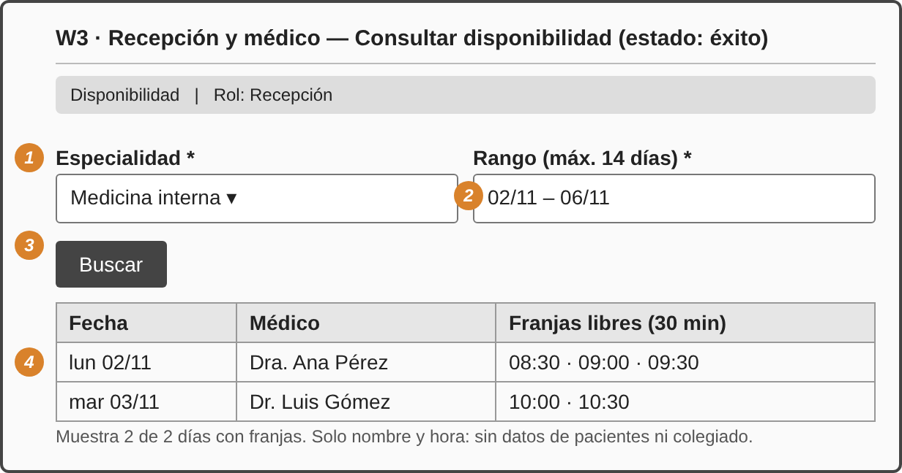
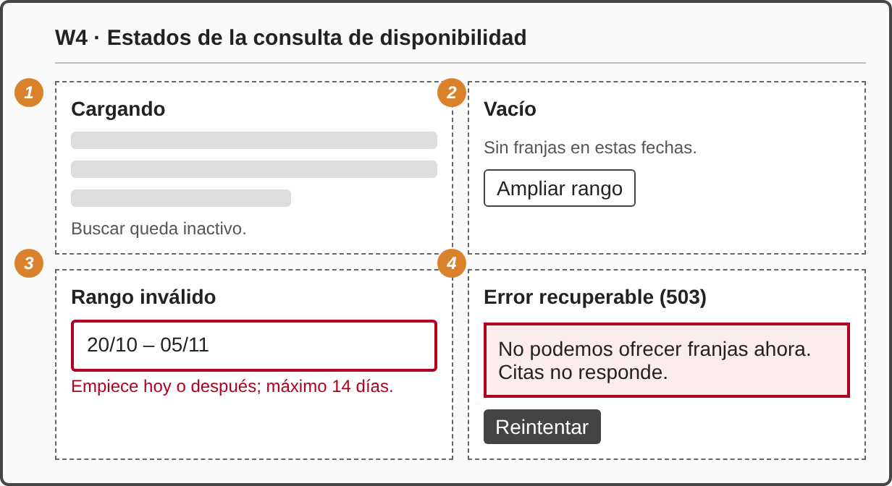
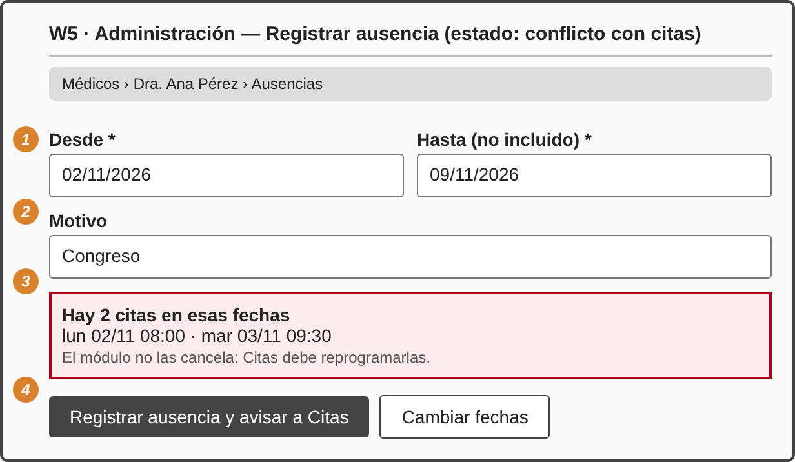

# Semana 8 — Diseño de la experiencia de usuario

**Estudiante:** Joshua Eduardo García Reyes (`jgarciar73-svg`) · **Módulo:** Médicos, especialidades y disponibilidad (módulo 4, reasignado dentro del grupo G1) · **Flujo:** «registro de médico, asociación de especialidad y consulta de disponibilidad»

**Entregables:** user flow por rol (§1) y cinco wireframes anotados (§2) con sus estados, mensajes, validaciones y reglas de interacción. Los wireframes están en [`wireframes/wireframes.html`](wireframes/wireframes.html) y se exportan a PNG. Alimentan el prototipo de la semana 11.

## 1. Flujo por rol

| Rol | Puede | No ve ni puede |
|---|---|---|
| Administración | Registrar médico, asociar especialidad, registrar ausencia, consultar disponibilidad | — |
| Recepción | Consultar disponibilidad | Botones de registro, colegiado, datos de pacientes |
| Médico | Consultar disponibilidad | Lo mismo que recepción |

Los botones de escritura **no se dibujan** para recepción y médico (no solo se desactivan); aun así el servidor responde 403 si alguien llama la ruta (RNF-01).

## 2. Wireframes anotados

Los números naranjas de cada imagen corresponden a las filas de su tabla.

### W1 · Registrar médico

| # | Elemento | Regla de interacción, validación y mensaje |
|:-:|---|---|
| 1 | Barra con ruta y rol | Siempre visible; solo Administración llega aquí |
| 2 | Usuario del sistema | Solo usuarios activos sin perfil de médico; si no hay: «No hay usuarios disponibles» |
| 3 | Colegiado | Obligatorio; se valida al enviar. Repetido: «Ese colegiado ya tiene perfil de médico. Revise el número o busque al médico» (409). El «?» explica el formato |
| 4 | Especialidad principal | Opcional; ayuda: «se puede asociar después» |
| 5 | Vigente desde | Hoy por defecto |
| — | Botones | «Registrar médico» pasa a «Guardando…» y se desactiva para evitar doble envío; éxito: «Dr. A quedó registrado» y atajo a asociar especialidad |

### W2 · Asociar especialidad

| # | Elemento | Regla |
|:-:|---|---|
| 1 | Tabla de lo vigente | Se ve antes de escribir, para evitar el cruce |
| 2 | Especialidad | Solo activas; inactiva: «La especialidad no existe o no está activa» |
| 3 | Desde / Hasta | Hasta vacío = abierta; Hasta debe ser posterior. Cruce: «Esa especialidad ya está vigente en esas fechas. Cierre la anterior o elija otro rango» (409 `especialidad_duplicada`) |
| 4 | Es la principal | Ayuda: «Solo puede haber una principal a la vez». El error conserva todo lo escrito |

### W3 · Consultar disponibilidad (éxito)

| # | Elemento | Regla |
|:-:|---|---|
| 1 | Especialidad | Obligatoria; lista de activas |
| 2 | Rango | Hoy o después, máximo 14 días; si es mayor se avisa antes de enviar |
| 3 | Buscar | Enter también busca; se desactiva mientras carga |
| 4 | Tabla | Fecha, médico y franjas de 30 min; solo nombre y hora, sin colegiado ni pacientes (protección de datos); se lee con teclado fila por fila |

### W4 · Estados de la consulta

| # | Estado | Mensaje y salida |
|:-:|---|---|
| 1 | Cargando | Esqueleto de tabla; «Buscar» inactivo; el estado se anuncia a lectores de pantalla |
| 2 | Vacío | «Sin franjas en estas fechas» y botón «Ampliar rango» |
| 3 | Rango inválido | Mensaje bajo el campo: «Empiece hoy o después; máximo 14 días» (422 `rango_invalido`); conserva la especialidad |
| 4 | Error recuperable | «No podemos ofrecer franjas ahora. Citas no responde» (503, RNF-02); no muestra franjas viejas; botón «Reintentar» |

### W5 · Registrar ausencia con conflicto

| # | Elemento | Regla |
|:-:|---|---|
| 1 | Desde / Hasta | Hasta no incluido; con hasta ≤ desde: «La ausencia necesita una fecha final posterior» |
| 2 | Motivo | Opcional; si se deja vacío queda «sin motivo» |
| 3 | Aviso de conflicto | Lista solo la hora de cada cita, sin nombre del paciente. Texto fijo: «El módulo no las cancela: Citas debe reprogramarlas» |
| 4 | Botones | «Registrar ausencia y avisar a Citas» es la acción principal y exige este paso de confirmación; «Cambiar fechas» vuelve sin guardar |

## 3. Reglas transversales

| Tema | Regla |
|---|---|
| Confirmación | Toda escritura termina con un mensaje de lo guardado; ninguna se confirma solo con un color |
| Errores | Junto al campo, en lenguaje de la tarea, sin códigos técnicos; los datos escritos no se pierden |
| Ayuda contextual | Un «?» por campo que no se entiende solo (colegiado, vigencia, hasta no incluido) |
| Sesión | Sin sesión (401): se vuelve a ingresar y se regresa a la misma pantalla; sin permiso (403): «Su rol no puede hacer esta operación» |
| Protección de datos | Recepción y médico nunca ven el colegiado; los conflictos de ausencia no muestran pacientes; los errores no repiten datos personales |
| Accesibilidad | Cada campo con etiqueta visible; error asociado al campo y anunciado; foco al primer error; contraste de texto de al menos 4.5:1 |

## 4. Trazabilidad

| Wireframe | Casos de uso y requisitos | Criterios |
|---|---|---|
| W1 | CU-01, RF-01 y RF-02 | CA-01, CA-02 |
| W2 | CU-02, RF-03 | CA-04, CA-05 |
| W3 y W4 | CU-03, RF-04 y RF-06, RNF-02, RNF-03 | CA-03, CA-07, CA-10 |
| W5 | CU-05, RF-05 | CA-09 |
