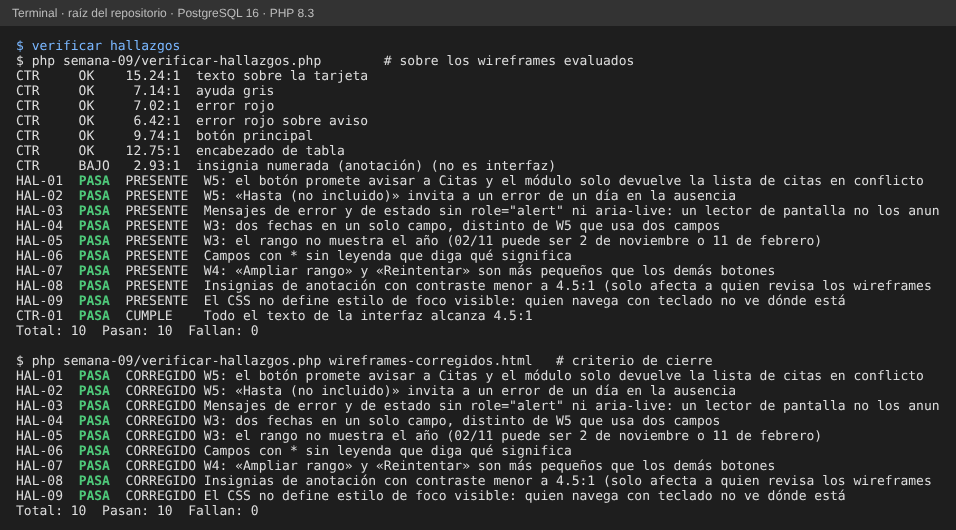

# Semana 9 — Evaluación de usabilidad y accesibilidad

**Estudiante:** Joshua Eduardo García Reyes (`jgarciar73-svg`) · **Módulo:** Médicos, especialidades y disponibilidad (módulo 4, reasignado dentro del grupo G1) · **Flujo:** «registro de médico, asociación de especialidad y consulta de disponibilidad»

**Entregables:** checklist completado (§2), 9 hallazgos con evidencia (§3) y backlog priorizado con corrección y criterio verificable (§4). Se evalúa la propuesta de la semana 8; la captura exacta que se revisó está en [`evaluado/wireframes.html`](evaluado/wireframes.html) y cada hallazgo se reproduce con [`verificar-hallazgos.php`](verificar-hallazgos.php).

## 1. Método

Heurísticas de Nielsen y WCAG 2.2 AA, aplicadas a los cinco wireframes (W1 a W5) y a sus reglas de interacción. Se priorizó por el daño a lo que el módulo protege: **médicos, especialidades, horarios, disponibilidad y conflictos de agenda**. Severidad: **Alta** = puede dejar una agenda mal sin que nadie lo note; **Media** = el usuario se equivoca o se frena; **Baja** = molestia o detalle del documento.

## 2. Checklist

| Área | Ítem | Resultado | Evidencia |
|---|---|:-:|---|
| Teclado | Todo se opera con Tab y Enter (la búsqueda con Enter) | Cumple | W3 regla 3 |
| Teclado | Sin trampas de foco: no hay ventanas modales | Cumple | W1 a W5 |
| Foco | El foco va al primer error al enviar | Cumple | Semana 8 §3 |
| Foco | Estilo de foco visible definido | **No cumple** | HAL-09 |
| Contraste | Texto de la interfaz de al menos 4.5:1 (medido: de 6.4 a 15.2) | Cumple | CTR-01 |
| Contraste | El error no depende solo del color (borde y texto) | Cumple | W1, W2, W4 |
| Etiquetas | Cada campo con etiqueta visible | Cumple | W1 a W5 |
| Etiquetas | Los campos obligatorios se explican | **No cumple** | HAL-06 |
| Etiquetas | Etiqueta asociada al control (`for`) | Se comprueba en el prototipo (semana 11) | — |
| Mensajes | Junto al campo y en lenguaje de la tarea | Cumple | W1, W2, W4 |
| Mensajes | Se anuncian a lectores de pantalla | **No cumple** | HAL-03 |
| Prevención | Doble envío evitado («Guardando…» desactiva el botón) | Cumple | W1 |
| Prevención | Confirmación antes de una acción con efecto | **Parcial** (el texto engaña) | HAL-01 |
| Prevención | Fechas sin ambigüedad | **No cumple** | HAL-02, HAL-04, HAL-05 |
| Heurísticas | Estado visible, control y libertad (Cancelar, Volver), reconocimiento (tabla vigente en W2), ayuda (?) | Cumple | W1 a W5 |
| Heurísticas | Consistencia entre pantallas | **Parcial** | HAL-04, HAL-07 |

## 3. Hallazgos

| ID | Dónde | Qué pasa | Norma | Impacto en la agenda |
|---|---|---|---|---|
| HAL-01 | W5 | El botón dice «Registrar ausencia y **avisar a Citas**», pero el módulo solo devuelve la lista de citas en conflicto: no envía ningún aviso | Heurística 2 (coincidir con el mundo real) | La persona cree que Citas ya sabe y las citas de ese médico quedan sin reprogramar |
| HAL-02 | W5 | «Hasta (**no incluido**)» es el criterio interno `[desde, hasta)`; casi nadie lo espera | Heurística 5, WCAG 3.3.2 | Ausencia de un día de más o de menos: se bloquea o se ofrece un día equivocado |
| HAL-03 | W1 a W5 | Los mensajes de error, de estado y el aviso de conflicto aparecen sin `role="alert"` ni `aria-live` | WCAG 4.1.3 | Quien usa lector de pantalla no se entera del 503 ni de las citas en conflicto |
| HAL-04 | W3 | Las dos fechas van en un solo campo («02/11 – 06/11»); W5 usa dos | Heurística 4, WCAG 3.3.2 | Se escribe mal el rango y se consulta la semana equivocada |
| HAL-05 | W3 | El rango no muestra el año: 02/11 puede ser 2 de noviembre o 11 de febrero | WCAG 3.3.2 | Se ofrecen franjas de otra fecha |
| HAL-06 | W1, W2, W3, W5 | Hay `*` pero ninguna leyenda dice qué significa | WCAG 3.3.2 | Se envían formularios incompletos |
| HAL-07 | W4 | «Ampliar rango» y «Reintentar» son más pequeños que los demás botones | Heurística 4, WCAG 2.5.8 | Más errores al tocar en móvil (semana 10) |
| HAL-08 | Documento | Las insignias naranja de anotación tienen 2.93:1 con el texto blanco | WCAG 1.4.3 | Solo quien revisa los wireframes; no es interfaz |
| HAL-09 | W1 a W5 | No se define estilo de foco visible | WCAG 2.4.7 | Quien navega con teclado se pierde en una tabla de franjas |

**Evidencia:** `php semana-09/verificar-hallazgos.php` reproduce los nueve sobre la captura evaluada. Para comprobar que los detectores sí miden, se probó el mismo script con una copia corregida de los wireframes y los nueve pasaron a CORREGIDO.

## 4. Backlog priorizado

| Prioridad | ID | Corrección propuesta | Criterio verificable |
|:-:|---|---|---|
| 1 | HAL-01 | Botón «Registrar ausencia»; en el aviso, un botón «Copiar lista para Citas» y el texto «Citas aún no fue avisada» | El texto del botón no contiene «avisar»; la lista se puede copiar con teclado |
| 2 | HAL-02 | Mostrar «Último día de ausencia» (inclusivo) y sumar un día al enviar | Una ausencia del 02 al 08 bloquea el 08 y libera el 09 (prueba con la API) |
| 3 | HAL-03 | `role="alert"` en errores y avisos; `aria-live="polite"` en cargando, vacío y resultados | HAL-03 pasa a CORREGIDO; con lector de pantalla se anuncia el 503 |
| 4 | HAL-04 | Dos campos de fecha («Desde», «Hasta»), como en W5 | HAL-04 CORREGIDO |
| 5 | HAL-05 | Fechas siempre con año (`02/11/2026`) | HAL-05 CORREGIDO |
| 6 | HAL-09 | Contorno de foco de 3 px con contraste de 3:1 o más | HAL-09 CORREGIDO; el foco se ve en cada control al pulsar Tab |
| 7 | HAL-06 | Leyenda «* Campo obligatorio» arriba de cada formulario | HAL-06 CORREGIDO |
| 8 | HAL-07 | Mismo tamaño de botón en todas las pantallas (alto de 40 px o más) | HAL-07 CORREGIDO |
| 9 | HAL-08 | Insignias en un naranja más oscuro (por ejemplo `#8a4b0a`, 6.79:1) | CTR de las insignias en OK |

**Cierre del backlog:** cuando los wireframes corregidos se pasen como argumento, `php semana-09/verificar-hallazgos.php <ruta>` debe terminar con 10 de 10 y los nueve hallazgos en CORREGIDO. Las correcciones 1 a 3 entran en el prototipo de la semana 11.

## 5. Qué no se evaluó

Navegación real con lector de pantalla y orden de tabulación: necesitan un prototipo con controles reales, que llega en la semana 11. Aquí se evaluó lo que los wireframes y sus reglas ya prometen.
