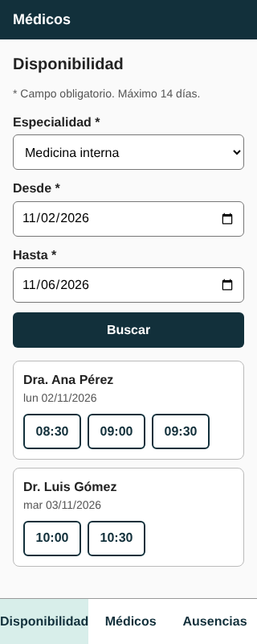
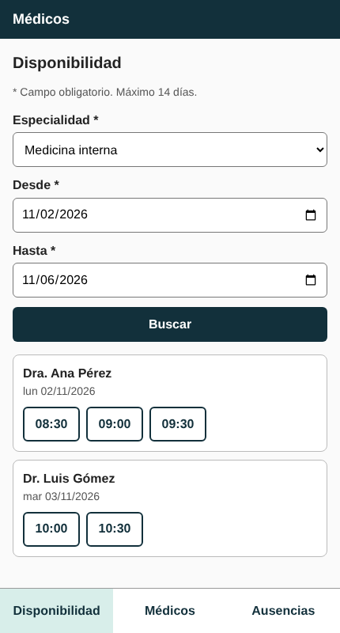
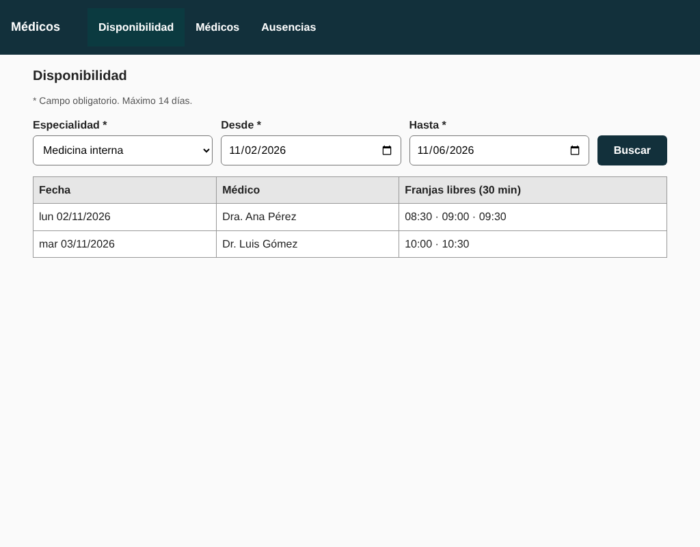
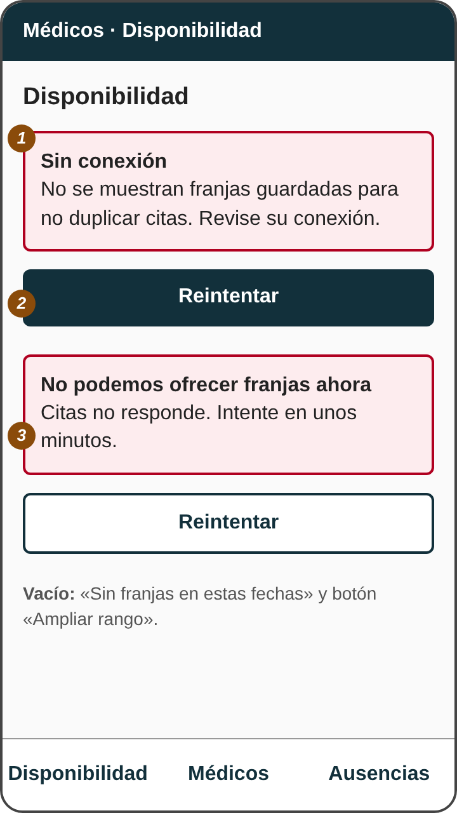
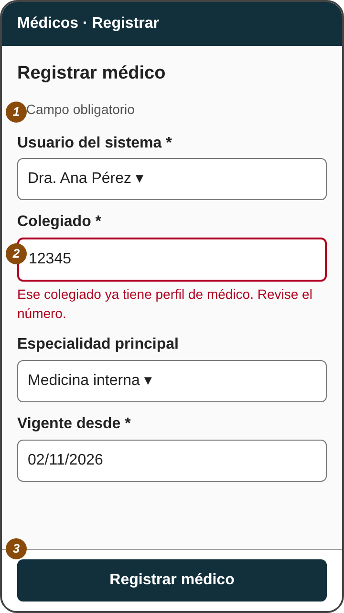
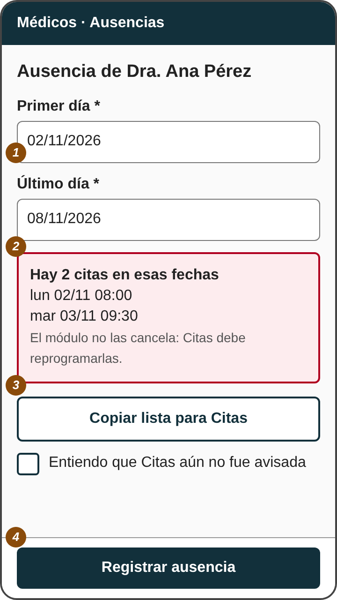
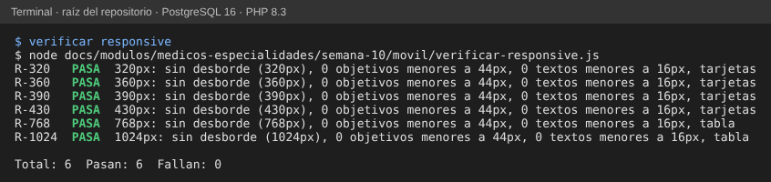

# Semana 10 — Diseño para movilidad (320 a 430 px)

**Estudiante:** Joshua Eduardo García Reyes (`jgarciar73-svg`) · **Módulo:** Médicos, especialidades y disponibilidad (módulo 4, reasignado dentro del grupo G1) · **Flujo:** «registro de médico, asociación de especialidad y consulta de disponibilidad»

**Entregables:** cuatro pantallas móviles (§1), reglas de breakpoint (§2), dos escenarios con decisiones de contenido y de error (§3) y una pantalla responsive real que se comprueba con [`verificar-responsive.js`](movil/verificar-responsive.js). Aplica los hallazgos más importantes de la semana 9: fechas con año, dos campos de fecha, mensajes con `role="alert"`, foco visible, objetivos de 44 px y leyenda de obligatorios.

## 1. Pantallas

### M1 · Consulta de disponibilidad (la pantalla principal, funciona de verdad)

Se abre [`movil/consulta-responsive.html`](movil/consulta-responsive.html) en el celular o en el navegador achicado. Un mismo documento cambia de forma según el ancho.

| 320 px | 430 px | 1024 px |
|:-:|:-:|:-:|
|  |  |  |

**Jerarquía de datos:** primero lo que se decide (especialidad y fechas), luego el resultado por médico, y las franjas como botones de al menos 44 px que se tocan para copiar la hora. Se deja fuera lo que no ayuda a agendar: colegiado, vigencias y horario completo.

### M2 · Errores y conexión limitada

| # | Elemento | Decisión |
|:-:|---|---|
| 1 | «Sin conexión» | Mensaje con `role="alert"`. **No se muestran franjas guardadas**: serían de otro momento y podrían duplicar una cita (RNF-02) |
| 2 | Reintentar | Botón de ancho completo; el foco pasa al mensaje al aparecer |
| 3 | 503 «Citas no responde» | Mismo tratamiento, texto distinto para saber de quién es el problema; el estado vacío («Sin franjas en estas fechas» y «Ampliar rango») se ve debajo |

### M3 · Registrar médico

| # | Elemento | Decisión |
|:-:|---|---|
| 1 | Leyenda «* Campo obligatorio» | Siempre arriba, antes del primer campo |
| 2 | Colegiado | Una columna; teclado numérico (`inputmode="numeric"`); el error aparece pegado al campo y lleva el foco |
| 3 | Botón fijo abajo | «Registrar médico» siempre al alcance del pulgar; pasa a «Guardando…» y se desactiva |

### M4 · Registrar ausencia con conflicto

| # | Elemento | Decisión |
|:-:|---|---|
| 1 | Primer día / Último día | Inclusivos, como se piensa; la app suma un día al enviar (corrección HAL-02) |
| 2 | Aviso de conflicto | Solo hora de cada cita, sin nombre del paciente (protección de datos) |
| 3 | «Copiar lista para Citas» y casilla | La app no avisa a Citas; la casilla «Entiendo que Citas aún no fue avisada» habilita el botón final |
| 4 | Botón fijo «Registrar ausencia» | Inactivo hasta marcar la casilla cuando hay conflicto |

## 2. Reglas de breakpoint y de contenido

| Ancho | Diseño | Navegación | Datos |
|---|---|---|---|
| 320 a 430 px | Una columna; formularios apilados | Pestañas abajo: Disponibilidad, Médicos, Ausencias (las dos últimas solo para Administración) | Tarjetas por médico; franjas como botones |
| 431 a 767 px | Especialidad arriba; Desde y Hasta en dos columnas | Las mismas pestañas abajo | Tarjetas |
| 768 px o más | Filtros en una fila | Pestañas en la barra superior | Tabla de tres columnas (igual que W3 de la semana 8) |

Reglas fijas en todos los anchos: sin desplazamiento horizontal, objetivos táctiles de 44 px o más, texto de 16 px o más en campos (evita el acercamiento automático en iPhone), un campo por fecha, y el estado de cada acción visible sin desplazarse.

**Tablas y formularios:** la tabla se convierte en tarjetas porque tres columnas no caben en 320 px; los formularios se quedan en una columna y el botón principal queda fijo abajo.

## 3. Escenarios móviles

### Escenario A — Recepción, en el mostrador, con conexión lenta

| Paso | Qué pasa | Decisión de contenido o de error |
|---|---|---|
| 1 | Elige Medicina interna y toca «Buscar» | Aparece «Cargando…» (anunciado) y «Buscar» queda inactivo |
| 2 | A los 8 segundos no hay respuesta | M2-1: «Sin conexión»; no se ofrecen franjas viejas aunque haya una consulta anterior |
| 3 | Toca «Reintentar» y responde bien | Tarjetas por médico; toca «08:30» y la hora se copia |
| 4 | Si responde 503 | M2-3: «Citas no responde»; se explica quién falla |

### Escenario B — Administración, en el pasillo, registra una ausencia y se corta la conexión

| Paso | Qué pasa | Decisión de contenido o de error |
|---|---|---|
| 1 | Pone del 02 al 08 de noviembre | Se envía `desde = 02/11` y `hasta = 09/11` (último día inclusivo) |
| 2 | Hay 2 citas en conflicto | M4: lista de horas, «Copiar lista para Citas» y casilla de confirmación |
| 3 | Marca la casilla y toca «Registrar ausencia» | El botón dice «Guardando…» |
| 4 | La conexión se corta antes de la respuesta | «No sabemos si se guardó. Compruebe en Disponibilidad antes de reintentar.» **No se reintenta solo**: hoy no existe `Idempotency-Key` (propuesto en la semana 5) y se podría registrar dos veces |

## 4. Evidencia

`node semana-10/movil/verificar-responsive.js` (necesita Playwright) abre la pantalla en 320, 360, 390, 430, 768 y 1024 px y comprueba que no haya desborde horizontal, que todo objetivo mida 44 px o más, que el texto de los campos sea de 16 px o más, y que se vea el diseño correcto (tarjetas por debajo de 768 y tabla desde 768).

Se introdujeron 4 errores a propósito (botones de 30 px, tabla siempre oculta, un elemento de 500 px de ancho y letra de 12 px) y la verificación falló en los 4.

## 5. Pendiente

Las pantallas M2 a M4 son maquetas; el prototipo navegable con todas las pantallas, en escritorio y celular, es el de la semana 11. Probar con un celular real y con conexión limitada queda para ese prototipo.
