# Semana 11 — Prototipo navegable de escritorio y celular

**Estudiante:** Joshua Eduardo García Reyes (`jgarciar73-svg`) · **Módulo:** Médicos, especialidades y disponibilidad (módulo 4, reasignado dentro del grupo G1) · **Flujo:** «registro de médico, asociación de especialidad y consulta de disponibilidad»

**Entregables:** [prototipo](prototipo/index.html) (se abre con doble clic, sin servidor), mapa de navegación (§2) y capturas de escritorio y celular del camino feliz y de un error crítico (§3). Parte de los wireframes de la semana 8, aplica las correcciones de la semana 9 y usa la pantalla responsive de la semana 10.

## 1. Cómo usarlo

1. Abra `prototipo/index.html` en el navegador (para ver el celular, achique la ventana a 390 px).
2. Elija el rol arriba a la derecha: **Administración**, **Recepción** o **Médico**. Las pestañas cambian según el rol y, si alguien llega a una ruta que no es suya, ve «Sin permiso».
3. El **panel de demostración** de abajo simula que Citas no responde (503) o que se cae la conexión.

Los datos viven en `prototipo/api-simulada.js`, que aplica las mismas reglas y los mismos códigos que el Micro-HIS (colegiado repetido 409, cruce de vigencia 409, especialidad o rango inválidos 422, ausencia con citas en conflicto). Lo que todavía no existe en el servidor está marcado como propuesto en el propio archivo.

## 2. Mapa de navegación

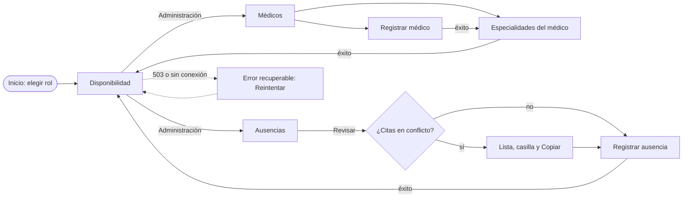

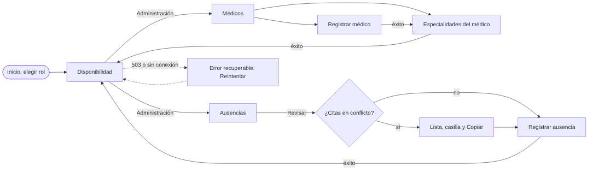

| Rol | Pestañas | Puede |
|---|---|---|
| Administración | Disponibilidad, Médicos, Ausencias | Todo el flujo |
| Recepción | Disponibilidad | Consultar franjas |
| Médico | Disponibilidad, Ausencias (solo las suyas, desde la semana 12) | Consultar franjas y registrar sus ausencias |

## 3. Capturas

**Camino feliz:** la administración registra a la Dra. Sofía Ruiz, le asocia Pediatría, y recepción ve sus franjas.

| | Registrar médico | Consultar disponibilidad |
|---|---|---|
| Escritorio | 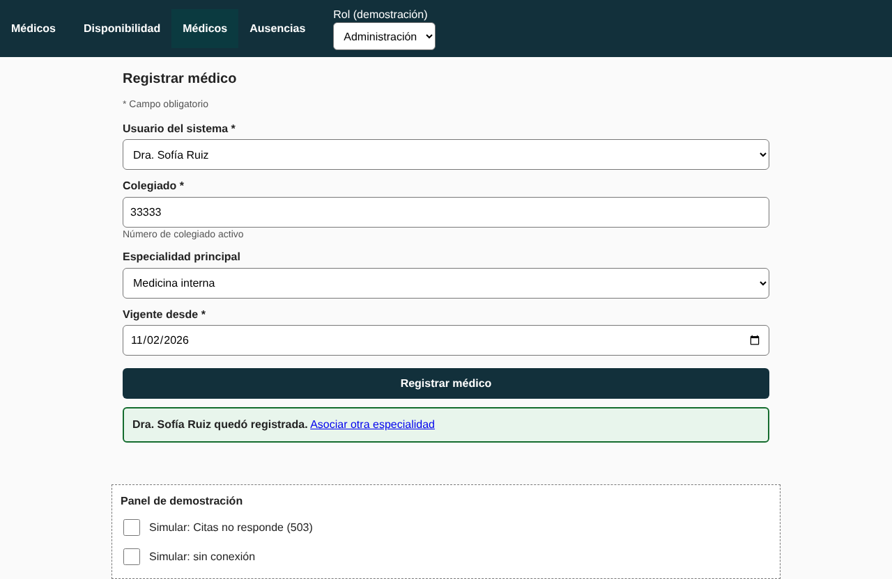 | 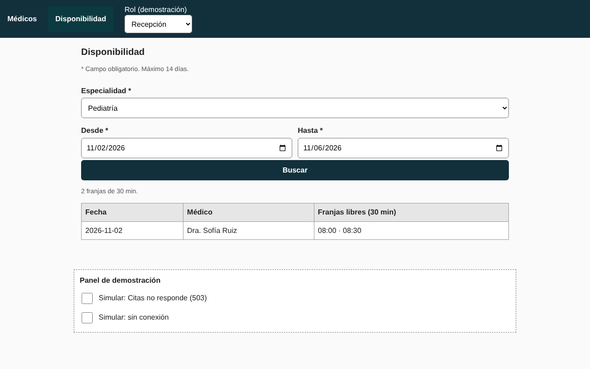 |
| Celular | 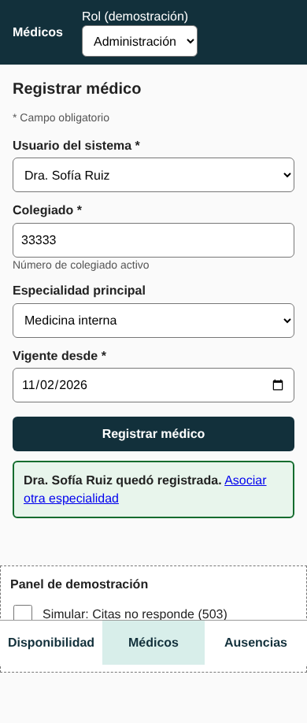 | 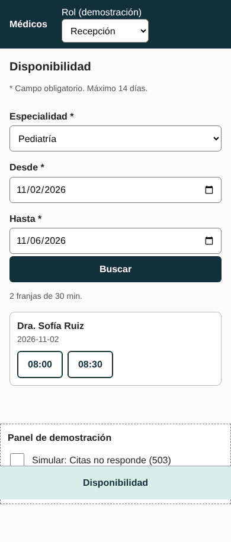 |

**Error crítico:** una ausencia choca con dos citas ya agendadas (conflicto de agenda). La pantalla las lista, no deja registrar hasta confirmar que Citas aún no fue avisada, y después la médica deja de aparecer en la disponibilidad. Como segundo error, Citas no responde.

| | Ausencia con conflicto | Citas no responde (503) |
|---|---|---|
| Escritorio | 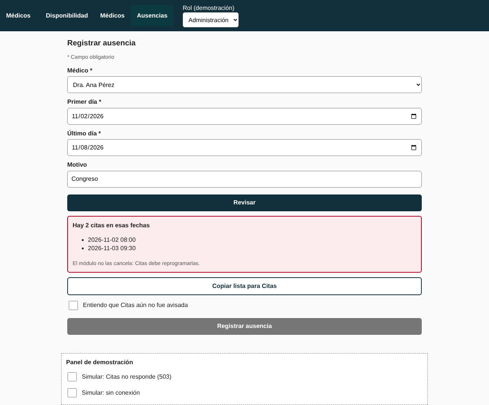 | 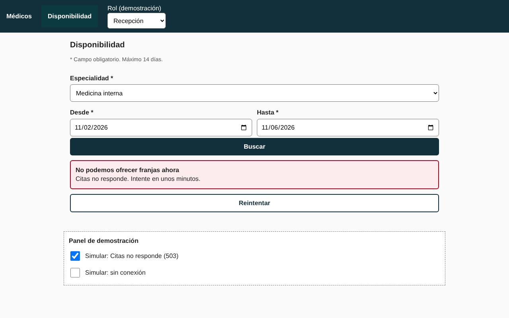 |
| Celular | 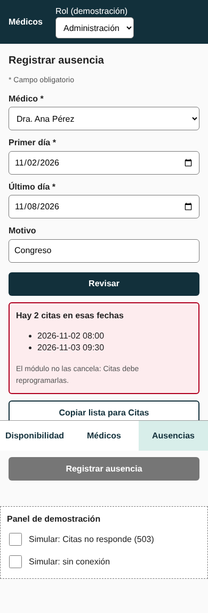 | 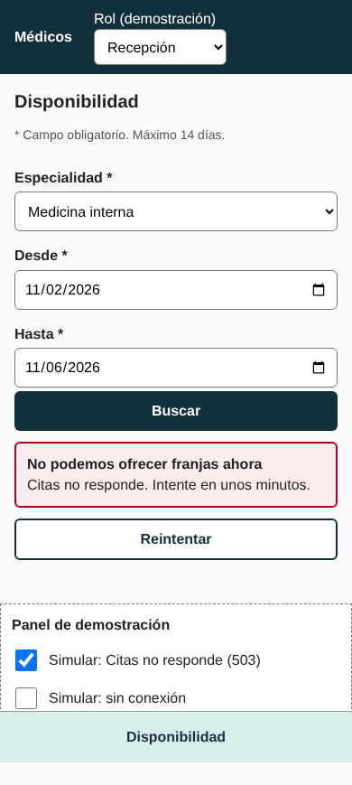 |

## 4. Consistencia de roles, estados y accesibilidad

| Tema | Cómo queda en el prototipo |
|---|---|
| Roles | Un solo selector; pestañas y rutas se filtran igual en escritorio y en celular; el servidor simulado responde 403 si se llama sin permiso |
| Estados | Cargando, vacío, éxito y error en cada pantalla; mientras guarda, el botón dice «Guardando…» y se desactiva |
| Errores | Junto al campo, con el foco en el campo (`aria-invalid`, `aria-describedby`) y `role="alert"` (hallazgo HAL-03) |
| Confirmación | El éxito dice lo que se guardó; la ausencia con conflicto exige la casilla antes del botón final (HAL-01) |
| Fechas | Dos campos, con año; la ausencia pide «Último día» inclusivo y suma un día al enviar (HAL-02, HAL-04, HAL-05) |
| Teclado y foco | Controles reales con etiqueta y `for`; contorno de foco de 3 px; objetivos de 44 px o más (HAL-07, HAL-09) |
| Sin conexión | No muestra franjas guardadas (RNF-02); en una ausencia no reintenta solo |

## 5. Evidencia

`node semana-11/prototipo/probar-prototipo.js` (necesita Playwright) recorre el prototipo en escritorio (1280 px) y en celular (390 px) y genera las capturas. Son 11 comprobaciones por tamaño: colegiado repetido con foco en el campo, registrar, asociar, cruce de vigencia, franjas de la médica nueva, ausencia con conflicto, efecto en la disponibilidad, 503, sin conexión y permisos.

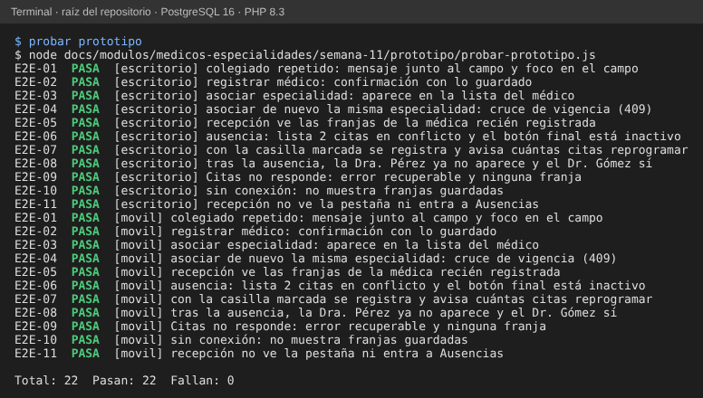

## 6. Pendiente

- El prototipo usa una API simulada: la simulación de ausencia sin guardar y el 503 son propuestos y no están en el servidor.
- El módulo todavía no tiene una operación para cargar los horarios: los de la demo vienen precargados.
- No incluye el botón «Ampliar rango» del estado vacío (semana 10).
- Probar con un celular real y con lector de pantalla queda para la evaluación final.
