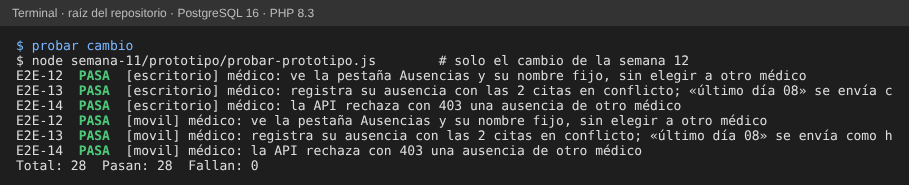

# Registro del cambio solicitado — el médico registra sus propias ausencias

## 1. Solicitud

«Jefatura de Medicina pide que cada médico pueda registrar sus ausencias desde el celular, sin pasar por Administración.»

## 2. Análisis de impacto

| Área | Impacto | Decisión |
|---|---|---|
| Roles (RNF-01) | Hoy solo Administración escribe | El rol médico puede registrar ausencias, pero **solo las suyas**; las de otro responden 403 |
| UX (semana 8) | W5 elige al médico en una lista | Si el rol es médico, su nombre aparece fijo y no hay lista |
| Móvil (semana 10) | M4 ya existe | Se reutiliza sin cambios: mismas fechas, conflicto y casilla |
| Conflicto de agenda | El médico también ve las citas en conflicto | Igual que Administración: solo la hora; no cancela nada |
| Contrato API | `POST /medicos/{id}/ausencias` acepta solo `admin` | Acepta `admin` y `medico`; para `medico` exige que `{id}` sea su perfil; sin cambios de forma |
| Dominio | — | Sin cambios |
| Datos | No hay quién registró la ausencia | Se propone una columna `registrada_por` para auditoría |

**Alternativa descartada:** que Administración apruebe cada ausencia. Retrasa a quien ya avisó y duplica el trabajo; se prefiere avisar y auditar.

## 3. Qué se hizo

| Dónde | Cambio |
|---|---|
| `api-simulada.js` | `registrarAusencia` permite `medico` y rechaza con 403 si el médico no es el suyo (2 líneas) |
| `app.js` | La pestaña Ausencias aparece para el rol médico y su nombre sale fijo (3 líneas) |
| `probar-prototipo.js` | Tres comprobaciones nuevas: E2E-12, E2E-13 y E2E-14 |
| Servidor real | **No se tocó.** Propuesto: `exigirRol(['admin','medico'])` en `RegistrarAusencia` y buscar el perfil con `local_user_ref_id` |

## 4. Evidencia

- `node semana-11/prototipo/probar-prototipo.js`: 28 de 28 (14 en escritorio y 14 en celular).
- Se introdujeron 3 errores a propósito (permitir ausencias ajenas, no sumar el día y no rechazar con 403) y la prueba falló en los 3.
- Capturas: [escritorio](capturas/escritorio-cambio-medico-conflicto.png) y [celular](capturas/movil-cambio-medico-conflicto.png) del conflicto, y su [éxito](capturas/movil-cambio-medico-exito.png).

## 5. Riesgos y pendiente

- Un médico puede bloquear su agenda sin control: queda la auditoría propuesta y la lista de ausencias para Administración (no construida).
- La identidad del médico hoy es de demostración; en el SHI sale del token del módulo RBAC.
- Sigue sin existir aviso automático a Citas.
