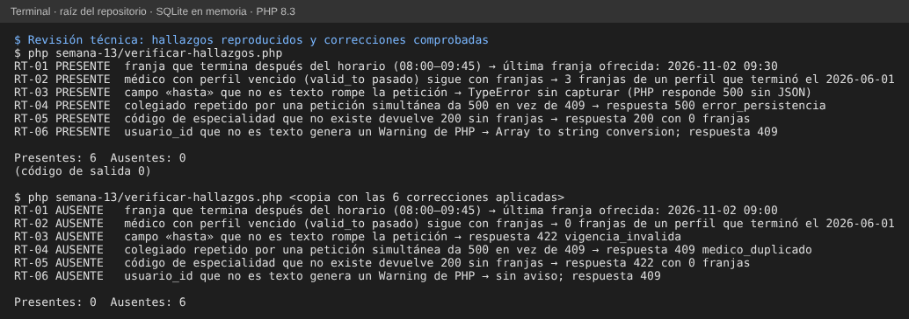

# Semana 13 — Revisión técnica formal del Micro-HIS de Médicos

**Estudiante:** Joshua Eduardo García Reyes (`jgarciar73-svg`) · **Módulo:** Médicos, especialidades y disponibilidad (módulo 4, reasignado dentro del grupo G1)

Revisión formal (inspección) del Micro-HIS de la semana 3: `RegistrarMedico`, `AsociarEspecialidad` y `ConsultarDisponibilidad`. Este documento trae el plan, los roles, los criterios de entrada y salida, la lista de verificación, los hallazgos y la decisión. Los hallazgos se reproducen con [`verificar-hallazgos.php`](verificar-hallazgos.php).

**Alcance de esta entrega:** el autor hizo la preparación individual y dejó los hallazgos listos. El moderador y los revisores los asigna el grupo; hasta que ellos confirmen, los hallazgos están **abiertos y sin confirmar por un tercero**.

## 1. Elemento revisado

| | |
|---|---|
| Versión | `develop` con las semanas 1, 2, 3 y 5 de Médicos (el código de las semanas 4 y 6 aún no está fusionado; el script también corre sobre la semana 4) |
| Archivos | `src/Dominio/Medicos.php` (51 líneas), `src/Aplicacion/CasosMedicos.php` (67), `src/Persistencia/MedicosPdo.php` (67), `src/Presentacion/MedicosControlador.php` (31), `sql/esquema.sql` (27) |
| Tamaño | 243 líneas |
| Referencias | RF/RNF y criterios CA-01 a CA-11 de la [semana 2](../semana-02/semana-02-isp-requerimientos-diseno.md); [contrato OpenAPI](../semana-05/api/openapi.yaml) |
| Estado previo | `php tests/ejecutar.php`: 8 de 8 pasan; `php semana-05/verificar-contrato.php`: 1 de 1 |

## 2. Plan

| Fase | Qué se hace | Quién | Cuándo (propuesto) |
|---|---|---|---|
| Planeación | Se fija el elemento, los roles y los criterios | Moderador y autor | Día 0 |
| Resumen | El autor presenta el diseño de capas en 10 minutos | Autor | Día 1 |
| Preparación | Cada revisor lee el código con la lista de la §5 y anota hallazgos (máximo 90 minutos, 150 líneas por hora) | Revisores | Días 1–2 |
| Reunión | Se revisan los hallazgos, se clasifican y se decide; no se discuten soluciones largas | Moderador (conduce), secretario (anota) | Día 3, máximo 90 minutos |
| Retrabajo | El autor corrige los hallazgos aceptados | Autor | Días 3–5 |
| Seguimiento | El moderador comprueba cada corrección con `verificar-hallazgos.php` y las pruebas | Moderador | Día 6 |

## 3. Roles

| Rol | Responsabilidad | Quién |
|---|---|---|
| Autor | Presenta el código y corrige; no modera ni decide la severidad | Joshua Eduardo García Reyes |
| Moderador | Conduce, controla el tiempo y los criterios, decide el resultado | Por asignar (una persona del grupo G1 que no sea el autor) |
| Revisor 1 | Mira corrección y reglas de negocio (RF-01 a RF-05, CA-01 a CA-11) | Por asignar |
| Revisor 2 | Mira entradas, errores, base de datos y seguridad | Por asignar |
| Secretario | Registra los hallazgos con el formato de la §6 | El moderador o un revisor |

## 4. Criterios de entrada y de salida

| Entrada (para empezar) | Salida (para cerrar) |
|---|---|
| El código compila y `tests/ejecutar.php` pasa | Se revisó el 100 % de las 243 líneas |
| El elemento es de una sola persona y tiene menos de 400 líneas | Todo hallazgo tiene ID, severidad y estado |
| Están a mano los RF/RNF, el contrato y el esquema | Cada hallazgo **Mayor** se corrigió y se comprobó con el script |
| Hay lista de verificación y formato de hallazgos | Los **Menores** se corrigieron o quedaron con fecha y responsable |
| Moderador y revisores asignados | El moderador firma el resultado: Aprobado, Aprobado con cambios o Nueva revisión |

## 5. Lista de verificación (15 ítems) y resultado de la preparación del autor

| # | Pregunta | Resultado | Hallazgo |
|---|---|---|---|
| C-01 | ¿Cada caso de uso valida el rol antes de actuar? | Cumple | — |
| C-02 | ¿Las entradas se validan por tipo y formato antes de usarse? | No cumple | RT-03, RT-06 |
| C-03 | ¿Todo error esperado sale como código del contrato y no como excepción sin capturar? | No cumple | RT-03 |
| C-04 | ¿Todo el SQL usa sentencias preparadas? | Cumple | — |
| C-05 | ¿Las escrituras relacionadas van en una transacción con rollback? | Cumple (PER-01) | — |
| C-06 | ¿La unicidad se protege también en la base y se traduce a su código de error? | Parcial | RT-04 |
| C-07 | ¿La vigencia se aplica a todas las entidades que intervienen (perfil y especialidad)? | No cumple | RT-02 |
| C-08 | ¿El cálculo de franjas respeta los límites del horario? | No cumple | RT-01 |
| C-09 | ¿Un filtro con un valor que no existe se rechaza? | No cumple | RT-05 |
| C-10 | ¿El Dominio no depende de otras capas? | Cumple (ARQ-01) | — |
| C-11 | ¿Los códigos HTTP coinciden con el contrato OpenAPI? | Cumple | — |
| C-12 | ¿Tablas y columnas son las del esquema real del grupo? | Cumple | — |
| C-13 | ¿Hay pruebas del borde del horario, de entradas con tipo incorrecto y de la carrera de unicidad? | No cumple | RT-01, RT-03, RT-04 |
| C-14 | ¿Los mensajes de error evitan detalles internos (rutas, SQL)? | Parcial | RT-06 |
| C-15 | ¿Hay credenciales o datos reales en el código? | Cumple (usuarios de demostración) | — |

Resultado: 7 cumplen, 2 parciales y 6 no cumplen.

## 6. Formato de hallazgos

Cada hallazgo lleva: **ID** · **Ubicación** · **Severidad** (Crítico: pierde o expone datos; Mayor: resultado incorrecto o falla visible; Menor: mejora o riesgo bajo) · **Descripción** · **Evidencia** · **Recomendación** · **Estado** (Abierto, Corregido, Rechazado) · **Verificó** (quién comprobó la corrección).

| ID | Ubicación | Sev. | Descripción | Recomendación |
|---|---|---|---|---|
| RT-01 | `Dominio/Medicos.php:44` (`Agenda::franjas`) | Mayor | Compara solo el inicio de la franja con el fin del horario. Con un horario 08:00–09:45 ofrece la franja 09:30–10:00, que termina fuera del horario. | Comparar el fin de la franja: `$t->modify('+30 minutes')->format('H:i') <= $fin`. |
| RT-02 | `Persistencia/MedicosPdo.php:23-31` | Mayor | La consulta de disponibilidad solo mira `doctor_profiles.status`; ignora `valid_from` y `valid_to`. Un médico cuyo perfil terminó sigue con franjas. | Agregar la vigencia del perfil a la consulta (`valid_from <= fecha` y `valid_to` nulo o posterior). |
| RT-03 | `Aplicacion/CasosMedicos.php:42` | Mayor | `$e['hasta']` se pasa sin convertir; con `"hasta": 5` PHP lanza `TypeError`, que el controlador no captura: no hay respuesta JSON. | Convertir a texto como se hace con `desde`, o validar el tipo y responder `vigencia_invalida`. |
| RT-04 | `Aplicacion/CasosMedicos.php:24-28`, `Persistencia/MedicosPdo.php:57-60` | Menor | Se consulta el colegiado y luego se inserta. Si otra petición lo registra en medio, la restricción UNIQUE falla y el cliente recibe 500 `error_persistencia` en vez de 409 `medico_duplicado`. | Traducir el código SQLSTATE 23xxx a `medico_duplicado`. La base ya impide el duplicado: solo cambia el código de respuesta. |
| RT-05 | `Aplicacion/CasosMedicos.php:51-53` | Menor | Un código de especialidad que no existe devuelve 200 con lista vacía; recepción no distingue «sin horarios» de «código mal escrito». | Responder 422 `especialidad_invalida` (ya está en el contrato). |
| RT-06 | `Aplicacion/CasosMedicos.php:22` | Menor | `(string)` sobre un arreglo produce un Warning de PHP («Array to string conversion»); con `display_errors` activo mostraría la ruta del servidor. | Aceptar solo texto: `is_string(...) ? ... : ''`. |

Los seis estaban **Abiertos** al cerrar esta entrega.

## 7. Evidencia

`php semana-13/verificar-hallazgos.php` reproduce los seis (6 PRESENTE). Para saber si el script detecta de verdad, se aplicaron las seis correcciones de la tabla a una copia y volvió a correr: 6 AUSENTE. Las dos corridas están en la captura.

## 8. Resultado y métricas

- **Decisión propuesta: Aprobado con cambios.** No hay hallazgos Críticos; los tres Mayores deben corregirse antes de integrar Médicos con Citas.
- Densidad: 6 hallazgos en 243 líneas (24 por cada 1000). Mayores: 3. Menores: 3.
- Las correcciones **no** se incluyen en este PR: esta semana pide proceso, no código, y el código de las semanas 4 y 6 está en otros PR. Se harán en la semana 15, junto con las pruebas que cubran C-13.

## 9. Límites

- La preparación la hizo solo el autor; no hubo reunión. Un revisor distinto puede encontrar más o rechazar alguno.
- Los nombres de moderador y revisores no se inventaron: los asigna el grupo.
- No se revisó el prototipo de la semana 11 ni el contrato más allá de los códigos HTTP.
