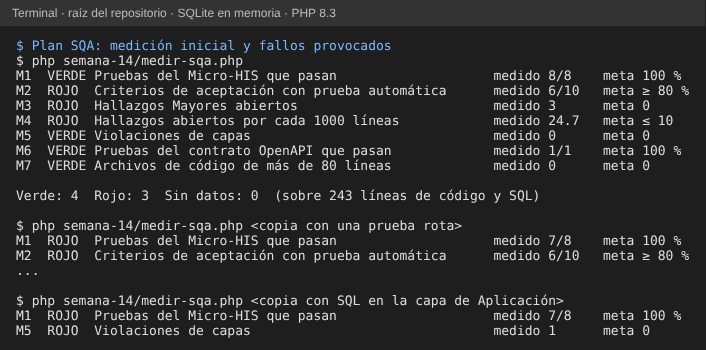

# Semana 14 — Plan SQA del módulo Médicos, especialidades y disponibilidad

**Estudiante:** Joshua Eduardo García Reyes (`jgarciar73-svg`) · **Módulo:** Médicos, especialidades y disponibilidad (módulo 4, reasignado dentro del grupo G1)

Plan de aseguramiento de la calidad del software (SQA) del módulo para las semanas 14 a 18: qué se mide, qué riesgos hay, qué controles los reducen, quién responde y cuándo. Las siete métricas se **miden con un script** ([`medir-sqa.php`](medir-sqa.php)) sobre el estado actual del módulo; no son metas inventadas. Parte de los hallazgos de la [revisión técnica de la semana 13](../semana-13/semana-13-revision-tecnica-formal.md) y de los RF/RNF y criterios CA-01 a CA-11 de la [semana 2](../semana-02/semana-02-isp-requerimientos-diseno.md).

## 1. Métricas de calidad (7)

| ID | Métrica | Cómo se mide | Meta | Hoy | Estado |
|---|---|---|---|---|---|
| M1 | Pruebas del Micro-HIS que pasan | `tests/ejecutar.php` | 100 % | 8/8 | Verde |
| M2 | Criterios de aceptación con prueba automática | CA de la tabla de la semana 2 que nombra alguna prueba | ≥ 80 % | 6/10 | Rojo |
| M3 | Hallazgos Mayores abiertos | Hallazgos RT Mayores que `verificar-hallazgos.php` aún reproduce | 0 | 3 | Rojo |
| M4 | Hallazgos abiertos por cada 1000 líneas | Hallazgos abiertos ÷ líneas de código y SQL × 1000 | ≤ 10 | 24.7 | Rojo |
| M5 | Violaciones de capas | Regla de ARQ-01 (Dominio sin otras capas; SQL solo en Persistencia) | 0 | 0 | Verde |
| M6 | Pruebas del contrato OpenAPI que pasan | `semana-05/verificar-contrato.php` | 100 % | 1/1 | Verde |
| M7 | Archivos de código de más de 80 líneas | Conteo de líneas por archivo de `src/` | 0 | 0 | Verde |

Resultado de la medición inicial: **4 en verde y 3 en rojo**. Los rojos son los que importan: M2 deja sin prueba los criterios CA-03 (Citas no responde), CA-08, CA-09 (ausencias) y CA-11; M3 y M4 son los hallazgos RT-01 a RT-06. Relación con los requisitos de la semana 2: M1 y M5 con RNF-05 y RNF-04 (verificabilidad y mantenibilidad), M2 con RNF-02 (CA-03) y con los criterios de aceptación, M3 y M4 con los riesgos R-01 y R-05, M6 con R-06 y M7 con RNF-04.

## 2. Matriz de riesgos

Probabilidad (P) e impacto (I) de 1 a 3; exposición = P × I. Alta: 6 o más; Media: 3 a 5; Baja: 1 o 2.

| ID | Riesgo | Base | P | I | Exp. | Nivel | Controles |
|---|---|---|---:|---:|---:|---|---|
| R-01 | Recepción ve franjas que no existen (fuera de horario o de un perfil vencido) y agenda una cita imposible | RT-01, RT-02 | 3 | 3 | 9 | Alta | CP-01, CP-02, CD-01 |
| R-07 | Las semanas encadenadas se atrasan porque un PR previo no se fusiona | Semanas 4, 6 y 11 esperan fusión | 3 | 2 | 6 | Alta | CP-03, CD-05 |
| R-02 | Se registra una ausencia con citas ya agendadas y nadie avisa a Citas | Semana 6: el aviso a Citas es propuesto | 2 | 3 | 6 | Alta | CD-04 |
| R-03 | Cualquiera puede usar los usuarios de demostración si el módulo sale a producción | Controlador con usuarios de demostración | 2 | 3 | 6 | Alta | CP-04 |
| R-04 | Citas no responde y se muestran franjas que podrían estar ocupadas | CA-03 sin implementar ni probar | 2 | 2 | 4 | Media | CD-04 |
| R-06 | El contrato OpenAPI y el código se separan sin que nadie lo note | Códigos propuestos (`x-propuestos`) | 2 | 2 | 4 | Media | CP-05, CD-01, CD-03 |
| R-05 | Dos registros simultáneos del mismo colegiado dan 500 en vez de 409 | RT-04 | 1 | 2 | 2 | Baja | CP-02 |
| R-08 | La evidencia no se puede reproducir en otra máquina (PHP sin `pdo_sqlite`, sin Playwright) | Scripts de verificación y de prototipo | 2 | 1 | 2 | Baja | CD-06 |

## 3. Controles

| ID | Tipo | Control | Responsable | Frecuencia | Evidencia |
|---|---|---|---|---|---|
| CP-01 | Preventivo | Revisión técnica formal con la lista de 15 ítems antes de integrar un cambio del módulo | Moderador | Cada integración | Acta con hallazgos RT |
| CP-02 | Preventivo | Cada corrección se entrega con su prueba (borde de horario, entrada con tipo incorrecto, carrera de unicidad) | Autor | Cada corrección | Prueba nueva en `tests/` |
| CP-03 | Preventivo | Un solo PR por semana, de menos de 400 líneas, con script que se detiene si falta su base | Autor | Cada semana | `numstat` en la descripción del PR |
| CP-04 | Preventivo | Sustituir los usuarios de demostración por el control de acceso del grupo | Líder y autor | Semana 17 | Prueba de permisos por rol |
| CP-05 | Preventivo | Todo cambio de código HTTP actualiza `openapi.yaml` y su versión en el mismo PR | Autor | Cada cambio de API | `verificar-contrato.php` |
| CD-01 | Detectivo | Correr `medir-sqa.php`; un Rojo nuevo se explica en la descripción del PR | Autor | Cada PR | Salida del script |
| CD-02 | Detectivo | Correr `tests/ejecutar.php`, que incluye ARQ-01 | Autor | Cada PR | Salida del script |
| CD-03 | Detectivo | Correr `verificar-contrato.php` | Autor | Cada PR | Salida del script |
| CD-04 | Detectivo | Prueba de integración con una Citas simulada: Citas caída (503) y ausencia con citas agendadas | Autor y moderador | Semana 16 | Pruebas CA-03 y CA-09 |
| CD-05 | Detectivo | Revisión de los PR abiertos y de lo que espera fusión | Líder | Semanal | Lista de PR abiertos |
| CD-06 | Detectivo | Ejecutar las pruebas en un clon nuevo, en otra máquina | Moderador | Antes de la defensa | Captura de la corrida |

## 4. Responsables

| Rol | Responsabilidad en este plan | Quién |
|---|---|---|
| Autor | Mantiene el plan, corre las mediciones, corrige y entrega las pruebas | Joshua Eduardo García Reyes |
| Moderador de calidad | Conduce las revisiones, comprueba las correcciones y la corrida en máquina limpia | Por asignar (otra persona del grupo G1) |
| Líder del grupo | Autoriza la apertura de PR, vigila las dependencias y aprueba la integración con Citas y el control de acceso | Por asignar por el grupo |

## 5. Calendario (semanas 14 a 18)

| Semana | Actividad | Metas de esa semana |
|---|---|---|
| 14 | Plan SQA y medición inicial | M1, M5, M6, M7 en verde (cumplido); línea base de M2 a M4 |
| 15 | Pruebas y corrección de RT-01 a RT-06 (CP-02) | M3 = 0; M4 ≤ 10; M2 ≥ 80 % con CA-03, CA-08, CA-09 y CA-11 |
| 16 | Integración con Citas (CD-04) y revisión formal del cambio (CP-01) | R-02 y R-04 con prueba; M6 sigue en verde |
| 17 | Seguridad y despliegue (CP-04), prueba en máquina limpia (CD-06) | R-03 y R-08 cerrados |
| 18 | Defensa final | Medición final: 7 métricas en verde y los 8 riesgos con control activo |

## 6. Evidencia

`php semana-14/medir-sqa.php` mide las siete métricas. Para comprobar que el script **detecta** problemas y no solo los informa, se provocaron seis fallos en copias del módulo (una prueba rota, SQL en la capa de Aplicación, un archivo de más de 80 líneas, pruebas sin CA, el contrato roto y la semana 13 ausente) y cada uno cambió la métrica esperada. Primero va la medición real; después, la copia con la prueba rota y la que tiene SQL en Aplicación.

## 7. Límites

- Las metas son propuestas del autor; el grupo debe aprobarlas.
- M2 cuenta los criterios que una prueba **nombra**; no mide cuánto código ejecuta cada prueba (no hay cobertura de líneas en este Micro-HIS).
- M3 y M4 dependen de la semana 13: si falta, salen N/D.
- Moderador y líder los nombra el grupo.
